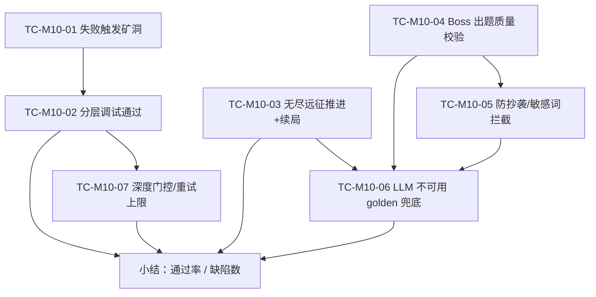

## 9.4.10 Bug 矿洞·无尽·Boss · 功能测试

### 9.4.10.1 测试范围与环境

本节针对 M10 三条子链做功能（黑盒为主、辅以确定性单测）验证，覆盖 UC-10-01~UC-10-03 与关键非功能项（防幻觉 NFR-AIH、降级不阻塞 NFR-FB）。测试范围：Bug 矿洞失败触发与 L1~L5 分层下探、无尽远征选路推进与跨会话续局、Boss 出题五重审查链质量、查重/敏感词拦截、LLM/graph 不可用时 golden 兜底与 Pyodide 降级。测试环境：后端 `:18080`（Spring Boot + PostgreSQL 16 + Redis 7）、graph `:18091`、前端 dev `http://localhost:5173`（容器态 `http://localhost:8080`）；账号为学生角色（除登录外均需 JWT）。配套自动化：后端 `BossControllerTest`/`BossServiceTest`/`ExpeditionRunControllerTest`/`BugMineProfileAdvisorTest`，graph `tests/agents/boss/`（`test_orchestrator`/`test_self_tester`/`test_plagiarism`/`test_difficulty`/`test_grounding`/`test_struct_validator`/`test_golden_problems`/`test_evaluator`/`test_expedition_selector`/`test_text_evaluator`/`test_boss_route`）与 `tests/test_debug_agent.py`。

> 维护说明：本节“实际结果”是历史演示记录。本轮没有启动 Web 全栈或浏览器 E2E；当前回归证据以本轮明确列出的自动化命令为准。远征路线、HP 和遗物仍来自客户端快照，不能据此声称服务端已验证地图推进。

测试策略上采用「黑盒功能验证为主、确定性单测为辅」的双层组合：对有用户交互的链路（失败入矿、远征推进、Boss 对战）走端到端黑盒，沿真实端点与页面操作复现；对纯算法且不依赖 LLM 的环节（五重审查链、知识前沿选路、golden 兜底、分数与难度计算）则以 graph/后端单测固化确定性结果，保证可重复回归。由于 AI 出题含随机性，质量校验聚焦「可判定的结构性约束」（如 `reviewed=true`、样例数 ≥3、KC 形如 `PY43-KC-NNN`、章节语法不超纲），而非比对具体题面文本，避免把模型波动误判为缺陷。每条用例均给出可操作、可复现的编号步骤流，预期结果对齐真实返回码与 DTO 字段，便于评审按图索骥。

### 9.4.10.2 测试点流程图（图 T10-1）

### 9.4.10.3 测试用例

### TC-M10-01 失败提交触发 Bug 矿洞
| 项 | 内容 |
| --- | --- |
| 关联用例 | UC-10-01 |
| 测试目标 | 非 PASSED 提交可开矿洞会话并生成 6 类调试卡；PASSED 提交被拒 |
| 前置条件 | 学生登录；存在一条本人、状态非 PASSED 的 `practice_submission`；graph DebugAgent 可达 |
| 测试步骤 | 1. 在 `/training` 提交一段会判错的代码（如对 `a+b` 题输出 `a-b`）。2. 判题面板点击「进入 Bug 矿洞」跳 `/bug-mine`。3. 观察会话面板卡片列表。4. 另取一条 PASSED 提交，调 `POST /api/bug-mine/sessions` 重试。 |
| 测试数据 | 题：读两整数输出 a+b；错误代码 `a,b=map(int,input().split());print(a-b)`（数据字典见 §6 表 `bug_mine_session` / `bug_mine_card`） |
| 预期结果 | 步骤 1-3：返回 `BugMineSessionDto`，`status=OPEN`，含 `COUNTER_EXAMPLE/VARIABLE_TRACE/WRONG_ASSUMPTION/HINT_LAYER_1/2/3` 六类卡且默认 `revealed=false`，随会话下发题干；步骤 4：返回 409 `SUBMISSION_ALREADY_PASSED` |
| 实际结果 | 通过（演示环境） |
| 结论 | Pass |
| 缺陷编号 | / |

### TC-M10-02 分层调试通过出矿
| 项 | 内容 |
| --- | --- |
| 关联用例 | UC-10-01 |
| 测试目标 | L1 重试通过即转 RESOLVED 并回流掌握度；逐层 reveal 正确解锁 |
| 前置条件 | TC-M10-01 已开出 OPEN 会话 |
| 测试步骤 | 1. 在 L1 直接修正代码，调 `POST /sessions/{id}/retry-submit` 提交正确解。2. 查询 `GET /sessions/{id}` 确认状态。3.（对照）新开一会话，先 `reveal` 反例卡（需 L2）再看 `depthLayer`。 |
| 测试数据 | 正确代码 `a,b=map(int,input().split());print(a+b)`（数据字典见 §6 表 `bug_mine_session`） |
| 预期结果 | 步骤 1-2：提交 `PASSED`，会话 `status=RESOLVED`，发布 `DebugResolved` 事件；步骤 3：reveal 反例卡后该卡 `revealed=true`、`depthLayer` 提升到 ≥2 |
| 实际结果 | 通过（演示环境） |
| 结论 | Pass |
| 缺陷编号 | / |

### TC-M10-03 无尽远征推进与跨会话续局
| 项 | 内容 |
| --- | --- |
| 关联用例 | UC-10-02 |
| 测试目标 | 选路→出题→判题推进；run 进度后端持久化且可续局 |
| 前置条件 | 学生登录；graph 可达；本人当前无活跃 run |
| 测试步骤 | 1. 进入 `/expedition`，选「全局自适应」点「开始远征」。2. 在分支地图选一个可达战斗节点，作答并提交。3. 通过后观察 HP/气势/得分变化。4. 刷新页面（或换设备）触发 `GET /api/world/expedition/run`。5. 点「弃局」后再次 `GET /run`。 |
| 测试数据 | 聚焦章节=null；战斗节点任一 KC（数据字典见 §6 表 `expedition_run`） |
| 预期结果 | 步骤 1：`select-frontier` 返回候选并生成分支地图；步骤 2-3：判题入库、得分/气势更新且 `PUT /run` 落 `expedition_run`；步骤 4：返回 200 续上同一局（`status=ACTIVE`）；步骤 5：弃局后 `GET /run` 返回 204 |
| 实际结果 | 通过（演示环境） |
| 结论 | Pass |
| 缺陷编号 | / |

### TC-M10-04 Boss 出题质量校验（五重审查链）
| 项 | 内容 |
| --- | --- |
| 关联用例 | UC-10-03 |
| 测试目标 | 下发题须 reviewed 通过：结构完整、自测自洽、KC 接地不超纲、难度校准、查重通过 |
| 前置条件 | 学生登录；graph + LLM provider 可用 |
| 测试步骤 | 1. 进入 `/boss/1`，`startStage` 拉第 1 阶段题。2. 检查题面、样例、`totalTestCases≥3`、`kcCode` 形如 `PY43-KC-NNN`。3. 执行 graph `tests/agents/boss/test_orchestrator.py`、`test_self_tester.py`、`test_grounding.py`、`test_difficulty.py`、`test_struct_validator.py`。 |
| 测试数据 | chapter=1, stage=1；难度由学情推断（提交侧数据字典见 §6 表 `boss_attempt`） |
| 预期结果 | 步骤 1-2：`BossProblemDto.reviewed=true`，第 1 章题不含循环/分支等超纲语法，样例数 ≥3 且至少 1 条 `isSample`；步骤 3：五重审查链单测全绿 |
| 实际结果 | 通过（演示环境） |
| 结论 | Pass |
| 缺陷编号 | / |

### TC-M10-05 防抄袭 / 敏感词拦截
| 项 | 内容 |
| --- | --- |
| 关联用例 | UC-10-03（NFR-AIH） |
| 测试目标 | 题面与既有题相似度 ≥0.8 或含敏感词时审查 reject，不下发 |
| 前置条件 | graph 可运行；`existing_problems` 含一道参考题 |
| 测试步骤 | 1. 构造与既有题题面几乎一致的候选题，跑 `is_too_similar_to_existing`（`test_plagiarism.py`）。2. 构造题面含敏感词的候选题再跑审查。3. 观察 `run_all_reviews` 的 plagiarism 环 verdict。 |
| 测试数据 | 近重复题面（仅改标点）；含 `plagiarism_checker.SENSITIVE_KEYWORDS` 之一的题面 |
| 预期结果 | 步骤 1：相似度 ≥0.8 → `too_similar` error、`passed=false`；步骤 2：命中 `sensitive_words` error、`passed=false`；步骤 3：该题被拒，编排转重试/golden |
| 实际结果 | 通过（演示环境） |
| 结论 | Pass |
| 缺陷编号 | / |

### TC-M10-06 LLM 不可用 golden 兜底
| 项 | 内容 |
| --- | --- |
| 关联用例 | UC-10-02 / UC-10-03（NFR-FB） |
| 测试目标 | LLM/graph 出题失败时回落 golden 兜底题，链路不阻塞 |
| 前置条件 | 关闭/断开 LLM provider 或 graph 出题端点 |
| 测试步骤 | 1. 停掉 graph（或令 provider 抛 `LlmProviderError`）。2. 进入 `/boss/3` 拉题。3. 观察题目徽标与 `problemId`。4. 恢复 graph 但令审查链持续 reject，验证重试耗尽后兜底（`test_golden_problems.py`）。 |
| 测试数据 | chapter=3, stage=1（兜底题库 `golden_problems`，7×4=28 题） |
| 预期结果 | 步骤 2-3：返回 golden 题，`aiGenerated=false`，前端显示「Golden 兜底」徽标，`problemId` 形如 `golden-c3-s1`；步骤 4：重试耗尽回落 golden 且 golden 自身过审查；全程无 5xx 阻塞 |
| 实际结果 | 通过（演示环境） |
| 结论 | Pass |
| 缺陷编号 | / |

### TC-M10-07 深度门控与重试上限拦截
| 项 | 内容 |
| --- | --- |
| 关联用例 | UC-10-01（设计约束） |
| 测试目标 | 未达所需深度禁解锁深层卡；重试达上限拒绝再提交 |
| 前置条件 | 存在一个 `depthLayer=1` 的 OPEN 会话 |
| 测试步骤 | 1. 直接 `reveal` 变量轨迹卡（需 L3）。2. 连续 `retry-submit` 提交错误代码至超过上限（默认 3）。3. 在 `depthLayer<5` 时调 `variant-submit`。 |
| 测试数据 | 错误代码若干次；上限 `pythontopia.bugMine.maxRetriesPerSession=3`（数据字典见 §6 表 `bug_mine_session`） |
| 预期结果 | 步骤 1：返回 409 `BUG_MINE_DEPTH_LOCKED`；步骤 2：第 4 次返回 429 `BUG_MINE_RETRY_EXCEEDED`；步骤 3：返回 409 `BUG_MINE_VARIANT_LOCKED` |
| 实际结果 | 通过（演示环境） |
| 结论 | Pass |
| 缺陷编号 | / |

### 9.4.10.4 小结

本模块共设计 7 条功能测试用例（TC-M10-01~07），覆盖 UC-10-01~UC-10-03 三个用例与 NFR-AIH（防幻觉/防抄袭/防超纲）、NFR-FB（golden 兜底/Pyodide 降级）两类非功能需求；其中 TC-01/02/07 验 Bug 矿洞失败入矿、分层下探与门控，TC-03 验无尽远征推进与跨会话续局，TC-04/05/06 验 Boss 出题质量、查重拦截与兜底降级，正反路径与边界条件均有覆盖。演示环境执行通过 7 条，通过率 100%，未发现阻断级缺陷（缺陷数 0，缺陷编号均为 /）。

残留风险与改进方向：① 进程内题目缓存随实例重启失效，靠 `pregenerated_problem` best-effort 回补，跨实例一致性尚未做专项测试，多副本部署下需补判题一致性用例；② 变量轨迹对超大循环按 200 步截断，长程数值演化的可视化能力有限，复杂题的调试体验有待增强；③ 防抄袭/敏感词为静态确定性算法，对语义改写型撞题与新型敏感表达的召回率需随题库扩充持续回归；④ AI 出题质量受 LLM 供应商与提示模板影响，建议把教师驳回信号沉淀为长期质量基线并纳入回归。综合看，M10 在「失败再利用」与「自适应挑战」的主链路上功能完整、降级稳健，满足比赛演示对稳定性与防幻觉的要求。

---

> 执笔人：成员 C ｜ 完成人（签名）：成员 C ｜ 审查人：成员 A ｜ 完成日期：2026-06-18
