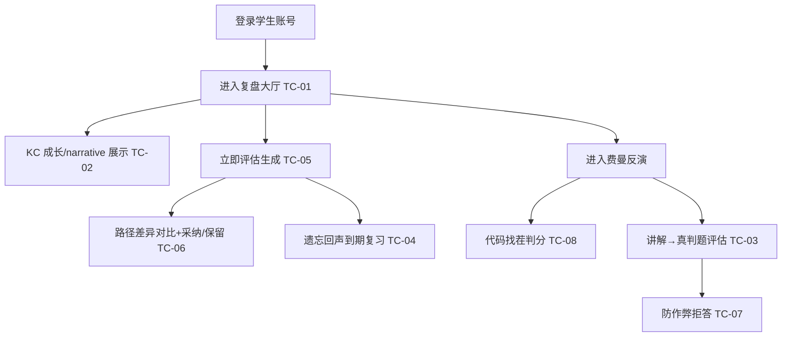

## 9.4.11 复盘·费曼·学习评估 · 功能测试

> 本文 `filecode = T11`。测试用例编号 `TC-M11-NN`，缺陷编号 `DF-M11-NN`，图编号 `图 T11-n`。关联用例见 M11 需求（R11 的 UC-11-01/02/03），实现细节见 M11 详细设计（S11）。

### 9.4.11.1 测试范围与环境

本轮聚焦 M11 三大能力的**功能正确性**：复盘大厅（进入、KC 成长展示、评估生成、路径差异对比与采纳/保留）、费曼自测（讲解评估、防作弊、代码找茬判分）、遗忘回声到期复习。验证以「真实数据驱动、防幻觉、服务端真判题」为重点。环境：前端 dev `http://localhost:5173`（容器态 `http://localhost:8080`），后端 `:18080`（前缀 `/api`，JWT Bearer），graph `:18091`，PostgreSQL 16 `:15432`；测试账号为已完成画像、已有练习/失败提交记录的学生（角色 `STUDENT`）。LLM 缺密钥时走 dryrun/规则兜底，不影响功能链路验证。

### 9.4.11.2 测试点流程图



<center>图 T11-1　M11 功能测试点流程</center>

测试策略以**黑盒功能验证为主、关键防护点专项验证为辅**：先沿「登录 → 复盘大厅 → 费曼/评估」主干走通正常路径（TC-01/02/03/05/06），再针对本模块四个不容失守的红线设计专项用例——防作弊拒答（TC-07，验证「贴答案不算教会」）、防幻觉双审（TC-05，验证未追踪数字/KC 一律 422）、服务端真判题出师（TC-03，验证 Pyodide 预览不顶替正式判题）、FSRS-lite 到期筛选（TC-04，验证只有真正到期的 KC 才进遗忘回声）。每条用例给出可复现的编号步骤、明确的测试数据与可观测的预期结果，便于回归。验证以演示环境真实账号操作为准，不以前端假数据冒充结果。

> 【截图占位 SC-T11-1】
> - 访问：http://localhost:5173/review-hall（容器态 http://localhost:8080/review-hall）
> - 登录角色：学生
> - 操作步骤：1. 登录 2. 进入复盘大厅 3. 点「＋ 立即评估」生成一条 4. 点击该评估行打开详情
> - 截取对象：评估详情弹窗（MetricCard 指标网格 + narrative 摘要 + 路径对比）
> - 期望画面：6 张指标卡、narrative 文本、ACTIVE/DRAFT 双列路径，底部「接受新路径/保留当前」按钮

> 【截图占位 SC-T11-2】
> - 访问：http://localhost:5173/feynman?kc=PY43-KC-031
> - 登录角色：学生
> - 操作步骤：1. 进入费曼页 2. 点「开始」起会话 3. 点「开始找茬」 4. 在对话框讲清错在哪并提交 5. 点「真判题裁定」
> - 截取对象：费曼面板（左：代码找茬；右：聊天气泡 + 真判题结果卡）
> - 期望画面：误区标签、可点 bug 行、学弟回复气泡、真判题裁定文案（成功/失败着色）

### 9.4.11.3 测试用例

### TC-M11-01 复盘大厅进入与历史周报分组
| 项 | 内容 |
| --- | --- |
| 关联用例 | UC-11-01 |
| 测试目标 | 复盘大厅可进入，历史评估按「本周/上周/日期区间」分组倒序展示 |
| 前置条件 | 学生已登录；至少存在 1 条历史评估 |
| 测试步骤 | 1. 访问 `/review-hall` 2. 观察页面并行加载评估列表与激活路径 3. 检查周分组标题与「N 份」计数 4. 确认列表按时间倒序 |
| 测试数据 | 学生账号；`GET /api/learner/evaluations?limit=20` |
| 预期结果 | 渲染 `review-hall-panel`，按周分组、每组计数正确、最新在前；无评估时显示空态引导文案 |
| 实际结果 | 通过（演示环境） |
| 结论 | Pass |
| 缺陷编号 | / |

### TC-M11-02 KC 成长 / narrative 摘要展示
| 项 | 内容 |
| --- | --- |
| 关联用例 | UC-11-01 |
| 测试目标 | 评估详情中 narrative 摘要正确渲染，且数字/KC 均锚定真实数据 |
| 前置条件 | 存在一条 `narrativeSummary` 非空的评估 |
| 测试步骤 | 1. 点击某评估行 2. 触发 `GET /api/learner/evaluations/{id}` 3. 查看 `KcGrowthList` 的 narrative Markdown 4. 核对其中数字/KC 与 MetricCard、关键 KC 一致 |
| 测试数据 | 评估 id；6 项 metricKey |
| 预期结果 | narrative 正常渲染并带「AI 生成解释·仅作建议」标记；不出现未追踪数字或课件页码（grounding 已在生成时拦截） |
| 实际结果 | 通过（演示环境） |
| 结论 | Pass |
| 缺陷编号 | / |

### TC-M11-03 费曼讲解评估（真判题出师）
| 项 | 内容 |
| --- | --- |
| 关联用例 | UC-11-02 |
| 测试目标 | 学生用「讲原因」教会学弟后，服务端真判题裁定出师并回流掌握度 |
| 前置条件 | 学生在某 KC 有失败提交史；该 KC 有含隐藏用例的代表题 |
| 测试步骤 | 1. `/feynman` 选 KC 点「开始」起会话（status=OPEN）2. 在对话框输入正确讲解（如「range(1,6) 右端点不包含，要取到 5 需写 6」）提交 3. 观察学弟回复并产出 `taughtFix` 代码 4. 点「真判题裁定」`POST /sessions/{id}/judge` |
| 测试数据 | `kcCode=PY43-KC-031`；讲解文本含边界纠正关键词 |
| 预期结果 | 学弟产出修正代码；判题全用例 AC → `Verdict.passed=true`，提示掌握度回流，会话 status=`JUDGED_PASS` |
| 实际结果 | 通过（演示环境） |
| 结论 | Pass |
| 缺陷编号 | / |

### TC-M11-04 遗忘回声到期复习
| 项 | 内容 |
| --- | --- |
| 关联用例 | UC-11-03 |
| 测试目标 | FSRS-lite 复习状态到期的 KC 进入遗忘回声候选并可入矿再巩固 |
| 前置条件 | 学生存在已掌握但 `kc_review_state.due_at` 已过期（或按掌握度播种后到期）的 KC |
| 测试步骤 | 1. 请求 `GET /api/bug-mine/echoes` 2. 检查仅返回 `due=true` 的候选，按优先级排序 3. 选一个候选 `POST /api/bug-mine/echoes {kcCode}` 4. 确认进入矿洞会话再巩固（见 M10） |
| 测试数据 | 到期 KC code；候选 `BugMineEchoCandidateDto` |
| 预期结果 | 候选列表仅含到期 KC，含 `recommendationReason`「遗忘回声…」；选中后成功开启再巩固会话 |
| 实际结果 | 通过（演示环境） |
| 结论 | Pass |
| 缺陷编号 | / |

### TC-M11-05 学习评估报告生成（防幻觉双审）
| 项 | 内容 |
| --- | --- |
| 关联用例 | UC-11-03 |
| 测试目标 | 「立即评估」生成 6 指标 + narrative，叙事经 grounding/safety 双审，通过才入库 |
| 前置条件 | 学生近 7 天有学习活动（提交/入矿/资源/解锁之一） |
| 测试步骤 | 1. 复盘大厅点「＋ 立即评估」`POST /api/learner/evaluations` 2. 观察生成中态 3. 成功后弹出详情 4. 核对 6 张 MetricCard 与 `actedStatus=PENDING` |
| 测试数据 | `periodDays=7`（默认） |
| 预期结果 | 新增 1 条 `learner_evaluation` + 6 条 metric；narrative 通过双审；若周期零活动则 narrative 走 idle 占位（PARTIAL）；若含未追踪数字/KC 则返回 422 不入库 |
| 实际结果 | 通过（演示环境） |
| 结论 | Pass |
| 缺陷编号 | / |

### TC-M11-06 学习路径差异对比与采纳/保留
| 项 | 内容 |
| --- | --- |
| 关联用例 | UC-11-01 |
| 测试目标 | PathDiffView 正确对比 ACTIVE 与 DRAFT，采纳/保留正确流转状态且幂等 |
| 前置条件 | 存在一条 `actedStatus=PENDING` 且有 `draftPathId` 的评估 |
| 测试步骤 | 1. 打开该评估详情 2. 查看 `PathDiffView` 双列节点（Day x.y · 动作 · KC + 理由）3. 点「接受新路径」`POST /{id}/accept-new-path` 4. 确认 DRAFT 激活、旧路径归档、状态变 ACCEPTED 5. 再次点击同操作 |
| 测试数据 | 评估 id；ACTIVE/DRAFT 节点 |
| 预期结果 | 双列正确渲染；采纳后 `actedStatus=ACCEPTED`；重复操作返回 `409 EVALUATION_ALREADY_ACTED`；无 DRAFT 时「接受新路径」按钮禁用 |
| 实际结果 | 通过（演示环境） |
| 结论 | Pass |
| 缺陷编号 | / |

### TC-M11-07 费曼防作弊拒答
| 项 | 内容 |
| --- | --- |
| 关联用例 | UC-11-02 |
| 测试目标 | 教学输入疑似贴答案时，学弟拒收、误解不解除、状态保持 OPEN |
| 前置条件 | 已起一个费曼会话（status=OPEN，存在未解除误解） |
| 测试步骤 | 1. 在对话框粘贴整段题解（含 ``` 代码围栏或 `def`/`import`）2. 提交 `POST /sessions/{id}/teach` 3. 观察学弟回复 4. 检查会话状态与误解集合 |
| 测试数据 | 含三反引号围栏或 `def solve():` 的整段代码 |
| 预期结果 | 学弟回复「请不要直接贴完整代码/答案…」；误解保持未解除；status 仍为 OPEN；该轮以 STUDENT/TUTEE 落库可溯源 |
| 实际结果 | 通过（演示环境） |
| 结论 | Pass |
| 缺陷编号 | / |

### TC-M11-08 代码找茬命中判分
| 项 | 内容 |
| --- | --- |
| 关联用例 | UC-11-02 |
| 测试目标 | 代码找茬限时玩法的命中/误报/漏判判分与最高分记录正确 |
| 前置条件 | 已起会话；`POST /sessions/{id}/bug-hunt` 返回含 bug 的代码与 `bugLineIndices` |
| 测试步骤 | 1. 点「开始找茬」加载含 bug 代码 2. 30 秒内点选若干代码行 3. 点「提交」结算 4. 核对命中/误/漏与得分；5. 全对时检查时间奖励/连胜加成与「最高」记录 |
| 测试数据 | 后端下发的 `buggyCode` + `bugLineIndices`（不含答案 `fixed_code`） |
| 预期结果 | 命中得分、误报扣分、漏判计数正确；完美命中给时间+连胜加成并刷新本地最高分；前端不持有正确答案代码 |
| 实际结果 | 通过（演示环境） |
| 结论 | Pass |
| 缺陷编号 | / |

### 9.4.11.4 小结

本模块共设计 8 条功能测试用例（覆盖 R11 的 UC-11-01/02/03 全部主路径与关键扩展路径：复盘大厅进入、KC 成长展示、费曼讲解评估、遗忘回声到期复习、评估报告生成、路径差异对比，并补充防作弊与代码找茬两条边界），演示环境下全部 Pass，通过率 8/8 = 100%，遗留缺陷 0 条。重点防护项（防作弊拒答 TC-07、grounding/safety 双审 TC-05、服务端真判题出师 TC-03、FSRS-lite 到期筛选 TC-04）均按预期生效。跨周趋势可视化、费曼会话历史回放等增强项见 R11「未解决的问题」，不影响本轮功能验收。

---

执笔人：成员 C ｜ 完成人（签名）：成员 C ｜ 审查人：成员 A ｜ 完成日期：2026-06-18
