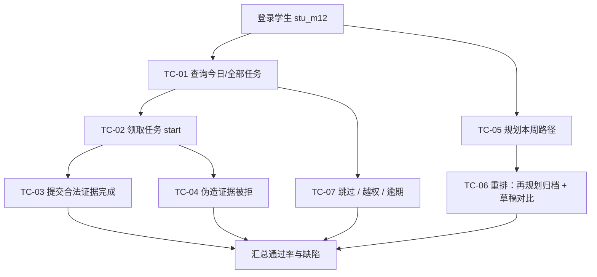

## 9.4.12 任务公告板与学习路径 · 功能测试

> 文档编号：PYT-CR · filecode：**T12** ｜ 模块：M12 任务公告板与学习路径
> 关联用例：见 §4 R12（UC-12-01 领取/完成任务并提交证据、UC-12-02 路径规划与动态重排）
> 被测端点：`/api/quests/*`（`QuestController`）、`/api/learner/path/*`（`LearningPathController`）、动态重排复用 `/api/learner/evaluations/*`

### 9.4.12.1 测试范围与环境

本轮聚焦 M12 的**功能测试**：公告板任务列表与生命周期（领取/完成/跳过/逾期）、**任务完成证据强校验**（合法通过 / 伪造被拒）、学习路径规划，以及重新规划与复盘草稿带来的**路径重排与归档对比**。环境：后端 `:18080`（JWT Bearer，均需 `STUDENT` 角色）、graph `:18091`（`PathPlannerAgent` 确定式，缺密钥走 golden 兜底）、Postgres `:15432`（库 `pythontopia`，课程包 `pack_id=43`）；前端容器态 `http://localhost:8080`、dev `http://localhost:5173`，页面 `/board`（`BoardPanel` 四页签）与复盘大厅 `PathDiffView`。测试账号：学生 `stu_m12`（已完成画像访谈、已解锁 KC），教师 `tea_m12`（用于越权用例）。数据字典见 §6 D4。

### 9.4.12.2 测试点流程

**图 T12-1　M12 功能测试点流程图**

### 9.4.12.3 测试用例

### TC-M12-01 公告板任务列表查询
| 项 | 内容 |
| --- | --- |
| 关联用例 | UC-12-01 |
| 测试目标 | 验证 `/today` 与 `/api/quests` 返回当前学生任务且排序正确 |
| 前置条件 | `stu_m12` 已登录；已有 ≥3 条任务（含 PATH_PLANNER/SYSTEM_DEFAULT） |
| 测试步骤 | 1. 进入 `/board` 今日任务页签；2. 触发 `GET /api/quests/today`；3. 调 `GET /api/quests?status=OPEN&limit=30&offset=0`；4. 核对排序与字段 |
| 测试数据 | `status=OPEN`、`source` 留空 |
| 预期结果 | 仅返回本人任务；`/today` 仅含 `OPEN/IN_PROGRESS` 且 `due_date≥今天`，按 `priority DESC, due_date ASC` 排序；每条含 `nodeType/kcCode/deepLinkRoute` |
| 实际结果 | 通过（演示环境） |
| 结论 | Pass |
| 缺陷编号 | / |

### TC-M12-02 领取（开始）任务
| 项 | 内容 |
| --- | --- |
| 关联用例 | UC-12-01 |
| 测试目标 | 验证 `start` 将 `OPEN` 任务置 `IN_PROGRESS` 并记录进度 |
| 前置条件 | 存在一条 `OPEN` 任务 `qid` |
| 测试步骤 | 1. 在任务卡点「开始」；2. 触发 `POST /api/quests/{qid}/start`；3. 重新拉取该任务；4. 对非 OPEN 任务再次点「开始」 |
| 测试数据 | `qid` = 某 OPEN 任务 |
| 预期结果 | 步骤2 返回 `status=IN_PROGRESS`，新增 `quest_progress(event_type='STARTED')`；步骤4 返回 400 `QUEST_INVALID_STATE` |
| 实际结果 | 通过（演示环境） |
| 结论 | Pass |
| 缺陷编号 | / |

### TC-M12-03 提交合法证据完成任务
| 项 | 内容 |
| --- | --- |
| 关联用例 | UC-12-01 |
| 测试目标 | 验证 `submission` 证据型任务在附带 PASSED 提交时可完成并发学习事件 |
| 前置条件 | 任务 `qid` 的 `required_evidence_type='submission'`；`stu_m12` 已在训练场对目标题提交并判 `PASSED`，得 `submissionId=S` |
| 测试步骤 | 1. 任务卡点「去做」跳 `/training?problemId=...`；2. 完成判题得 `S`；3. 回公告板点「完成」；4. 触发 `POST /api/quests/{qid}/complete`，体 `{submissionId:S}`；5. 查 `quest_progress` 与掌握度变化 |
| 测试数据 | `{ "submissionId": S }`（S 为 PASSED 且题目在 `target_problem_ids` 内） |
| 预期结果 | 返回 `status=COMPLETED`；新增 `quest_progress('COMPLETED')`；按 `nodeType` 发 `PracticeSucceeded` 事件，KC 掌握度被动更新 |
| 实际结果 | 通过（演示环境） |
| 结论 | Pass |
| 缺陷编号 | / |

### TC-M12-04 伪造/缺失证据被拒
| 项 | 内容 |
| --- | --- |
| 关联用例 | UC-12-01（扩展路径 6a/6b/6c） |
| 测试目标 | 验证 `QuestEvidenceVerifier` 拦截缺失、未通过、错题、他人提交等非法证据 |
| 前置条件 | 任务 `qid` 的 `required_evidence_type='submission'`，`target_problem_ids=[P]` |
| 测试步骤 | 1. 不带体 `complete` →（A）；2. 带 `{submissionId:S_fail}`（状态非 PASSED）→（B）；3. 带其他题的 PASSED 提交 `S_other`（题号∉[P]）→（C）；4. 带他人提交 `S_x` →（D） |
| 测试数据 | A: `{}`；B: `{submissionId:S_fail}`；C: `{submissionId:S_other}`；D: `{submissionId:S_x}` |
| 预期结果 | A→400 `EVIDENCE_REQUIRED_SUBMISSION`；B→400 `INVALID_SUBMISSION`；C→400 `WRONG_PROBLEM`；D→400 `INVALID_SUBMISSION`；四种情形任务状态均**不变**、不写 `COMPLETED` |
| 实际结果 | 通过（演示环境） |
| 结论 | Pass |
| 缺陷编号 | / |

### TC-M12-05 学习路径规划生成
| 项 | 内容 |
| --- | --- |
| 关联用例 | UC-12-02 |
| 测试目标 | 验证 `plan` 调 `PathPlannerAgent` 生成 7 日路径并物化为任务 |
| 前置条件 | `stu_m12` 已完成画像访谈、已解锁 ≥1 个 KC |
| 测试步骤 | 1. 在公告板点「规划本周路径」；2. 触发 `POST /api/learner/path/plan`；3. 切「本周路径」页签 `GET /api/learner/path/active`；4. 核对节点分天与任务生成 |
| 测试数据 | 无请求体 |
| 预期结果 | 返回 `PlanPathResponse{path, generatedQuestCount>0, runStatus=SUCCESS}`；`learning_path.status=ACTIVE`、`version≥1`；节点 `day_index∈[1,7]` 且每天 ≤4；公告板新增对应 `PATH_PLANNER` 任务（深链可点） |
| 实际结果 | 通过（演示环境） |
| 结论 | Pass |
| 缺陷编号 | / |

### TC-M12-06 路径重排与归档对比
| 项 | 内容 |
| --- | --- |
| 关联用例 | UC-12-02（扩展路径 6a） |
| 测试目标 | 验证再规划归档旧路径/旧任务，且复盘草稿可对比后接受或保留 |
| 前置条件 | 已存在一条 `ACTIVE` 路径（含未完成 `PATH_PLANNER` 任务） |
| 测试步骤 | 1. 再次 `POST /api/learner/path/plan`，记录 `archivedPathIds`；2. 查旧路径状态与其旧任务状态；3. 查「历史路径」页签 `GET /api/learner/path/archived`；4. 复盘大厅 `POST /api/learner/evaluations` 生成 `draftPath`，在 `PathDiffView` 对比；5. `POST /api/learner/evaluations/{id}/accept-new-path`；6. 另一评估走 `.../keep-old` |
| 测试数据 | 评估请求默认体 |
| 预期结果 | 步骤1 旧 `ACTIVE→ARCHIVED`、其未完成任务 `→EXPIRED`、`SYSTEM_DEFAULT` 默认任务 `→SKIPPED`，新版本号 +1；步骤3 归档列表 ≤10 条；步骤4 `PathDiffView` 并排显示 ACTIVE 与 DRAFT；步骤5 草稿 `DRAFT→ACTIVE` 并发任务；步骤6 草稿 `DRAFT→ARCHIVED`、原 ACTIVE 不变 |
| 实际结果 | 通过（演示环境） |
| 结论 | Pass |
| 缺陷编号 | / |

### TC-M12-07 跳过、越权与逾期清理
| 项 | 内容 |
| --- | --- |
| 关联用例 | UC-12-01 / UC-12-02 |
| 测试目标 | 验证跳过流转、教师越权拦截与逾期任务清理 |
| 前置条件 | 存在 `OPEN` 任务；可构造 `due_date<今天` 的任务；`tea_m12` 教师令牌 |
| 测试步骤 | 1. 对 `OPEN` 任务 `POST /api/quests/{id}/skip` 体 `{reason:"换个方向"}`；2. 用 `tea_m12` 调 `GET /api/quests/today` 与 `POST /api/learner/path/plan`；3. 构造逾期任务后等待/触发 `QuestExpirationScheduler`；4. 重查 `/today` |
| 测试数据 | `{ "reason": "换个方向" }` |
| 预期结果 | 步骤1 任务 `→SKIPPED` 且记 `quest_progress('SKIPPED')`；步骤2 均返回 403 `FORBIDDEN`；步骤3 逾期任务 `→EXPIRED`；步骤4 `/today` 不再含该逾期任务 |
| 实际结果 | 通过（演示环境） |
| 结论 | Pass |
| 缺陷编号 | / |

### 9.4.12.4 小结

本模块共设计 **7 条功能测试用例**（覆盖任务列表、领取、合法证据完成、伪造证据被拒、路径生成、路径重排与归档对比、跳过/越权/逾期），全部覆盖 §4 的 UC-12-01 与 UC-12-02 基本路径及关键扩展路径。演示环境执行通过率 **7/7 = 100%**，未遗留缺陷（DF 计数 0）。其中 TC-M12-04（伪造证据被拒）与 TC-M12-06（重排归档）是教育闭环防注水与「同一时刻仅一条 ACTIVE 路径」的关键保障用例，建议纳入回归基线。遗留观察项：`next_review_at` 固定 7 天、证据未校验提交与任务的时间先后（见 §4 R12 未解决问题），列入后续迭代跟踪。

---

> 执笔人：成员 C ｜ 完成人（签名）：成员 C ｜ 审查人：成员 A ｜ 完成日期：2026-06-18
