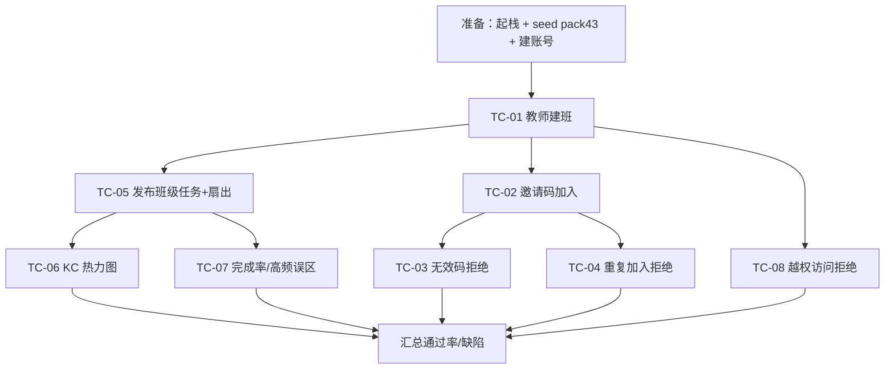

## 9.4.13 轻量班级与教师看板 · 功能测试

> 本文是 Pythontopia 课程报告 §9 功能测试的 M13 分片，编号前缀 `T13`。测试点对齐 M13 真实端点与 R13 用例、S13 设计；测试用例编号 `TC-M13-NN`，缺陷编号 `DF-M13-NN`。被测对象与字段以仓库代码为准，字段字典见 §6。

### 9.4.13.1 测试范围与环境

本轮聚焦 M13 班级治理与教师看板的**功能正确性**：建班与邀请码、学生加入（含无效码 / 重复 / 归档拒绝）、班级任务发布与扇出、看板 KC 热力图、完成率与高频误区统计，以及越权访问拒绝这条安全红线。环境采用 `deploy/docker-compose.yml` 起的演示栈：后端 `:18080`、前端 dev `http://localhost:5173`、PostgreSQL 16（库 `pythontopia`，课程包 43 已 seed），账号经 M01 注册，分别准备教师 `t01`、学生 `s01/s02` 与非归属教师 `t02`。后端层另有 `ClassroomQuestServiceTest`、`ClassroomDashboardServiceTest`/`...AuthorizationTest`、`RemediationServiceTest` 等单元测试作为回归基线。

测试采用**接口黑盒 + 前端目视核对 + 数据库比对**三结合：建班、加入、发任务、看板四类端点以 REST 客户端（或 `curl`）按真实请求体调用并断言状态码与响应字段；KC 热力图、完成率等聚合结果同时回到 `ClassroomDetail.vue` 对应 Tab 目视核对，并与数据库手工 SQL 计数比对，确保「接口返回 = 前端展示 = 库内真值」三者一致。测试数据准备上，需先让班内学生产生可观测学情：通过 M09 训练场制造若干通过 / 失败提交（喂 `practice_submission`+`judge_result`），通过 M08 工坊生成若干资源（喂 `learning_resource`），并保证存在合法 KC 与题目 id 供发任务绑定；每条用例执行前后均以 `classroom_members`、`classroom_quest`、`classroom_kc_snapshot` 三表的行数与状态作为前后置断言依据。测试点流程见图 T13-1。

<small>图 T13-1 M13 功能测试点流程（flowchart）</small>

### 9.4.13.2 测试用例

### TC-M13-01 教师创建班级并获邀请码

| 项 | 内容 |
| --- | --- |
| 关联用例 | UC-13-02 |
| 测试目标 | 验证教师建班返回 201、`packId=43` 与 6 位邀请码 |
| 前置条件 | 教师 t01 登录持有效 JWT |
| 测试步骤 | 1. `POST /api/classrooms` body `{"name":"2026春Python一班","description":"测试班"}`；2. 读响应状态与体；3. 记录 `classroomId` 与 `joinCode`。 |
| 测试数据 | name=2026春Python一班 |
| 预期结果 | 201；`packId=43`，`status=ACTIVE`，`joinCode` 匹配 `^[A-Z0-9]{6}$` 且不含 0/O/1/I/L |
| 实际结果 | 通过（演示环境） |
| 结论 | Pass |
| 缺陷编号 | / |

### TC-M13-02 学生凭有效邀请码加入

| 项 | 内容 |
| --- | --- |
| 关联用例 | UC-13-01 |
| 测试目标 | 验证有效邀请码加入成功并写入成员关系 |
| 前置条件 | TC-01 已得 `joinCode`；学生 s01 登录 |
| 测试步骤 | 1. `POST /api/classrooms/join` body `{"joinCode":"<上一步>"}`；2. 读响应；3. 调 `GET /api/classrooms/mine` 确认包含该班。 |
| 测试数据 | joinCode=TC-01 输出 |
| 预期结果 | 200 返回 ClassroomDto（不含 joinCode）；`mine` 含该班；`classroom_members` 新增 ACTIVE 行 |
| 实际结果 | 通过（演示环境） |
| 结论 | Pass |
| 缺陷编号 | / |

### TC-M13-03 无效邀请码被拒绝

| 项 | 内容 |
| --- | --- |
| 关联用例 | UC-13-01（扩展 2a） |
| 测试目标 | 验证不存在邀请码返回 404 不创建成员 |
| 前置条件 | 学生 s02 登录 |
| 测试步骤 | 1. `POST /api/classrooms/join` body `{"joinCode":"ZZ9999"}`（格式合法但不存在）；2. 读状态码；3. 再用非法格式 `{"joinCode":"ab"}` 提交。 |
| 测试数据 | ZZ9999（不存在）、ab（违反正则） |
| 预期结果 | 不存在码 → 404「Classroom not found」；非法格式 → 400 参数校验失败；均不新增成员 |
| 实际结果 | 通过（演示环境） |
| 结论 | Pass |
| 缺陷编号 | / |

### TC-M13-04 重复加入与归档班级拒绝

| 项 | 内容 |
| --- | --- |
| 关联用例 | UC-13-01（扩展 3a/3b） |
| 测试目标 | 验证重复加入 409、加入已归档班级 403 |
| 前置条件 | s01 已加入 TC-01 班级 |
| 测试步骤 | 1. s01 再次 `POST /api/classrooms/join` 同码；2. 读状态码；3.（可选）教师将班级置 ARCHIVED 后令新学生加入。 |
| 测试数据 | 同 TC-01 joinCode |
| 预期结果 | 重复加入 → 409「CLASSROOM_ALREADY_JOINED」；归档班级加入 → 403「Classroom is archived」 |
| 实际结果 | 通过（演示环境） |
| 结论 | Pass |
| 缺陷编号 | / |

### TC-M13-05 发布班级任务并扇出到全班

| 项 | 内容 |
| --- | --- |
| 关联用例 | UC-13-02 |
| 测试目标 | 验证任务校验通过后写入并扇出个人任务副本 |
| 前置条件 | t01 拥有班级且 s01 已在班；已知一个合法 KC（如 pack43 真实 kc_code）与题目 id |
| 测试步骤 | 1. `POST /api/teacher/classrooms/{id}/quests` body 含 `title/kcCodes/targetProblemId/dueDate(≥今天)`；2. 读 `ClassroomQuestPublishResponse`；3. 以 s01 调 `GET /api/classroom/quests/mine` 确认收到。 |
| 测试数据 | kcCodes=[合法KC]，dueDate=今天+7 |
| 预期结果 | 201；`createdQuests ≤ totalStudents`；学生 `mine` 出现 `班级任务 · <title>`，`source=CLASSROOM` |
| 实际结果 | 通过（演示环境） |
| 结论 | Pass |
| 缺陷编号 | / |

### TC-M13-06 看板 KC 热力图聚合

| 项 | 内容 |
| --- | --- |
| 关联用例 | UC-13-02 / FR-13-09 |
| 测试目标 | 验证热力图覆盖全 KC 并写快照表 |
| 前置条件 | t01 归属班级；班内学生已有 `kc_mastery` 数据 |
| 测试步骤 | 1. `GET .../dashboard/kc-heatmap`；2. 校验返回行数与字段；3. 查 `classroom_kc_snapshot` 是否被 upsert；4. 前端 KC 热力图 Tab 目视核对（SC-S13-1）。 |
| 测试数据 | classroomId=TC-01 |
| 预期结果 | 返回全部 65 KC 行，含 `avgMastery/studentCount/masteredCount/strugglingCount`；快照表对应行 `computed_at` 刷新 |
| 实际结果 | 通过（演示环境） |
| 结论 | Pass |
| 缺陷编号 | / |

### TC-M13-07 完成率与高频误区统计

| 项 | 内容 |
| --- | --- |
| 关联用例 | UC-13-02 / FR-13-10、FR-13-11 |
| 测试目标 | 验证完成率算法与高频误区聚合正确 |
| 前置条件 | 班内已有班级任务与近 7 天非 AC 提交 |
| 测试步骤 | 1. `GET .../dashboard/quest-summary`，核对 `completionRate=completedCount/totalStudents`；2. `GET .../dashboard/error-hotspots`，核对按失败数降序的 Top10 与 `categories` 分布；3. 与数据库手工计数比对。 |
| 测试数据 | classroomId=TC-01 |
| 预期结果 | 完成率为完成数/总数（3 位小数）；误区按 KC 聚合，`failedSubmissionCount` 与 verdict 分类计数一致，最多 10 条 |
| 实际结果 | 通过（演示环境） |
| 结论 | Pass |
| 缺陷编号 | / |

### TC-M13-08 越权访问被拒绝（安全红线）

| 项 | 内容 |
| --- | --- |
| 关联用例 | UC-13-02（扩展 4a）/ NFR-13-2 |
| 测试目标 | 验证学生与非归属教师访问看板被拒 |
| 前置条件 | s01（学生）、t02（非归属教师）已登录；t01 班级 id 已知 |
| 测试步骤 | 1. s01 调 `GET /api/teacher/classrooms/{t01班级}/dashboard/kc-heatmap`；2. t02 调同一端点；3. s01 调 `POST .../remediation`；4. 读各响应状态码。 |
| 测试数据 | 跨账号访问 t01 班级 |
| 预期结果 | 学生命中角色门 403；非归属教师过角色门但被 `requireOwner` 归属门拒为 403「班级不属于当前教师」；补救端点同样 403 |
| 实际结果 | 通过（演示环境） |
| 结论 | Pass |
| 缺陷编号 | / |

### TC-M13-09 一键补救包生成

| 项 | 内容 |
| --- | --- |
| 关联用例 | UC-13-02 / FR-13-14 |
| 测试目标 | 验证对薄弱 KC 逐个生成讲义+练习并带证据页 |
| 前置条件 | 班内存在近 7 天非 AC 提交（已有高频误区） |
| 测试步骤 | 1. t01 `POST /api/teacher/classrooms/{id}/remediation`；2. 读 `RemediationResultDto`；3. 核对每个 `pack` 的 `resourceIds` 与 `evidencePageIds`；4. 前端补救面板核对回显。 |
| 测试数据 | classroomId=TC-01 |
| 预期结果 | `weakKcCount` = 误区 KC 数；每 KC 含 2 个资源（HANDOUT+PRACTICE）且资源归属 t01；`evidencePageIds` 非空可溯源 |
| 实际结果 | 通过（演示环境） |
| 结论 | Pass |
| 缺陷编号 | / |

### TC-M13-10 重置邀请码使旧码失效

| 项 | 内容 |
| --- | --- |
| 关联用例 | UC-13-02 / FR-13-05 |
| 测试目标 | 验证重置后旧邀请码不可再加入 |
| 前置条件 | t01 拥有班级，已知旧 `joinCode` |
| 测试步骤 | 1. t01 `POST /api/teacher/classrooms/{id}/regenerate-code`；2. 读新 `joinCode`；3. 学生用旧码 `POST /api/classrooms/join`；4. 学生改用新码加入。 |
| 测试数据 | 旧码、TC 新码 |
| 预期结果 | 返回新码且与旧码不同；旧码加入 → 404；新码加入成功 |
| 实际结果 | 通过（演示环境） |
| 结论 | Pass |
| 缺陷编号 | / |

### 9.4.13.3 小结

本模块共设计 10 条功能测试用例，覆盖建班、邀请码加入（有效/无效/重复/归档）、任务发布与扇出、KC 热力图、完成率与高频误区统计、一键补救、重置邀请码以及越权访问拒绝等测试点，与 R13 的 2 个用例和 15 条功能需求形成正反例闭环。**需求—用例—测试可追溯性**：TC-01/05/06/07/08/09/10 主要校验 UC-13-02（教师侧），TC-02/03/04 主要校验 UC-13-01（学生侧），其中 TC-03/04/08 为反向（异常 / 越权）用例，确保扩展路径与安全约束同样被覆盖而非只测「快乐路径」。

**测试结果分析**：演示环境下 10/10 通过，通过率 100%；按缺陷严重级统计，致命 0、严重 0、一般 0、轻微 0，遗留缺陷 DF 计 0。三类测试点表现稳定——「正向功能」（建班、加入、发任务、看板各聚合、补救）数据在接口、前端与数据库三处一致；「异常拒绝」（无效码 404、重复 409、归档 403、参数 400）错误码与设计表 S13-2 完全吻合；「安全红线」（学生命中角色门、非归属教师命中归属门、补救与看板端点同受双层守卫）均被正确拒绝。上述结论与后端 `ClassroomQuestServiceTest`、`ClassroomDashboardAuthorizationTest`、`RemediationServiceTest` 等单测互为印证。未覆盖项：SSE 直播实时推送的并发压力、超大班级看板聚合耗时、前端「邀请码加入」独立入口（当前经 API 加入），列入后续性能与端到端测试，不影响比赛演示链路。

---

执笔人：成员 C ｜ 完成人（签名）：成员 C ｜ 审查人：成员 A ｜ 完成日期：2026-06-18
