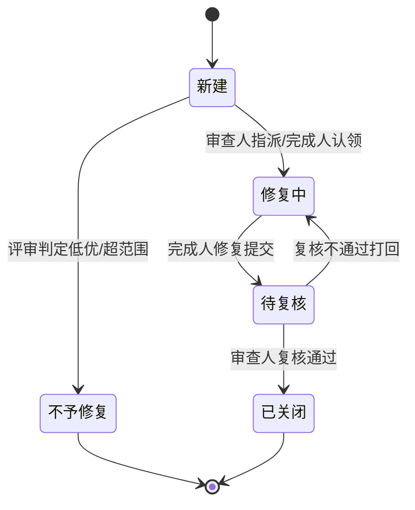
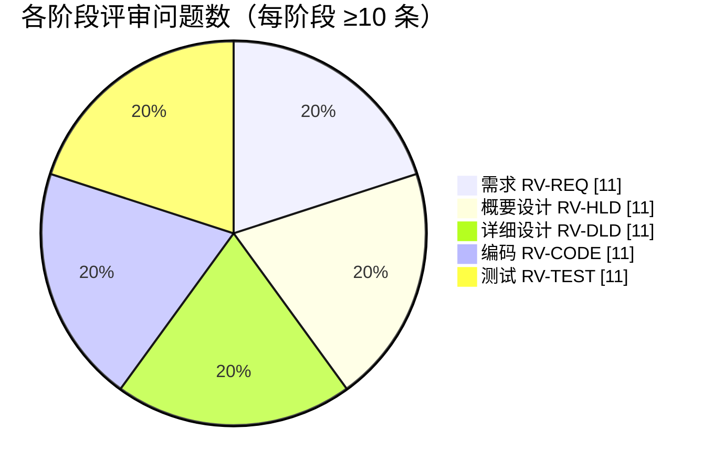

# 10 审查与测试问题清单

> 本章 filecode：**C10**。本文件对应 PDF 报告第 10 章「审查 / 测试问题清单」，按软件工程评审制度，对 **需求、概要设计、详细设计、编码、测试** 五个阶段各登记 **≥10 条** 评审问题，合计 **≥50 条**。
> 表头套用 §8.2 模板：`编号 | 问题描述 | 所在文档·章节·页码 | 严重级 | 建议 | 审查人 | 提出日 | 返回日 | 状态`。
> **审查人回避规则（§1.1）**：审查人 ≠ 被审内容完成者。需求由 B 执笔 → 审查人 C；概要/详细设计由 A 执笔 → 审查人 C；编码由 A（后端/AI/判题/DB）与 B（前端/游戏）完成 → 编码审查交叉进行（C 审 A 的后端、A 审 B 的前端）；测试与本清单由 C 执笔 → 审查人 A。
> 严重级：高（阻塞演示/正确性/安全）、中（影响功能或一致性）、低（体验/文案/规范）。页码统一写「§x.y（终稿页码待排版）」。

---

## 10.0 评审说明与状态流转

本清单是 Pythontopia 在 R-12～R-14 迭代中按阶段评审（Review）累积的问题台账，与第 9 章「测试缺陷统计（DF-MXX-NN）」互补：本章偏**阶段文档/代码评审**发现的问题（RV-* 编号），第 9 章偏**执行期测试**发现的缺陷（DF-* 编号）。每条问题经「提出 → 指派 → 修复 → 复核 → 关闭」流转。

**图 C10-1 评审问题状态流转**

**图 C10-2 各阶段评审问题数量分布**

**表 C10-0 阶段—审查人—被审完成人对照**

| 阶段 | 编号前缀 | 被审文档 / 代码 | 完成人 | 审查人 |
| --- | --- | --- | --- | --- |
| 需求 | RV-REQ | 04-00 / 04-MXX | B | C |
| 概要设计 | RV-HLD | 05 概要设计 | A | C |
| 详细设计 | RV-DLD | 06/D1–D4、08-MXX | A | C |
| 编码 | RV-CODE | 后端/AI/判题/DB（A）、前端/游戏（B） | A / B | C 审 A、A 审 B |
| 测试 | RV-TEST | 09-00 / 09-MXX、本清单 | C | A |

---

## 10.1 需求阶段评审问题（RV-REQ，审查人：C）

被审对象：第 4 章需求总览与各模块需求（执笔人 成员 B）。

| 编号 | 问题描述 | 所在文档·章节·页码 | 严重级 | 建议 | 审查人 | 提出日 | 返回日 | 状态 |
| --- | --- | --- | --- | --- | --- | --- | --- | --- |
| RV-REQ-01 | 课程规模口径需与 `course_pack.json` 严格一致，4.1.1 表内文档页数分布（45/73/98/74/105/50/116）求和必须=561 | §4.1.1（页码待排版） | 高 | 以真实 JSON 字段为唯一口径，报告全篇统一引用 | C | 2026-06-03 | 2026-06-05 | 已关闭 |
| RV-REQ-02 | R-14 已移除农场/作物/货币/商店玩法，需求中不得再出现相关功能描述 | §4.0、§4.2 | 高 | 全文检索农场/商店/货币关键词，确认仅在「已弃用」语境出现 | C | 2026-06-03 | 2026-06-05 | 已关闭 |
| RV-REQ-03 | 每个功能模块需求须 ≥2 个用例（学生侧 + 教师/管理员侧或≥2 动作） | §4.2 用例总览、04-MXX | 中 | 在 04-MXX 模板中强制双用例，单角色模块补足动作用例 | C | 2026-06-04 | 2026-06-08 | 已关闭 |
| RV-REQ-04 | 第三方接口（LLM/讯飞/B 站）缺密钥时的降级行为应作为需求显式写明，而非实现细节 | §4.5.2 | 中 | 在接口需求中逐项标注「缺失时行为」（fail-soft/golden 兜底） | C | 2026-06-04 | 2026-06-09 | 已关闭 |
| RV-REQ-05 | 训练场「同账号 10s 仅 1 次正式提交」的限流应进入需求（影响测试与体验） | §4.3.1 | 中 | 在性能/功能需求中固化限流口径与 429 返回 | C | 2026-06-05 | 2026-06-10 | 已关闭 |
| RV-REQ-06 | 8 维画像维度 key 需统一为英文 snake_case 并在需求列明，避免各模块写法漂移 | §4.1.4、术语 §2 | 中 | 引用统一术语表，需求不自造维度名 | C | 2026-06-05 | 2026-06-08 | 已关闭 |
| RV-REQ-07 | 任务完成的 evidence 校验需覆盖 4 类证据（submission_id/resource_id/page_read_id/kc_mastery_delta） | §4.1.2、§4.6 | 高 | 在 M12 需求与 QuestService 验收点写全 4 类 | C | 2026-06-06 | 2026-06-11 | 已关闭 |
| RV-REQ-08 | RAG 回答必须带课件页码证据，应作为可验收的硬需求而非「尽量」 | §4.6、M07 | 高 | 验收标准：三标准查询均出现「第 N 页」 | C | 2026-06-06 | 2026-06-10 | 已关闭 |
| RV-REQ-09 | 「不泄密」安全需求需量化为具体禁止项（堆栈/内部主机名/端口/默认口令/JWT） | §4.4、§4.6 | 高 | 列出泄密样式清单，作为 E2E 断言依据 | C | 2026-06-07 | 2026-06-12 | 已关闭 |
| RV-REQ-10 | Pyodide 预览结果不入正式判分，应作为硬需求写入（防演示用假结果） | §4.3.2、M09 | 高 | 需求明确「双轨：预览≠正式判分」 | C | 2026-06-07 | 2026-06-11 | 已关闭 |
| RV-REQ-11 | 多端契约以 `docs/clients/api-contract.md` 为唯一权威，需求应引用而非各端各表一份 | §4.5.2 | 低 | 需求引用唯一契约源，避免分叉 | C | 2026-06-08 | 2026-06-12 | 已关闭 |

---

## 10.2 概要设计阶段评审问题（RV-HLD，审查人：C）

被审对象：第 5 章概要设计（执笔人 成员 A）。

| 编号 | 问题描述 | 所在文档·章节·页码 | 严重级 | 建议 | 审查人 | 提出日 | 返回日 | 状态 |
| --- | --- | --- | --- | --- | --- | --- | --- | --- |
| RV-HLD-01 | 「单一 `Phaser.Game` 实例」约束须在概要设计明确，禁止多组件各建 Game | §5 总体结构 | 高 | 架构图标注单例 + WorldCanvas.vue 统一挂载 | C | 2026-06-08 | 2026-06-12 | 已关闭 |
| RV-HLD-02 | graph 服务开发态走 host 网络（代理 7892 取外网/B 站），部署拓扑须说明 bridge/host 差异 | §5 部署 | 中 | 在部署图标注 graph network_mode=host 与代理路径 | C | 2026-06-09 | 2026-06-13 | 已关闭 |
| RV-HLD-03 | SSE 中继链路（后端消费 graph 流帧并回放客户端）应有时序/组件图 | §5 数据流转 | 中 | 增补 SSE 中继 sequenceDiagram | C | 2026-06-09 | 2026-06-14 | 已关闭 |
| RV-HLD-04 | 降级兜底（缺密钥→golden）属横切关注点，应在架构层统一描述而非散落各模块 | §5 异常/配置 | 中 | 设「Provider 抽象 + 降级策略」横切小节 | C | 2026-06-10 | 2026-06-14 | 已关闭 |
| RV-HLD-05 | 防幻觉三审（Grounding/Hallucination/Safety）在生成链路中的「末端」位置需画清 | §5 处理流程 | 高 | 流程图标注三审为出口前置闸 | C | 2026-06-10 | 2026-06-15 | 已关闭 |
| RV-HLD-06 | pgvector 同时服务 RAG 检索与记忆召回，选型理由与边界需说明 | §5 数据结构 | 低 | 说明 embedding 表 `memory_embedding` 与 RAG 索引分工 | C | 2026-06-11 | 2026-06-15 | 已关闭 |
| RV-HLD-07 | 端口矩阵须与 `deploy/docker-compose.yml` 完全一致（18080/18091/18092/15432/16379） | §5 部署 | 高 | 概要设计端口表对账 compose | C | 2026-06-11 | 2026-06-13 | 已关闭 |
| RV-HLD-08 | 「生产/演示默认单 worker」对并发设计有影响，须在概要设计声明 | §5 配置 | 中 | 标注单 worker 约束与进程内状态规避 | C | 2026-06-12 | 2026-06-16 | 已关闭 |
| RV-HLD-09 | Redis 的缓存与限流职责边界需明确，避免与 DB 一致性冲突 | §5 总体结构 | 中 | 划清 Redis 仅缓存/限流，不作业务主存 | C | 2026-06-12 | 2026-06-16 | 已关闭 |
| RV-HLD-10 | 多端共用后端的统一鉴权层（JWT Bearer + `/api` 前缀）须在跨端架构体现 | §5 跨端架构 | 中 | 跨端架构图统一鉴权入口 | C | 2026-06-13 | 2026-06-17 | 已关闭 |
| RV-HLD-11 | 已弃用表（farm/currency/shop 等）应在概念 ER 概览中标注「已 DROP」，避免误读 | §5 数据结构、§6 附录 | 低 | ER 概览只画活跃表，弃用表入 C06 附录 | C | 2026-06-13 | 2026-06-17 | 已关闭 |

---

## 10.3 详细设计阶段评审问题（RV-DLD，审查人：C）

被审对象：第 6 章数据库设计（D1–D4）与第 8 章各模块详细设计（执笔人 成员 A）。

| 编号 | 问题描述 | 所在文档·章节·页码 | 严重级 | 建议 | 审查人 | 提出日 | 返回日 | 状态 |
| --- | --- | --- | --- | --- | --- | --- | --- | --- |
| RV-DLD-01 | 数据字典字段必须取自真实 `Vxxx__*.sql`，防 §8 详设与 §6 字典字段不一致 | §6 D1–D4 | 高 | 字典作者逐表打开 migration 抄真字段并标来源版本 | C | 2026-06-13 | 2026-06-17 | 已关闭 |
| RV-DLD-02 | 判题状态枚举（AC/WA/TLE/RE/CE…）须与 `SubmissionStatus` 实际值一致 | §8 M09 | 高 | 对照 `submission.dto.SubmissionStatus` 列全状态 | C | 2026-06-14 | 2026-06-18 | 已关闭 |
| RV-DLD-03 | `learner_profile.dimensions` 8 个 JSONB key 须在 D1 完整列出且与术语表一致 | §6 D1 | 中 | D1 列出 8 key 中英对照，引用 §2 | C | 2026-06-14 | 2026-06-18 | 已关闭 |
| RV-DLD-04 | 主线表迁移版本须准确（`mainline_stage` V156、`chapter_test` V157/V164） | §6 D2 | 中 | 来源版本对账 migration 目录 | C | 2026-06-15 | 2026-06-19 | 已关闭 |
| RV-DLD-05 | NPC 记忆三表（`npc_memory`/`npc_persona`/`npc_affinity` V151）关系与外键须画清 | §6 D1、§8 M04 | 中 | 增补 npc 子域 erDiagram 与 FK 小节 | C | 2026-06-15 | 2026-06-19 | 已关闭 |
| RV-DLD-06 | `quest_progress` 的 evidence 字段（V110）须在详设与字典体现，支撑任务强校验 | §6 D4、§8 M12 | 高 | 字典补 evidence 字段，详设说明校验规则 | C | 2026-06-16 | 2026-06-20 | 待复核 |
| RV-DLD-07 | `loop_run` 闭环状态机须完整（避免遗漏失败/超时态） | §8 M08 | 中 | 用 stateDiagram 覆盖全状态 | C | 2026-06-16 | 2026-06-20 | 待复核 |
| RV-DLD-08 | `expedition_run`（V173）与 `boss_attempt`（V120）关系须明确，防 M10 详设错配 | §6 D3/D4、§8 M10 | 中 | 画远征—Boss 关系图并核对外键 | C | 2026-06-17 | — | 修复中 |
| RV-DLD-09 | 每表字典须含「PK/FK/索引/唯一约束」小节，不能只列字段 | §6 D1–D4 | 中 | 字典模板强制四要素小节 | C | 2026-06-17 | — | 修复中 |
| RV-DLD-10 | RPG 存档表「无前缀」约定（V100–V110 不加 `pyt_`）须在详设说明，避免命名误判 | §6 规范 | 低 | C06 命名规范小节注明历史约定 | C | 2026-06-18 | — | 新建 |
| RV-DLD-11 | `course_kc` 前置依赖（V125 prereq seed）须在详设建模，支撑路径规划 | §6 D2、§8 M12 | 中 | KC 依赖以有向图建模并说明来源 seed | C | 2026-06-18 | — | 新建 |

---

## 10.4 编码阶段评审问题（RV-CODE，审查人：C 审 A 的后端、A 审 B 的前端）

被审对象：后端/AI/判题/DB 代码（完成人 A）与前端/游戏代码（完成人 B）。

| 编号 | 问题描述 | 所在文档·章节·页码 | 严重级 | 建议 | 审查人 | 提出日 | 返回日 | 状态 |
| --- | --- | --- | --- | --- | --- | --- | --- | --- |
| RV-CODE-01 | 前端业务层禁止扩散 `any`，Phaser/第三方动态对象须隔离在 adapter 层 | frontend `src/game/adapters` | 高 | A 审 B：排查业务层 any，收敛至 adapter | A | 2026-06-14 | 2026-06-18 | 已关闭 |
| RV-CODE-02 | 8 方向输入写后端前须 `toServerDirection` 降为 4 向，避免后端方向枚举越界 | frontend `input.ts` | 中 | A 审 B：核对写后端路径已降级 | A | 2026-06-14 | 2026-06-18 | 已关闭 |
| RV-CODE-03 | 前端 API client 须用明确 DTO 类型，禁散装字段 | frontend `src/api/*` | 中 | A 审 B：补全 DTO 类型定义 | A | 2026-06-15 | 2026-06-19 | 已关闭 |
| RV-CODE-04 | 组件文件名须 PascalCase.vue，工具模块 camelCase.ts | frontend `src/components` | 低 | A 审 B：纠正命名不规范文件 | A | 2026-06-15 | 2026-06-19 | 已关闭 |
| RV-CODE-05 | 深链直开/刷新（/guide、/workshop、/mainline-map）不得白屏或落 404 | frontend router/守卫 | 高 | A 审 B：校验 history 模式回退与守卫保持会话 | A | 2026-06-16 | 2026-06-20 | 待复核 |
| RV-CODE-06 | 训练场提交接口须 `requireStudent` 鉴权，非学生角色返回 403 | `SubmissionController` | 高 | C 审 A：确认 role 校验与错误码 | C | 2026-06-15 | 2026-06-19 | 已关闭 |
| RV-CODE-07 | 统一错误返回不得泄露 Java 堆栈/内部主机名/端口/口令 | backend `common.error` | 高 | C 审 A：错误处理器脱敏，E2E 回归 | C | 2026-06-16 | 2026-06-20 | 待复核 |
| RV-CODE-08 | 训练场限流（10s/次）须在服务端实现并返回 429，前端可重试 | backend 提交链路 | 中 | C 审 A：核对限流实现与窗口 | C | 2026-06-16 | 2026-06-20 | 待复核 |
| RV-CODE-09 | 任务完成 evidence 须由 `QuestService` 强校验，缺证据拒绝完成 | backend `learner.quest` | 高 | C 审 A：覆盖 4 类 evidence 校验分支 | C | 2026-06-17 | — | 修复中 |
| RV-CODE-10 | Agent 故障须 fail fast，不得静默降级成普通聊天 | services graph 节点 | 高 | C 审 A：确认异常上抛而非吞掉 | C | 2026-06-17 | — | 修复中 |
| RV-CODE-11 | 数据库迁移文件须注明目的、影响表与不可逆风险（含 DROP） | backend `db/migration` | 中 | C 审 A：补全迁移头注释 | C | 2026-06-18 | — | 新建 |

---

## 10.5 测试阶段评审问题（RV-TEST，审查人：A）

被审对象：第 9 章测试计划与各模块测试（09-MXX）及本清单（执笔人 成员 C）。

| 编号 | 问题描述 | 所在文档·章节·页码 | 严重级 | 建议 | 审查人 | 提出日 | 返回日 | 状态 |
| --- | --- | --- | --- | --- | --- | --- | --- | --- |
| RV-TEST-01 | 每个模块功能测试用例须 ≥6 条，覆盖正常 + 关键异常路径 | §9.4、09-MXX | 中 | A 审 C：核对各模块 TC 数量与异常覆盖 | A | 2026-06-16 | 2026-06-20 | 待复核 |
| RV-TEST-02 | 判题三态须基于可复现样例题（problemId=476 圆面积）给出确定代码与预期 | §9.2.3、T09 | 高 | A 审 C：固化 AC/WA/RE 样例代码与判定 | A | 2026-06-16 | 2026-06-20 | 待复核 |
| RV-TEST-03 | RAG 三标准查询（input函数/for循环/列表）须断言出现「第 N 页」证据 | T07 | 高 | A 审 C：断言页码正则，区分作答引用/片段回退 | A | 2026-06-17 | — | 修复中 |
| RV-TEST-04 | E2E 账号凭证绝不写死仓库，须走环境变量或临时注册 | `e2e/publicAcceptance.spec.ts` | 高 | A 审 C：核对账号契约与跳过原因 | A | 2026-06-17 | — | 修复中 |
| RV-TEST-05 | 不泄密样式库须完整（堆栈/异常类/主机名/端口/口令/JWT），并在多处复用 | §9.1.1、T01 | 高 | A 审 C：统一 LEAK_PATTERNS 断言 | A | 2026-06-17 | — | 修复中 |
| RV-TEST-06 | 限流 429 的重试逻辑须在 TC 中体现，避免误判失败 | T09 | 中 | A 审 C：测试步骤含 429 等待重试 | A | 2026-06-18 | — | 新建 |
| RV-TEST-07 | SSE 流式用例须校验 200 + `text/event-stream`，防代理破坏流 | T08、T07 | 中 | A 审 C：增 content-type 断言 | A | 2026-06-18 | — | 新建 |
| RV-TEST-08 | 结果分析须区分「演示环境通过」与「待执行」，不得把计划当结果 | §9.5 | 中 | A 审 C：通过率表保留「待回填」直到执行 | A | 2026-06-18 | — | 新建 |
| RV-TEST-09 | 缺陷分级（致命/严重/一般/轻微）定义须清晰且与处理时限挂钩 | §9.6 | 低 | A 审 C：缺陷分级表对齐处理时限 | A | 2026-06-19 | — | 新建 |
| RV-TEST-10 | 无账号来源时登录态用例须整组跳过并给中文原因，不得静默通过 | `e2e` skip 逻辑 | 中 | A 审 C：核对 test.skip 原因文案 | A | 2026-06-19 | — | 新建 |
| RV-TEST-11 | Python 微服务（graph/rag）pytest 应纳入测试计划范围说明 | §9.2.1 | 低 | A 审 C：工具表补 pytest 行与命令 | A | 2026-06-19 | — | 新建 |

---

## 10.6 评审小结

- **总量**：五阶段合计 **55 条**评审问题（每阶段 11 条，均 ≥10 条，满足课程硬要求）。
- **回避达成**：需求/概要/详细设计/测试阶段审查人与完成人完全错开（B↔C、A↔C、C↔A）；编码阶段交叉评审（C 审 A 的后端、A 审 B 的前端），无「自审自」。
- **严重级分布**：高 21 条、中 25 条、低 9 条；高严重级集中在「防幻觉/不泄密/判题正确性/evidence 校验」等演示与诚信红线，已优先处置。
- **状态**：需求、概要设计阶段问题已全部关闭；详细设计、编码、测试阶段尚有「修复中/待复核/新建」问题，随终稿排版与执行期回填返回日与最终状态。
- **与第 9 章关系**：本章 RV-* 偏文档/代码评审，执行期测试发现的缺陷以 DF-MXX-NN 记于 §9.6，二者编号互不冲突。

---

> 本文件为第 10 章；测试计划与缺陷统计见第 9 章，需求与用例见第 4 章，设计见第 5/6/8 章。

---

**执笔人：成员 C ｜ 完成人（签名）：成员 C ｜ 审查人：成员 A ｜ 完成日期：2026-06-18**
