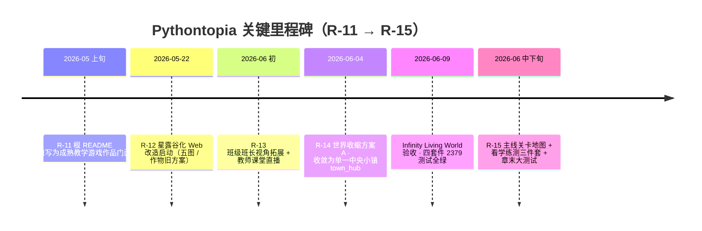

<!-- filecode: C11 -->

# 第 11 章　项目总结

本章对 Pythontopia 课程设计项目作整体复盘。Pythontopia 是一款面向高校 Python 初学者的多端像素学习小镇「第二课堂」，以 Alethicode `packId=43`《Python 语言基础》（7 文档 / 561 页 / 7 章 / 65 KC / 46 示例 / 39 题）为唯一知识底座，把「看→学→练→测」的教学闭环嵌入像素小镇玩法，做到「教育优先、游戏承载」。项目由三人小组（成员 A / B / C）配合 AI 协作完成，覆盖 Java 后端、Vue + Phaser Web 前端、FastAPI + LangGraph Python 微服务，以及 Android、Windows、微信小程序 / 小游戏四类共用同一后端的客户端。

整个项目并非一蹴而就，而是经过 R-11 至 R-15 多轮迭代逐步收敛的成果：从把作品门面立起来，到大胆的「星露谷化」改造，再到痛下决心做「世界收缩」、把分散的玩法重新聚拢到教学主线上。这一路既有成功经验，也有返工教训，本章如实记录。所有 AI 生成的代码与文档均经过人工审阅，团队对最终质量负责；下文按「先成果、后反思」的顺序，分成员陈述每个人在真实技术栈下的收获与不足，力求既看到做成了什么，也看清还差在哪里。

为便于阅读，先用一张里程碑时间线回顾项目从 R-11 到 R-15 的演进轨迹（图 C11-1），随后按成员分述经验成果（11.1）与反思（11.2）。

### 图 C11-1　项目关键里程碑时间线（R-11 → R-15）

### 表 C11-1　项目核心成果度量（截至定稿，取自仓库）

| 维度 | 度量 | 说明 |
| --- | --- | --- |
| 后端规模 | 770 个 `.java`，约 6.6 万行 | `com.pythontopia.*` 下 24 个业务包 |
| 数据库 | 89 个 Flyway 迁移（V001–V174），约 1.8 万行 SQL | PostgreSQL 16 + pgvector |
| Web 前端 | 172 个 `.vue` + 269 个 `.ts`，约 9.7 万行 | 31 页面 / 139 组件 |
| Python 微服务 | 278 个 `.py`，约 5.3 万行 | graph 234 + rag 44 |
| 多端客户端 | Android 315 `.kt` / Windows 132 `.cs` / 微信 60 `.ts` | 共用同一后端 |
| 测试基线 | 四套件 2379 / 2379 通过 | 后端 464 + graph 380 + rag 21 + 前端 1514 |
| 多智能体 | 11 个默认 Agent + 编排子图 | 全部结构化输出，不启用 ReAct |

---

## 11.1 经验与成果

### 11.1.1 成员 A：架构 / 后端 / AI·Agent·RAG / 数据库

成员 A 作为项目经理与核心开发者，承担了架构设计、后端、AI 编排、RAG 与数据库的主体工作，也是工作量最大、最核心的角色。最大的收获是真正落地了一套「**结构化、可解释、防幻觉**」的教育 AI 后端，而非把大模型当作聊天框。

在**架构与后端**层面，采用 Java 21 + Spring Boot 3.3.6 + Maven，把系统按业务域拆为 24 个清晰的包（`auth`、`learner`、`world`、`mainline`、`coursepack`、`tutor`、`workshop`、`submission`、`bugmine`、`feynman`、`classroom` 等），坚持 DTO 严格分离、统一 `ApiError` 错误返回、Spring Security（JWT）鉴权与统一 `/api` 前缀。这让接口契约稳定、可被四类客户端共用，也使后端 464 个测试（含 Testcontainers 端到端验收）能稳定全绿。成员 A 体会到「**边界清晰胜过聪明**」：把领域服务、控制器、DTO 三层职责切干净，后续无论是加无尽远征、费曼反演还是教师看板，都能外科手术式扩展而不动既有契约。

在 **AI·Agent·RAG** 层面，基于 FastAPI + LangGraph 构建了 11 个默认智能体（Profile / CurriculumMapper / ResourceDesigner / MindMap / Practice / CodeLab / Storyboard / PathPlanner / Debug / GroundingCritic / Safety）与若干编排子图，全部采用 pydantic 结构化输出、明确拒绝 ReAct 自由循环。最关键的工程经验是「**防幻觉要做在末端**」：任何生成资源都要先过 GroundingCritic 与 Safety 校验，命中证据则写明 `evidence_page_ids`，否则显式标注「基于通识知识」；RAG 命中分数低于阈值时统一返回 `no_evidence_found=true, hits=[]`，绝不编造课件引用。LLM Provider 做成可插拔（dryrun / OpenAI 兼容 / 讯飞 Spark），缺密钥自动降级到 golden 兜底，保证演示链路永不中断。

在**数据库与判题**层面，成员 A 设计并维护了 89 个 Flyway 迁移（V001–V174），覆盖账号、8 维学习画像、世界存档、课程包、主线、工坊、判题、矿洞、复盘、任务、班级等全部领域；坚持 `snake_case` 命名、每个迁移注明目的与影响表。判题采用「双轨执行」：Pyodide 前端即时预览、服务端沙箱正式判分，预览结果绝不入正式成绩，隐藏用例不下发前端。成员 A 最大的成长，是学会用「**数据先行**」思维驱动设计——先把表与证据链定清楚（任务完成必须带 evidence），业务逻辑与 AI 决策自然有了可信的地基。

此外，成员 A 还在「个性化」与「可解释」两条线上做了纵深建设。8 维学习画像（`learner_profile.dimensions` JSONB）不是一次问卷的静态结果，而是由 `PassiveProfileService` 监听 `LearningEvent` 持续被动演化，并允许学生对主观维度自评；周度则由数字孪生周报（`TwinWeekly`）沉淀画像快照，复习调度用 FSRS-lite（`kc_review_state`）驱动「遗忘回声」再练习。在可解释层面，`DecisionTraceService` 把 AI 的决策链整理成面向用户的「决策玻璃盒」，配合 SSE 中继把 graph 的流式事件帧回放给前端，让「AI 为什么这样推荐」对师生可见。回头看，成员 A 体会最深的是：教育系统里每一个 AI 动作都应当**可追溯、可解释、可回流到判题**，这远比模型本身的花哨更重要。

### 11.1.2 成员 B：前端 / 游戏 / 像素世界 / UI / 交互

成员 B 负责 Web 前端与像素游戏世界，把抽象的教学闭环变成学生愿意停留的「小镇」。技术栈为 Vue 3.5.13 + Vite + TypeScript（strict）+ Pinia + Vue-Router，游戏渲染用 Phaser 3.87，前端最终沉淀为 172 个 `.vue` 组件页面、269 个 `.ts` 模块、约 9.7 万行代码，31 个页面与 139 个组件覆盖了从登录、世界、工坊、训练场到复盘大厅的完整动线。

最重要的工程经验是「**游戏引擎必须隔离**」。Pythontopia 严守业务层禁用 `any`、Phaser 与第三方动态对象只能待在 adapter 层，并用 `phaserGame.ts` 单例 + `WorldCanvas.vue` 保证全应用只有一个 `Phaser.Game` 实例。这条纪律让 Vue 的响应式状态与 Phaser 的帧循环互不污染，避免了多场景切换时常见的内存泄漏与状态错乱。8 方向输入在前端用 `ExtendedDirection` 表达、写后端前再降级为 4 向，也是这层 adapter 的典型收益。

在**像素世界与交互**层面，成员 B 经历了 R-12「星露谷化」到 R-14「世界收缩方案 A」的关键转身：从五张地图分块的大世界，收敛为单一中央小镇 `town_hub`（≤50×40），并移除农场作物、货币、商店等与教学无关的玩法残留。这次收缩验证了「**少即是多**」——把所有学习入口与 NPC 收进一个 hub 后，主线更清晰、引导更易懂，学生不再在多图间奔波。成员 B 还落地了 Pyodide 即时预览、CodeMirror 6 代码编辑器、Mermaid 11 思维导图渲染等「学习内容可读、可复制、可引用」的能力，并配合 1514 个前端测试（Vitest）守住组件与 store 的回归底线，做到 typecheck 0 错误、lint 0 错误。成员 B 的体会是：教育产品的 UI 不能为炫技服务，每一个面板都要对应教学闭环里的一个动作，没有纯装饰系统。

在**动线与交互细节**上，成员 B 把 31 个页面与 139 个组件组织成一条顺滑的学习链路：从世界小镇（`WorldPage`）出发，经 NPC 对话树（`DialogTree`）触发开面板，进入主线关卡地图、小节三件套学习页与章末大测试；工坊（`WorkshopPage`）承载思维导图 / PPT / 代码实验 / 分镜故事板 / 讲义 / 练习六类资源的生成与消费，训练场（`TrainingPage`）承载真题判题。为保证学习的严肃性，章末大测试期间用全局路由守卫拦截一切跳向 AI / 答疑类页面的导航以防作弊，并在工坊、训练场、矿洞等已自带助教的页面隐藏重复的「随身助教」浮层。成员 B 深知，前端纪律（TS strict、禁 `any`、单 Phaser 实例、adapter 隔离）看似拖慢一时，却是大体量交互可维护的根本保障。

### 11.1.3 成员 C：测试 / 质量 / 多端 / 数据字典整理

成员 C 负责质量保障、多端协同与数据字典整理，是把项目从「能跑」推向「可信交付」的关键角色。最大的成果，是建立了覆盖四套件的统一测试基线：后端 464、graph 380、rag 21、前端 1514，合计 **2379 / 2379 全部通过**，0 失败 / 0 错误，并配套 typecheck 与 lint 双零门禁。这套基线在 Infinity Living World 验收（2026-06-09）中作为硬指标，使「绿色才合并」成为团队共识。

在**测试策略**上，成员 C 推动了分层测试：后端用 Testcontainers 做真实数据库端到端验收（含限频并发、补救、预言家、反思等复杂链路），Python 服务用 pytest 覆盖 11 个 Agent 单测与编排真接力、语义接地 entailment，前端用 Vitest 覆盖 Pinia store、API client 与组件 spec，并辅以 Playwright 做真实浏览器走查。成员 C 深刻体会到「**测试数据要贴近真实**」：判题必须验证通过、失败、运行错误三类提交，RAG 必须验证「input 函数 / for 循环 / 列表」等真实查询能命中正确页码，才能暴露防幻觉与脱敏的边界问题。

在**多端与数据字典**层面，成员 C 梳理了 Web、Android（Kotlin + Compose + LibGDX，315 个 `.kt`）、Windows（.NET 8 + WinUI 3 + MonoGame，132 个 `.cs`）、微信小程序 / 小游戏（共 60 个 `.ts`）四类客户端如何共用同一套 Spring Boot 后端，并以 `docs/clients/api-contract.md` 作为跨端唯一权威契约，避免各端各写一套字段。Android 端的 DTO 更进一步由 OpenAPI Generator 从后端 springdoc 自动生成，从源头消除手抄字段的漂移风险。同时，成员 C 把 89 个迁移里的真实字段逐表整理成数据字典（第 6 章 D1–D4），坚持「字段必须取自真实 SQL」，为全报告的防幻觉红线兜底。这段经历让成员 C 意识到：质量不是测试一个环节，而是从字段命名、契约定义到回归门禁的一条链。

在**交付与验收**层面，成员 C 还把质量延伸到了部署侧：用 `preflight_ecs.sh` 做上线前环境预检、用 `public_acceptance.sh` 做公网验收、用 `demo_smoke.sh` 做演示前最小冒烟，并维护回归报告（`docs/release/regression_report.md`）记录每一轮验收结论。Android 端引入 Detekt（含 ktlint）静态分析、Roborazzi 截图回归与 Kover 覆盖率，让原生端也有可量化的质量基线。成员 C 总结：交付不是「测完就完」，而是把「构建—验收—回滚」串成可重复执行、可证据留痕的闭环，让演示与答辩的每一项指标都经得起复查。

---

## 11.2 反思

### 11.2.1 成员 A 反思

成员 A 最大的反思是「**复杂度管理**」。系统在 R-11 至 R-15 间快速演进，迁移数量从个位数膨胀到 89 个（V001–V174），其中夹杂了 R-14 世界收缩留下的农场 / 经济 / 商店等已弃用表（如 `crop_tile_state`、`player_currency`、`shop_listing`）。虽然这些表已 DROP 并在第 6 章附录登记，但「先加后删」的代价说明：在需求尚未稳定时过早落库，会带来难以回收的技术债。若重来，会更克制地用「占位 + 灰度」推进玩法，待验证后再固化表结构。

其次是**对 LLM Provider 的依赖**。当前演示默认单 worker、缺密钥降级 golden，虽保证了链路不中断，但也意味着真实生成质量受外部模型与网络（如讯飞代理 fake-ip DNS 问题）影响较大。后续应加强多 Provider 的对账评测与缓存，让「降级」不只是兜底，而是可量化的服务等级。最后，11 个 Agent 的编排虽已结构化，但跨 Agent 的可观测性仍偏弱，决策玻璃盒（`DecisionTraceService`）覆盖面还需扩大，才能让 AI 决策对师生真正透明。

### 11.2.2 成员 B 反思

成员 B 的反思集中在「**方案反复的成本**」。R-12 投入大量精力做五图分块的星露谷式大世界，却在 R-14 被「世界收缩方案 A」整体推翻，外围图（farm_north / mine_south / campus_east / port_west）退出主线。这次返工虽然换来了更清晰的主线，但也暴露了前期需求与玩法定位未充分对齐的问题——像素世界的「大」并不等于「好」，教育动线的清晰度才是第一性指标。今后应在动手画地图前，先用低成本原型验证学习动线。

其次是**性能与边界**。Phaser 单实例 + adapter 隔离虽好，但大地图、众多 NPC 与实时存档对前端帧率与内存仍有压力；Pyodide 首次加载体积较大，弱网下体验有待优化。此外，像素素材严格限定 CC0 / CC-BY 等已审计授权、不得使用任何商业游戏官方素材，这条合规红线虽必须坚守，却也限制了美术表现力，后续需要在自制素材与授权素材间找到更好的平衡。

### 11.2.3 成员 C 反思

成员 C 的反思是「**多端覆盖不均衡**」。四类客户端虽共用后端，但成熟度差异明显：Web 端功能最全、测试最厚（1514 例），Android 端已成体系（315 个 `.kt`），而 Windows 端仍标注「建设中」、微信小游戏体量较小（15 个 `.ts`）。这意味着「多端」目前更多是架构上的可达，而非各端等质的交付。测试资源也主要集中在 Web 与后端，多端的自动化回归（尤其是 UI 与端到端）尚未对齐 Web 的水平。

其次是**测试的真实性边界**。当前 2379 个测试虽全绿，但其中部分依赖演示环境与 golden 兜底，真实 LLM 在线链路、并发压力与长时稳定性的覆盖仍不足；Android Beta 首发也仅支持服务端判题，端侧执行尚未纳入。未来应补充面向真实 Provider 的契约测试、性能基线与混沌测试，并把数据字典的「字段—契约—用例」三者做成可自动校验的一致性检查，从机制上杜绝跨端字段漂移与防幻觉回退。

### 本章小结

回望整个课程设计，三位成员的共同认识是：做一款「教育优先、游戏承载」的产品，最难的不是把功能堆出来，而是始终让每一处玩法、每一个 AI 动作都服务于「看→学→练→测」的真实学习闭环，并且能被证据与测试反复检验。成员 A 用数据与可解释性筑牢可信地基，成员 B 用前端纪律与世界收缩换来清晰动线，成员 C 用分层测试与跨端契约守住交付底线。R-11 到 R-15 的反复迭代证明，敢于推翻不合适的旧方案（如五图大世界），比固守沉没成本更重要。这些经验与教训，将是团队在后续把多端补齐、把真实 LLM 链路压稳的起点。

---

> 执笔人：成员 A ｜ 完成人（签名）：成员 A ｜ 审查人：成员 B / 成员 C ｜ 完成日期：2026-06-20
