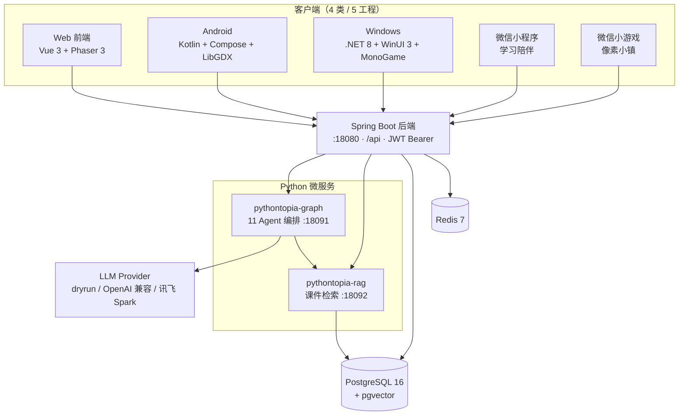

<!-- filecode: C12 -->

# 附录

本附录面向部署者、使用者与评审者，提供三份操作性材料：附录 A 安装手册（如何把 Pythontopia 全栈一键跑起来）、附录 B 使用手册（学生 / 教师 / 管理员三类角色的操作路径）、附录 C 编码清单（仓库目录树与各端代码规模概览）。全部内容以仓库 `deploy/docker-compose.yml`、`dev.sh`、`frontend/src/app/router.ts` 与真实目录结构为准。

---

## 附录 A　安装手册

Pythontopia 的部署遵循「**一键可达、幂等可重入、演示数据自带**」的原则：评审无需手工建库或导数据，跑完几条脚本即可登录体验。系统推荐用 Docker Compose 一键部署，`deploy/docker-compose.yml` 默认编排 **6 个核心服务**：`postgres`、`redis`、`backend`、`pythontopia-graph`、`pythontopia-rag`、`frontend`；另有可选的 `observability` profile（Langfuse 自托管，7 个 `langfuse-*` 容器，默认不启动）。本地开发也可用根目录 `./dev.sh`：依赖容器化、后端用原生 `mvn spring-boot:run`、前端用 Vite 热更新。所有 seed 与索引脚本均可重复执行而不污染数据，便于反复演示与排错。

### A.1 环境要求（表 C12-1）

| 类别 | 要求 | 说明 |
| --- | --- | --- |
| 操作系统 | Linux / macOS / Windows + WSL2 | 项目在 WSL2（Ubuntu）与阿里云 Ubuntu 22.04 实测 |
| 容器运行时 | Docker Engine + Docker Compose v2 | 一键演示的唯一硬依赖 |
| 内存 | 建议 ≥ 8 GB | 6 服务并行 + 首次镜像构建；4 GB 可跑但偏紧 |
| 磁盘 | 建议 ≥ 10 GB | 含课件 PDF、像素素材与镜像层 |
| JDK（仅本地开发） | Java 21 | `./dev.sh` 走原生 `mvn spring-boot:run` |
| 构建工具（仅本地开发） | Maven、Node.js + npm、Python 3.11 | 分别对应后端 / 前端 / 微服务本地构建 |
| 可选 | `ffmpeg` | 缺失时「合成短视频」降级，不阻塞主链路 |

### A.2 一键演示部署（推荐）

在仓库根目录执行：

```bash
cd deploy
cp .env.example .env          # 填入 PYT_DB_* / PYT_JWT_SECRET / PYT_TEACHER_INVITE_CODE / PYT_LLM_PROVIDER
docker compose up -d --build  # 启动 6 个核心服务（postgres/redis/backend/graph/rag/frontend）
bash scripts/init_rag_index.sh      # 课件向量索引一次性构建（需 PYT_RAG_ADMIN_TOKEN）
bash scripts/seed_demo_classroom.sh # 创建 demo 教师 + 3 学生 + 班级任务（幂等）
bash scripts/demo_smoke.sh          # 4 项健康检查 + 课程包 43 可读性验证
```

部署完成后，浏览器打开 **<http://localhost:8080>** 即可用演示账号登录。数据库迁移（Flyway）由 `backend` 容器首次启动时自动执行，无需手动建表；`bash scripts/init_db.sh` 可单独触发「等待 Postgres 就绪 → 起 backend 跑 Flyway」。

`deploy/.env` 是部署的唯一配置中心（已 gitignore，从 `.env.example` 复制）。其中：`PYT_DB_USERNAME / PYT_DB_PASSWORD` 决定 Postgres 凭据（注意密码在数据卷首次创建后即固定，改密码须同步数据卷或用 `dev.sh` 内置的 `ALTER USER` 兜底）；`PYT_JWT_SECRET` 须为不少于 32 字符的随机串；`PYT_TEACHER_INVITE_CODE` 是教师注册邀请码；`PYT_LLM_PROVIDER` 选择大模型供给方式（`dryrun` / OpenAI 兼容 / 讯飞 Spark），缺密钥时自动降级到 golden 兜底，保证演示链路不中断。若需多模态（文生图 / 语音合成）与外网检索，可按 `.env.example` 填讯飞 `PYT_SPARK_*` 与代理端口；部分宿主网络使用 fake-ip DNS（如 `198.18.x.x`）会导致 Java HttpClient 直连超时，`dev.sh` 与 compose 已内置把讯飞调用经代理、本地服务直连的处理。

### A.3 本地开发模式（热更新）

```bash
./dev.sh            # 依赖容器化 + 后端 mvn spring-boot:run(:18080) + 前端 Vite(:5173)
./dev.sh --no-deps  # 依赖已在别处运行时，跳过 docker 依赖
./dev.sh --down     # 停止本脚本拉起的后端 + 前端 + docker 依赖（数据卷保留）
```

开发模式入口为 **<http://localhost:5173>**（Vite 代理 `/api` → 后端 `:18080`）。`dev.sh` 内置健康门禁：Postgres、graph、rag 任一未就绪会 fail-fast 并打印日志；它还会校验宿主到 `127.0.0.1:15432` 的 Postgres 密码是否与 `deploy/.env` 一致（常见踩坑：改过密码但未重建数据卷）。

### A.4 服务端口表（表 C12-2，取自 `docker-compose.yml`）

| 服务 | 容器端口 | 宿主映射 | 用途 |
| --- | --- | --- | --- |
| postgres | 5432 | `15432:5432` | PostgreSQL 16 + pgvector，库名 `pythontopia` |
| redis | 6379 | `16379:6379` | 缓存 / 队列 |
| backend | 18080 | `127.0.0.1:18080:18080` | Spring Boot REST，统一前缀 `/api`，JWT Bearer |
| pythontopia-graph | 18091 | host 网络（`127.0.0.1:18091`） | 多智能体编排（FastAPI + LangGraph） |
| pythontopia-rag | 18092 | `127.0.0.1:18092:18092` | 课件 RAG 检索 |
| frontend | 80 | `8080:80` | Web 端（Nginx 托管构建产物） |
| Vite dev（开发态） | 5173 | `5173`（`./dev.sh`） | 前端热更新，代理 `/api` |
| langfuse-web（可选） | 3000 | `127.0.0.1:3000:3000` | 可观测性，仅 `--profile observability` 启用 |

> 容器态访问入口为 `http://localhost:8080`；开发态为 `http://localhost:5173`。`graph` 走 host 网络是为了访问宿主本地代理（外网检索 / B 站），对外入口仍是 `127.0.0.1:18091`。

### A.5 初始化验证（表 C12-3）

部署完成后，应验证「服务健康」与「课程包完整」两类指标。`bash scripts/demo_smoke.sh` 会依次检查 backend / graph / rag / frontend 的 `/healthz`，并请求 `GET /api/course/pack` 确认课程包 43 可读。课程包是整个系统的知识底座，其完整性直接决定 65 个 KC 的学习任务、46 个示例与 39 道题能否正确加载，因此必须逐项核对。课程包的完整性以下列固定口径为准（来自 `data/course-pack-43/`，packId=43《Python 语言基础》）：

| 验证项 | 期望值 | 验证方式 |
| --- | --- | --- |
| 服务健康检查 | backend / graph / rag / frontend 四项均 `ok` | `bash scripts/demo_smoke.sh` |
| 课程包可读 | `GET /api/course/pack` 返回 200 | `demo_smoke.sh` 内置校验 |
| 文档数 | **7 份文档** | 课程包接口 / `data/course-pack-43/` |
| 总页数 | **561 页** | 同上 |
| 章节数 | **7 章** | 同上 |
| 知识点（KC） | **65 个 KC** | 同上 |
| 示例 | **46 个示例** | 同上 |
| 题目 | **39 道题** | 同上 |
| 演示数据 | 1 教师 + 3 学生 + 1 班级任务 | `bash scripts/seed_demo_classroom.sh`（幂等） |

`scripts/seed_demo_classroom.sh` 经真实 REST API 注册 `demo-teacher-01` 与 `demo-stu-01/02/03`，并随机生成一次性登录密码打印到 stdout（不落盘，请运行时复制保存）。

### A.6 部署 / 运维脚本（表 C12-4，位于 `deploy/scripts/`）

| 脚本 | 作用 |
| --- | --- |
| `init_db.sh` | 等待 Postgres 就绪后起 backend 触发 Flyway 迁移 |
| `init_rag_index.sh` | 调用 `pythontopia-rag` 的 `/rag/index/rebuild` 重建课件向量索引 |
| `seed_demo_classroom.sh` | 经 REST API 注入演示教师 / 学生 / 班级任务（幂等） |
| `demo_smoke.sh` | 演示前最小冒烟：4 健康检查 + 课程包可读 |
| `teardown_demo.sh` | 清理演示数据 |
| `ensure_public_demo_account.sh` | 保障公开演示账号存在 |
| `build_release_archive.sh` / `verify_release_archive.sh` | 构建 / 校验发布归档 |
| `install_release.sh` / `rollback_release.sh` | 生产安装 / 回滚 |
| `preflight_ecs.sh` / `public_acceptance.sh` | ECS 预检 / 公网验收 |

### A.7 常见问题排查（表 C12-5）

下列问题均来自 `dev.sh` 与 `docker-compose.yml` 中已注明的真实踩坑点，遇到时按「现象 → 处置」对照解决：

| 现象 | 可能原因 | 处置 |
| --- | --- | --- |
| 后端启动报 Postgres 认证失败 | 改过 `PYT_DB_PASSWORD` 但数据卷里的旧密码未变 | 用 `dev.sh` 内置的 `ALTER USER` 同步，或 `down -v` 重建数据卷 |
| 答疑 / 工坊 / 路径功能降级 | `pythontopia-graph` 未就绪或缺 LLM 密钥 | 查 `:18091/healthz`；缺密钥时走 golden 兜底属预期 |
| 课件证据检索为空 | `pythontopia-rag` 未就绪或索引未建 | 查 `:18092/healthz`，重跑 `init_rag_index.sh` |
| 文生图 / 语音合成恒降级 | fake-ip DNS 致讯飞直连超时，或未填 `PYT_SPARK_*` | 配置代理端口与讯飞密钥（见 `.env.example`） |
| 「合成短视频」失败 | 宿主缺 `ffmpeg` | 安装 `ffmpeg` 或 `pip install imageio-ffmpeg` 后软链入 PATH |
| 端口被占用 | 15432/16379/18080/18091/18092/8080 已被本机其它进程占用 | 释放端口或在 `.env` / compose 调整映射 |

启用可观测性（Langfuse）时另需 `docker compose --profile observability up -d`，UI 在 `http://127.0.0.1:3000`；不启用时上述 6 个核心服务照常运行。

### A.8 清理

```bash
bash deploy/scripts/teardown_demo.sh                 # 清理演示数据
docker compose -f deploy/docker-compose.yml down -v  # 停止并删除数据卷（彻底清空）
```

---

## 附录 B　使用手册

Pythontopia 区分三类角色：**学生 student / 教师 teacher / 管理员 admin**。除 `/login`、`/register`、`/credits` 外，所有页面均需登录（路由 `meta.requiresAuth`，未登录自动跳 `/login`）。Web 端是单页应用（SPA），根路径 `/` 默认重定向到中央小镇 `/world`；登录态失效会被路由守卫拦回登录页并带上 `redirect` 参数，登录后自动回到原页面。下文路由以开发态 `http://localhost:5173/<路由>` 给出，容器态等价于 `http://localhost:8080/<路由>`。

### B.1 默认角色与演示账号（表 C12-6）

| 角色 | 演示账号 | 说明 |
| --- | --- | --- |
| 教师 teacher | `demo-teacher-01`（演示教师） | 注册需教师邀请码（默认 `pytopia-teacher`） |
| 学生 student | `demo-stu-01/02/03`（Alice/Bob/Carol） | 由 seed 脚本批量注入 |
| 管理员 admin | （运维 / 后台角色） | 经部署脚本与后端 API 运作，Web 端不单设管理后台页 |

> 演示密码由 `seed_demo_classroom.sh` 随机生成并打印到 stdout，运行时请及时复制。

### B.2 学生操作路径（表 C12-7）

学生的主线动线即「看→学→练→测」的教学闭环，全部收敛进单一中央小镇 `town_hub`（R-14 世界收缩）。

| 步骤 | 操作 | 路由 |
| --- | --- | --- |
| 1. 注册 / 登录 | 创建学生账号并登录 | `/register` → `/login` |
| 2. 进入小镇 | 默认进入像素中央小镇 | `/` → `/world` |
| 3. 学习画像 | 对话访谈生成 8 维画像、查看 / 自评 | `/profile-room`、`/profile` |
| 4. 主线·看学练测 | 关卡地图 → 小节三件套（看 / 学 / 练） | `/mainline-map` → `/mainline/stage/:stageId` |
| 5. 章末测 | 章末测验 / 大测试（考试期禁 AI 协助） | `/chapter-quiz/:chapter`、`/chapter-test/:chapter` |
| 6. 看（课件） | 课件阅读器 + RAG 证据问答 / 视频讲解 | `/library`、`/lecture/:chapter` |
| 7. 学（工坊） | 百晓工坊：六类资源生成与 AI 答疑 | `/workshop`（`/tutor` 自动并入） |
| 8. 练（训练场） | 题目列表 + 在线判题（双轨执行） | `/problems`、`/training` |
| 9. 调试支线 | 提交失败进入 Bug 矿洞分层调试 | `/bug-mine` |
| 10. 挑战 | 无尽练习 / 无尽远征 / 章末 Boss / 毕业典礼 | `/endless`、`/expedition`、`/boss/:chapter`、`/graduation` |
| 11. 复盘 | 复盘大厅再巩固 + 费曼反演自测 | `/review-hall`、`/feynman` |
| 12. 任务 | 任务公告板领取每日 / 班级任务 | `/board` |
| 13. 帮助 | 操作指南文档页 | `/guide` |

学生的典型一次学习是：登录进入小镇后，先在画像房完成 / 更新画像，再到任务公告板领取当日任务；按主线关卡地图推进到某个小节，先「看」课件或视频、用 RAG 问答弄懂疑点，再到工坊「学」并生成配套资源，随后到训练场「练」真题；若提交失败则进入 Bug 矿洞分层调试，掌握度达阈值即视为「测」过；阶段性地到复盘大厅与费曼反演巩固，最终参加章末大测试与章末 Boss，七章通关后触发毕业典礼。整条动线始终围绕「看→学→练→测」展开，没有脱离教学目标的纯娱乐环节。

### B.3 教师操作路径（表 C12-8）

| 步骤 | 操作 | 路由 |
| --- | --- | --- |
| 1. 登录 | 以教师身份登录（注册需邀请码 `pytopia-teacher`） | `/login` |
| 2. 教师工作台 | 进入教师主页，管理班级入口 | `/teacher` |
| 3. 班级看板 | 查看班级 KC 热力图、高频误区、资源使用、任务完成率 | `/teacher/classroom/:id` |
| 4. 发布班级任务 | 在班级详情发布任务，学生在 `/board` 领取 | `/teacher/classroom/:id` |
| 5. AI 出题审核 | 拉取 AI 出题，查看 5 重审查结论后通过 / 驳回 | `/teacher/review` |

教师的核心价值在于「看清班级、精准补位」：班级看板把每个 KC 的掌握度聚合成热力图，把高频错误聚成误区清单，把资源使用情况可视化，教师据此发布有针对性的班级任务，学生在公告板领取后形成闭环。AI 出题审核页则体现了防幻觉与教师把关的结合——每道 AI 生成的题目都附带接地、防抄袭、自测等多重审查结论，教师通过或驳回，驳回原因会写入学习事件用于后续改进。Pythontopia 刻意不把班级做成复杂的课堂协作或评分后台，而是保持「建班 → 发任务 → 看板 → 补位」的轻量闭环。

### B.4 管理员（运维）路径

管理员角色面向账号、班级、课程包与索引等后台 / 运维事务。Web 端 SPA 未单设独立管理后台页面（与师生共用 `/login` 入口）；管理员职责主要通过部署脚本与后端 API 完成：

- 演示数据注入 / 清理：`seed_demo_classroom.sh`、`teardown_demo.sh`、`ensure_public_demo_account.sh`；
- 课件索引重建：`init_rag_index.sh`（`POST /rag/index/rebuild`，需 `X-Internal-Token`）；
- 课程包可读性与健康巡检：`demo_smoke.sh`、各服务 `/healthz`；
- 数据库迁移：`init_db.sh`（Flyway 由 backend 容器执行）。

> 教师邀请码、JWT 密钥、LLM Provider 等敏感配置集中在 `deploy/.env`（已 gitignore），由管理员维护。

---

## 附录 C　编码清单

本附录给出仓库顶层目录树与各端代码规模概览，帮助评审快速建立工程全貌。代码规模统计自 git 跟踪的源文件（`git ls-files` + `wc -l`，含空行与注释），仅作量级参考。Pythontopia 采用「单仓多端」组织：一套后端与 Python 微服务作为唯一真理源，四类客户端各自独立子目录、互不复用前端代码；课程数据、像素素材、部署脚本与文档各归其位，便于课程设计的分工与审阅。

### C.1 顶层目录树

```text
Pythontopia/
├── backend/                  # Spring Boot 后端（24 业务包 + Flyway 迁移）
│   └── src/main/resources/db/migration/   # 89 个 Flyway 迁移（V001–V174）
├── frontend/                 # Vue 3 + Phaser 3 Web 前端
│   └── src/{api,app,components,composables,game,pages,stores,types,utils,...}
├── services/
│   ├── pythontopia-graph/    # 多智能体编排（11 Agent + 编排子图，FastAPI+LangGraph）
│   └── pythontopia-rag/      # 课件 RAG（chunker / embedder / store / safety）
├── android/                  # Kotlin + Jetpack Compose + LibGDX 客户端
├── windows/                  # .NET 8 + WinUI 3 + MonoGame 客户端（建设中）
├── wechat-miniprogram/       # 微信小程序（学习陪伴，无像素小镇）
├── wechat-minigame/          # 微信小游戏（像素小镇，canvas2d）
├── data/
│   ├── course-pack-43/       # 《Python 语言基础》课程种子数据（7 文档/561 页/65 KC…）
│   └── demo/                 # 演示账号 / 班级 / 任务 + seed.py
├── assets/                   # 像素素材（CC0 / CC-BY 审计）+ LICENSE
├── deploy/                   # docker-compose.yml + .env.example + scripts/
├── docs/                     # 系统设计 / 测试 / 演示 / 课程报告（含本报告）
├── dev.sh                    # 本地开发一键脚本（依赖容器化 + 后端原生 + 前端 Vite）
├── AGENTS.md                 # 项目硬约束 + 目录约定 + 防幻觉规则
└── README.md                 # 项目门面与快速开始
```

### C.2 多端共享后端拓扑（图 C12-1）

四类客户端不复用彼此的前端代码，但共用同一套 Spring Boot 后端与 Python 微服务，接入契约以 `docs/clients/api-contract.md` 为唯一权威。



### C.3 各端代码规模概览（表 C12-9）

| 模块 / 端 | 主语言 | 源文件数 | 代码行数（约） | 备注 |
| --- | --- | --- | --- | --- |
| 后端 `backend/` | Java 21 | 770 `.java` | 66,353 | `com.pythontopia.*` 24 业务包 |
| 数据库迁移 | SQL（Flyway） | 89 `.sql` | 18,127 | V001–V174 |
| Web 前端 `frontend/` | Vue 3 / TS | 172 `.vue` + 269 `.ts` | 97,432 | 31 页面 / 139 组件；另含 224 个测试文件 |
| `pythontopia-graph` | Python 3.11 | 234 `.py` | —（见下行合计） | 11 Agent + 编排子图 |
| `pythontopia-rag` | Python 3.11 | 44 `.py` | —（见下行合计） | chunker / embedder / store / safety |
| 微服务合计 `services/` | Python | 278 `.py` | 53,506 | graph + rag |
| Android `android/` | Kotlin | 315 `.kt` | 36,251 | Compose + LibGDX |
| Windows `windows/` | C# | 132 `.cs` | 12,761 | WinUI 3 + MonoGame（建设中） |
| 微信小程序 | TypeScript | 45 `.ts` | —（见下行合计） | 学习陪伴 |
| 微信小游戏 | TypeScript | 15 `.ts` | —（见下行合计） | 像素小镇 |
| 微信端合计 | TypeScript | 60 `.ts` | 8,199 | 两个工程 |
| 像素素材 `assets/` | — | 21,946（文件） | — | CC0 / CC-BY 审计，配 `LICENSE.md` |

综观全表，Pythontopia 是一个以**后端（Java，约 6.6 万行）+ Python 微服务（约 5.3 万行）+ Web 前端（约 9.7 万行）** 为主干、并向 Android / Windows / 微信多端横向扩展的中大型工程；数据库以 89 个 Flyway 迁移沉淀了完整的领域模型，像素素材全部来自已审计的开源授权。这一规模与「四套件 2379 / 2379 测试全绿」（详见第 9 章）共同支撑了课程设计的可信交付。

### C.4 后端业务包与功能模块对应（表 C12-10）

后端按业务域划分为 24 个 `com.pythontopia.*` 包，与第 4 / 8 章的 13 个功能模块（M01–M13）一一对应，便于按模块定位代码。

| 后端包 `com.pythontopia.*` | 对应模块 | 说明 |
| --- | --- | --- |
| `auth` | M01 账号认证与权限 | 注册 / 登录 / JWT |
| `learner`（profile/mastery/event/memory…） | M02 学习画像与个性化 | 8 维画像、被动演化、掌握度 |
| `world` | M03 中央小镇世界与存档 | 存档 / 技能 / 日历 / 能量 |
| `npc`、`dialog` | M04 NPC 对话与记忆 | 对话树、人格、记忆 |
| `mainline` | M05 主线冒险·看学练测 | 关卡、练习、章末测试 |
| `coursepack`、`courseware`、`video`、`media` | M06 课程包与课件资产 | 课程包、PDF 页、视频、多模态 |
| `tutor`、`rag` | M07 课件问答与导师答疑 | RAG 检索 + 证据卡片 |
| `workshop`、`orchestrator`、`agent`、`browse`、`loop`、`intent` | M08 资源工坊与多智能体编排 | 六类资源、SSE 编排 |
| `submission` | M09 训练场与判题·双轨 | 提交、判题结果、调试用例 |
| `bugmine` | M10 Bug 矿洞·无尽·Boss | 失败回流、远征、Boss |
| `learner`（reflection/evaluation）、`feynman` | M11 复盘·费曼·学习评估 | 复盘、费曼反演、评估 |
| `learner`（quest/path） | M12 任务公告板与学习路径 | 任务领取、路径重排 |
| `classroom` | M13 轻量班级与教师看板 | 建班、班级任务、KC 热力图 |
| `common`、`download` | 公共 / 杂项 | 通用工具、下载统计 |

由表可见，业务包与模块的边界基本对齐，少数横切能力（如 `learner` 同时承载画像、复盘、任务、路径）按子包进一步细分；这种「按域分包、按模块对应」的组织方式，使三人小组能并行开发、互不踩踏，也让评审能顺着模块号快速找到对应实现与测试。

---

> 执笔人：成员 A ｜ 完成人（签名）：成员 A ｜ 审查人：成员 C ｜ 完成日期：2026-06-20
