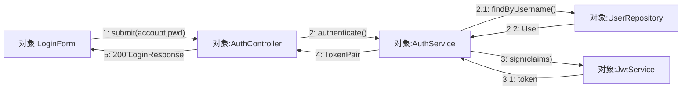

# Pythontopia 课程报告 · 写作总纲（Writing Kit）

> 本文是**写作元文件**，不计入最终课程报告正文，不参与 Word 拼接。
> 所有撰写子任务（subagent）**必须先完整阅读本文件**，再写自己负责的 md。
> 目的：54 个分片文件由 ~22 个并发子任务写成，**风格统一、编号不冲突、事实不矛盾、不重复定义**。
> 一切内容**以仓库真实代码为准**（`backend/` `frontend/` `services/` `deploy/` `data/`），不得照抄 `docs/` 下旧 `.md`（可能过时/错误），不得照抄 `实训总结报告.pdf` 的**内容**（仅借其**格式骨架**）。

---

## 0. 最高优先约束（所有子任务硬性遵守）

1. **真实性 / 防幻觉红线**：所有表名、字段、端点、页面、Agent、版本号必须能在仓库中找到实体。无法确认的写「（待核实 / 占位）」，**严禁编造**课件页码、题号、作者、第三方数据。
2. **格式参考 PDF，内容来自代码**：章节骨架对齐 `实训总结报告.pdf`（见 §3 文件清单的章节映射），但每段文字写的是 **Pythontopia 真实系统**。
3. **不重复定义**：一张表的**完整字段字典只在 §6 数据库设计（D1–D4 文件）出现一次**；其它章节（§4/§5/§8）引用表名时只写「详见 §6 表 xxx」，不再列全字段。
4. **统一编号**：图、表、用例、测试用例、审查问题均按本文 §5–§8 的编号规则；每个文件有唯一 `filecode`，图表用 `filecode` 前缀避免跨文件撞号。
5. **统一术语 / 事实**：一律采用 §1 项目事实卡 与 §2 术语表的措辞与数值。
6. **图多、种类多**：每个模块文件至少覆盖本文 §5 指定的多种图类型；能用 Mermaid / Graphviz / draw.io XML 画的**一律画出源码**，不能画的给【截图占位】或【配图检索】。
7. **字数**：全报告正文目标 **≈ 8 万汉字**（不含表格内容与代码块）；各文件配额见 §3 清单，**就低不就高**，靠图表与数据字典撑页数，不靠注水文字。
8. **语言**：简体中文；代码、标识符、SQL、英文术语保留原文。

---

## 1. 项目事实卡（Single Source of Truth · 逐字采用）

| 事实 | 取值（统一口径） |
| --- | --- |
| 项目名 | Pythontopia |
| 一句话定位 | 面向高校 Python 初学者的**多端像素学习小镇「第二课堂」** |
| 解决的问题 | 大班统一进度下「翘课 / 跟不上 / 坚持不下去」的学生，提供课外可达、按自己节奏「看→学→练→测」的补位学习场 |
| 课程知识底座 | Alethicode `packId=43`《Python 语言基础》 |
| 课程包规模 | 7 份文档 · 561 页 · 7 章 · 65 个 KC · 46 个示例 · 39 道题 |
| 用户角色 | 学生 student / 教师 teacher / 管理员 admin |
| 后端 | Java 21 · Spring Boot 3.3.6 · Maven · Spring Security(JWT) · Spring Data JPA · Flyway · springdoc-openapi 2.6.0 · PDFBox |
| 数据库 | PostgreSQL 16 + pgvector（镜像 `pgvector/pgvector:pg16`），库名 `pythontopia` |
| 缓存/队列 | Redis 7 |
| 前端 | Vue 3.5.13 · Vite 5.4.21 · TypeScript 5.7（strict）· Pinia 2.3 · Vue-Router 4.5 · Phaser 3.87 · Pyodide 0.25 · Mermaid 11.15 · CodeMirror 6 · Vitest 2.1 · Playwright |
| Python 微服务 | FastAPI + LangGraph（Python 3.11）：`pythontopia-graph`（多智能体）、`pythontopia-rag`（课件检索） |
| 多端 | Android(Kotlin+Compose+LibGDX)、Windows(.NET8+WinUI3+MonoGame)、微信小程序、微信小游戏；**共用同一后端** |
| 鉴权 | JWT Bearer；API 统一前缀 `/api` |
| 端口（开发态/容器态） | 前端 dev `http://localhost:5173`、前端容器 `http://localhost:8080`；后端 `:18080`；graph `:18091`；rag `:18092`；Postgres `:15432→5432`；Redis `:16379→6379`；Langfuse(可选) `:3000` |
| LLM Provider | 可插拔（dryrun / OpenAI 兼容 / 讯飞 Spark）；演示默认单 worker；缺密钥自动降级 golden 兜底 |
| 文档编号前缀 | 课程报告整体 `PYT-CR`；本文件不编号 |
| 报告日期 | 2026-06（统一用 2026 年 6 月口径） |

### 1.1 团队与分工（仅 3 人 A / B / C，满足课程「需求≠设计人、编码≠测试/审查人」约束）

| 成员 | 主责（A 工作最多且负责最核心部分） | 需求分析 | 概要/详细设计 | 编码 | 审查/测试 |
| --- | --- | --- | --- | --- | --- |
| **A** | 项目经理 / 架构 / 后端 / AI·Agent·RAG / 数据库 / 主线判题（**核心**） | — | ✅ **设计主笔** | ✅ **核心编码**（后端·AI·判题·数据库·主线） | — |
| **B** | 前端 / 游戏 / 像素世界 / UI / 交互 | ✅ **需求主笔** | 协同 | ✅ 前端·游戏编码 | — |
| **C** | 测试 / 质量 / 多端 / 数据字典整理 | 协同 | 协同 | — | ✅ **测试 & 审查主笔** |

> 约束落实（强制按下表签名）：
> - **需求文件（04-MXX、需求总览）**：执笔/完成人 = **B**，审查 = **C**。
> - **设计文件（05、06、D1–D4、07、08-MXX、多端）**：执笔/完成人 = **A**，审查 = **C**。
> - **测试/审查文件（09-00、09-MXX、10 审查清单）**：执笔/完成人 = **C**，审查 = **A**。
> - **框架综述（00 封面、01 概述、02 计划、03 可行性、11 总结、12 附录）**：执笔/完成人 = **A**，审查 = **B/C**。
> - 由此满足：**需求主笔 B ≠ 设计主笔 A**；**编码者 A/B ≠ 测试/审查主笔 C**。
> 每份文档末尾写「执笔人：X ｜ 完成人（签名）：X ｜ 审查人：Y ｜ 完成日期：2026-06-__」。

---

## 2. 术语表（统一定义，引用勿改写）

| 术语 | 定义 |
| --- | --- |
| KC（Knowledge Component） | 知识点，课程包 `packId=43` 共 65 个，是学习/掌握度/出题的最小单元 |
| 看→学→练→测 | 主线学习闭环：看课件/视频 → 工坊生成并消费资源 → 训练场真题判题 → 掌握度达阈值 |
| 主线 Stage | 主线冒险关卡；含「看/学/练」三件套与章末大测试 |
| 章末大测试 | 每章末综合测验，产出分数与星级 |
| 星级 | 关卡/章节完成质量评级 |
| 双轨执行 | Pyodide 前端即时预览 + 服务端沙箱正式判题；**预览结果不入正式判分** |
| Bug 矿洞 | 失败提交触发的分层调试支线 |
| 遗忘回声 | 基于复习状态的再练习/再巩固机制 |
| FSRS-lite | 轻量间隔复习调度（复习状态 `kc_review_state`） |
| 8 维学习画像 | `learner_profile.dimensions`(JSONB)：专业背景/知识基础/学习目标/认知风格/学习偏好/易错模式/实践能力/情绪与坚持度 |
| 被动画像演化 | `PassiveProfileService` 监听 `LearningEvent` 自动更新画像维度 |
| 决策玻璃盒 | `DecisionTraceService` 面向用户的 AI 决策可解释视图 |
| 防幻觉三审 | 生成内容末端经 GroundingCritic / Hallucination / Safety 校验后才出 |
| 证据锚定 | RAG 回答必须带课件页码/出处引用 |
| SSE 中继 | 后端消费 graph 流式事件帧并回放给客户端 |
| 资源工坊六类资源 | 思维导图 / PPT / 代码实验 / 分镜故事板 / 讲义 / 练习 |
| 数字孪生周报 | `TwinWeekly` 学习者周度画像快照 |
| town_hub | R-14 收缩后的单一中央小镇主玩图 |

---

## 3. 文件清单（Manifest）· 55 个正文文件 + 章节映射

> 命名：`docs/course-report/` 下，序号前缀保证拼接顺序。`filecode` 用于图表编号前缀。
> 「必读代码」= 该文件作者撰写前必须实际打开阅读的真实路径（防止脱离代码空写）。

### 3.1 框架文件（12）

| 序号文件 | filecode | 标题 / 对应 PDF 章 | 字数配额 | 必读 |
| --- | --- | --- | --- | --- |
| `00-封面与文档控制.md` | FC | 封面·文档控制·签名表·修订历史·全局目录 | 1500 | 本总纲 §1/§3 |
| `01-项目概述.md` | C01 | 1 项目概述（背景/定位/方案/目标/价值） | 5000 | `README.md`、`AGENTS.md` 顶部、本总纲 §1 |
| `02-开发计划.md` | C02 | 2 开发计划（形式/功能/环境/验收/关键问题/**GANTT 进度**/预算） | 5500 | `AGENTS.md` 版本节奏、`deploy/`、本总纲 §1 |
| `03-可行性分析.md` | C03 | 3 可行性分析（技术/资源/市场） | 4500 | `backend/pom.xml`、`frontend/package.json`、`services/*/pyproject.toml` |
| `04-00-需求总览与数据需求.md` | C04 | 4.1 数据需求 + 4.2 功能总览框架 + 4.3 性能 + 4.4 界面 + 4.5 接口 + 4.6 其他 | 6000 | 全 controller 列表、`data/course-pack-43/`、本总纲 §4/§5 |
| `05-概要设计.md` | C05 | 5 概要设计（处理流程/总体结构/功能/数据流转/UI/数据结构/接口/异常/配置/部署/跨端架构/其他） | 8000 | `deploy/docker-compose.yml`、后端包结构、`services/*/`、本总纲 §1 |
| `06-00-数据库设计-规范与总览.md` | C06 | 6.1–6.4 命名规范 + 概念 ER 总览 + 表索引 + 已弃用表附录 | 4500 | `backend/src/main/resources/db/migration/`（全量浏览）、本总纲 §6 |
| `07-多端部署设计.md` | C07 | 7 手机端/多端侧部署设计 | 4000 | `android/docs/ADR-001-tech-selection.md`、`docs/clients/`、`windows/` `wechat-*/` README |
| `09-00-测试计划与结果分析.md` | T00 | 9.1 目标范围 / 9.2 环境工具 / 9.3 策略 / 9.5 结果分析 / 9.6 缺陷统计（聚焦功能测试） | 3500 | 本总纲 §8、`frontend` 测试脚本、`backend` 测试目录 |
| `10-审查与测试问题清单.md` | C10 | 10 审查/测试问题清单（每阶段≥10） | 3500 | 本总纲 §8、各阶段文档结构 |
| `11-项目总结.md` | C11 | 11 项目总结（经验成果/反思，按成员） | 4000 | 本总纲 §1.1 |
| `12-附录-安装使用手册与编码清单.md` | C12 | 附录 A 安装手册 / B 使用手册 / C 编码清单 | 4000 | `README.md`、`dev.sh`、`deploy/`、目录树 |

### 3.2 数据库数据字典分片（4）— §6.5 完整字段字典

| 文件 | filecode | 覆盖模块 → 表 | 字数 | 必读 |
| --- | --- | --- | --- | --- |
| `06-01-数据表字典-账号画像世界NPC.md` | D1 | M01,M02,M03,M04 | 2500 | 见 §6 表清单中各表对应 migration |
| `06-02-数据表字典-课程主线答疑.md` | D2 | M05,M06,M07 | 2500 | 同上 |
| `06-03-数据表字典-工坊判题挑战.md` | D3 | M08,M09,M10 | 2500 | 同上 |
| `06-04-数据表字典-复盘任务班级.md` | D4 | M11,M12,M13 + 杂项 + 已弃用 | 2500 | 同上 |

> 数据字典格式：每表一个三线表 `字段 | 类型 | 约束/默认 | 说明`，并附「PK / FK / 索引 / 唯一约束」小节与「来源 migration」。**字段必须取自真实 SQL**，作者须打开对应 `Vxxx__*.sql` 抄真字段。

### 3.3 功能模块分片（13×3 = 39）

> 每个模块 3 个文件，**同一子任务一并完成本模块 3 个文件**，保证模块内一致。
> `04-MXX` = §4.2 该模块功能需求（用例）；`08-MXX` = §8 该模块详细设计；`09-MXX` = §9 该模块功能测试。

| 模块 | 04 需求文件 / filecode | 08 详设文件 / filecode | 09 测试文件 / filecode |
| --- | --- | --- | --- |
| M01 账号认证与权限 | `04-M01-需求-账号认证.md` R01 | `08-M01-详细设计-账号认证.md` S01 | `09-M01-功能测试-账号认证.md` T01 |
| M02 学习画像与个性化 | `04-M02-需求-学习画像.md` R02 | `08-M02-详细设计-学习画像.md` S02 | `09-M02-功能测试-学习画像.md` T02 |
| M03 中央小镇世界与存档 | `04-M03-需求-世界存档.md` R03 | `08-M03-详细设计-世界存档.md` S03 | `09-M03-功能测试-世界存档.md` T03 |
| M04 NPC 对话与记忆 | `04-M04-需求-NPC对话.md` R04 | `08-M04-详细设计-NPC对话.md` S04 | `09-M04-功能测试-NPC对话.md` T04 |
| M05 主线冒险·看学练测 | `04-M05-需求-主线冒险.md` R05 | `08-M05-详细设计-主线冒险.md` S05 | `09-M05-功能测试-主线冒险.md` T05 |
| M06 课程包与课件资产 | `04-M06-需求-课程包.md` R06 | `08-M06-详细设计-课程包.md` S06 | `09-M06-功能测试-课程包.md` T06 |
| M07 课件问答与导师答疑(RAG) | `04-M07-需求-课件问答.md` R07 | `08-M07-详细设计-课件问答.md` S07 | `09-M07-功能测试-课件问答.md` T07 |
| M08 资源工坊与多智能体编排 | `04-M08-需求-资源工坊.md` R08 | `08-M08-详细设计-资源工坊.md` S08 | `09-M08-功能测试-资源工坊.md` T08 |
| M09 训练场与判题·双轨 | `04-M09-需求-训练判题.md` R09 | `08-M09-详细设计-训练判题.md` S09 | `09-M09-功能测试-训练判题.md` T09 |
| M10 Bug矿洞·无尽·Boss | `04-M10-需求-矿洞无尽Boss.md` R10 | `08-M10-详细设计-矿洞无尽Boss.md` S10 | `09-M10-功能测试-矿洞无尽Boss.md` T10 |
| M11 复盘·费曼·学习评估 | `04-M11-需求-复盘费曼评估.md` R11 | `08-M11-详细设计-复盘费曼评估.md` S11 | `09-M11-功能测试-复盘费曼评估.md` T11 |
| M12 任务公告板与学习路径 | `04-M12-需求-任务路径.md` R12 | `08-M12-详细设计-任务路径.md` S12 | `09-M12-功能测试-任务路径.md` T12 |
| M13 轻量班级与教师看板 | `04-M13-需求-班级看板.md` R13 | `08-M13-详细设计-班级看板.md` S13 | `09-M13-功能测试-班级看板.md` T13 |

---

## 4. 模块目录卡 M01–M13（后端包 / 页面 / 端点 / Agent / UC 段）

> 每个模块需求文件（04-MXX）至少含 2 个用例（学生侧 + 教师/管理员侧，单角色模块可只学生侧但≥2 用例动作）。
> UC 编号：`UC-<两位模块号>-<两位序号>`，如 M01 → UC-01-01、UC-01-02。

| 模块 | 后端包 `com.pythontopia.*` | 代表前端页面/组件 | 关联 Agent / 服务 | UC 段 |
| --- | --- | --- | --- | --- |
| M01 账号认证与权限 | `auth.controller.AuthController` | LoginPage / RegisterPage / LoginForm | — | UC-01-xx |
| M02 学习画像与个性化 | `learner.profile/decision/oracle/twin/memory/probe/recommendation/event/mastery` | ProfilePage / ProfileRoomPage / ProfileInterview | profile_agent, personalization | UC-02-xx |
| M03 中央小镇世界与存档 | `world(.calendar/.save/.skill/.controller)` | WorldPage / WorldCanvas / HudShell / FastTravelPanel | — | UC-03-xx |
| M04 NPC 对话与记忆 | `npc`, `dialog`, `world.npc` | DialogTree / CompanionDock | npc_dialog_agent | UC-04-xx |
| M05 主线冒险·看学练测 | `mainline(.practice/.test)` | MainlineMapPage / StageLearnPage / LecturePage / ChapterTestPage / StageExamplePractice | curriculum_mapper_agent, reading_agent | UC-05-xx |
| M06 课程包与课件资产 | `coursepack(.controller)`, `courseware`, `video`, `media` | LibraryPage / ExampleListPage / LecturePage | video_insight_agent, media(ASR/TTS) | UC-06-xx |
| M07 课件问答与导师答疑(RAG) | `tutor`, `rag` + `pythontopia-rag` 服务 | TutorPanel / CoursewareEvidence / CoursewareMentionMenu | tutor_agent, tutor_workflow_cards | UC-07-xx |
| M08 资源工坊与多智能体编排 | `workshop(.controller/.history/.upload)`, `orchestrator`, `agent.run`, `browse`, `loop`, `intent` + `pythontopia-graph` | WorkshopPage / WorkshopChat / MindMapView / PptView / CodeLabView / StoryboardView / HandoutView / PracticeList / MarvisPanel / ToolCallTimeline | orchestrator_agent, mind_map/practice/code_lab/storyboard/handout/reading_agent, intent_router_agent, guide_guardrail_critic | UC-08-xx |
| M09 训练场与判题·双轨 | `submission(.controller)`, `mainline.practice` | TrainingPage / TrainingPanel / PythonCodeEditor / ProblemListPage / JudgeResultPanel / DualTrackCard | practice_agent, debug_agent | UC-09-xx |
| M10 Bug矿洞·无尽·Boss | `bugmine(.controller)`, `world.boss` | BugMinePage / EndlessPage / EndlessExpeditionPage / BossPage / ExpeditionCanvas / KnowledgeConstellation | boss/* (orchestrator,evaluator,difficulty_estimator,plagiarism_checker,self_tester...), expedition_selector | UC-10-xx |
| M11 复盘·费曼·学习评估 | `feynman`, `learner.reflection/evaluation` | ReviewHallPage / ReviewHallPanel / FeynmanPage / FeynmanPanel / BugHunterGame / KcGrowthList | feynman_tutee_agent, reflection_agent, evaluation_narrative_agent | UC-11-xx |
| M12 任务公告板与学习路径 | `learner.quest`, `learner.path` | BoardPage / BoardPanel / TodayQuestsTab / PathTreeTab / ArchivedPathsTab / PathDiffView | path_planner_agent | UC-12-xx |
| M13 轻量班级与教师看板 | `classroom(.controller/.dashboard/.quest/.remediation/.live)` | TeacherPage / teacher/ClassroomDetail / KcHeatmap / ClassroomHotspotsTab / ResourceUsageChart | — | UC-13-xx |

> 端点细节：每个模块作者**必须打开本模块 controller 源码**，按真实 `@GetMapping/@PostMapping` 路径写「字段列表 / 接口」一节，不得臆测路径。

---

## 5. 图表规范（"图多、种类多" 强制执行）

### 5.1 编号
- 图：`图 <filecode>-<n>`（如 `图 S09-3`）；表：`表 <filecode>-<n>`。每文件内从 1 自增。
- 引用其它文件的图表写「见 M09 详细设计 图 S09-3」。

### 5.2 优先用可渲染源码（Mermaid / Graphviz / draw.io XML）
**Mermaid 类型轮换**（全报告需覆盖以下≥10 种，子任务按"模块指定图种"分摊）：
`flowchart` · `sequenceDiagram` · `stateDiagram-v2` · `erDiagram` · `classDiagram` · `journey`(用户旅程) · `gantt`(进度) · `mindmap` · `timeline` · `pie` · `quadrantChart` · `gitGraph`(版本/Scrum 迭代) · `requirementDiagram`。

**各模块"至少包含"的图种**（保证多样性，可超出）：

| 模块 | 必含图种 |
| --- | --- |
| C02 开发计划 | `gantt`（任务到人+起止）、`gitGraph`（R-11→R-15 迭代）、`timeline` |
| C05 概要设计 | 分层架构图(flowchart/draw.io)、`erDiagram`(核心ER概念)、部署图(flowchart)、`sequenceDiagram`(请求处理)、组件图 |
| C06/D1-D4 | 物理 ER（Graphviz/draw.io XML，大图）+ 各表三线表 |
| M01 | `flowchart`(注册/登录) + `sequenceDiagram`(JWT 签发校验) + `stateDiagram-v2`(令牌/会话状态) + `classDiagram`(User/Role/DTO) |
| M02 | `mindmap`(8维画像) + `flowchart`(被动演化) + `sequenceDiagram`(自评写入) + `quadrantChart`(认知风格分布占位) |
| M03 | `stateDiagram-v2`(世界/能量/日历) + `flowchart`(移动→存档) + `erDiagram`(world 子域) + `sequenceDiagram`(bootstrap 加载) |
| M04 | `sequenceDiagram`(对话+记忆检索) + `flowchart`(对话树) + `classDiagram`(NPC persona/memory) |
| M05 | `flowchart`(看→学→练→测) + `stateDiagram-v2`(Stage 进度/星级) + `sequenceDiagram`(章末测试判分) + `journey` |
| M06 | `flowchart`(课件资产装载) + `erDiagram`(course_*) + `sequenceDiagram`(PDF 页渲染/视频洞察) |
| M07 | `sequenceDiagram`(RAG 检索→证据→三审) + `flowchart`(澄清分支) + `classDiagram`(会话/卡片) |
| M08 | `flowchart`(编排 DAG) + `sequenceDiagram`(SSE 流式工具调用) + `stateDiagram-v2`(loop_run 状态) + `classDiagram`(六类资源) |
| M09 | `sequenceDiagram`(双轨判题) + `flowchart`(提交→沙箱→入库) + `stateDiagram-v2`(判题状态 AC/CE/TLE...) |
| M10 | `flowchart`(失败→矿洞分层) + `stateDiagram-v2`(expedition_run) + `sequenceDiagram`(Boss 出题+防抄袭+自测) |
| M11 | `flowchart`(复盘闭环) + `sequenceDiagram`(费曼自测) + `pie`/`timeline`(评估指标) + FSRS 状态图 |
| M12 | `flowchart`(任务领取→证据校验) + `mindmap`/树(学习路径) + `sequenceDiagram`(路径重排 PathDiff) |
| M13 | `flowchart`(建班→发任务→看板) + `erDiagram`(classroom_*) + KC 热力图【截图占位】 |

### 5.3 不能用源码画的两类占位

**截图占位**（UI 界面 / 雷达图 / 热力图 / 分数分布等动态渲染）—— 统一格式：
```
> 【截图占位 SC-<filecode>-<n>】
> - 访问：http://localhost:5173/<路由>（容器态 http://localhost:8080）
> - 登录角色：学生/教师/管理员（除 /login 外均需登录）
> - 操作步骤：1.… 2.… 3.…
> - 截取对象：<具体面板/区域>
> - 期望画面：<一句话描述应出现什么>
```

**配图检索占位**（示意图 / 素材 / 概念配图，无法用代码画）—— 统一格式：
```
> 【配图检索 IMG-<filecode>-<n>】
> - 搜索关键词：「关键词1」「关键词2」「english keyword」
> - 用途：<放在哪、说明什么>
> - 授权要求：CC0 / CC-BY / 可商用（与 LICENSE-ART.md 一致）
```

### 5.4 渲染约定
- Mermaid 一律用项目已装版本 11.x 语法；方向优先 `TD`/`LR`；节点中文用双引号包裹避免解析错误。
- 大 ER / 复杂架构用 Graphviz `dot` 或 draw.io（mxGraphModel XML），给出**可直接渲染的源码块**。

---

## 6. 数据库表清单与归组（§6 / D1–D4 唯一权威）

> 数据字典作者按下表打开对应 `migration` 抄真实字段。标注「已弃用」的表写入 C06 附录「已弃用/历史遗留表」，注明引入与 DROP 版本，不展开字段。

### 6.1 活跃表 → 模块归组

- **M01**：`users`(V010)
- **M02**：`learner_profile`(V012,+V111 dimensions)、`profile_interview`(V012)、`profile_revision`(V012)、`kc_mastery`(V030)、`kc_mastery_event`(V030)、`learning_event_log`(V121,+V134)、`learner_insight`(V136)、`memory_embedding`(V141)
- **M03**：`world_session`(V013)、`player_state`(V013,+V113,V114)、`npc_state`(V013)、`weather_state`(V013)、`save_slot`(V108)、`skill_node`(V104)、`learner_skill`(V104)、`world_calendar`/`world_event`(V107)、`world_festival`(V118)、`fast_travel_route`(V119,+V131,V154)、`world_session_energy`(V115)、`main_quest_save_state`(V120)
- **M04**：`npc_dialog_state`(V101)、`npc_memory`(V151)、`npc_persona`(V151)、`npc_affinity`(V151)
- **M05**：`mainline_stage`(V156)、`mainline_stage_progress`(V156)、`chapter_star`(V156)、`star_award_event`(V156)、`mainline_practice_question`(V158,+V159 seed)、`mainline_oj_catalog`(V159)、`chapter_test`(V157,+V164)
- **M06**：`course_pack`(V001)、`course_document`(V001)、`course_chapter`(V001)、`course_page`(V002)、`course_kc`(V003,+V125 prereq seed)、`course_example`(V004,+V109 index)、`course_problem`(V005)、`media_asset`(V124)、`media_job`(V160)
- **M07**：`tutor_session`(V122,+V127)、`tutor_workflow_session`(V161)、`tutor_workflow_card`(V161)、`tutor_workflow_agent_state`(V165)、`tutor_workflow_action_event`(V165)
- **M08**：`learning_resource`(V040)、`resource_run`(V021)、`resource_feedback`(V139)、`prevention_pack`(V140)、`workshop_upload`(V162)、`workshop_upload_chunk`(V163)、`workshop_chat_turn`(V172)、`agent_strategy`(V137)、`loop_run`(V171)、`agent_memory_ref`(V169)、`browse_run`(V170)、`browse_step`(V170)
- **M09**：`practice_submission`(V060)、`judge_result`(V060)、`debug_case`(V060)、`pyodide_execution`(V116)、`pregenerated_problem`(V150)
- **M10**：`bug_mine_session`(V070,+V128,V129,V130,V132)、`bug_mine_card`(V070)、`expedition_run`(V173)、`boss_attempt`(V120)
- **M11**：`feynman_session`(V152,+V153)、`feynman_turn`(V152)、`kc_review_state`(V133)、`learner_evaluation`(V090)、`learner_evaluation_metric`(V090)
- **M12**：`quest`(V051)、`quest_progress`(V051,+V110 evidence)、`learning_path`(V050)、`learning_path_node`(V050)
- **M13**：`classrooms`(V011)、`classroom_members`(V011)、`classroom_quest`(V052)、`classroom_kc_snapshot`(V080)
- **杂项**：`app_download_stat`(V174)

### 6.2 已弃用 / 历史遗留表（仅在 C06 附录登记，不展开）
`crop_tile_state`(V013，DROP V126)、`npc_relationship`(V117，DROP V135)、`npc_gift_log`(V102/V117，DROP V135)、`item_catalog`/`inventory_item`(V103)、`player_currency`/`currency_transaction`(V105)、`shop_listing`(V106)——R-14「世界收缩」移除农场/经济/商店玩法的残留。**作者须用 `rg "DROP TABLE"` 复核当前真实状态再定性。**

---

## 7. §4 功能需求用例模板（每个 04-MXX 文件逐用例套用，沿用 PDF 体例）

每个用例输出下列字段（缺省写「/」）：

```
#### UC-XX-NN <用例名>
- 功能简述：
- 用例编号：UC-XX-NN
- 执行者：学生 / 教师 / 管理员
- 前置条件：1. … 2. …
- 后置条件：成功：… 失败：…
- 涉众利益：学生：… 教师：… 管理员：…
- 基本路径：1. … 2. …（编号步骤流）
- 扩展路径：Na. …（异常/分支）
- 字段列表：<对应 DTO/表字段，逗号分隔>（取自真实 controller/DTO/表）
- 设计规则：业务规则 / 非功能需求 / 设计约束
- 未解决的问题：/（如实写已知局限）
- 备注：/
```
> 每个 04-MXX 文件结构：模块概述（1 段）→ 模块用例图（mermaid）→ 各 UC →（指向 §5 指定图种的若干图）。

---

## 8. §9 功能测试 与 §10 审查清单 模板

### 8.1 功能测试用例（每个 09-MXX 文件 ≥6 条，聚焦功能测试，给编号步骤流）
```
### TC-MXX-NN <测试点>
| 项 | 内容 |
| --- | --- |
| 关联用例 | UC-XX-NN |
| 测试目标 | … |
| 前置条件 | … |
| 测试步骤 | 1. … 2. … 3. …（可操作、可复现） |
| 测试数据 | <账号/输入/样例代码…> |
| 预期结果 | … |
| 实际结果 | 通过（演示环境）/ 待执行 |
| 结论 | Pass / Fail |
| 缺陷编号 | / 或 DF-MXX-NN |
```
每个 09-MXX 文件：测试范围与环境（1 段）→ 测试点流程图（mermaid flowchart）→ 各 TC 表 → 小结（通过率/缺陷数）。

### 8.2 §10 审查问题清单（C10 文件，**每阶段≥10 条**，共 5 阶段）
阶段：需求 / 概要设计 / 详细设计 / 编码 / 测试。每条：
```
| 编号 | 问题描述 | 所在文档·章节·页码 | 严重级 | 建议 | 审查人 | 提出日 | 返回日 | 状态 |
```
- 编号：`RV-<阶段缩写>-NN`（REQ/HLD/DLD/CODE/TEST）。
- 审查人 ≠ 被审内容完成者（用 §1.1 分工错开）。
- 页码可写「§x.y（终稿页码待排版）」。

---

## 9. 子任务通用写作流程（每个 subagent 必照做）

1. 读本总纲全文（尤其 §0 约束、§1 事实卡、§2 术语、自己文件在 §3 的配额、§4–§8 模板）。
2. 打开「必读代码」实际阅读，确认表名/字段/端点/页面/Agent 真实存在。
3. 按对应模板写作；图能画就画（覆盖 §5.2 指定图种），不能画给 §5.3 占位。
4. 编号用本文件 `filecode` 前缀；引用他文件用「见 §X / 见 M0X」。
5. 文件结尾加签名块，按 §1.1 规则填 A/B/C：`执笔人：X ｜ 完成人（签名）：X ｜ 审查人：Y ｜ 完成日期：2026-06-__`。
6. 自检：无编造、未超字数配额过多、图表已编号、表字典只在 §6 展开。

---

## 10. 拼接与转换（最后由主控执行，子任务勿动）
- 顺序：FC → C01 → C02 → C03 → C04 → R01..R13 → C05 → C06 → D1..D4 → C07 → S01..S13 → T00 → T01..T13 → C10 → C11 → C12。
- 工具：`pandoc` + `mermaid-filter`（或先把 mermaid 预渲染为 svg/png）转 `.docx`。
- 目标：Word ≈ 400 页；正文 ≈ 8 万汉字 + 完整数据字典 + 丰富图表。

---

## 11. 增补规范（2026-06-20 · 图表补全与时间线优化）

> 本节是对前文的**补丁**，优先级高于前文冲突处。目标：把"图多、种类多、不机械重复、截图占位充足"落到每个文件。
> **团队口径更正**：全报告统一用 **成员 A / 成员 B / 成员 C（三人小组）** 匿名标识（与 `00-封面` 一致）：A=项目经理/架构/后端/AI/数据库/判题（核心），B=前端/游戏/像素世界/UI，C=测试/质量/多端/数据字典。新文件签名一律用 A/B/C，**不要**用真实姓名或 D。

### 11.1 §8 详细设计：每个 `08-MXX` 必含「六类图 + 截图」

在既有 流程图 / 状态图 / 时序图 / 类图 基础上，**每个 08-MXX 必须新增以下三类图**，且**内容须贴合本模块真实逻辑、彼此不同**（严禁 13 个模块套同一模板）：

1. **通信图（UML 协作图）**：用 mermaid `flowchart LR`，节点是对象/组件（真实类名），边标注**带序号的消息**（`1:`、`2:`、`2.1:` …）。它与时序图的区别：无生命线、强调对象间链接拓扑。标题写「图 S0X-n 通信图（协作图）」。
2. **PDL（过程设计语言/伪代码）**：用 ```text 代码块，写本模块**一个关键算法**的结构化伪代码（`PROCEDURE/INPUT/OUTPUT/IF…THEN…ELSE/WHILE/FOR/RETURN`），变量/方法名取自真实代码。标题写「PDL S0X-n …」。
3. **NS 图（Nassi–Shneiderman 盒图）**：用 HTML `<table>` 画盒图（顺序=堆叠行、分支=条件行下分 T/F 两列、循环=外框含内嵌表），描述本模块**一个结构化过程**。标题写「图 S0X-n NS 盒图（…）」。模板见 §11.5。

并**至少加 1 个截图占位**（§5.3 格式）展示该模块主界面。融入既有「六要素」对应小节（通信图入要素二处理流程、PDL+NS 入要素五关键算法、截图入要素一/二），**不要**统一堆到文末同名小节。

各模块"建议主题"（保证差异化，可调整）：

| 模块 | PDL 主题 | NS 盒图主题 | 通信图主链路 |
| --- | --- | --- | --- |
| M01 | JWT 签发/校验 | 注册参数校验分支 | LoginForm→AuthController→JwtService→UserRepo |
| M02 | 画像维度被动演化（衰减/加权） | 4 维主观自评写入分支 | LearningEvent→PassiveProfileService→ProfileRepo |
| M03 | 存档槽加载/合并 | 能量结算与跨天重置 | WorldCanvas→WorldController→SaveSlotService |
| M04 | 记忆检索 + 个性化寒暄拼装 | 对话脚本节点推进分支 | DialogTree→NpcDialogController→NpcDialogAgent→MemoryRepo |
| M05 | 章末大测试判分 + 星级评定 | 看/学/练三件套推进 | StageLearnPage→MainlineController→ChapterTestService |
| M06 | PDF 指定页渲染 + 磁盘缓存 | 课件装载与计数校验 | LibraryPage→CoursePackController→PdfRenderer |
| M07 | RAG 检索→证据打分→三审 | 问题澄清与无证据分支 | TutorPanel→TutorController→RAG→GroundingCritic |
| M08 | 意图路由 + 编排 DAG | 工具调用循环（loop_run） | WorkshopChat→Orchestrator→各 Agent(SSE) |
| M09 | 逐用例短路判定 | 两阶段静态检查 | TrainingPanel→SubmissionController→JudgeService→Sandbox |
| M10 | 矿洞卡分层/优先级 | Boss 出题校验+自测 | BugMinePage→BugMineController→BugBank |
| M11 | FSRS-lite 间隔调度 | 费曼自测评分分支 | ReviewHallPanel→FeynmanController→FeynmanTutee |
| M12 | 学习路径重排 | 任务证据强校验分支 | BoardPanel→QuestController→PathPlanner |
| M13 | 班级 KC 热力图聚合 | 建班/发任务校验 | TeacherPage→ClassroomController→DashboardService |

### 11.2 §2.6 进度安排：时间线与必含图（C02 重写依据）

- **项目周期**：**2026-05-15（周五·立项）→ 2026-06-18（周四·项目构建结束）**，约 5 周（按 Scrum，Sprint 0–5）。
- **窗口内真实迭代里程碑**（取自 `AGENTS.md`）：R-11 Web 冻结 `2026-05-21`、R-12 解冻 `2026-05-22`、R-13 班级 `≈2026-05-30`、R-14 世界收缩 `2026-06-04`、R-15 主线重构 `2026-06-08`。
- **§2.6 必含图（缺一不可）**：① WBS 工作分解图（`flowchart TD`，带 1/1.1/1.1.1 编号）② 阶段甘特图（`gantt`，`2026-05-15`→`06-18`，关键路径任务标 `crit`）③ 关键路径网络图（`flowchart LR`，活动节点 + 工期）④ 版本迭代分支图（`gitGraph`）⑤ 里程碑时间线（`timeline`）⑥ 迭代燃尽图（`xychart-beta`，理想 vs 实际剩余故事点）。
- **关键路径（我方确认，统一采用）**：`需求建模 → 概要设计 → 数据库设计 → 后端核心(鉴权/课程包/画像) → 判题沙箱+AI编排 → R-15 主线重构 → 功能测试 → 多端验收 → 容器化与 ECS 部署 → 构建结束(06-18)`。多端拓展、前端像素世界、文档为非关键路径（有浮动时差）。

### 11.3 §5 概要设计（C05）：必含图

架构分层图（`flowchart TB`）、系统上下文图（C4-context 风格 `flowchart`）、部署图（`flowchart`，ECS/Docker/Nginx 拓扑）、数据流转图 DFD（`flowchart LR`）、典型请求时序（`sequenceDiagram`）、统一异常处理流程（`flowchart`）、概念 ER（`erDiagram`，指向 §6）、UI 总体设计（**≥4 个截图占位**：登录/小镇世界/资源工坊/训练场/教师看板）。

### 11.4 §6 总览（C06）：必含图

命名规范表、概念 ER 总图（`erDiagram`，覆盖核心域）、模块↔表归组矩阵表、Flyway 迁移阶段 `timeline` 或 `gitGraph`、已弃用表登记表。完整字段字典仍只在 D1–D4。

### 11.5 通信图 / PDL / NS 图 统一样式模板（复制后按模块改写，勿原样照抄）

**通信图（mermaid flowchart + 序号消息）**：


**PDL（结构化伪代码）**：
```text
PROCEDURE issueToken(account, password)
  INPUT : account:String, password:String
  OUTPUT: TokenPair | error
  user <- UserRepository.findByUsername(account)
  IF user IS NULL OR NOT passwordEncoder.matches(password, user.hash) THEN
      RAISE BusinessException(AUTH_INVALID_CREDENTIAL)
  ENDIF
  claims <- {sub: user.id, role: user.role, exp: now()+TTL}
  RETURN { access: JwtService.sign(claims), refresh: ... }
END
```

**NS 盒图（HTML table，pandoc→Word 可渲染）**：
```html
<table border="1" cellspacing="0" cellpadding="6" style="border-collapse:collapse;text-align:center">
  <tr><td colspan="2">读取 account / password</td></tr>
  <tr><td colspan="2">user ← findByUsername(account)</td></tr>
  <tr>
    <td colspan="2">凭据是否有效？（user≠null 且 密码匹配）</td>
  </tr>
  <tr>
    <td style="width:50%">T：生成 claims → 签发 JWT → 返回 TokenPair</td>
    <td style="width:50%">F：抛 AUTH_INVALID_CREDENTIAL</td>
  </tr>
</table>
```

> 三类图务必**按模块真实算法改写文字**；不同模块的盒图层数、分支数、循环结构应不同，以避免"机械重复"。
