# Pythontopia 设计说明书

> System Design Specification（概要设计 · 数据库设计 · 详细设计 · 关键算法与横切设计）
> 本文是《需求分析说明书》（`docs/需求分析说明书.md`）的**下游设计文档**：需求回答「做什么（What）」，本文回答「**怎么做（How）**」。
> 所有架构、包结构、类 / 服务、表结构、端点与算法均**以仓库真实代码为准**（`backend/`、`services/`、`frontend/`、`deploy/`）。

---

## 文档控制（Document Control）

| 项目 | 内容 |
| --- | --- |
| 文档标题 | Pythontopia 设计说明书 |
| 文档编号 | PYT-DESIGN-002 |
| 版本 | v2.0（对齐新版需求结构重构） |
| 上游依据 | 《需求分析说明书》v2.0（§1–§5，功能模块 §3.3–§3.19，非功能 §4） |
| 内容来源 | 后端包 `com.pythontopia.*`、graph `pythontopia_graph`、rag `pythontopia_rag`、前端 `frontend/src`、`deploy/docker-compose.yml` |
| 创建 / 更新 | 2026-06-11 |
| 密级 | 内部 · 比赛评审可见 |

### 修订历史（Revision History）

| 版本 | 日期 | 修订人 | 摘要 |
| --- | --- | --- | --- |
| v1.x | 2026-06-11 | 项目组 | 旧版（详细设计按参考文档 F1–F10 模块组织） |
| v2.0 | 2026-06-11 | 项目组 | **重构**：详细设计改为对齐新版需求文档的原生模块（§3.3–§3.19），按子系统组织；新增「模块划分 ↔ 后端包 ↔ 需求」三向映射、关键算法与横切设计独立成部，末尾给需求 ↔ 设计可追踪性矩阵 |

### 与需求文档及参考文档的体例对应

| 本文部分 | 对应需求文档 | 对应参考文档体例 |
| --- | --- | --- |
| 第一部分 概要设计 | 需求 §2 系统概述、§3.1–§3.2、§4 | 《2.1 概要设计说明书》 |
| 第二部分 数据库设计 | 需求 §3 各模块「数据要点」 | 《2.2 数据库设计说明书》 |
| 第三部分 详细设计 | 需求 §3.3–§3.19 功能模块 | 《3.x 详细设计报告》（按模块） |
| 第四部分 关键算法与横切设计 | 需求 §3.6/§3.11、§4.1–§4.3/§4.8 | （横切补充） |
| 第五部分 可追踪性 | 需求全文 | 需求 ↔ 设计互证 |

### 图示约定

- 流程 / 时序 / 状态机 / ER / 组件 / 类图（classDiagram）/ 部署图一律用 **Mermaid**。
- 不适合 Mermaid 的图分两类并以 `图示占位` 标注：**截图类**（八维雷达 / KC 热力图 / 章测分数分布 / UI 界面）统一写明【网址】+【操作步骤】+【截取对象】，前端 Base 开发 `http://localhost:5173`、Docker `http://localhost:8080`（除 `/login` 外需登录）；**生成图类**（完整物理 ER、65 节点 KC 依赖网、沙箱架构）用 Graphviz / draw.io 生成。均注明数据来源与工具。
- 本 `.md` 可经 Pandoc / 支持 Mermaid 的工具转 Word。

---

## 目录（Table of Contents）

**第一部分 概要设计**
- 1 引言（编写目的 / 范围与设计目标 / 术语 / 与需求文档对应）
- 2 总体架构设计（架构分层 / 系统上下文 / 微服务拓扑 / 技术栈选型）
- 3 设计原则与规范
- 4 模块划分与职责（模块 ↔ 后端包 ↔ 需求映射）
- 5 通用机制设计（请求处理 / 鉴权 / 统一错误 / SSE 中继 / 审计 / 出错处理）

**第二部分 数据库设计**
- 6 标识符与建模规范
- 7 概念数据模型（核心 ER）
- 8 关键表结构字典
- 9 数据完整性、迁移与初始化

**第三部分 详细设计（按子系统）**
- 10 账号与画像子系统
- 11 小镇世界与 NPC 子系统
- 12 主线冒险子系统（Stage 三件套 / 章末大测试 / 星级 / 无尽）
- 13 课程资产与 RAG 答疑子系统
- 14 资源工坊与多智能体编排子系统
- 15 训练场判题与 Bug 矿洞子系统
- 16 评估 / 复盘 / 费曼 / 路径子系统
- 17 任务 / 班级 / 教师看板子系统
- 18 前端与多端接入设计

**第四部分 关键算法与横切设计**
- 19 核心算法设计（掌握度 / FSRS-lite / 星级 / 矿洞优先级）
- 20 安全与防幻觉设计
- 21 可观测性设计
- 22 性能与并发设计

**第五部分 可追踪性**
- 23 需求 ↔ 设计可追踪性矩阵

---

# 第一部分　概要设计（High-Level Design）

## 1 引言

### 1.1 编写目的

本文将《需求分析说明书》中「做什么」的需求，落实为「怎么做」的工程设计，作为编码、测试、部署与评审的设计基线，并通过第五部分的可追踪性矩阵与需求互证。读者：研发（后端 / AI / 前端 / 多端）、测试、运维、比赛评审。

### 1.2 范围与设计目标

设计覆盖 Pythontopia 全栈：Spring Boot 后端、两个 Python 微服务（graph 多智能体、rag 课件检索）、PostgreSQL+pgvector、Redis、Vue 3 + Phaser 3 Web 前端，以及多端共享后端的契约。核心设计目标（源自需求 §4 非功能需求）：

| 目标 | 设计取向 |
| --- | --- |
| 可信（防幻觉为红线） | 证据锚定 + 末端三审 + fail-fast + 审计可追溯 |
| 真实（练习与判分） | 服务端沙箱判题，Pyodide 仅预览，隐藏用例不下发 |
| 个性化 | 8 维画像被动演化 + 画像驱动出题 / 选型 / 路径 |
| 演示稳健 | 重 LLM 路径预生成解耦 + golden 兜底 + 单 worker 队列削峰 |
| 多端一致 | 单一权威契约 + 能力收敛 + 各端独立实现 |
| 轻量可维护 | DTO 分层 + 审计即可观测，不上重型监控栈 |

### 1.3 术语

沿用需求 §1.4 术语表（KC / Stage / 三件套 / 章末大测试 / 星级 / Bug 矿洞 / 遗忘回声 / FSRS-lite / 双轨执行 / 防幻觉三审 / SSE 等）。本文补充实现层术语：

| 术语 | 含义 |
| --- | --- |
| 子系统（Subsystem） | 详细设计的组织单位，聚合若干需求功能模块（§3.x） |
| GraphSseConsumer | 后端消费 graph SSE 事件帧并回放给客户端的中继组件 |
| JudgeWorkerPool | 判题沙箱并发受限的工作池 |
| 决策玻璃盒 | `DecisionTraceService` 提供的面向用户的 AI 决策可解释视图 |

### 1.4 与需求文档的对应关系

| 需求章节 | 本文落点 |
| --- | --- |
| §2 系统概述 / §2.4 系统上下文 | §2 总体架构设计 |
| §3.1 业务概述 / §3.2 功能框架 | §4 模块划分与职责 |
| §3.3–§3.19 功能模块 | §10–§18 详细设计（子系统） |
| §3.6/§3.11 关键机制 | §12/§15 + §19 关键算法 |
| §4.1–§4.10 非功能需求 | §3 设计原则 + §20–§22 横切设计 |
| §5 部署环境 | §2.3 微服务拓扑与部署单元 |

## 2 总体架构设计

### 2.1 架构风格与分层

Pythontopia 是**多端 + 共享后端 + AI 微服务**的分布式系统，整体遵循「**编排在后端、智能在微服务、渲染在客户端**」的分工：

- **客户端层**：5 端独立实现，仅消费后端 REST/SSE 契约，不含业务规则权威（星级 / 判分 / 接地全在后端）。
- **后端应用层（Spring Boot）**：分包按领域模块（见 §4），内部分层 `Controller（DTO + 校验）→ Service（领域逻辑 / 事务）→ Repository（JPA / JDBC）`；对 AI 能力以**网关 + 中继**方式调用微服务。
- **AI 微服务层（FastAPI + LangGraph）**：graph 负责多智能体编排与生成，rag 负责课件检索；二者**无业务库写权威**（生成结果由后端落库与审计）。
- **数据层**：PostgreSQL（业务 + pgvector 向量）+ Redis（缓存 / 限流 / 状态）。

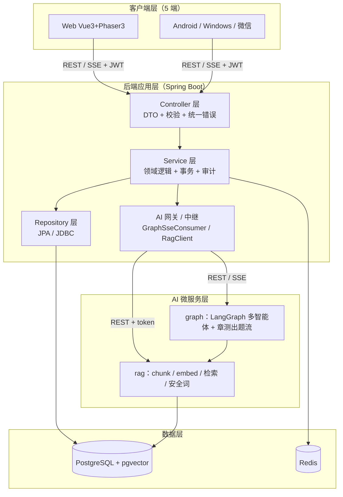

### 2.2 系统上下文与容器视图

系统边界、外部实体与容器（详见需求 §2.4）：后端 `:18080 /api` 为统一入口，graph `:18091`、rag `:18092` 为内部微服务，外部依赖为 LLM Provider（讯飞 Spark / OpenAI 兼容）与 B 站讲解视频检索。

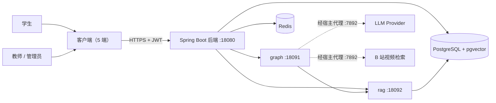

### 2.3 微服务拓扑与部署单元

部署为单宿主 Docker Compose 六服务（端口 / 镜像 / 健康检查以 `deploy/docker-compose.yml` 为准）：

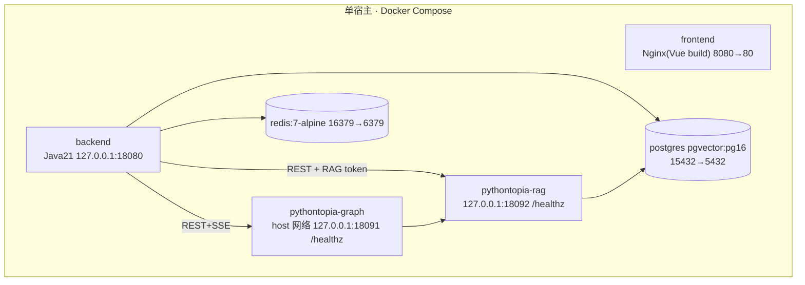

| 部署单元 | 运行时 | 端口 | 健康检查 | 关键说明 |
| --- | --- | --- | --- | --- |
| backend | Java 21 / Spring Boot | `127.0.0.1:18080` | `/api` 探活 | 业务权威 + AI 网关 |
| pythontopia-graph | Python 3.11 / FastAPI+LangGraph | `127.0.0.1:18091` | `/healthz` | host 网络以经代理访问外网；单 worker |
| pythontopia-rag | Python 3.11 / FastAPI+pgvector | `127.0.0.1:18092` | `/healthz` | RAG 检索；`X-Internal-Token` 保护重建 |
| postgres | `pgvector/pgvector:pg16` | `15432→5432` | `pg_isready` | 业务 + 向量 |
| redis | `redis:7-alpine` | `16379→6379` | `redis-cli ping` | 缓存 / 限流 / 状态 |
| frontend | Nginx 静态 | `8080→80` | 依赖 backend | Vue build 产物 |

### 2.4 技术栈选型与理由

| 层 | 选型 | 选型理由（设计权衡） |
| --- | --- | --- |
| 后端 | Java 21 + Spring Boot + Maven | 强类型 + 事务 + 生态成熟；承载业务权威与审计 |
| 持久化 | PostgreSQL 16 + pgvector | 单库同时承载业务关系数据与向量检索，降运维复杂度 |
| 缓存 / 限流 | Redis 7 | 看板 TTL 缓存、打点限频、NPC 寒暄缓存 |
| AI 编排 | FastAPI + LangGraph | 图式编排多智能体，结构化节点 + 可追踪轨迹 |
| 向量检索 | pgvector + 自研 chunk/embed | 与业务库同源，证据页可直接回链 |
| Web 前端 | Vue 3 + Vite + TS strict + Pinia | 强类型组件化；游戏外学习内容可读可引用 |
| 游戏渲染 | Phaser 3（单 Game 实例） | 像素小镇渲染，adapter 层隔离动态对象 |
| 前端判题预览 | Pyodide（WASM） | 浏览器内即时预览，零往返；不作正式判分 |
| LLM | 讯飞 Spark / OpenAI 兼容 / dryrun | provider 可切换，缺凭据自动降级不阻塞 |

## 3 设计原则与规范

### 3.1 设计原则（↔ 需求 §4 NFR）

| 编号 | 原则 | 对应 NFR |
| --- | --- | --- |
| DP-01 | **业务权威在后端**：星级 / 判分 / 接地 / 路径全由后端裁定，客户端只读 + 打点 | §3.6、§4.2 |
| DP-02 | **可信优先**：所有 AI 生成证据锚定 + 末端三审 + fail-fast，不静默降级 | §4.3 |
| DP-03 | **真实落库**：正式判题 / 章测 / 星级 / 画像修订入库，Pyodide 预览不入正式表 | §4.2 |
| DP-04 | **解耦削峰**：重 LLM 路径（章测）预生成 + 异步队列 + 信号量，考试期零 LLM | §4.1 |
| DP-05 | **幂等与不变量**：打点 / 星级 / 补星幂等、只升不降、可审计 | §3.6.4 |
| DP-06 | **契约单一权威**：多端以 `api-contract.md` 为准，能力收敛一致 | §4.6 |
| DP-07 | **轻量可观测**：审计即可观测 + 决策玻璃盒，不上重型监控栈 | §4.8 |

### 3.2 设计规范（↔ AGENTS.md / 需求 §2.3）

- 后端：类 `PascalCase`、方法 / 变量 `camelCase`、常量 `UPPER_SNAKE_CASE`；表 / 字段 `snake_case`；REST 用资源名非动作路径；新增 API 必有 DTO + 校验 + 统一错误 + 测试；迁移说明目的 / 影响 / 不可逆风险。
- Python：`snake_case` 文件 / 函数、`PascalCase` 类；Agent 输出结构化（Pydantic）、fail-fast、不启 ReAct、单 worker。
- 前端：TS strict、业务层禁 `any`、Phaser / 第三方动态对象隔离 adapter 层；组件 `PascalCase.vue`、工具 `camelCase.ts`；单 `Phaser.Game` 实例。

## 4 模块划分与职责

后端按领域分包；详细设计将这些包聚合为**子系统**（§10–§18），并与需求功能模块（§3.3–§3.19）一一对应。

| 后端包 `com.pythontopia.*` | 职责 | 需求模块 | 详细设计 |
| --- | --- | --- | --- |
| `auth` | 注册 / 登录 / 续签 / 角色鉴权 | §3.3 | §10 |
| `learner.profile` | 8 维画像 / 访谈 / 自评 / 被动更新 | §3.4 | §10 |
| `world`、`npc`、`dialog` | 小镇启动 / 存档 / 技能 / 日历 / NPC 对话与寒暄 | §3.5、§3.17 | §11 |
| `mainline` | 关卡地图 / Stage 三件套 / 章末大测试 / 星级 / 无尽 | §3.6、§3.12 | §12 |
| `coursepack`、`rag`、`tutor` | 课件资产 / RAG 检索 / 导师答疑 | §3.7、§3.8 | §13 |
| `workshop`、`intent`、`orchestrator`、`agent` | 资源工坊 / 意图路由 / 学习总管编排 | §3.9、§3.18 | §14 |
| `submission`、`bugmine` | 训练场判题 / Bug 矿洞 / 遗忘回声 | §3.10、§3.11 | §15 |
| `learner.evaluation`、`feynman`、`learner.path` | 复盘评估 / 费曼自测 / 学习路径 | §3.13、§3.14 | §16 |
| `learner.quest`、`classroom` | 任务公告板 / 班级 / 教师看板 | §3.15、§3.16 | §17 |
| `media`、`video` | 多模态生成（TTS/TTI）/ B 站视频检索 | §3.7/§3.9 支撑 | §13/§14 |
| `common` | 统一错误信封 / 鉴权过滤 / 配置 | 横切 | §5 |

模块依赖（顶层，与需求 §3.2 功能框架一致）：

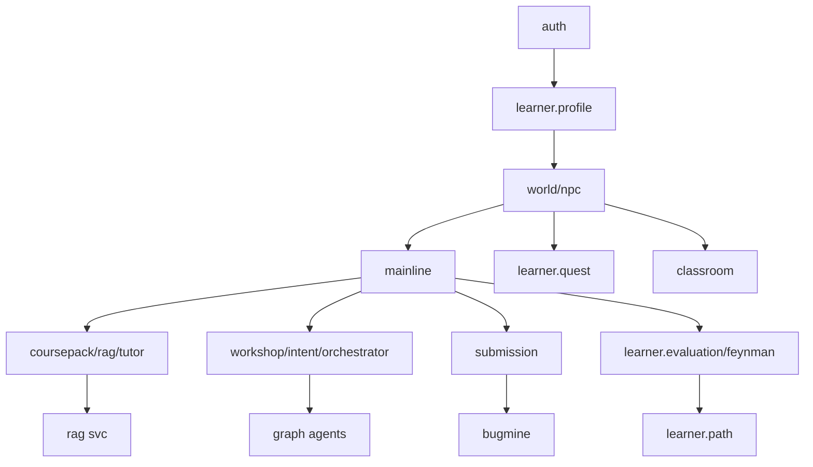

## 5 通用机制设计

### 5.1 请求处理与鉴权

统一请求链路：客户端带 `Authorization: Bearer <jwt>` → `JwtAuthenticationFilter` 解析 claims（userId / role）→ 方法级角色校验（多数学习端点仅 `STUDENT`）→ Controller 参数校验（Bean Validation）→ Service 事务执行 → DTO 返回。

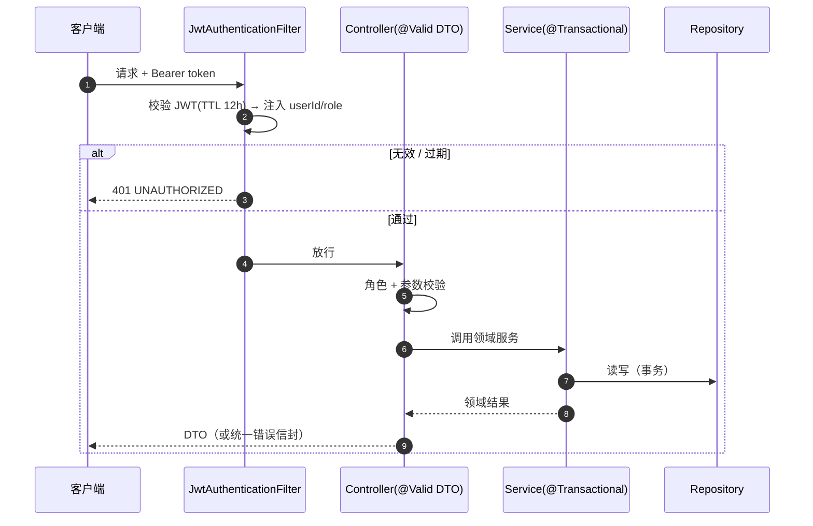

### 5.2 统一错误信封

全局异常处理（`@RestControllerAdvice`）将业务异常与校验失败映射为统一信封，HTTP 状态码与 `code` 对应：

```jsonc
{ "code": "FORBIDDEN", "message": "仅学生可访问公告板任务",
  "details": [], "traceId": "", "timestamp": "2026-06-05T13:39:00Z" }
```

设计约定：`code` 机器可读分支处理（如 `BAD_CREDENTIALS` / `CHAPTER_TEST_OVERTIME` / `BUG_MINE_DEPTH_LOCKED` / `EVIDENCE_REQUIRED`），`message` 兜底展示，`details[]` 列字段级校验明细。

### 5.3 AI 网关与 SSE 中继

后端不直接持有 LLM 凭据用于业务对话，而是经网关把请求转发到 graph，并由 `GraphSseConsumer` 把 graph 的事件帧（`plan / trace / token / result / error`）**原样回放**给客户端。中继统一用 HTTP/1.1（避免 h2c 升级被拒）。

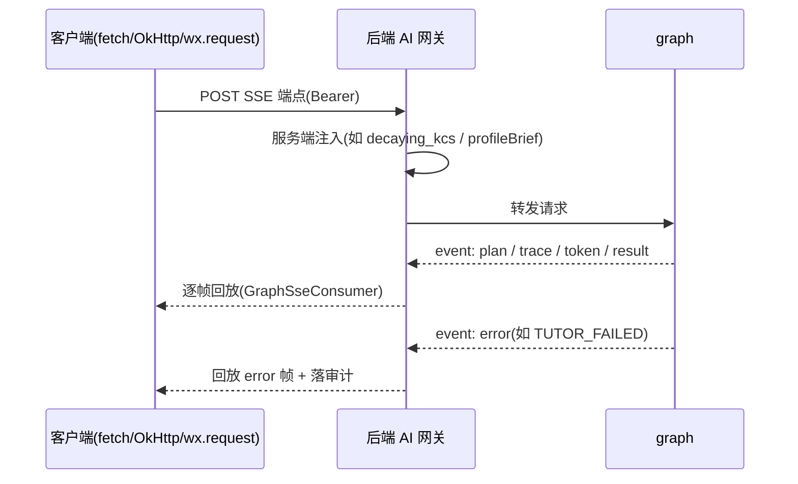

### 5.4 审计与出错处理

- **生成审计**：所有 AI 生成写 `resource_run`（agent / 证据页 / safety / grounding / `graph_trace` / `correlation_id`），见 §21。
- **fail-fast**：Agent 故障、接地失败（数字 / KC 未现于证据）直接报错，不静默降级成普通聊天。
- **降级（仅限非教学权威路径）**：NPC 寒暄 / 记忆 / 编排取数失败 → 降级为空 / 脚本对话、不阻断；LLM 不可用 → dryrun / golden 兜底。

---

# 第二部分　数据库设计（Database Design）

## 6 标识符与建模规范

- 表名 / 字段名一律 `snake_case`；主键 `id`（bigint）；外键 `<entity>_id`；时间字段 `*_at`（`timestamptz`，ISO-8601）。
- KC 编码 `PY43-KC-NNN` 全局稳定（slug 不可改）；课程包 `packId=43` 固定。
- 迁移由 Flyway 管理（现状 V001–V160），文件须说明目的 / 影响表 / 不可逆风险；RPG 存档表无前缀（V100–V110）。
- **快照 + 事件**双写：掌握度 / 星级等可演化量采用「快照表（当前值）+ 事件表（每次变更追加）」模式，保证可审计、可回溯。
- 8 维画像采用 `JSONB`（`learner_profile.dimensions`）统一聚合，避免维度增减触发频繁迁移。

## 7 概念数据模型（核心 ER）

聚焦核心教学闭环实体（字段为概念级，实际以迁移为准）：

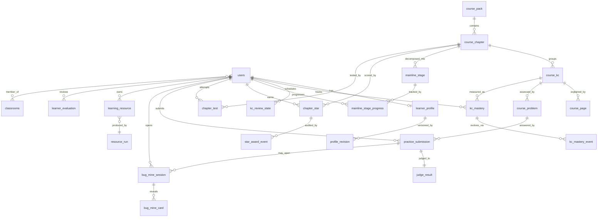

## 8 关键表结构字典（节选）

| 表 | 关键字段 | 约束 / 设计说明 |
| --- | --- | --- |
| `users` | id, username(唯一), password_hash, role | role ∈ {STUDENT,TEACHER,ADMIN}；无独立 roles 表 |
| `learner_profile` | user_id, dimensions(JSONB), narrative_summary | 8 维统一聚合（英文 snake_case key） |
| `profile_revision` | profile_id, source, summary, created_at | 画像每次主动 / 被动更新追加修订 |
| `course_pack` | id=43, name, *_count | 计数验收 7/561/7/65/46/39 |
| `course_kc` | code(PY43-KC-NNN), chapter_id, name, prerequisite_codes | code 稳定；前置依赖列（V125 seed） |
| `kc_mastery` | user_id, kc_code, mastery_score[0,1], confidence[0,1], last_event_at | 一学生一 KC 一行快照（UNIQUE） |
| `kc_mastery_event` | kc_mastery_id, source, delta, created_at | 每次更新必追加事件，禁只改快照 |
| `kc_review_state` | user_id, kc_code, D, S, R, due_at, reps, lapses | FSRS-lite 状态（V133 由 kc_mastery 回填） |
| `mainline_stage` | chapter, stage_index, kc_codes[], video_keyword, courseware_page_ids[], example_problem_ids[], required_* | 静态定义，UNIQUE(chapter,stage_index) |
| `mainline_stage_progress` | user_id, stage_id, video_watched_sec, pages_read[], examples_done[], completed_at | UNIQUE(user_id,stage_id)，幂等打点 |
| `chapter_star` | user_id, chapter, stars[0,3], best_test_score, breakdown(JSONB) | **唯一权威**，只升不降，UNIQUE(user_id,chapter) |
| `star_award_event` | user_id, chapter, delta, source, reason | 审计；source ∈ {TEST,STAGE_COMPLETE,MASTERY,ERRORBOOK_RECOVERY,ENDLESS_RECOVERY,ADMIN} |
| `chapter_test` | user_id, chapter, status, attempt_no, questions(JSONB), profile_snapshot, generator_meta, time_limit_sec, score, detail, integrity | questions 持答案 / 解析 / 证据，**绝不下发答案** |
| `practice_submission` | user_id, problem_id, code, source, status | source ∈ {TRAINING,PATH_QUEST,BUG_MINE_*,CLASSROOM} |
| `judge_result` | submission_id, verdict, passed_cases, total_cases, failure_reason | verdict ∈ {AC,WA,RE,TLE,CE,MLE,SYSTEM_ERROR} |
| `bug_mine_session` / `bug_mine_card` | user_id, submission_id, depth_layer(L1–L5), status | status ∈ {OPEN,RESOLVED,ABANDONED} |
| `learning_resource` | user_id, type, kc_codes[], content_format, content, evidence_page_ids[] | type ∈ 6 类；format ∈ {MARKDOWN,MERMAID,STRUCT_JSON} |
| `resource_run` | agent_name, scenario, input_summary, output_artifact, evidence_page_ids, safety_result, grounding_result, status, correlation_id, graph_trace, created_at | 生成审计（AGENTS.md 硬要求） |
| `learner_evaluation` / `learner_evaluation_metric` | user_id, narrative_md, draft_path / metric_key, value | 复盘评估 + 6 指标 |
| `quest` / `quest_progress` | user_id, source, kc_code, required_evidence_type, status | 任务 + evidence 校验 |
| `classrooms` / `classroom_members` / `classroom_quest` / `classroom_kc_snapshot` | join_code, ... | 轻量班级 + 看板快照 |
| `npc_memory` / `npc_persona` | user_id, npc_key, summary | NPC 记忆寒暄 |
| `feynman_session` / `feynman_turn` | user_id, kc_code, problem_link | 费曼自测（V153 题目关联列） |

> 生成图占位（完整物理 ER 大图，**非截图**）：用 Graphviz / dbdiagram 从 Flyway 迁移 schema 出全量 60+ 表 ER（含 world / skill / save_slot / learning_path 等）；本文正文给核心闭环 ER + 字段字典。

## 9 数据完整性、迁移与初始化

**数据完整性不变约束（设计级断言）**

| 编号 | 约束 |
| --- | --- |
| DI-01 | `mastery_score` / `confidence ∈ [0,1]`，delta 应用后裁剪到合法区间 |
| DI-02 | 一学生一 KC 仅一行 `kc_mastery` 快照；每次更新必追加 `kc_mastery_event` |
| DI-03 | `chapter_star.stars ∈ [0,3]`，只升不降、幂等；变更必写 `star_award_event` |
| DI-04 | `mainline_stage_progress` 三件套打点幂等（UPSERT + 服务端限频） |
| DI-05 | `chapter_test.questions` 持答案，但对客户端任何响应都不下发答案；解析仅提交后返回 |
| DI-06 | 资源生成必写 `resource_run` 审计字段（agent / evidence / safety / grounding / time） |
| DI-07 | 任务完成必须有 evidence（submission / resource / page-read / mastery delta） |
| DI-08 | `target_kc_codes` / `frequent_kc_codes` 必须存在于 packId=43 |

**迁移与初始化**

- Flyway 迁移 V001–V160 顺序执行；R-15 主线域为 V156/V157，画像前置依赖 V125，FSRS 状态 V133。
- 课程种子内置 `data/course-pack-43/`，空库初始化后计数验收 **7/561/7/65/46/39**（`deploy/scripts/init_db.sh`）。
- RAG 向量索引由 `deploy/scripts/init_rag_index.sh` 一次性构建。
- 踩坑：数据卷历史密码与 `deploy/.env` 不一致会致 Flyway 失败（见 `docs/operations/dev-startup.md`）。

---

# 第三部分　详细设计（Detailed Design）

> 详细设计以**子系统**为单位组织，每个子系统聚合若干需求功能模块（§3.x）。统一模板：**设计目标 → 组件与类设计 → 关键流程（时序 / 状态）→ 数据契约要点 → 设计取舍**。

## 10 账号与画像子系统

> 覆盖需求 §3.3 认证与账号、§3.4 学习画像。后端包 `auth`、`learner.profile`；graph `profile_agent`。

### 10.1 设计目标

无状态鉴权 + 角色访问控制；画像**可持续演化**（主动访谈 + 被动行为），驱动全系统个性化；画像写入须接地校验，**接地失败不写库**。

### 10.2 组件与类设计

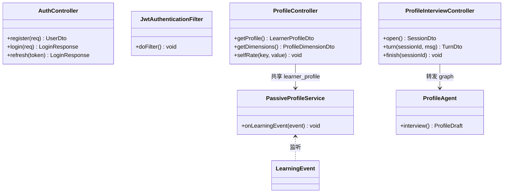

### 10.3 关键流程（画像访谈落库）

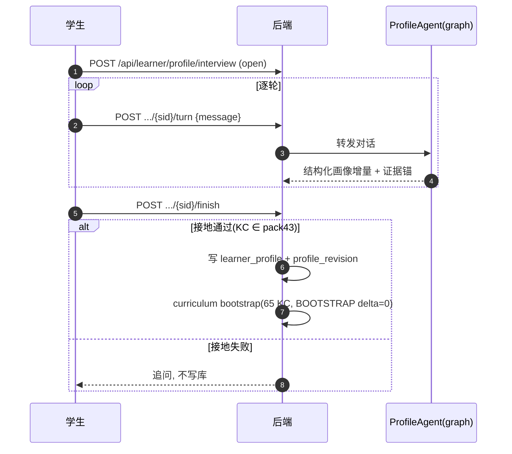

### 10.4 数据契约要点

- 登录 → `LoginResponse{token, expiresAt, user}`；TTL 720 分钟；无独立 refresh token（refresh 须带未过期 token）。
- 维度 `ProfileDimensionDto{key,label,score(0..1),confidence=min(1,evidence/8),selfEditable,tags[]}`。
- 被动更新：`PassiveProfileService` 监听 `LearningEvent`（练习 / 判题 / 调试 / 资源反馈 / 任务 / 班级），写 `profile_revision`。

### 10.5 设计取舍

- 8 维用 `JSONB` 而非 8 张表：维度可增减不触发迁移，代价是查询需 JSON 路径（演示规模可接受）。
- 自评仅限 4 主观维度：客观维度由行为信号推导，防学生「刷画像」骗个性化。

## 11 小镇世界与 NPC 子系统

> 覆盖需求 §3.5 中央小镇与世界状态、§3.17 NPC 记忆个性化。后端包 `world`、`npc`、`dialog`；graph `npc_dialog_agent`。

### 11.1 设计目标

**单次聚合启动**减少往返；像素小镇 `town_hub` 单 Phaser 实例渲染；NPC 寒暄记忆感知 + 画像驱动，**agent 失败降级不伪造**。

### 11.2 组件与类设计

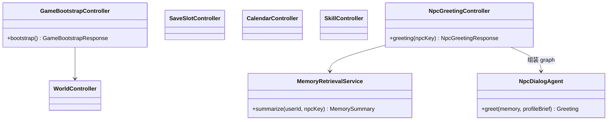

### 11.3 关键流程（聚合启动 + NPC 寒暄降级）

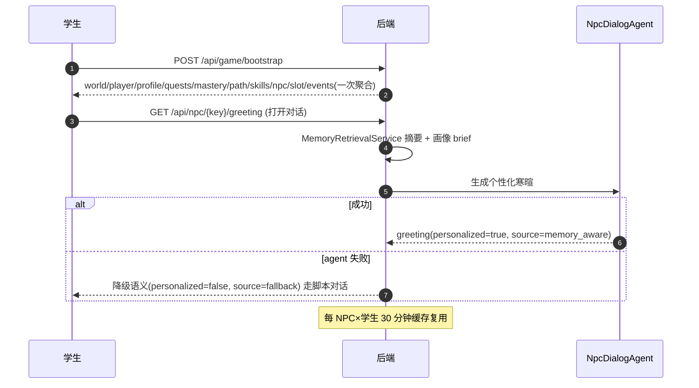

### 11.4 数据契约与设计取舍

- `GameBootstrapResponse` 聚合 10 字段（world/player/profile/quests/mastery/path/skills/npcStates/activeSlot/pendingEvents）；响应**不含** currency/inventory。
- NPC 寒暄缓存 30 分钟（基于 `npc_memory`）；agent 失败**不抛业务码**、返回降级、不阻断。
- 取舍：bootstrap 聚合换「少往返、首屏快」，代价是单端点 payload 较大（需 CTE 单查询，见 §22）。

## 12 主线冒险子系统

> 覆盖需求 §3.6 主线冒险（看 / 学 / 练 / 测）、§3.12 无尽模式。后端包 `mainline`；graph `paper_pipeline`（`paper_designer` / `paper_reviews` / `paper_golden`）。**R-15 核心子系统**。

### 12.1 设计目标

主线进度**后端权威**（旧前端 mainQuest 存档废弃）；章末大测试**画像驱动预生成 + 考试期零 LLM**；星级 0–3★ **幂等、只升不降、单一权威**。

### 12.2 组件与类设计

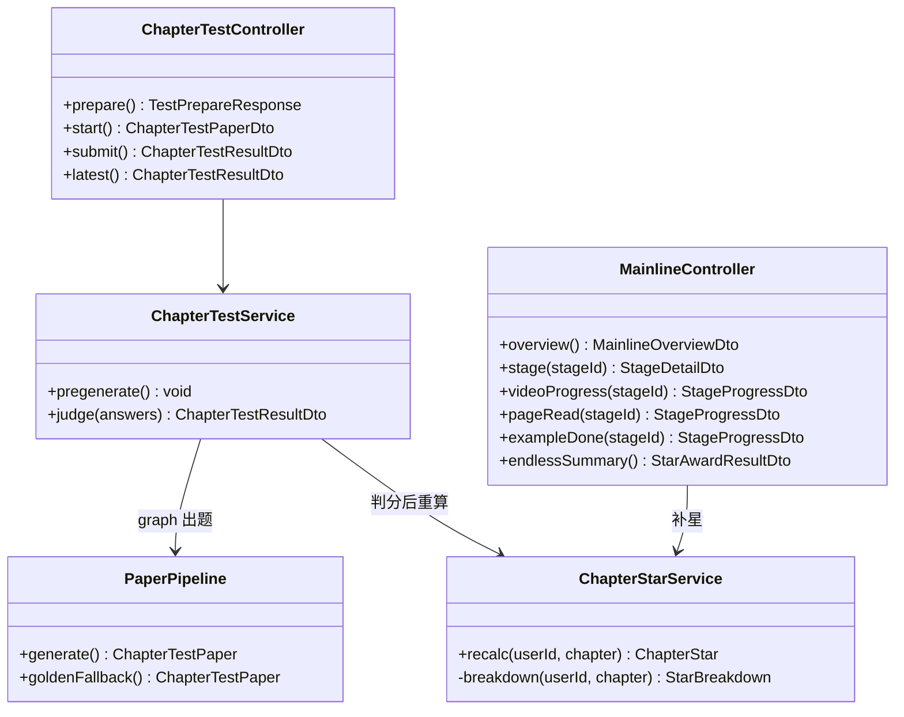

### 12.3 关键流程（章末大测试：预生成 + 零 LLM 考试）

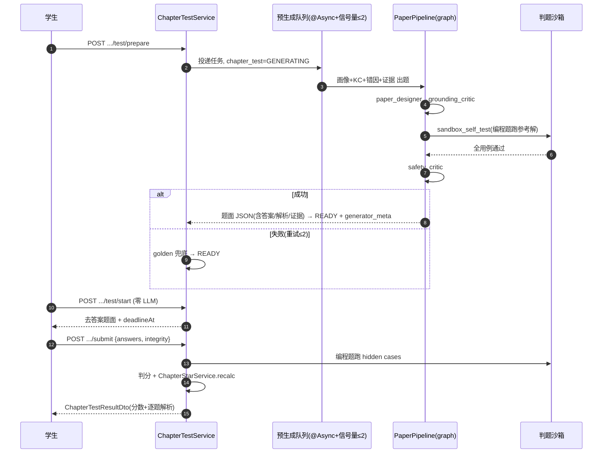

章末大测试状态机与星级演化（与需求 §3.1 一致）：

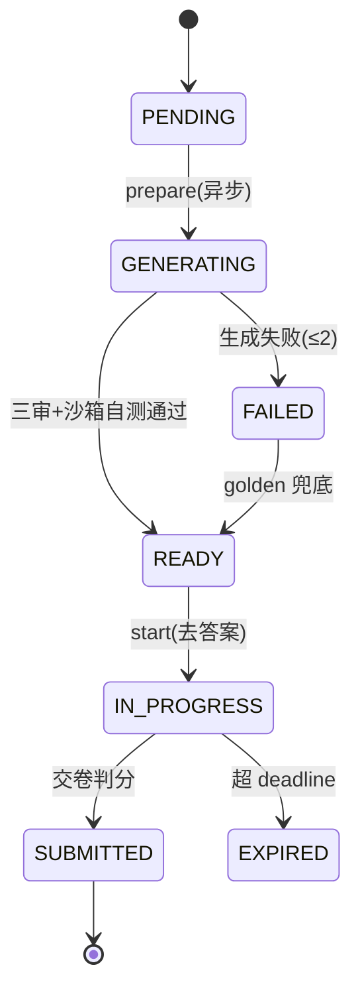

### 12.4 三件套打点与无尽补星

- 三件套：`video-progress`（限频单次 ≤120s / 每分钟 ≤2 次、可见才计）、`page-read`（幂等）、`example-done`（带 submissionId 须本人 PASSED）；全过线置 `completed_at`。
- 无尽补星：`POST /api/mainline/endless/summary` → `ENDLESS_RECOVERY`（单轮 ≥8 对且 ≥80% +1，每日每章至多 1 次）。

### 12.5 设计取舍

- **预生成解耦**：把「贵且慢」的 LLM 出题与「快且稳」的考试分离，是兼顾个性化与考试体验的关键设计（DP-04）。
- **golden 兜底**：宁可发人工题组也不在考试时阻塞或出烂题。
- **星级单一权威 + 审计**：`ChapterStarService.recalc` 统一收口，杜绝多处写星导致的不一致。

## 13 课程资产与 RAG 答疑子系统

> 覆盖需求 §3.7 课程包与课件资产、§3.8 导师答疑与课件问答。后端包 `coursepack`、`rag`、`tutor`；微服务 `pythontopia-rag`（`chunk` / `embed` / `index` / `safety`）；graph `tutor_agent`。

### 13.1 设计目标

课程资产**只读、匿名可读**；答疑**证据锚定、绝不编造引用、防泄答**；RAG 与业务库同源以支持证据页可点击回链。

### 13.2 组件与类设计

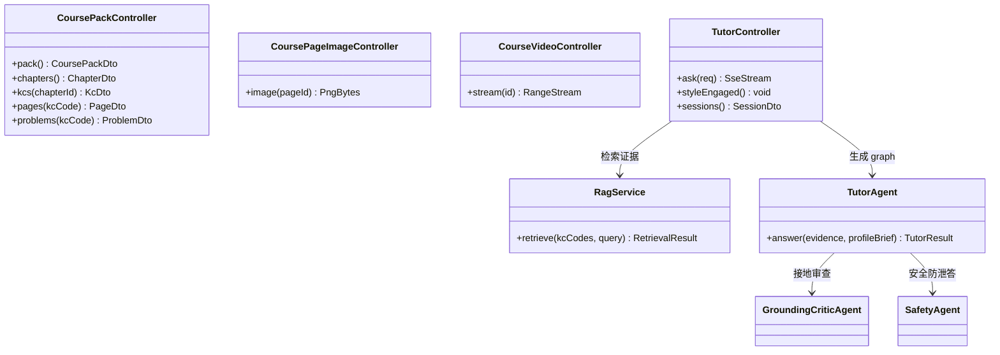

### 13.3 关键流程（RAG 答疑防幻觉）

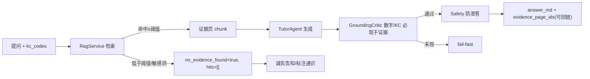

### 13.4 数据契约与设计取舍

- 课程只读端点 `/api/course/**` 匿名；视频 Range（`206` + `Content-Range`）；证据图 `image/png` 缓存 24h。
- 答疑 SSE `result` 帧含 `evidence_page_ids` + `grounding/safety` 状态；`page_id → (docId,pageNo)` 回链。
- 取舍：RAG 嵌入默认 `hash` embedder（`PYT_RAG_EMBEDDER`，演示可用、可换真实嵌入）；与业务库共用 PostgreSQL+pgvector，省去独立向量库运维。

## 14 资源工坊与多智能体编排子系统

> 覆盖需求 §3.9 资源工坊、§3.18 多智能体编排与防幻觉。后端包 `workshop`、`intent`、`orchestrator`、`agent`；graph `agents/*`（11 默认 + 扩展）。

### 14.1 设计目标

一句话**意图路由**分派；六类资源生成**结构化 + 末端三审 + 全链路审计**；学习总管编排看 / 学 / 练 / 测并**服务端注入** FSRS 到期 KC；Agent fail-fast、不启 ReAct、单 worker。

### 14.2 组件与类设计（graph Agent 全景）

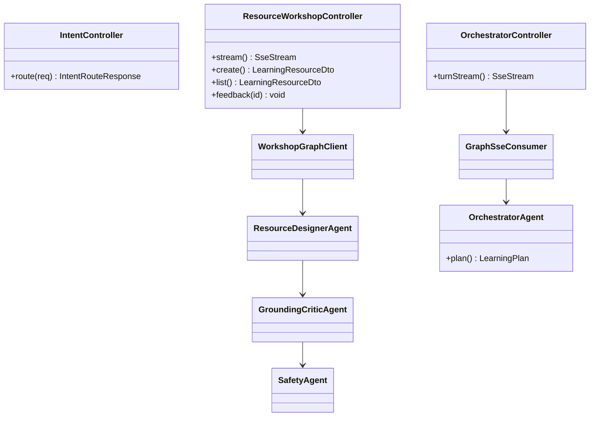

graph 真实 Agent 文件（`pythontopia_graph/agents`）：`profile_agent` / `curriculum_mapper_agent` / `resource_designer`（handout / mind_map / practice / code_lab / reading / storyboard）/ `path_planner_agent` / `debug_agent` / `evaluation_narrative_agent` / `orchestrator_agent` / `intent_router_agent` / `npc_dialog_agent` / `tutor_agent` / `feynman_tutee_agent` / `reflection_agent` / `video_insight_agent` / `paper_*`（章测流水线）/ `boss`。

### 14.3 关键流程（意图路由 + 工坊生成）

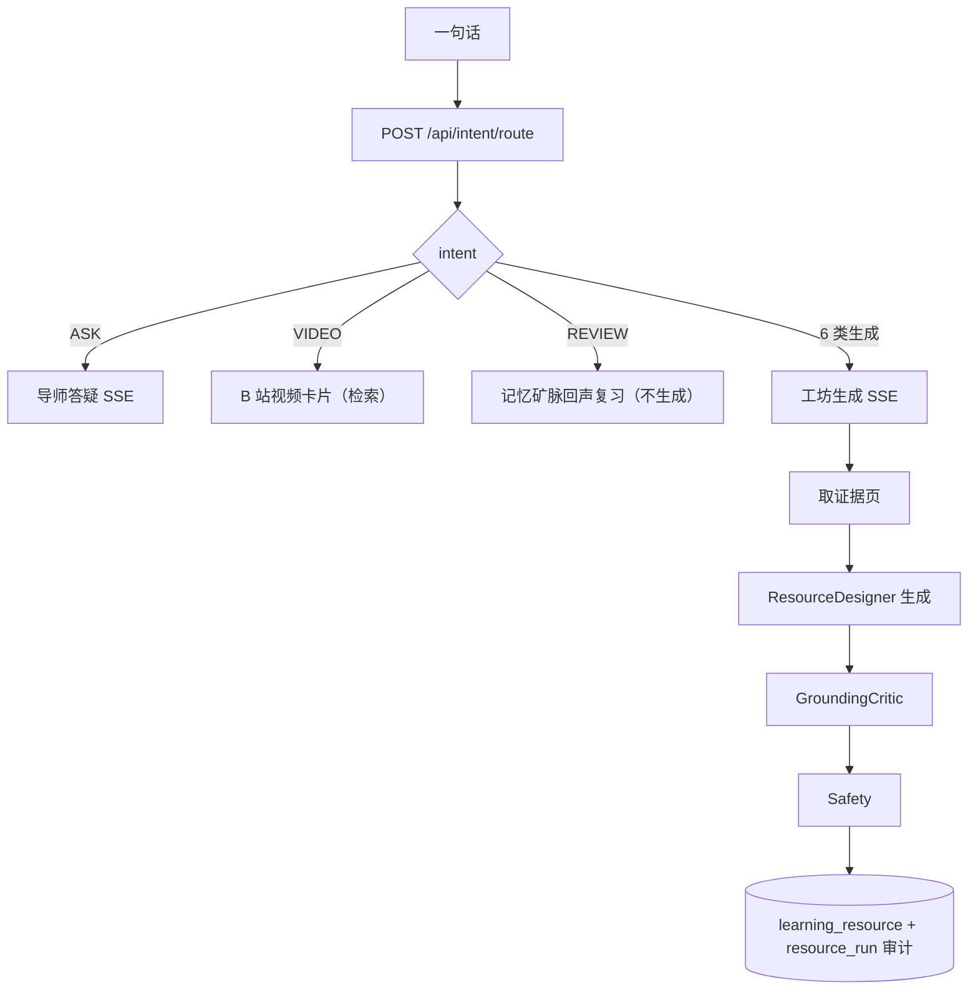

### 14.4 数据契约与设计取舍

- `LearningResourceDto{type ∈ 6 类, contentFormat ∈ MARKDOWN/MERMAID/STRUCT_JSON, evidencePageIds[], safetyStatus, groundingStatus}`。
- 学习总管：后端注入 `decaying_kcs`（前 5，来自 `BugMineService`），客户端不上送；取数失败降级为空。
- 审计：每次生成写 `resource_run`（含 `graph_trace` / `correlation_id`）。
- 取舍：教师禁止生成资源（仅 STUDENT）；Agent 故障 fail-fast（不降级普通聊天、不启 ReAct）——以可信换「偶尔不可用」，符合 DP-02。

## 15 训练场判题与 Bug 矿洞子系统

> 覆盖需求 §3.10 训练场与判题、§3.11 Bug 矿洞与遗忘回声。后端包 `submission`、`bugmine`；graph `debug_agent`。

### 15.1 设计目标

**双轨执行**（Pyodide 预览 + 服务端沙箱正式判题）；隐藏用例不下发；失败提交沉淀为分层调试学习；遗忘由 FSRS-lite 科学召回。

### 15.2 组件与类设计

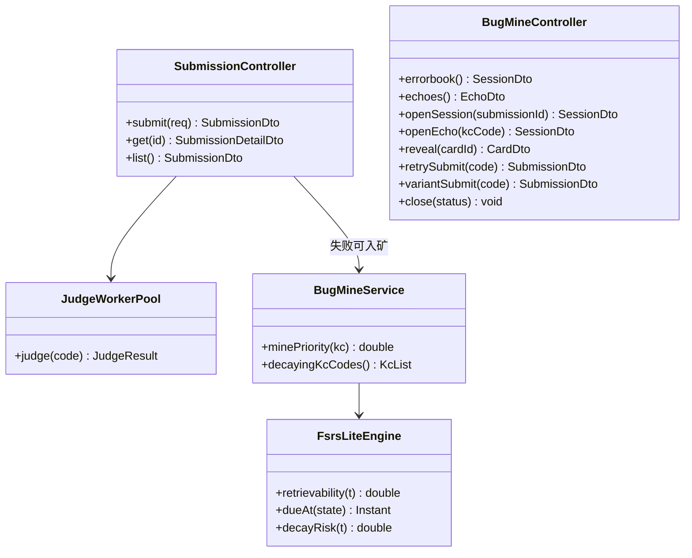

### 15.3 关键流程与状态

提交判题状态机：

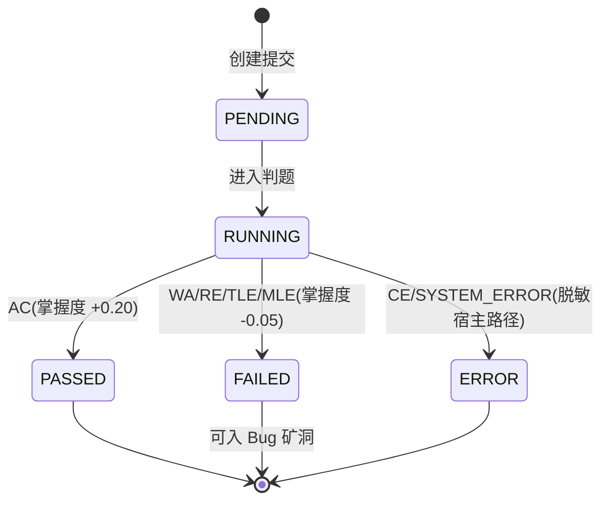

Bug 矿洞分层揭示：`L1(默认)→L2→L3→L4→L5(同 KC 变式)`，逐层 reveal 不一次给答案；`retry-submit` / `variant-submit` 通过则 `RESOLVED`（掌握度 `DEBUG_FIX +0.15`），本章 `RESOLVED≥3` 触发错题复盘补星（§12）。遗忘回声仅召回 FSRS 到期（`now>due_at`）且 `mastery≥0.45` 的 KC，写真实 `practice_submission(source=BUG_MINE_ECHO)`。

### 15.4 设计取舍

- Pyodide 结果**绝不**写正式判题表；隐藏用例**绝不**下发（`/public` 去用例）——真实与可信的硬边界。
- 入矿优先级与回声门槛全由后端算、前端只展示，避免客户端篡改学习优先级。

## 16 评估 / 复盘 / 费曼 / 路径子系统

> 覆盖需求 §3.13 复盘 / 费曼 / 评估、§3.14 学习路径规划。后端包 `learner.evaluation`、`feynman`、`learner.path`；graph `evaluation_narrative_agent` / `feynman_tutee_agent` / `path_planner_agent` / `reflection_agent`。

### 16.1 设计目标

周期评估**聚合客观指标 + 接地叙事**，并产出 DRAFT 路径供学生接受重排；费曼自测让学生「讲给 AI 学弟」、AI 接地课件提问；同一学生**仅一条 ACTIVE 路径**。

### 16.2 组件与关键流程

```mermaid
sequenceDiagram
  autonumber
  participant Stu as 学生
  participant BE as LearnerEvaluationService
  participant GP as EvaluationNarrativeAgent
  participant PP as PathPlannerAgent
  Stu->>BE: POST /api/learner/evaluations
  BE->>BE: 聚合 6 指标(resolve_rate/mastery_delta/...)
  BE->>GP: 生成 narrative_md
  GP-->>BE: narrative + grounding(数字/KC 必现于 metrics)
  BE->>PP: planDraft(userId)
  PP-->>BE: DRAFT 路径(经 GroundingCritic)
  BE->>BE: 写 learner_evaluation + 6 metric + EVALUATION 修订
  BE-->>Stu: EvaluationDto(含 draftPath)
  Stu->>BE: POST .../{id}/accept-new-path
  BE->>BE: 归档旧 ACTIVE + 重排 quest(promoteDraft)
```

- 费曼：`POST /api/feynman/sessions {kcCode}` → `.../teach {explanation}` → `.../judge`；`feynman_tutee_agent` 基于课件证据追问、不伪造；逐轮落 `feynman_turn`。
- 路径：`PathPlannerAgent` 输入 8 维画像 + `kc_mastery` + `course_kc.prerequisite_codes`，产出有序 KC 路径（DRAFT / ACTIVE）。

### 16.3 设计取舍

- 评估叙事 fail-fast（`EVALUATION_NARRATIVE_GROUNDING_FAILED`）——叙事数字必须可溯源，宁可报错不编故事。
- DRAFT 不影响当前学习、ACTIVE 唯一——把「重排」做成学生显式接受的动作，避免路径无声突变。

## 17 任务 / 班级 / 教师看板子系统

> 覆盖需求 §3.15 任务与公告板、§3.16 轻量班级与教师看板。后端包 `learner.quest`、`classroom`（含 `dashboard`、`quest`、`remediation`、`live`）。

### 17.1 设计目标

任务完成**强 evidence 校验**；班级保持**轻量**（不做监控大屏 / 协作编码 / 复杂评分）；教师看板聚合查询 50 人 < 500ms（快照表 + TTL 缓存）。

### 17.2 组件与关键设计

```mermaid
classDiagram
  class QuestController {
    +today() QuestDto
    +list() QuestDto
    +start(id) QuestDto
    +complete(id) QuestDto
    +skip(id) QuestDto
  }
  class QuestService {
    +complete(id, evidence) QuestDto
  }
  class TeacherClassroomController {
    +createClassroom() ClassroomDto
    +publishQuest() ClassroomQuestDto
  }
  class TeacherDashboardController
  class MainlineDashboardController {
    +mainlineStars() DashboardDto
    +chapterTests() DashboardDto
    +endlessActivity() DashboardDto
    +mainlineProgress() DashboardDto
  }
  class ClassroomGuard {
    +assertOwnership(classroomId) void
  }
  QuestController --> QuestService
  TeacherDashboardController --> ClassroomGuard
  MainlineDashboardController --> ClassroomGuard
```

- 任务状态机 `OPEN → IN_PROGRESS → COMPLETED`（或 `SKIPPED` / `EXPIRED`）；`complete` 须提供与 `requiredEvidenceType` 匹配的证据（submission 须本人 PASSED）。
- 教师看板四类（`mainline-stars` / `chapter-tests` / `endless-activity` / `mainline-progress`）：JDBC 聚合 + `classroom_kc_snapshot` 快照表 + 5 分钟 TTL 缓存（EXPLAIN 验证）。

### 17.3 设计取舍

- evidence 强校验把「任务完成」与真实学习行为绑定，杜绝空刷任务推进路径。
- 看板用快照表 + 缓存而非实时大查询，换取 50 人聚合 < 500ms 与演示稳定（CON-OUT-06 拒绝实时监控大屏）。

> 截图占位（KC 掌握度热力图 / 章测分数箱线图）：
> - **网址**：`http://localhost:5173/teacher` →（进入某班级）`/teacher/classroom/{id}` 的「学情看板」
> - **操作**：用演示教师账号登录 → `/teacher` 选演示班级（seed 见 `deploy/scripts/seed_demo_classroom.sh`）→ 打开「KC 掌握度热力图」与「章测分数分布」面板 → 分别截取。
> - **数据来源**：`classroom_kc_snapshot`、`GET /api/teacher/classrooms/{id}/dashboard/chapter-tests`。

## 18 前端与多端接入设计

> 覆盖需求 §3.19 多端接入，以及 Web 前端（Vue 3 + Phaser 3）整体架构。前端目录 `frontend/src`。

### 18.1 Web 前端架构

```mermaid
flowchart TB
  subgraph Vue["Vue 3 应用层"]
    Pages["pages/*.vue（Login/World/MainlineMap/StageLearn/ChapterTest/Training/Workshop/ReviewHall/BugMine/Endless/Feynman/Teacher...）"]
    Stores["Pinia stores（world/mainline/arena/tutor/workshop*/feynman/skill/teacher/hud...）"]
    Api["api/*（DTO 强类型 client）"]
    Comp["components / composables"]
  end
  subgraph Game["Phaser 适配层（game/）"]
    Singleton["phaserGame.ts 单 Game 实例"]
    Canvas["WorldCanvas.vue"]
    Scenes["scenes/*（town_hub / ChapterMapScene）"]
    Adapters["adapters/*（隔离动态对象，禁 any 扩散）"]
    Core["core / config"]
  end
  Pages --> Stores --> Api
  Pages --> Canvas --> Singleton --> Scenes
  Scenes --> Adapters
  Api -->|/api/* + Bearer| BE["后端"]
```

设计约束：**单 `Phaser.Game` 实例**（`game/adapters/phaserGame.ts` 单例 + `WorldCanvas.vue`）；地图 Tiled JSON 由 `scripts/generate-maps.mjs` 程序化生成；输入 8 向（`ExtendedDirection`）写后端降 4 向（`toServerDirection`）；游戏画布之外的学习内容（课件 / 答疑 / 资源）用普通 DOM 渲染以保证可读、可复制、可引用。

### 18.2 多端接入设计

```mermaid
flowchart TB
  Web["Web Vue3+Phaser3"] --> BE["共享后端 :18080 /api（JWT Bearer）"]
  And["Android Compose+LibGDX"] --> BE
  Win["Windows WinUI3+MonoGame"] --> BE
  WxA["微信小程序(学习陪伴)"] --> BE
  WxG["微信小游戏(像素小镇)"] --> BE
  BE --> GP[graph]
  BE --> RG[rag]
  BE --> DB[(PostgreSQL)]
```

- 以 `docs/clients/api-contract.md` 为**唯一权威契约**；各原生 / 微信端**不复用** Web 端 Phaser / `tilemap.ts` / `frontend/src/api/*.ts`（语义一致、实现独立）。
- Base URL 按环境区分（Web/Win `localhost:18080`、Android 模拟器 `10.0.2.2:18080`、微信线上备案 HTTPS 白名单）。
- SSE 跨端：Web `fetch`+`ReadableStream`、原生 OkHttp/HttpClient 流式按行、微信 `wx.request({enableChunked:true})`（`POST`+自定义头，原生 `EventSource` 不适用）。
- 能力收敛：无背包 / 货币 / 商店端点，各端不得建 UI。

> 截图占位（关键界面 UI 流序列）：登录后依次访问并各截一图（前端 Base：开发 `http://localhost:5173`、Docker `http://localhost:8080`）：登录 `/login` → 小镇 `/world` → 关卡地图 `/mainline-map` → Stage 学习页 `/mainline/stage/{stageId}` → 章测页 `/chapter-test/{chapter}` → 复盘大厅 `/review-hall`。历史截图见 `qa-screens/`。

---

# 第四部分　关键算法与横切设计

## 19 核心算法设计

> 全部为**确定性纯函数**（无随机、无 LLM），可单测可复现；权威实现见 `docs/mastery_formula.md` 与后端服务。

### 19.1 掌握度累积与置信度

```text
mastery_score(new) = clamp(mastery_score(old) + delta, 0.0, 1.0)
delta:  RESOURCE_READ +0.10 | PRACTICE_PASS +0.20 | PRACTICE_FAIL -0.05 | DEBUG_FIX +0.15 | BOOTSTRAP 0
confidence: ±0.05 / 事件, 读时 DECAY -0.02
维度 confidence = min(1, evidenceCount / 8);  < 0.3 视为信号不足, 不强断言
```

设计：快照（`kc_mastery`）+ 事件（`kc_mastery_event`）双写；delta 应用后裁剪到 `[0,1]`（DI-01）。

### 19.2 FSRS-lite 间隔复习引擎

```text
R(t) = (1 + FACTOR * t / S) ^ (-DECAY)        # DECAY=0.5, FACTOR≈0.2346
interval(S, 0.9) = S
due_at = last_review_at + interval(S, 0.9)     # now > due_at 即到期
decay_risk = 1 - R
```

设计：以「可提取性 R」驱动复习时机，替代「固定 14 天」拍脑袋规则；状态落 `kc_review_state`（D / S / R / due_at / reps / lapses）。

### 19.3 Bug 矿洞入矿优先级与遗忘回声

```text
mine_priority = 0.35*(1-mastery) + 0.20*decay_risk + 0.20*recent_fail + 0.15*profile_hit + 0.10*(1-confidence)
echo_priority = 0.45*decay_risk + 0.25*(1-confidence) + 0.20*(1-mastery) + 0.10
recent_fail: 失败 24h 内 = 1, 到 7 天线性降 0
回声门槛: now > due_at 且 mastery_score >= 0.45 且 同 KC 无未关闭 session
```

### 19.4 章节星级（chapter_star，0–3★）

```text
1★: 章测最高分 >= 60
2★: 1★ 且 本章全部 Stage 三件套过线
3★: 2★ 且 (本章 KC 平均掌握 >= 0.80 且 章测最高分 >= 85)
补星: 错题复盘(RESOLVED>=3) +1 | 无尽(单轮>=8对且>=80%) +1
约束: 每章每途径<=1, 封顶 3★, 幂等, 只升不降, 变更必写 star_award_event
```

## 20 安全与防幻觉设计

| 设计点 | 实现 | 对应需求 |
| --- | --- | --- |
| 鉴权授权 | 无状态 JWT（TTL 12h）+ 方法级角色校验；学习端点多数仅 STUDENT，越权 403 | §4.2 |
| 判题沙箱 | subprocess 隔离 + 静态检查 + 限频 + 资源限制；失败脱敏宿主路径 | §4.2 |
| 不泄密 | 隐藏用例 / 章测答案 / 解析不下发；公开题视图去用例 | §4.2 |
| 防泄答护栏 | 答疑 / 导学在练习 / 考试语境只给思路（`SAFETY_KEYWORDS` + prompt） | §4.3 |
| 防幻觉三审 | RAG 证据锚定 → GroundingCritic（数字 / KC 必现于证据）→ Safety；不达标 fail-fast | §4.3 |
| 无证据诚实 | 命中不足 / 敏感词 → `no_evidence_found`，标注通识或告知未找到，绝不编造引用 | §4.3 |
| 内部服务保护 | RAG 重建端点 `X-Internal-Token`；backend / rag 仅监听 `127.0.0.1` | §4.2 |

防幻觉三审是**贯穿设计**：资源 / 画像 / 路径 / debug / 评估 / 章测出题的生成末端统一接 `GroundingCritic + Safety`。

## 21 可观测性设计

走「**审计即可观测 + 面向用户可解释**」轻量路线（不引入 Prometheus / Grafana / Jaeger / APM）：

```mermaid
flowchart LR
  Gen["AI 生成（资源/章测/评估/画像）"] --> RR[(resource_run<br/>agent/evidence/safety/grounding/graph_trace/correlation_id)]
  Gen --> CT[chapter_test.generator_meta]
  Star[星级变更] --> SAE[(star_award_event<br/>source/reason)]
  RR --> Glass[决策玻璃盒 DecisionTraceService<br/>最近≤50 条 → 人话结论 + 证据页链]
  Health[healthz / pg_isready / redis ping] --> Ops[六服务起停可观测]
  SSE[编排/工坊/答疑/章测 SSE 阶段事件] --> UI[前端可见进度 + error 帧]
```

- 跨服务以 `correlation_id` 贯穿，graph 节点轨迹落 `resource_run.graph_trace`（JSON）。
- 边界：当前为应用层结构化日志，**不接入**集中式日志 / 指标时序库 / 分布式追踪（CON-OUT-10）。

## 22 性能与并发设计

| 关键路径 | 设计 | 目标 |
| --- | --- | --- |
| `GET /api/mainline/overview` | 单查询 CTE 聚合避免 N+1 | < 200ms |
| 教师看板（50 人） | 索引 + `classroom_kc_snapshot` 快照 + 5 分钟 TTL 缓存 | < 500ms |
| 章末考试 | 预生成解耦，start 永不等 LLM | 考试期零 LLM |
| 章测预生成 | `@Async` + 信号量并发默认 2（`pythontopia.mainline.pregen-concurrency`）+ `@Scheduled` 补偿 | 不超并发、不丢任务 |
| 判题 | `JudgeWorkerPool` 并发上限；客户端 1s 轮询 + 退避 | 稳定不打满 |
| 「看」打点 | 前端 10s 批量上报；服务端单行 UPSERT + 限频（单次 ≤120s、每分钟 ≤2） | 降高频写压 |
| graph / rag | 默认单 worker，靠队列削峰；无尽题面预生成池只取不生成 | 进程内状态不错乱 |

---

# 第五部分　可追踪性

## 23 需求 ↔ 设计可追踪性矩阵

| 需求模块 | 需求章节 | 设计落点 | 关键数据 / 算法 |
| --- | --- | --- | --- |
| 认证与账号 | §3.3 | §10 | `users`；JWT 过滤器 |
| 学习画像 | §3.4 | §10 | `learner_profile(JSONB)`；置信度 §19.1 |
| 小镇与世界状态 | §3.5 | §11 | `GameBootstrapResponse` 聚合 |
| NPC 记忆个性化 | §3.17 | §11 | `npc_memory`；降级不伪造 |
| 主线冒险 | §3.6 | §12 | `mainline_*` / `chapter_*`；星级 §19.4 |
| 无尽模式 | §3.12 | §12.4 | `ENDLESS_RECOVERY` 补星 |
| 课程包与课件 | §3.7 | §13 | `course_*`；Range 流；证据图 |
| 导师答疑 / RAG | §3.8 | §13 | RAG 检索；防幻觉三审 §20 |
| 资源工坊 | §3.9 | §14 | `learning_resource` / `resource_run` |
| 多智能体编排 | §3.18 | §14 | 11 Agent；`decaying_kcs` 注入 |
| 训练场判题 | §3.10 | §15 | `practice_submission` / `judge_result` |
| Bug 矿洞 / 遗忘回声 | §3.11 | §15 | FSRS-lite §19.2；矿洞优先级 §19.3 |
| 复盘 / 费曼 / 评估 | §3.13 | §16 | `learner_evaluation`；`feynman_*` |
| 学习路径 | §3.14 | §16 | `learning_path*`；PathPlanner |
| 任务与公告板 | §3.15 | §17 | `quest*`；evidence 强校验 |
| 班级 / 教师看板 | §3.16 | §17 | `classroom*`；看板快照 |
| 多端接入 | §3.19 | §18 | `api-contract.md`；前端 Phaser 单例 |
| 非功能（性能 / 安全 / 可信 / 可观测） | §4.1–§4.10 | §3、§20–§22 | — |

---

> **文档维护说明**：本设计文档是《需求分析说明书》的下游，随需求与后端契约演进同步更新；如与 `AGENTS.md` / `api-contract.md` 冲突，以「`AGENTS.md` > `api-contract.md` > 需求文档 > 本文」为准并尽快回填。图示用 Mermaid，雷达图 / 完整 ER 大图 / 65 节点 KC 依赖网 / 热力图 / UI 线框以 `图示占位` 标注，可用 SVG / ECharts / Graphviz / 截图替换。本 `.md` 可经 Pandoc / 支持 Mermaid 的工具转 Word。
