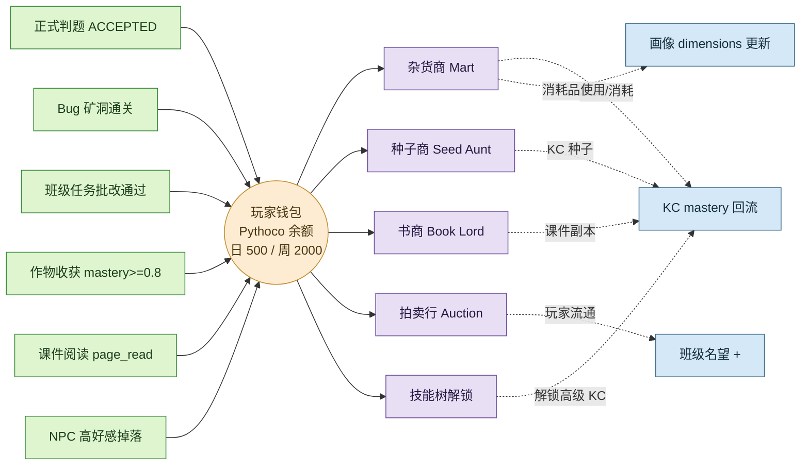
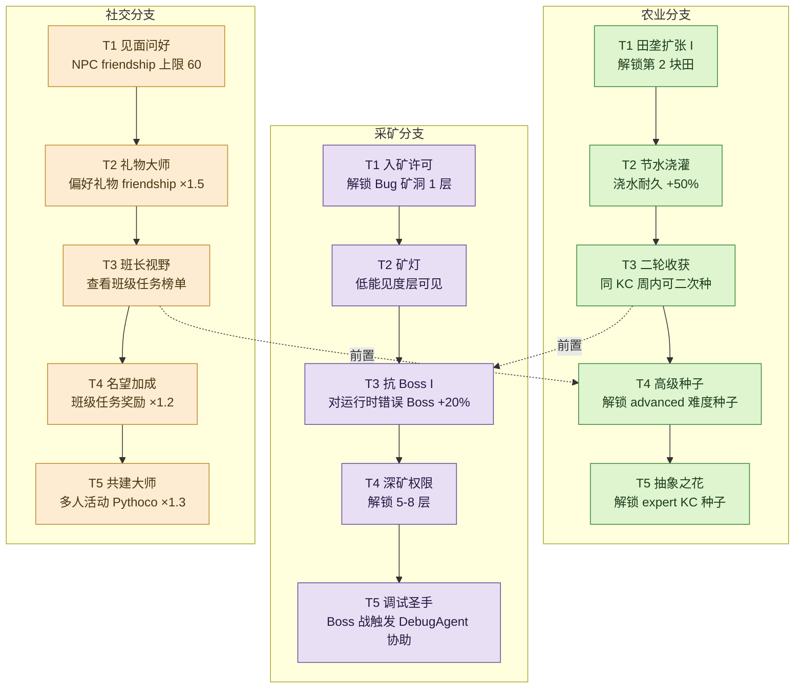

# Pythontopia 经济系统设计

> 道具 / 技能树 / 经济三位一体，服务"学 Python = 经营小镇"的教育隐喻。
> 课程底座：Alethicode `packId=43`《Python语言基础》7 章 / 65 KC / 46 示例 / 39 题。
> 与 `docs/gameplay/education-loop.md`、`docs/gameplay/movement-and-feel.md`、`docs/mastery_formula.md`、`docs/product/profile_schema.md` 同构，是 R-12 解冻后玩法层经济维度的合规约束。
> DTO 对齐：`frontend/src/api/dto/InventoryItemDto.ts`（6 类道具）、`frontend/src/api/dto/SkillNodeDto.ts`（tier + kcCodes）。

---

## 1. 货币系统

### 1.1 主货币 Pythoco

为避免与课程域名词 Knowledge Component（KC）冲突，主货币命名为 **Pythoco**（读作 /paɪˈθoʊko/，复数同形）。它是玩家在小镇内唯一通用货币，所有商人物品、技能解锁部分门槛、拍卖行结算均以 Pythoco 计价。

### 1.2 获取途径（按教育权重排序）

| 途径 | 单次奖励 | 触发条件 | 教育意图 |
| --- | --- | --- | --- |
| 完成正式判题通过 | 5-30 Pythoco | `submission.status = ACCEPTED` 且 evidence 合法 | 把"提交即收益"绑定在真实判题 |
| 通关 Bug 矿洞一层 | 20-80 Pythoco | `quest_evidence.kc_mastery_delta > 0` | 鼓励调试失败提交 |
| 班级任务完成 | 教师定额 10-200 | `classroom_quest.status = SUBMITTED` 且教师批改 | 把班级激励内化为经济 |
| 收获作物 | 8-50 Pythoco | KC mastery ≥ 0.8 触发"收获" | 与遗忘曲线相反方向的正反馈 |
| 复盘读课件 | 2-10 Pythoco | `page_read.duration_ms ≥ 30s` 单页限一次 | 防"翻页刷币" |
| NPC 礼物高好感掉落 | 5-25 Pythoco | NPC friendship ≥ 50 且当日首次互动 | 社交-经济联动 |

### 1.3 上限与衰减

- **每日上限 500 Pythoco**：超出部分进入"溢出袋"，需第二天回家入账，且 24h 内不取自动清零，防止单日刷币与肝度过载。
- **每周上限 2000 Pythoco**：跨日累计，到周日 24:00 重置。超出后所有获取来源 ×0.2 衰减。
- **闲置衰减 -5 Pythoco/连续未登录日**（从第 3 日起触发），最低衰减至 0，不为负。鼓励持续学习而非囤积。
- **通胀控制**：商人价格表每"季节"（30 游戏日）按 +10% 自动上浮；玩家技能"议价"可抵消最多 8%。
- **季节性折扣**：节日期间（见 §6）所有商人 -15%，仅持续 3 游戏日。

### 1.4 经济流图

下图展示 Pythoco 在"教学事件 → 玩家钱包 → 商人 / 拍卖行 / 技能树 → 教学回流"的单向证据链。所有 Pythoco 入账必须伴随一条 `quest_evidence` 或 `submission` 凭证，禁止反向（即"花钱购买 mastery"）。

---

## 2. 道具分类与列表

严格对齐 `InventoryItemDto.ItemCategory` 6 类。每件道具的 `itemKey` 使用 snake_case；价格单位为 Pythoco；"教育用途"列说明该道具如何回流到 KC mastery / submission / page_read / friendship 之一。

### 2.1 seed（65 KC 种子，每 KC 一种，命名规则 `seed_<kc_slug>`）

| itemKey | displayName | 价格 | 获取途径 | 教育用途 |
| --- | --- | --- | --- | --- |
| `seed_input_print` | 输入输出之种 | 15 | Seed Aunt 章 2 解锁后常驻 | 种下后绑定 KC-013，浇水=读对应课件页 |
| `seed_branch_struct` | 分支之种 | 25 | Seed Aunt 章 4 解锁 | 绑定 KC-033，掌握度推进解锁 if/elif 题 |
| `seed_for_loop` | for 循环之种 | 30 | Seed Aunt 章 4 解锁 | 绑定 KC-031，夏季成长 +30% |
| `seed_while_loop` | while 循环之种 | 30 | Seed Aunt 章 4 解锁 | 绑定 KC-032，必须配合除草=做练习 |
| `seed_list_basic` | 列表之种 | 45 | Seed Aunt 章 5 解锁 | 绑定 KC-040，掌握度达 0.6 解锁字典种 |
| `seed_dict_apply` | 字典之种 | 60 | Seed Aunt 章 5 解锁 | 绑定 KC-041 |
| `seed_file_io` | 文件读写之种 | 80 | Seed Aunt 章 6 解锁 | 绑定 KC-048，需先掌握列表 |
| `seed_lambda` | lambda 之种 | 120 | Seed Aunt 章 7 解锁 | 绑定 KC-054，秋季成长 +30% |
| `seed_class_definition` | 类之种 | 150 | Seed Aunt 章 7 + 教师推荐 | 绑定 KC-064，冬季成长 +30% |
| `seed_decorator_pack` | 装饰器礼盒 | 200 | 限定节日 | 三连 KC 礼包（lambda+闭包+装饰器） |

> 完整 65 种 `seed_*` 与 KC 一一映射，存于 `data/course-pack-43/seeds/`，由后端 `SeedCatalogService` 在玩家章节解锁后自动注入到 Seed Aunt 货架，不在前端 hardcode。

### 2.2 tool（工具，可降级耐久度）

| itemKey | displayName | 价格 | 获取途径 | 教育用途 |
| --- | --- | --- | --- | --- |
| `tool_watering_can_basic` | 木质浇水壶 | 50 | 新手赠送 | 浇水触发课件页阅读事件 |
| `tool_watering_can_steel` | 钢质浇水壶 | 350 | Mart 章 3 解锁 | 一次浇 3 块田，耐久 200 |
| `tool_hoe` | 锄头 | 80 | 新手赠送 | 翻地=新种 KC 前置准备 |
| `tool_axe` | 斧头 | 120 | Mart 章 4 解锁 | 砍枯萎作物=触发遗忘补救任务 |
| `tool_pickaxe_basic` | 铁镐 | 180 | Mart 章 5 解锁 | 进入 Bug 矿洞前置 |
| `tool_pickaxe_steel` | 钢镐 | 600 | Mart 章 7 + 采矿技能 3 级 | 深矿洞可用 |
| `tool_fertilizer_basic` | 普通化肥 | 25/袋 | Mart 常驻 | 浇水时 +10% 成长，限当日 |
| `tool_fertilizer_focus` | 专注化肥 | 80/袋 | 节日限定 | 当日同一 KC 成长 ×2 |

### 2.3 gift（礼物，影响 NPC friendship）

| itemKey | displayName | 价格 | 获取途径 | 教育用途 |
| --- | --- | --- | --- | --- |
| `gift_handmade_cookie` | 手作小饼干 | 30 | Chef 处合成 | 通用礼物 friendship +2 |
| `gift_rare_book` | 稀有古书 | 250 | Book Lord 限购 | merchant / librarian_doc 偏好 +5 |
| `gift_seedling_bouquet` | 嫩苗花束 | 80 | 收获季玩家手工 | gardener / farmer_kc 偏好 +5 |
| `gift_pomodoro_tea` | 番茄钟茶包 | 60 | Mart 周五 | student_* NPC 偏好 +3 |
| `gift_bug_specimen` | Bug 标本 | 100 | 矿洞 boss 掉落 | foreman_bug 偏好 +6 |
| `gift_class_pin` | 班级徽章 | 50 | 班级活动赠 | class_president 偏好 +4 |
| `gift_review_incense` | 复盘香（小） | 40 | Mart 周一 | sage_review 偏好 +3 |

### 2.4 consumable（消耗品，使用即扣）

| itemKey | displayName | 价格 | 获取途径 | 教育用途 |
| --- | --- | --- | --- | --- |
| `consumable_coffee_basic` | 现磨咖啡 | 20 | Chef / Mart | +5 energy（每日可用 4 次） |
| `consumable_bread_whole` | 全麦面包 | 35 | Chef | +10 energy |
| `consumable_pomodoro_potion` | 番茄钟续命水 | 90 | merchant | +25 energy +1 专注 buff（45 min 内提交 +10% Pythoco） |
| `consumable_hint_scroll_basic` | 提示卷轴（初级） | 50 | merchant / Mart | 解锁当前题的 1 条 hint，不解锁答案 |
| `consumable_hint_scroll_pro` | 提示卷轴（进阶） | 150 | 教师发放 | 解锁该题完整解题思路（不含可提交代码），仅在班级任务限定题可用 |
| `consumable_retro_incense` | 复盘香 | 110 | merchant | sage_review 复盘流程跳过一步 |
| `consumable_seed_revive` | 复种水 | 70 | gardener | 把枯萎作物复活到 mastery 0.3 |

### 2.5 book（书籍，可任意场景翻阅离线读）

书籍对应课程包章节副本，是玩家在网络不稳时的离线读源；每读完一页都会上传 `page_read` 事件供 PassiveProfileService 更新画像。

| itemKey | displayName | 价格 | 获取途径 | 教育用途 |
| --- | --- | --- | --- | --- |
| `book_chapter_1_compute_thinking` | 《计算思维入门》Ch1 副本 | 80 | Book Lord 章 1 解锁 | 课件章 1 离线副本 |
| `book_chapter_4_flow_auto` | 《流程自动化》Ch4 副本 | 120 | Book Lord 章 4 解锁 | 离线 + 配套例题集 |
| `book_chapter_5_data_struct` | 《数据结构》Ch5 副本 | 160 | Book Lord 章 5 解锁 | 离线 + 列表 / 字典专题 |
| `book_chapter_7_abstraction` | 《归纳与抽象》Ch7 副本 | 200 | Book Lord 章 7 解锁 | 离线 + 高阶函数专题 |
| `book_list_master` | 《列表速通》 | 180 | merchant 限购 | KC-040 学习速度 +5% |
| `book_dict_master` | 《字典讲究》 | 180 | merchant 限购 | KC-041 学习速度 +5% |
| `book_mistake_pattern_atlas` | 《错误模式图鉴》 | 260 | merchant 周限 3 | 39 题错误模式漫画，触发 DebugAgent 优先 |

### 2.6 quest（任务道具，不能交易）

| itemKey | displayName | 获取途径 | 教育用途 |
| --- | --- | --- | --- |
| `quest_teacher_stamp` | 教师印章 | 班级任务完成签收 | 凭证道具，回收时累计班级名望 |
| `quest_port_vip_stamp` | 港口 VIP 章 | merchant friendship 80 解锁 | 解锁拍卖行高级位 |
| `quest_kc_certificate` | KC 结业证 | 单 KC mastery ≥ 0.95 颁发 | 证书集齐 65 张 = 通关成就 |
| `quest_bug_logbook` | Bug 探险日志 | 矿洞首通触发 | DebugAgent 引用证据 |
| `quest_class_pennant` | 班级锦旗 | 班级整体合作完成的大任务 | 教师视角可见的群体荣誉 |

---

## 3. 技能树

3 主分支共 15 节点（每支 5 层），对齐 `SkillNodeDto.tier ∈ {1..5}`。解锁三资源门槛：
**mastery 门槛**（关联 KC 平均掌握度）+ **Pythoco 成本** + **任务证明**（具体 evidence 类型）。

### 3.1 技能树拓扑

### 3.2 节点解锁门槛示例

| 节点 | mastery 门槛 | Pythoco | 任务证明 |
| --- | --- | --- | --- |
| F1 田垄扩张 I | Ch1+Ch2 平均 0.5 | 100 | 完成 3 道 ACCEPTED 提交 |
| F3 二轮收获 | 任 5 个 KC ≥ 0.7 | 400 | 复盘 sage_review 1 次 |
| M3 抗 Boss I | KC-031/032/033 ≥ 0.6 | 350 | 通关矿洞 2 层 |
| S4 名望加成 | 全章 mastery 平均 0.55 | 500 | 班级任务 3 次教师批改通过 |
| F5 抽象之花 | Ch7 任 2 KC ≥ 0.8 | 800 | 提交 lambda 题通过 + 复盘 |

> 跨分支前置（F3→M3，S3→F4）防止单线刷点，强迫玩家在"种地-挖矿-社交"间循环，对应"学-练-讲"三重学习闭环。

---

## 4. 天气-季节-作物联动

季节按"游戏日"推进，每 30 游戏日（≈ 现实 30 天）一季。季节 buff 在 `WorldClock` 内广播到 `CropTileService`，由后端真实计算 mastery 增量，前端只可视化。

| 季节 | 主推 KC 类型 | 成长 buff | 风险 | 教育意图 |
| --- | --- | --- | --- | --- |
| 春 | 所有种子 | +20% | 无 | 新学期总起步，鼓励铺垫 |
| 夏 | for / while / iterator (KC-031/032/044) | +30% | 干旱 → 需 2 次浇水（多读 1 页课件） | 循环密集训练 |
| 秋 | function / closure / lambda (KC-038/054/056) | +30% | 易枯萎，未复盘掉 mastery 0.05/天 | 收获季 + 抽象 |
| 冬 | class / OOP (KC-063~065) | +30% | 作物 4 天冬眠不长 | 鼓励复盘类资源（精读 + sage_review） |

天气随机日触发：

| 天气 | 效果 | 教育隐喻 |
| --- | --- | --- |
| 雨天 | 所有作物自动浇水 1 次 | 当天不读课件也保底加成 |
| 雪天 | 矿洞掉落率 +10%，Pythoco 翻倍 | 鼓励挑战 Bug 矿洞 |
| 阴天 | NPC 对话刷出复习题概率 +20% | 主动复盘的"软提醒" |
| 晴天 | 浇水加成 +5%，能量恢复 +1 | 默认正向 |

---

## 5. NPC 商人系统

四类商人定位互补，价格与刷新规则均落库于 `merchant_inventory` 表，由后端每日 02:00 调度刷新。

| 商人 | itemKey 前缀 | 商品池 | 刷新规则 | 价格策略 |
| --- | --- | --- | --- | --- |
| 杂货商 Mart | `tool_*` / `consumable_*` | 工具 8 件 + 消耗品 12 件 | 每日 02:00 库存 + 周限品 | 基础价 +0%，节日 -15% |
| 种子商 Seed Aunt | `seed_*` | 65 种 KC 种子（按章节解锁） | 每周一刷新今日 12 种 | 按章节难度阶梯：foundation 15-30 / intermediate 25-60 / advanced 45-120 / expert 100-250 |
| 书商 Book Lord | `book_*` / `gift_rare_book` | 章节副本 + 高级 LLM 名家答疑 | 每日 02:00 重列 3 本 | 副本固定，名家答疑 200-500（含 LLM 调用成本） |
| 拍卖行 Auction | 任意（除 quest 与 book 章节副本外） | 玩家寄售 | 每 8h 撮合 | 自动监控：与基础价偏差 > 50% 触发预警，> 200% 禁挂 |

### 5.1 商人对话样本

参考 `data/npcs/merchant/dialog.json`：商人会按玩家画像（`profileAdaptive`）动态推荐"番茄钟续命水" vs "复盘香"，并对偏好礼物给出 -20% 折扣。这是经济与画像的第一个真实耦合点。

---

## 6. 节日与活动

每季 1 主节日（3 游戏日）+ 每周 1 小活动（半个游戏日）。所有节日奖励均与教学事件绑定，禁止纯抽奖。

| 季 | 节日 | 玩法 | 奖励 |
| --- | --- | --- | --- |
| 春 | 开学集会 | 新生加入班级 + 班级合影任务 | 100 Pythoco + `gift_class_pin` |
| 夏 | 编程马拉松 | 24h 限时多人在线挑战，5 题阶梯 | 排名前 30% 奖 `book_mistake_pattern_atlas` |
| 秋 | 丰收祭 | mastery 季度排名 + 班级合影 | 锦旗 + 300 Pythoco |
| 冬 | 跨年答辩 | 教师视角学生年度总结 + 课件复盘任务 | `quest_kc_certificate` 批量颁发 |

周限小活动轮换：拍卖行半价日 / Bug 矿洞翻倍日 / NPC 礼物双倍好感日 / 复盘双倍 Pythoco 日。

---

## 7. 经济平衡参数表

下表是 Beta 首发参数，写入 `data/economy/balance.json`（M5 阶段实装），由后端 `EconomyBalanceService` 注入。比赛前两周采集真实数据后允许 ±20% 调整。

| 项 | 起始值 | 上限 | 衰减 | 通胀 |
| --- | --- | --- | --- | --- |
| Pythoco / day | 50 | 500 | -5 / 连续未登录日（≥3） | 10% / 季节（商品端） |
| Pythoco / week | - | 2000 | 上限后续获取 ×0.2 | 同上 |
| Skill Point / week | 1 | 5 | 不衰减，积压上限 5 | - |
| Tool durability | 100% | - | -5% / 使用 | 修理价 = 基础价 ×10% |
| Energy / day | 100 | 100 | 每动作 -1~-5 | 不通胀 |
| NPC friendship | 0 | 100 | -1 / 7 日无互动 | 不通胀 |
| Auction 上架费 | 5 Pythoco | - | - | 与基础价同步通胀 |
| Class quest 奖励 | 50 | 200 | 教师可微调 ±50% | 不通胀（教师视角受控） |

---

## 8. 反作弊

经济系统是教育反作弊的延伸，必须遵守"道具 → KC mastery → 经济"的单向证据链，禁止任何"经济 → KC"的反向伪造。

- **拍卖行价格监控**：与基础价偏差 > 50% 预警，> 200% 自动下架并通知教师；同一买卖双方在 24h 内三次互卖判定为洗 Pythoco，账号冻结结算。
- **矿洞 Boss 不掉金币**：所有 Pythoco 必须通过教学事件（提交 / 阅读 / 复盘 / 班级任务）入账；矿洞 Boss 只掉 `gift_bug_specimen` 和 KC 修复种子，金币必须靠通关后写 `quest_evidence` 才结算。
- **Pyodide 预览不结算**：前端 Pyodide 仅供调试，所有 Pythoco 仅在服务端判题 ACCEPTED 后入账，与 `docs/architecture/system_design.md` 双轨执行约束一致。
- **班级任务奖励上限**：教师可在 0-200 Pythoco 间微调单次奖励，但单班单周总额不得超过 5000 Pythoco，由后端 `ClassroomQuestService` 强校验。
- **道具教学注解**：每件道具 `description` 必须包含教育用途字段，由 ResourceDesignerAgent 生成时强制注入，缺失则审查不通过。

---

## 9. 验收指标

Beta 上线后第 1-4 周采集，写入 `docs/evaluation_metrics.md` 经济子节。

| 指标 | 目标区间 | 告警阈值 |
| --- | --- | --- |
| 第 1 周玩家平均 Pythoco 余额 | 30-150 | < 10 或 > 400 |
| 第 1 月技能点用尽率（已用 / 已发） | 60-80% | < 40% 或 > 95% |
| 拍卖行交易量 | ≥ 0.5 件 / 人 / 周 | < 0.2 件 |
| 道具教学注解覆盖率 | 100% | < 100% 阻塞发布 |
| 单 KC 平均"种子-收获"周期 | 5-12 游戏日 | < 3 日（疑似刷币）或 > 20 日（学习卡壳） |
| Bug 矿洞参与率 | ≥ 30% 周活跃玩家 | < 15% |

---

## 10. 风险与缓解

| 风险 | 触发场景 | 缓解 |
| --- | --- | --- |
| 经济系统过重，学生忙做生意不学 Python | 道具种类 > 50 且拍卖行高活跃 | 每件道具必须有教学注解（§8）；周经济总收益 ×0.5 时弹"学习提醒"模态框 |
| 道具种类太多，新手入门困难 | 第 1 周流失率 > 30% | 新手仅能见 5 件白名单道具（`seed_input_print` / `tool_watering_can_basic` / `tool_hoe` / `consumable_coffee_basic` / `gift_handmade_cookie`），其余按章节解锁 |
| 通胀失控，Pythoco 贬值 | 玩家平均余额 > 1000 | 季节通胀 +5% 紧急补丁；Auction 上架费阶梯翻倍 |
| 教师批改成奖励瓶颈 | 班级任务奖励发放延迟 > 48h | 班级任务系统降级：教师 48h 未批改自动给基础 50 Pythoco + 标记"待复核" |
| 拍卖行成投机市场 | 同一物品 24h 涨幅 > 100% | 触发 §8 价格监控；强制 8h 冷却 |
| 跨季 KC 失衡（冬季 OOP 太晚） | Ch7 mastery 平均 < 0.3 | 增加 winter 期间 OOP 类 NPC 任务，引入 quest_pythoco 补偿 |

---

-- 子代理生成于 2026-05-24 00:24 CST
