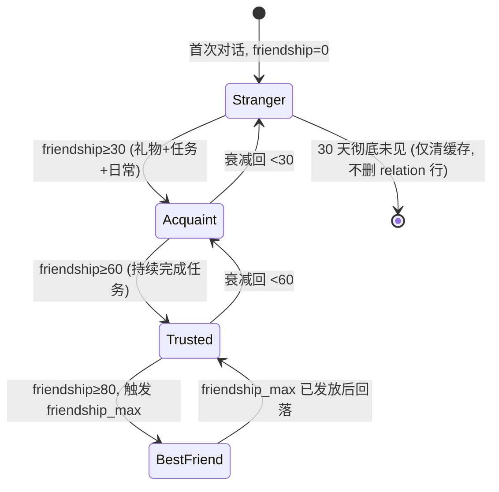

# Pythontopia NPC 生态系统设计

> R-12 解冻 Web 后，小镇被切成 5 张地图，常驻 20 个 NPC。
> 本文档把"哪些 NPC、各自干什么、怎么动、什么时候说话、说什么、给玩家发什么任务"约束在一处，避免每张 scene 自行重写 NPC 行为。
> 唯一权威来源：`data/npcs/<key>/{meta,dialog}.json` 真实数据 + `frontend/src/game/core/NpcFramework.ts` 巡逻 / 对话锚点 API。
> 上游教育闭环见 `docs/gameplay/education-loop.md`；移动手感见 `docs/gameplay/movement-and-feel.md`。

---

## 1. 20 NPC 全名单（按地图分组）

下表与 `data/npcs/index.json` 的 20 项严格一一对应；任何 NPC 名 / spawnMap 改动都必须先改这两份数据再回写本文档。

| spawnMap | npcKey | 中文名 | 英文名（人格化） | 类型 | 主要功能 | 教育耦合 |
| --- | --- | --- | --- | --- | --- | --- |
| town_hub | `mayor_py` | 镇长 Py | Mayor Py | 教师 | 入镇欢迎、整体路径建议、每周复盘提醒 | Ch1 计算工具与计算思维（入门导览） |
| town_hub | `nurse` | 医务 | Town Nurse | 路人 | 恢复每日 Pyodide 体力、过劳提醒 | 全局节奏，配合 `practice_capability` 流失预警 |
| town_hub | `postman` | 邮差 | Postman | 路人 | 投递日常签到题、班级公告、教师留言 | 每日 `kc_mastery_event` 触发器 + 班级公告通道 |
| town_hub | `gardener` | 园丁 | Gardener | 路人 | 中央花园季节更替、节日活动公告 | 季节资源生成（每 30 游戏日触发 `season_end`） |
| town_hub | `chef` | 厨师 | Chef | 路人 | 按 KC 主题出菜，吃后短时学习速度 buff | 列表沙拉=KC-040、字典咖喱=KC-041、循环饺子=KC-031/032 |
| town_hub | `guard` | 守门 | Town Guard | 路人 | 地图入口要求提示（矿洞需 1 次失败提交、港口需 Ch4 解锁） | 守关解锁条件可视化 |
| town_hub | `student_diligent` | 勤勉小柒 | Diligent Qi | 同学 | 同伴示范：每天准点出现，主动分享 KC 进度 | 让玩家看到"稳定节奏"的可参考样本 |
| town_hub | `student_procrast` | 拖延小迟 | Procrast Chi | 同学 | 同伴对照：deadline 前一晚熬到三点 | 让玩家直视拖延型代价（含期末后悔对话） |
| town_hub | `student_anxious` | 焦虑小安 | Anxious An | 同学 | 同伴互助：拉玩家共写第六遍代码 | "错也没关系"重构，配合 `student_anxious_pair_today` flag |
| town_hub | `student_late_starter` | 后赶小赶 | Late-Starter Gan | 同学 | 同伴鼓励：期中后顿悟、一天三题 | "什么时候开始都不晚"叙事 |
| town_hub | `student_top` | 拔尖小尖 | Top Jian | 同学 | 同伴上限：39 题做完去刷外校题 | 不傲、主动分享解法，给玩家看天花板 |
| town_hub | `student_hobby` | 兴趣小好 | Hobby Hao | 同学 | 同伴外延：用 Python 做像素小游戏 | 回答"学这玩意能干嘛"，连通 craftsman 副项目 |
| farm_north | `farmer_kc` | 田老 | Farmer KC | 教师 | 把 KC 当庄稼，按 mastery 解读作物状态 | Ch2 Python 语言基础（变量 / I/O 即播种） |
| mine_south | `foreman_bug` | 矿头 Bug | Foreman Bug | 教师 | Bug 矿洞副本工头，把失败 submission 转 5 层副本 | Ch5 数据结构（列表 / 字典最高发 IndexError/KeyError） |
| campus_east | `librarian_doc` | 馆长 Doc | Librarian Doc | 教师 | 7 份 561 页课件索引、KC↔页码精确翻 | Ch3 计算机信息表示 + Ch6 数据存取（文档密度最高的两章） |
| campus_east | `coach_q` | 教务 Q | Coach Q | 教师 | 按掌握度推荐下一题，掌管 39 道官方题库 | Ch4 流程自动化（39 题集中考察 if / for / while） |
| campus_east | `sage_review` | 复盘师 Sage | Sage Review | 教师 | 周五晚开复盘殿，写一句心得归档 | Ch7 归纳与抽象（lambda / 包需要更高维复盘） |
| campus_east | `craftsman` | 工长 | Craftsman | 工匠 | 资源工坊副项目对接，发"造点东西"型任务 | 与 `student_hobby` 联动，连通 CodeLab 课外工程 |
| port_west | `class_president` | 班长 | Class President | 路人 | 班级公告板、所有 `classroom_quest` 都先过她手 | 班级架构唯一交互入口（教师任务的 NPC 接收口） |
| port_west | `merchant` | 商人 | Port Merchant | 商人 | 卖技能书、消耗道具、KC 学习速度 buff | "外港"叙事支撑"周限定货" + friendship 折扣经济 |

> 6 个教师 NPC 覆盖 7 章：`librarian_doc` 同时承担 Ch3 与 Ch6 两章文档检索；其余 5 章一对一。这是 R-12 实际编制，不引入未上线的 `blacksmith_loop` / `chef_func` 等虚构 NPC。

---

## 2. NPC 行为模式分类

`NpcFramework` 暴露 4 类原语：`patrol[]`（巡逻）、`dialogAnchor`（对话锚点偏移）、`questPublisher`（任务发布器）、`inDialog` 暂停。下面 5 种行为模式都用这套原语拼装，scene 层只需要在 register 时填好。

### 2.1 巡逻型（patrolling）

- 适用：`postman`（每天下午跨 4 张地图轮投）、`gardener` 周三去农场。
- 数据：`patrol: [{x,y,dwellMs}…]`，`speed = 24 px/s`（NPC 默认 32 偏慢一档，避免追玩家）。
- 停顿：每个 waypoint 1500–3000 ms `dwellMs`，给玩家追上的窗口。

### 2.2 驻守型（stationary anchored）

- 适用：`librarian_doc`、`coach_q`、`sage_review`、`merchant`、`class_president`、`mayor_py` 工位时段。
- 数据：`patrol = []` 或省略；只填 `spawnX/Y` + `dialogAnchor`。
- 朝向：scene 用 `WorldClock` 每 8s 旋转一次 4 向 idle（S→W→N→E），避免长时间面壁。

### 2.3 跟随型（escort，触发后短时跟随）

- 适用：`postman` 投递剧情、`student_anxious` 被拉去矿洞的 `drag_anxious_to_mine` 任务。
- 实现：scene 层临时把 NPC 的 patrol 改成"玩家位置 ± 1 tile"，到目的地后恢复原 patrol；NpcFramework 本身不做寻路，避免和后端 store 耦合。
- 跟随上限：单次 ≤ 60 秒，超时自动回 spawn，防卡死。

### 2.4 触发型（hidden until story flag）

- 适用：`mayor_py.friendship_max` 解锁后才出现的"签名 Python 之禅"赠送场景；`sage_review` 满 40 次复盘后出现的《学问之静》场景。
- 实现：scene 层根据 `set_flag` 写入的 flag（如 `mayor_py_max_friend`）决定 register 时是否加入该 NPC 的特殊 dialog 节点，不新增 NPC 实例。

### 2.5 季节型（season / time gated）

- 适用：节日 NPC（春节龙舞 / 中秋兔子 / 教师节献花），仅在 `WorldClock` 报告的特定季节窗口 register。
- 实现：节日 NPC 不是 20 NPC 之一，是临时 instance；窗口关闭后 `NpcFramework.clear(id)` 移除。

---

## 3. 对话发放权重

每个 NPC 的 `dialog.json` 含多个 node：`greet` / 任务节点 / `lore`（剧情背景） / `hint`（提示） / `shop`（商人专属） / `gift_received` / `friendship_max`。scene 进入 dialog 时按下表算权重，选一个非 `greet` 节点作为 "话头推荐"，玩家在 `greet` 的 choice 列表里看到该话头被高亮。

| 因子 | 取值 | 加权（默认 1.0） |
| --- | --- | --- |
| `friendship` 0–29 | 冷淡期 | greet ×2.0；lore ×0.3 |
| `friendship` 30–59 | 熟悉期 | quest ×1.5；hint ×1.2 |
| `friendship` 60–100 | 信任期 | lore ×1.8；`friendship_max` 节点解锁 |
| 当前任务进度 | 该 NPC 有 active quest | 与该 quest 同 questKey 的节点 ×3.0 |
| 最近 mastery Δ | 过去 24h `mastery_score` 下降 | hint ×1.5（推 KC 复习） |
| 时段 | 早 / 晚（详见 §7） | 早晨 greet ×1.3；夜间 dismiss ×3.0 |
| 是否第一次见面 | `flag.first_meet_<npcKey>` 未置位 | greet ×5.0，其他节点 ×0 |

决策伪代码（scene 层 `NpcDialogPicker`，对应 frontend `src/game/scenes/dialog/` 未来实现）：

```ts
function pickTopic(npc, ctx) {
  const candidates = npc.dialog.nodes.filter(n => evalConditions(n.conditions, ctx));
  return weightedSample(candidates.map(n => ({
    node: n,
    weight: baseWeight(n.id)
          * friendshipMod(ctx.friendship, n.id)
          * questMod(ctx.activeQuests, n)
          * masteryMod(ctx.masteryDelta24h, n.id)
          * timeMod(ctx.hour, n.id)
          * firstMeetMod(ctx.flags, npc.id, n.id),
  })));
}
```

`evalConditions` 必须严格执行 `dialog.json` 里声明的 `conditions`（如 `friendship_min: 80`、`gift_just_given`、`first_time_this_week`），不允许 scene 层绕开。

---

## 4. NPC 任务发布

### 4.1 任务类型↔NPC 绑定

| NPC 类型 | 任务种类 | `quest.kind` 字段 |
| --- | --- | --- |
| 教师（6 位） | 课件阅读、练习推荐、矿洞副本、复盘 | `READ` / `PRACTICE` / `BUG_MINE` / `RETRO` |
| 同学（6 位） | 共写、互改、组队、安慰互助 | `PEER_PAIR` / `PEER_REVIEW` |
| 商人 / 工匠 | 跑腿、采购、副项目交付 | `ERRAND` / `SIDE_PROJECT` |
| 班长 | 班级任务接收 / 提交 | `CLASSROOM` |
| 其余路人 | 日常签到、生活互动 | `DAILY` |

### 4.2 单 NPC 任务上限

每个 NPC 同时最多 **2 个 active task** 挂在玩家身上：1 个主推 + 1 个隐藏（如 `gift_quest`）。第 3 个任务发布请求必须先关闭旧任务，`QuestService` 在后端强校验，前端 NPC 只读后端返回的 `availableTopics` 列表，不能本地凭空 push。

### 4.3 发布触发条件

| 触发器 | 数据源 | 示例 |
| --- | --- | --- |
| 玩家进对话锚 | `dialogAnchor` 触发 | `mayor_py` 第一次靠近 → `first_kc_unlock` |
| mastery 达阈值 | `kc_mastery.mastery_score` 跨过 0.5 / 0.8 | `farmer_kc` 推 `harvest_ready` |
| 班级任务联动 | `classroom_quest.status = PUBLISHED` | `class_president` 贴公告 |
| 节日 / 时段 | `WorldClock` 触发 `festival_*` | 中秋兔子卖月饼 |
| 主线推进 | `world_session.main_chapter` 切换 | 解锁港口后 `merchant` 出现 |

---

## 5. 朝向与情感

### 5.1 4 方向 idle / walk

- sprite sheet 每个 NPC 4 行 × 8 帧：`down / left / right / up`，与 `PlayerStateMachine.Direction` 罗盘的 S/W/E/N 对齐。
- `NpcFramework` 内部计算 8 方向（含 SE/SW/NE/NW），渲染层在 sprite 选择时把 SE/NE 折叠为 E，SW/NW 折叠为 W，保持视觉只有 4 向，但物理运动方向不损失精度。
- walk 帧率：8 fps，与玩家保持一致；NPC 速度 `24 px/s` 时单步走 4 帧刚好穿越 1 tile。

### 5.2 5 种表情

5 种 sprite 表情贴在 NPC 头顶 16×16 气泡里，由 dialog effect / quest 事件触发，2 秒后自动消失。

| 表情 | 触发 | 例子 |
| --- | --- | --- |
| neutral | 默认 / 收到非偏好礼物 | 任意非匹配 `favoriteGifts` |
| happy | 收到偏好礼物、完成它布置的任务、friendship +3 | `farmer_kc.gift_received` 收到 `watering_can` |
| surprised | 第一次 mastery 跨过 0.8 / 矿洞通关 | `coach_q` 看到玩家 AC 第 39 题 |
| sad | 长期不见（≥ 14 天）、任务过期 | `student_anxious` 在 `weekly_review` 漏做时 |
| angry | 偷取设定保留位（R-12 不开放偷盗） | 仅占位，R-13 班长视角拓展时再启用 |

> 偷盗系统 R-12 不上线；angry 表情保留 sprite 槽位，避免后续 sprite sheet 重切。

---

## 6. friendship 系统

### 6.1 数值定义

- 范围 0–100，整数，存 `learner_npc_relation.friendship`（V100~V110 区间内已建表）。
- 初始 0；首次对话不送好感，避免被刷。

### 6.2 影响

| 应用 | 公式 |
| --- | --- |
| 商人折扣 | `discount % = floor(friendship / 10)`，封顶 10% |
| 教师高级任务解锁 | `friendship ≥ 50` 解锁 `challenge_problem` / `mine_boss_hint` 等节点（`coach_q` / `foreman_bug` 已硬编码） |
| 同学互助优先级 | 同学排序优先选 friendship 最高者出现在小镇广场 |
| `friendship_max` 限定礼 | `friendship ≥ 80` 单 NPC 触发一次性赠礼（如 `heirloom_watering_can`） |

### 6.3 增减规则

- **增**：
  - 偏好礼物 `+3`（`gift_received.giftFavorite` 分支）。
  - 完成该 NPC 发布的任务 `+2~+3`（quest 完成 effect 写入）。
  - 每日首次对话 `+1`（日 cap `+5`，超出不计）。
- **减**：
  - 任务过期（超 deadline 未交） `-2`。
  - 错过 NPC 生日（`meta.birthday` 当日未送任何礼） `-1`。
  - 长期不见：连续 7 天未对话起，每周 `-1`（衰减下限 0，不为负）。

### 6.4 状态机



---

## 7. 时段–NPC 行为

`WorldClock` 把游戏内 1 现实分钟映射到 1 游戏小时；下表是常规工作日（周一–周五）默认安排，与各 NPC `meta.json.schedule` 数据一致，周末另有调整。

| 时段 | NPC 群体动作 |
| --- | --- |
| 06:00–10:00 早晨 | `farmer_kc` / `gardener` / `foreman_bug` / `postman` / `guard` 上岗；`mayor_py` 在 town_hub 喊"早安路径建议"；商店 / 教师工位关门 |
| 10:00–12:00 上午 | `merchant` / `librarian_doc` / `coach_q` / `sage_review` 开门；`student_top` 在校园；NPC 集中 town_hub + campus_east |
| 12:00–14:00 中午 | NPC 向 `chef` 餐馆聚集；玩家可送饭给同学 NPC +1 friendship |
| 14:00–18:00 下午 | 店铺营业高峰；`postman` 跨地图轮投；学生 NPC 在 town_hub 闲聊广场 |
| 18:00–21:00 傍晚 | NPC 回家路上，灯笼亮起；`sage_review` 周五 20:00 开复盘殿 |
| 21:00–05:00 夜间 | NPC 全部下线；仅 `librarian_doc` 周六夜班保留（值守 `hallucination_warn` 提示） |

```mermaid
gantt
  title NPC 周一典型时间表
  dateFormat HH:mm
  axisFormat %H:%M
  section 教师
  mayor_py (town_hub)       :08:00, 6h
  mayor_py (campus_east)    :14:00, 4h
  farmer_kc (farm_north)    :06:00, 12h
  foreman_bug (mine_south)  :07:00, 12h
  librarian_doc (campus)    :08:00, 12h
  coach_q (campus)          :08:00, 6h
  coach_q (town_hub)        :14:00, 4h
  sage_review (campus)      :10:00, 11h
  section 生活
  postman (town_hub)        :07:00, 7h
  postman (port_west)       :14:00, 4h
  merchant (port_west)      :09:00, 13h
  chef (town_hub)           :07:00, 14h
  guard (town_hub)          :06:00, 16h
```



> 周末 schedule 见各 NPC `meta.json`；节日额外覆盖参见 §9。

---

## 8. NPC 与教育的耦合

### 8.1 章节绑定（实际编制）

| 章节 | 主对接 NPC | 高频误区警示节点 |
| --- | --- | --- |
| Ch1 计算工具与计算思维 | `mayor_py` | `where_to_start` / `weekly_recap` |
| Ch2 Python 语言基础 | `farmer_kc` | `today_focus` / `wilt_explain` |
| Ch3 计算机信息表示 | `librarian_doc` | `find_evidence` / `hallucination_warn` |
| Ch4 流程自动化 | `coach_q` | `next_problem` / `no_evidence_warn` |
| Ch5 数据结构 | `foreman_bug` | `last_failed` / `mine_boss_hint` |
| Ch6 数据存取与分析 | `librarian_doc`（兼任） | `chapter_recommend` 推 p458–p520 |
| Ch7 归纳与抽象 | `sage_review` | `weekly_retro` / `mistake_pattern` |

### 8.2 主动推送

当 `kc_mastery_event` 写入后，scene 层会向对应 NPC 的 `dialog.json` 注入 `recent_chapter_warning` 临时节点（不污染源 JSON），内容由 `PathPlannerAgent` 现算："你刚动了 KC-031 但 confidence 还低，下次回 mine_south 找矿头 Bug 看看类似 traceback。"

### 8.3 师徒制

- 连续 **3 个游戏日** 在同一教师 NPC 的 `dialogAnchor` 周围至少各完成 1 个该 NPC 任务，触发 `apprentice_<npcKey>` flag。
- 解锁专属对话树：每位教师 NPC 增加 1 个高级节点（如 `farmer_kc.apprentice_field_secret`），披露该章节"老教师私房经验"。
- 师徒上限：玩家同时只能拜 1 师，切换需冷却 7 天，避免刷 flag。

---

## 9. 节日 NPC

| 节日 | 触发窗口 | 临时 NPC | 玩法 |
| --- | --- | --- | --- |
| 春节 | 农历正月初一前后 3 天 | 龙舞班（4 人组团 sprite） | 在 town_hub 广场绕场，玩家可点击拜年 +5 friendship 给 `mayor_py` |
| 中秋 | 农历八月十五前后 3 天 | 月兔商贩 | `port_west` 临时摊位，限时卖 `mooncake` 消耗品（吃后所有 NPC +1） |
| 教师节 | 9 月 10 日 | 学生集体献花 | 6 位学生 NPC 自动给 6 位教师 NPC +5 friendship，玩家可旁观或参与 |
| 班级集会日 | 教师在班级面板按下"召集" | 班级全员 sprite | `class_president` 把同班同学 NPC 化的头像列在 `port_west` 公告板 |

节日 NPC 必须在窗口外通过 `NpcFramework.clear()` 移除，避免周年累计 NPC 数膨胀。

---

## 10. 验收指标

| 指标 | 目标 | 数据源 |
| --- | --- | --- |
| 玩家第 1 周触发 NPC 对话数 | ≥ 10 个不同 NPC | `npc_dialog_log` |
| 玩家第 1 周 friendship ≥ 30 的 NPC 数 | ≥ 3 个 | `learner_npc_relation` |
| NPC 发布任务完成率 | ≥ 60% | `quest.status` |
| 教师 NPC 章节绑定推送被接受率 | ≥ 40%（玩家点 `quest_recommend` 后真的去做） | `quest.created_by_recommendation = true` |
| 节日 NPC 参与率 | ≥ 50% 当周活跃玩家点击 ≥ 1 次 | `world_session.festival_event` |
| 师徒制达成 | 单学期 ≥ 30% 玩家解锁 ≥ 1 个 `apprentice_*` flag | `learner_flag` |

---

-- 子代理生成于 2026-05-24 00:25:24 (UTC+8)
