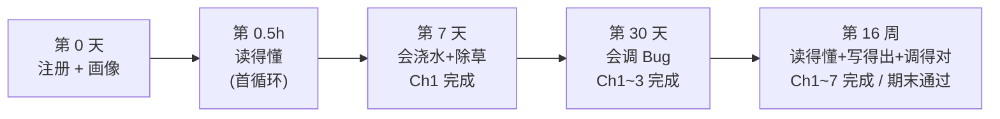
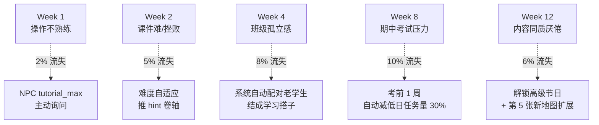
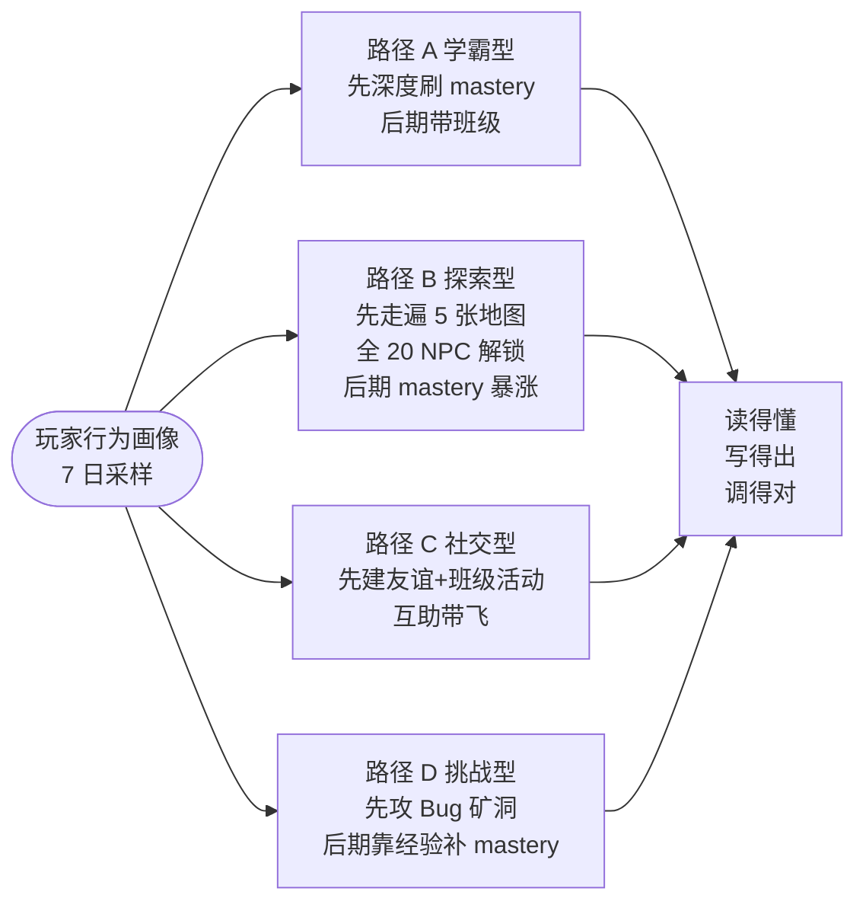

# Pythontopia 玩家成长曲线设计

> 版本：v1.0 · 起草日期：2026-05-24 · 适用版本：R-12 起 · 状态：Draft（待 W2 验收转 Active）
> 目标读者：玩法工程师、关卡设计师、课程设计师、班主任视角运营、画像分析师
> 平级文档：`docs/gameplay/education-loop.md`（教育闭环约束）、`docs/gameplay/movement-and-feel.md`（手感）、`docs/mastery_formula.md`（掌握度公式权威源）、`docs/product/profile_schema.md`（8 维画像 schema）

## 0. 文档定位

`education-loop.md` 回答"玩法如何映射教学"，本文档回答"一个真实学生从注册到结课的 16 周里、5 个时间断面分别要拿到什么可验证的里程碑"。所有数字（mastery delta、事件门槛、留存目标）严格使用既有事件源 `kc_mastery_event` / `practice_submission` / `bug_mine_session` / `learner_profile.dimensions` / `classroom_quest` 中真实可统计的字段，不允许为了曲线好看在前端造数。

---

## 1. 总览：1 学期 = 1 游戏年

| 现实时间 | 游戏时间 | 课程覆盖 | KC 数 |
| -------- | -------- | -------- | ----- |
| 16 周 | 1 游戏年 = 4 季节 | Ch1~Ch7 全部 | 65 |
| 4 周 | 1 季节 = 28 游戏日 | 1.5~2 章 | 约 16 |
| 1 周 | 7 游戏日 | 1 段 KC 簇 | 约 4~5 |
| 1 天 | 1 游戏日 | 单次 session | 1~3 KC 触达 |

学生从"零基础（`base_level.python_self_rated_level = 1`）"成长到三层里程碑：

1. **读得懂**：能在课件 RAG 引用里跟读，`PageReadEvent` 累计 ≥ 50，对应 mastery 平均 ≥ 0.3。
2. **写得出**：能在 CodeLab 独立提交 AC，`PRACTICE_PASS` ≥ 20 次，mastery 矩阵 ≥ 0.5 的 KC ≥ 25 个。
3. **调得对**：能在 Bug 矿洞独立修复运行错误，`DEBUG_FIX` ≥ 5 次，5 层副本全通关。

---

## 2. 前 30 分钟（首次登录黄金窗口）

**关键目标**：学生在 30 分钟内同时拿到"我能玩 + 我能学"两个确认信号，避免任何一边的认知断点。

| 阶段 | 时长 | 玩法动作 | 教学映射 | 后端事件 |
| ---- | ---- | -------- | -------- | -------- |
| 入学问卷 | 0~3 min | 在画像屋点 NPC `interviewer_eva` 答 9 题 | 主动 4 维（major / base_level / learning_goal / learning_preference） | `POST /api/profile/interview` |
| 操作教学 | 3~5 min | NPC `tutorial_max` 带走 8 步：方向键 / Shift 跑 / F 交互 / Esc 取消 / I 背包 / Tab 任务 / 进店门 / 出小镇 | 入门反馈：学生确认自己"能玩" | `world_session.tutorial_step` |
| 首种 | 5~15 min | 走到 `farm_north`，点田垄 → 自动跳 KC-008/010/013 课件首页 → 浇水 1 次（读 1 页） | `kc_mastery_event(source=RESOURCE_READ, +0.10)` ×3 | `bootstrap` 写入 8 KC，3 KC 状态 SEED → 即将 SPROUT |
| 首练 | 15~25 min | CodeLab 第 1 题 `print("hello, pythontopia")` | `PRACTICE_PASS, +0.20` 一次 | `practice_submission` 真实入库 |
| 首收 | 25~30 min | 回农场看作物动画从 SEED → SPROUT，HUD 数字滚动 `+0.20 掌握「变量与运算符」`；图书馆 NPC 赠送第 1 张 MindMap 资源（"变量"） | `learning_resource` 入库 + `viewed_count` ≥ 1 | `world_session.first_harvest_at` 落库 |

**首循环验收门槛**：30 分钟结束时同时满足

- 至少 1 KC 达到 SPROUT（`mastery ≥ 0.2`）。
- 至少 1 个资源在背包可见（`learning_resource.kind = MIND_MAP`）。
- `learner_profile.dimensions` 的 4 个主观维度全部非空。
- 玩家明确知道：怎么走 / 怎么对话 / 怎么交互、农场 = 学习玩法隐喻、自己的画像 8 维有 4 维已填、剩 4 维由 `PassiveProfileService` 后续被动更新。

> **为什么 30 分钟**：移动手感目标延迟 ≤ 120ms + 单 KC 浇水 → 收获最短 5 分钟（教育闭环 §2.4），30 分钟可塞下"画像 + 教学 + 玩法 + 反馈"四段完整链路，超过 30 分钟则触发画像第 8 维 `emotion_persistence.resilience` 噪声采样。

---

## 3. 前 3 天（首周末窗口）

**关键目标**：完成 Ch1《计算工具与计算思维》共 7 KC，并触发首个 Bug 矿洞副本，让学生体感"失败也是玩法的一部分"。

- **Day 1**：完成首循环后追加 Ch1 剩余 4 KC 的种植（KC-002/004/005/007），覆盖完 Ch1.1。任务系统从 `tutorial` 链路毕业，公告板出现"Ch1 田野速通"任务。
- **Day 2**：进入 Ch1 中段，浇水 → 读 Ch1.2 课件页，第 1 次提交 `print` 模板题时主动制造 `NameError`（教学脚本设计）→ 触发 L1 矿洞副本（syntax_error），玩家学到"看 traceback 第 4 行 column"的元技能，`DEBUG_FIX, +0.15` 写入。
- **Day 3**：完成 Ch1 全部 7 KC 首次种植。`learner_evaluation` 自动跑首份小型复盘（触发器：单章节所有 KC `mastery ≥ 0.6`），`ResourceDesignerAgent + MindMapAgent` 串联生成 1 张"Ch1 知识地图"个性化资源，由图书馆 NPC `librarian_doc` 主动赠送。

**里程碑**：

- 5 KC `mastery ≥ 0.3`（覆盖 Ch1 主干）。
- 1 个 Bug 矿洞副本通关（L1 syntax_error）。
- 1 张个性化 MindMap 进入背包（由 `learner_profile.dimensions.cognitive_style` 驱动布局：偏 `field_dependent` 走分支图、偏 holistic 走环形图）。
- 至少 1 个 NPC `friendship` ≥ 15（教程 NPC `tutorial_max` 不计入，避免送分）。

---

## 4. 前 7 天（首周窗口）

**关键目标**：完成 Ch1 收尾 + 进入 Ch2《Python 语言基础(2)》前 5 KC，玩家初步形成"读 → 练 → 调"工作流。

| 维度 | 7 天累计门槛 | 数据来源 |
| ---- | ------------ | -------- |
| `PageReadEvent` | ≥ 15 | `kc_mastery_event(source=RESOURCE_READ)` |
| `ExampleViewEvent` | ≥ 10 | 同上，子分类 `example` |
| `SubmissionEvent` | ≥ 8（4 通过 4 失败） | `practice_submission` |
| Bug 矿洞通关 | ≥ 3 层（L1~L3 任意组合） | `bug_mine_session.completed_at` |
| `friendship ≥ 30` 的 NPC | ≥ 3 | `npc_state.relationship` |
| 已领取/完成的班级任务 | ≥ 1 | `classroom_quest` |

**里程碑**：

- 10 KC `mastery ≥ 0.5`（达到 MATURE，覆盖 Ch1 + Ch2 前半）。
- 解锁第 1 个技能点（推荐分支由 `PathPlannerAgent` 根据画像偏好生成：内向 → 阅读分支、外向 → 社交分支、动手强 → 实践分支）。
- 8 维画像每维都至少更新过 1 次（4 主观维度已在首登录写入，4 被动维度由 `PassiveProfileService` 在 7 天累计事件里完成首轮聚合）。

> **为什么"4 通过 4 失败"**：纯通过 = 题目太简单或刷分；纯失败 = 难度失控。1:1 平衡是教育闭环 §6 反作弊与 `practice_capability.success_rate` 进入 0.4~0.6 健康区间的双重信号。

---

## 5. 前 30 天（首月窗口）

**关键目标**：完成 Ch1~Ch3，玩家覆盖到《计算机信息表示及计算》14 KC 的难点（KC-019 数值类型、KC-022 字符串、KC-018 format）。30 天恰好是 1 游戏季节，触发首次"丰收祭"季节性事件。

| 维度 | 30 天累计门槛 | 备注 |
| ---- | ------------- | ---- |
| 任务完成数（quest + classroom_quest） | ≥ 50 | 包含日常 / 周常 / 章节 / 班级 4 类 |
| 班级名望（贡献度） | ≥ 100 | 互助答疑 + 班级任务完成贡献 |
| `mastery ≥ 0.5` 的 KC | ≥ 25 个 | 占 65 KC 的 38%，覆盖 Ch1~Ch3 主干 |
| Bug 矿洞通关层数 | 5 层全打通 | L1~L5 至少各 1 次 |
| 丰收祭参与（运气依赖） | 选填 | 玩家在第 28~30 天上线即触发，未触发不扣分 |

**里程碑**：

- 复盘资源大集首版（≥ 10 个资源在背包 `book` 类目下可查），由"季节末"触发器（教育闭环 §4.1）自动批量生成。
- 解锁班级 PK 资格：`classroom_member.pk_eligible = true`，可参加教师组织的两班对抗任务。
- 教师视角的 KC 热力图（`classroom_kc_snapshot` 每日 02:00 物化）可见该学生连续 30 日的学习轨迹折线，断点不超过 3 天。

---

## 6. 完整学期（16 周窗口）

**关键目标**：完成全部 7 章 65 KC，期末通过教师统考任务，进入毕业流程。

| 维度 | 学期末门槛 | 数据来源 |
| ---- | ---------- | -------- |
| `mastery ≥ 0.7` 的 KC | ≥ 50 个（占 65 的 77%） | `kc_mastery` 聚合 |
| 4 季节节日参与 | 全部 4 次 | `world_session.cosmetic_event` |
| 期末统考任务 | 通过（教师在班级公告板发布） | `classroom_quest.status = CLOSED + grade=PASS` |
| 班级 PK 参与 | ≥ 2 次 | `classroom_quest.kind=PK` |
| 资源累积 | ≥ 100 个 | `learning_resource` 该学生维度 |

**里程碑**：

- 毕业 NPC `graduation_yi` 颁发 1 张毕业证（`achievement.code = GRADUATE_PACK_43`），是唯一可在玩家主页公示的成就。
- 玩家排行公开化（3 榜）：mastery 加权分（`Σ mastery × difficulty_weight`）、任务总数、互助贡献度。
- 教师视角触发"学生年度总结报告"多智能体串联（`CurriculumMapperAgent + ResourceDesignerAgent + EvaluationNarrativeAgent + GroundingCriticAgent + SafetyAgent`），输出含 8 维画像演化曲线 + Top-5 高频误区 + 推荐后续学习方向的 PDF。

---

## 7. 流失风险点与挽留机制

| 周 | 高风险事件 | 风险信号字段 | 挽留机制 |
| -- | ---------- | ------------ | -------- |
| 1 | 操作不熟练，卡死 → 退出 | `LearningEvent.player.stuck` 连续 ≥ 3 | `tutorial_max` 主动走过来询问"要不要切换控制方式" |
| 2 | 课件难，挫败感 → 退出 | `PRACTICE_FAIL` 7 日 ≥ 6 且 `success_rate < 0.2` | 难度自适应：`CodeLabAgent` 自动给 step-by-step hint 卷轴；`emotion_persistence.recent_mood` 写入 `negative` 触发 `SafetyAgent` 心情提示 |
| 4 | 班级孤立感 → 退出 | 7 日 NPC `friendship` 增量 = 0 且 `classroom_quest` 完成 = 0 | 系统自动配对班级中 `success_rate` 相近的老学生，结成"学习搭子"，进入对方好友列表 |
| 8 | 期中考试压力 → 退出 | 玩家上线时长 7 日均值 < 平时 50% | 考前一周自动把 daily quest 数量 从 5 降到 3，并把 `RESOURCE_READ` 配额提高（同 page 24h 限制放宽到 12h） |
| 12 | 厌倦同质内容 → 退出 | `learning_resource.viewed_count` 7 日新增 = 0 | 解锁高级节日（如"代码烟花夜"）；推出 `port_west` 新地图扩展事件 |

> 上述阈值不是"决策即流失"，而是"满足条件即写 `engagement_risk_event` 表，PathPlannerAgent 在下一次路径重排里降低难度并插入 1 个挽留任务"。挽留任务必须有教学价值，禁止纯娱乐补偿。

---

## 8. 自适应难度

| 触发条件 | 系统响应 | 涉及 agent |
| -------- | -------- | ---------- |
| 同一 KC 连续 3 次 `PRACTICE_FAIL` | 自动推 hint 卷轴（4 级提示链：思路 → 伪代码 → 关键 API → 完整解析。最后一级仅在第 5 次失败后解锁） | `CodeLabAgent + SafetyAgent` |
| 同一 KC 连续 5 次 `PRACTICE_PASS` | NPC 主动建议挑战高难度后续 KC："你已经掌握了 for 循环，要不要试试 list comprehension？" | `PathPlannerAgent` 重排 DAG 推前 KC-054 |
| 单周 mastery 增长 < 0.1 | `ProfileAgent` 把 `cognitive_style.sequential_vs_holistic` 在被动维度上微调，下周 `ResourceDesignerAgent` 切换资源类型（顺序学习者推线性讲义，整体学习者推 MindMap） | `ProfileAgent + ResourceDesignerAgent` |
| 单日 `player.stuck` ≥ 3 | 弹出"切换控制方式"提示，记录到 `emotion_persistence` 噪声 | `SafetyAgent` |
| 7 日 `success_rate ∈ [0.8, 1.0]` | 提升下一周新种 KC 的 `game_tier` 一档（foundation → intermediate） | `CurriculumMapperAgent` |
| 7 日 `success_rate ∈ [0.0, 0.2]` | 降一档，并在田垄上额外撒 2 个"营养包"（自动给该 KC `+0.05`，标注 source=DECAY 反向补偿，写库审计） | 同上 |

> 自适应规则的关键约束：**所有难度调整都必须落 `kc_mastery_event.source` 审计**，禁止前端"偷偷给学生减/加难度"而后台不知道。

---

## 9. 多元成长路径

教学不假设所有学生都走同一条曲线。`PathPlannerAgent` 根据玩家行为偏好（前 7 天采样）匹配 4 条主路径之一，每 4 周复评一次，允许切换。

| 路径 | 行为指纹（7 日采样） | 推荐任务侧重 | 风险 |
| ---- | -------------------- | ------------ | ---- |
| A 学霸型 | `RESOURCE_READ` 占比 > 50%，`success_rate ≥ 0.8` | 单 KC 深耕、章节连刷 | 易缺乏实战与社交，第 8 周加挂"组队带教"任务 |
| B 探索型 | 5 张地图全部踩过、NPC `dialog_count ≥ 8` | 地图收集、隐藏 NPC 对话 | 易广而不深，第 4 周加挂"专精 1 个 KC 到 0.8"任务 |
| C 社交型 | `classroom_quest` 完成数 > 个人 quest、`friendship ≥ 30` 的 NPC ≥ 5 | 班级 PK、互助答疑、师徒系统 | 易代写抄答，`SafetyAgent` 重点监控 |
| D 挑战型 | Bug 矿洞通关数 > 同年级平均 + `PRACTICE_FAIL → PRACTICE_PASS` 修复成功率 > 0.7 | Bug 矿洞高层、隐藏副本、Code Golf | 易跳过基础 KC，第 4 周强制回填 foundation 章节任务 |

> 路径切换由 `PathPlannerAgent.evaluate(playerId)` 每 4 周触发一次，写 `learner_path_event(playerId, from, to, evidence)`，玩家可在面板看到"你最近更像 B → C 的混合，是否切换主路径？"，不强制接受。

---

## 10. 里程碑总表

| 阶段 | 时间 | mastery 门槛 | 事件门槛 | 玩法门槛 | 玩家自我认知 |
| ---- | ---- | ------------ | -------- | -------- | ------------ |
| 首循环 | 30 min | 1 KC ≥ 0.2 | 3 RESOURCE_READ + 1 PRACTICE_PASS | 完成画像 + 收第 1 茬幼苗 | "我能玩 + 我能学" |
| 首周末 | 3 天 | 5 KC ≥ 0.3 | + 1 DEBUG_FIX | Ch1 全 7 KC 首植 + L1 矿洞 | "失败也是玩法" |
| 首周 | 7 天 | 10 KC ≥ 0.5 | 15 PR + 10 EX + 8 SUB + 3 矿洞 | 解锁技能分支 + 班级任务 | "我已经形成节奏" |
| 首月 | 30 天 | 25 KC ≥ 0.5 | 50 任务 + 5 层矿洞全通 | 班级 PK 资格 + 季节祭 | "我能带班级了" |
| 学期末 | 16 周 | 50 KC ≥ 0.7 | 100 资源 + 期末统考 PASS | 毕业证 + 3 榜公示 | "我读得懂、写得出、调得对" |

---

## 11. 验收指标

| 指标 | 目标值 | 行业基线 | 测量来源 |
| ---- | ------ | -------- | -------- |
| 前 30 分钟首循环完成率 | ≥ 90% | 70%（手游 onboarding 业界经验） | `world_session.first_harvest_at IS NOT NULL` / 注册数 |
| 前 7 天活跃率（DAU/注册） | ≥ 70% | 40% | `user.last_login_at` 在 D1~D7 任意一日 |
| 前 30 天活跃率 | ≥ 55% | 25% | 同上扩展窗口 |
| 学期完成率（毕业 / 注册） | ≥ 50% | 20%（高校在线课程经验） | `achievement.code = GRADUATE_PACK_43` 持有率 |
| 章节通关中位时长 | Ch1 ≤ 7 天、Ch7 ≤ 16 周 | —— | `kc_mastery` 同章节最后达到 0.6 的时间戳分布 |
| 路径切换接受率 | ≥ 40% | —— | `learner_path_event.accepted = true` / 推荐数 |

---

## 12. 风险与开放问题

1. **行业基线偏乐观**：高校 Python 课程线上完成率历史数据 15~25%，目标 50% 需要 Beta 跑完一学期才有真实校准基准。Beta 阶段先以"前 7 天 70%"为关键 KPI，学期末数据收集后再迭代。
2. **路径切换频度**：4 周一评可能漏掉早期切换需求（如学生在第 2 周就明显是 D 型），需要在 W4 验收前补"早期触发器：若 D 型指纹在前 14 天满足 80% 即立即切换"。
3. **班级孤立感识别不足**：Week 4 的"7 日 friendship 增量 = 0"对内向学生可能误伤，建议结合 `cognitive_style.field_dependent < 0.3` 排除高度独立学习者。
4. **挽留任务的教学价值审查**：所有挽留任务必须经过 `GroundingCriticAgent` 校验"不水任务、不送 mastery"。R-13 计划增加"挽留任务模板审查清单"放到 `docs/gameplay/`。
5. **多路径与教师视角统一性**：4 条路径意味着教师看 KC 热力图时学生进度差异变大，需要在班级看板增加"路径分布"过滤器，避免教师误判班级整体进度落后。

---

-- 子代理生成于 2026-05-24 00:24:46 (UTC+8)
