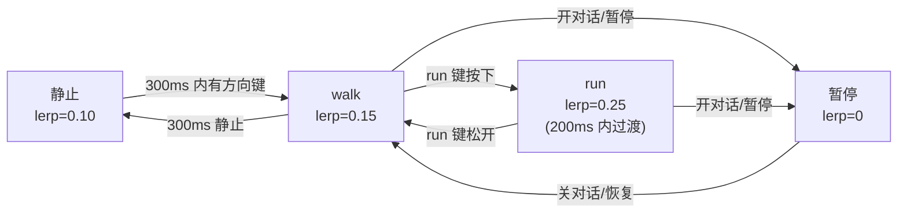
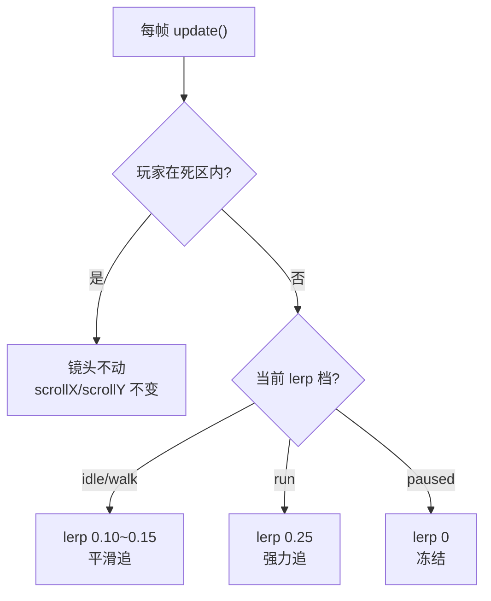
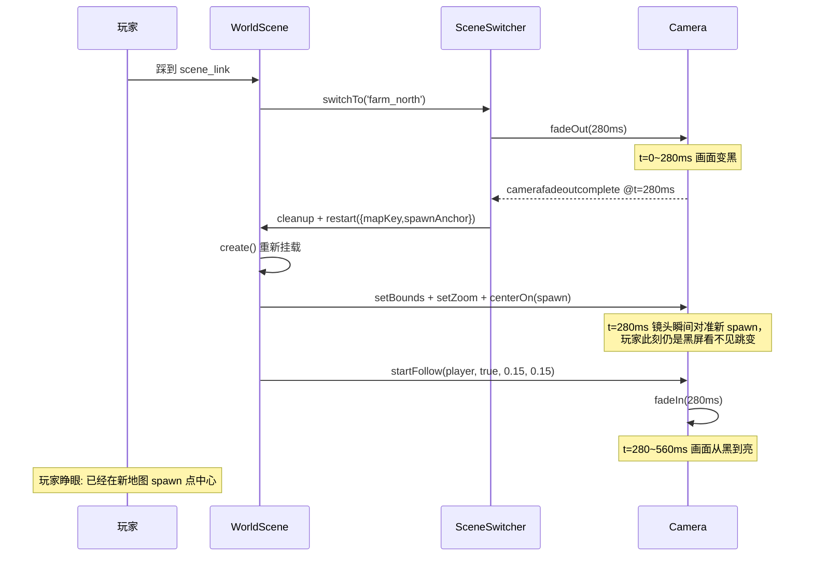

# Pythontopia 镜头跟随与缩放规范

> 版本：v1.0 · 起草日期：2026-05-24 · 状态：Draft（待 W4 验收转 Active） · 适用版本：R-12 起
> 目标读者：玩法工程师、关卡设计师、移动端工程师、QA、Beta 演示统筹
> 上游约束：`AGENTS.md`（单 Phaser Game 实例 / 8 方向降级 / 教育优先 / 不复制商业像素游戏）
> 平级文档：`docs/gameplay/r12-deepen/01-input-feel-tuning.md`、`docs/game-tilemap-conventions.md`、`docs/gameplay/world-clock-calendar.md`、`docs/gameplay/npc-ecosystem.md`
> 接口参考（仅读不改）：`frontend/src/game/scenes/WorldScene.ts`、`frontend/src/game/core/SceneSwitcher.ts`、`frontend/src/game/adapters/phaserGame.ts`

## 0. 文档定位

W1 已经把 `WorldScene` 升级为单实例 + `SUPPORTED_MAP_KEYS` 五张地图切换，并通过 `SceneSwitcher` 把 `fadeOut → cleanup → start → fadeIn` 收敛成统一管线。当前 `WorldScene` 镜头只做了三件事：`cameras.main.setBounds(0, 0, worldWidth, worldHeight)`、`startFollow(player, true, 0.15, 0.15)`、`setZoom(2)`，没有死区、没有缩放分层、没有特殊镜头事件，也没有跨场景复位策略——结果玩家急速跑动时 sprite 持续滞后于镜头中心 20–30 px，靠墙时镜头突然停而玩家继续走会「撞玻璃」，对话与节日等情绪场景只能依赖 HUD 提示而非镜头语言。

`01-input-feel-tuning.md` 把「玩家按下方向键到 sprite 移动」的 < 200 ms 链路锁死，本文紧接其后回答另一道题：

> 玩家移动 → 镜头跟随 → 镜头不出界 → 镜头响应特殊事件（对话 / 矿洞 / 节日 / KC 收获）的全套规则。

边界与不做：

- 不引入新 Phaser scene，仅围绕已实装的 `WorldScene` + `SceneSwitcher` 收敛参数。
- 不改 `WorldScene` 的 `setBounds / startFollow` 调用次数（W2 spec 已断言），只新增 `setDeadzone / setLerp / centerOn` 调用与事件钩子。
- 不替换 W1 已通过的 `frontend/tests/game/core/SceneSwitcher.spec.ts`，所有新断言只在其之上扩展。
- 不动 `docs/game-tilemap-conventions.md` §3 已规定的 depth 排序规则；本文显式约束镜头层不参与 depth 计算。

代码侧已固化的事实（本文不修改，只引用）：

| 事实 | 来源 | 用途 |
| --- | --- | --- |
| `RENDER_TILE_SIZE = 32`（`TILE_SIZE 16 × RENDER_SCALE 2`） | `WorldScene.ts` | 本文所有像素值的基础单位 |
| `CAMERA_ZOOM = 2`、`CAMERA_LERP = 0.15` | `WorldScene.ts` | 「W1 基线」，本文 §2/§5 以此为锚 |
| 视口 `width=960, height=640`，`Phaser.Scale.FIT + CENTER_BOTH` | `phaserGame.ts` | zoom=2 时世界可视 480×320 = 15×10 tile |
| `FADE_DURATION_MS = 280`（WorldScene）/ `DEFAULT_FADE_MS = 300`（SceneSwitcher） | 两处源文件 | §6 跨场景复位以两者中点为切换瞬间 |
| 单地图上限 50×40 tile = 1600×1280 px；最小不得低于视口可视范围 | `docs/game-tilemap-conventions.md` §1 | §4 边界 clamp 行为分支 |

---

## 1. 镜头目标

### 1.1 三条可观测目标

| 目标 | 玩家可观测信号 | 失败时玩家会说 |
| --- | --- | --- |
| 玩家始终位于屏幕中心 ±32 px 的舒适带 | 走、跑、停 sprite 都不会贴边或超出 60% 安全框 | 「我在哪？」 |
| 不暴露地图边界外的黑色 canvas | 任何方向走到墙：镜头停，玩家从中心偏移到屏幕边 | 「屏幕外露馅了」 |
| 急速移动 / 切场景 / 对话 / 节日 都有镜头语言 | 跑动有跟上感、对话有靠近感、烟花有拉远感、收获有短促 shake | 「镜头很死板」 |

### 1.2 安全框与舒适带

视口 960×640（zoom=2 后世界可视 480×320）划分三层框，业务层与测试断言均以世界坐标（player tile × 32）减镜头 `scrollX/scrollY` 后的相对位置为准：

| 框 | 世界像素尺寸（相对镜头中心） | 用途 | 触发动作 |
| --- | --- | --- | --- |
| 死区 dead zone | `±64 × ±64` | 玩家在框内 → 镜头**不**动 | 抑制微抖，详见 §3 |
| 舒适带 comfort | `±128 × ±96`（≈ 屏幕 53% × 60%） | 玩家在框内 → 普通 lerp 跟随 | §2.1 |
| 安全框 safe | `±192 × ±144`（≈ 屏幕 80% × 90%） | 玩家超出 → run lerp 强力追回 | §2.1 |

> **为什么 ±32 px 偏移舒适带**：32 px = 1 tile，玩家「走一步」对应「屏幕中心位移一步」，与像素 RPG（星露谷、Pokemon、牧场物语）的视觉直觉一致；±64 死区是 2 tile，正好覆盖玩家小幅左右抖动 / 朝向切换产生的次 tile 像素误差。

---

## 2. 跟随策略

### 2.1 lerp 因子分档

`Phaser.Cameras.Scene2D.Camera.startFollow(target, roundPixels, lerpX, lerpY)` 接受 `lerp ∈ [0, 1]`：1 = 瞬移、0 = 不跟。

| 玩家状态 | lerpX / lerpY | 体感 | 触发条件（业务层判定） |
| --- | --- | --- | --- |
| 静止 idle | 0.10 | 极平滑回中，掩盖死区进出抖动 | `InputIntent.move == null` 持续 ≥ 300 ms |
| 走 walk | 0.15（W1 基线） | 自然跟手 | 默认 |
| 跑 run | 0.25 | 跟得上 +50% 速度（详见 `01-input-feel-tuning.md` §1：WALK 120 px/s vs RUN 180 px/s） | run 键按下且 `vCurrent > WALK_SPEED · 1.1` |
| 对话 / 副本暂停 paused | 0（暂停 lerp） | 镜头冻结 | `dialogStore.open === true` 或 `WorldClock.gameMinutesPerRealSecond === 0` |

> **为什么 walk 0.15 → run 0.25**：玩家从 walk 切到 run 速度提升 50%（120 → 180 px/s），lerp 同步从 0.15 提到 0.25 后，镜头追赶单帧位移提升 67%，足以让 sprite 始终留在舒适带内。若 lerp 不动而 sprite 加速，sprite 会一帧帧外漂直到超出舒适带；若 lerp 再高则镜头先于玩家「抢跑」产生失重感，星露谷 1.5 版本曾在 0.30 lerp 下出现玩家投诉。

### 2.2 lerp 平滑过渡

walk ↔ run lerp 切换不允许瞬变，必须在 200 ms 内线性过渡，否则镜头会「卡顿一下」。具体在业务层用 `Phaser.Math.Linear` 每帧插值 `currentLerp`，并在 `update` 中调用 `cameras.main.setLerp(currentLerp, currentLerp)`。



---

## 3. 死区矩形（dead zone）

### 3.1 数值与实现

| 项 | 值 | 依据 |
| --- | --- | --- |
| `deadZoneWidth` | 128 px（玩家中心 ±64） | 2 tile，覆盖朝向切换 16 px 子像素抖动 + 1 tile 操作冗余 |
| `deadZoneHeight` | 128 px | 同上，保持各向同性，避免上下走比左右更敏感 |
| 实现 API | `cameras.main.setDeadzone(128, 128)` | Phaser 3 内置矩形死区，原点为镜头中心 |

> **为什么是 ±64 而不是 ±32**：±32 = 1 tile，玩家朝向切换瞬间 sprite 中心点会因 8 方向输入降级到 4 向（详见 AGENTS.md「8 方向输入降级」与 `01-input-feel-tuning.md`）而偏移约 8 px；若死区仅 ±32，每次掉头镜头都会被牵动 4 px，肉眼可见「抖一下」。±64 给出 2 tile 缓冲带，足以吸收朝向抖动 + lerp 过渡余震。

### 3.2 死区与 lerp 的交互

死区**先于** lerp 判定：玩家落在死区内，`startFollow` 输出 (0,0) 偏移，lerp 因子不参与计算；走出死区瞬间才按 §2 lerp 计算插值。两者解耦后，「轻微输入抖动」与「持续移动」在镜头层是完全不同的两种行为：



---

## 4. 地图边界 clamp

### 4.1 不变量

`WorldScene.create` 已经调用 `cameras.main.setBounds(0, 0, worldWidth, worldHeight)`，本文进一步约束三条不变量：

1. **bounds 不可缺省**：任何地图加载完毕都必须设过 bounds，否则镜头会跟玩家走出 canvas 暴露黑边。`BootScene` 在 tilemap 加载失败时已 fallback 到占位地图，**不得**跳过 setBounds。
2. **bounds 严格等于 `mapWidth × RENDER_TILE_SIZE`**：50×40 地图 → `1600×1280`；不允许多 / 少一 tile。
3. **小于视口的地图必须居中显示**：若 `worldWidth < 480` 或 `worldHeight < 320`（zoom=2 下视口），bounds 仍设为真实地图尺寸，但镜头中心固定到地图中心。Beta 五张地图均 ≥ 30×20 tile = 960×640，不触发此分支，但 R-13 室内小副本会用到。

### 4.2 靠墙偏移行为

玩家走到墙边时，镜头被 bounds clamp 住不动，玩家从屏幕中心偏移到边缘。这是符合直觉的：

| 玩家位置（tile） | 镜头 `scrollX` | 玩家在屏幕的相对位置 |
| --- | --- | --- |
| 地图正中央 (25, 20) | 720（地图中心 800 − 视口 480/2） | 屏幕正中 |
| 地图最左侧 (0, y) | 0（clamp 到 bounds 左边） | 屏幕左侧约 −240 px |
| 地图最右侧 (49, y) | 1120（clamp 到 bounds 右边） | 屏幕右侧约 +240 px |

> **为什么允许偏移**：星露谷 / Pokemon / Stardew 类像素 RPG 普遍接受「靠墙时玩家不在屏幕中心」，因为它是「我看到了边界，所以不能再往那边走」的最有效视觉反馈；强行让镜头跨越 bounds 会暴露 canvas 背景，破坏沉浸感。

---

## 5. 缩放策略

### 5.1 五档 zoom

| 设备 / 场景 | zoom | 可视世界范围 | 依据 |
| --- | --- | --- | --- |
| 桌面 Web（默认） | 2.0（W1 基线） | 480 × 320 px = 15 × 10 tile | 与 W1 已部署值一致，像素清晰、性能稳定 |
| 桌面 4K 高 DPR | 2.0 | 同上 | `Phaser.Scale.FIT` 等比放大 canvas，zoom 不动 |
| Android / iOS 横屏 | 2.5 | 384 × 256 px = 12 × 8 tile | 手机屏窄，2.5 倍让单个 NPC sprite ≥ 80 px 高，可点可看 |
| Android / iOS 竖屏 | 2.2 | 436 × 290 px ≈ 13.6 × 9 tile | 竖屏视野更窄，底部 HUD 让出 80 px（§9.1），zoom 适中避免迷路 |
| 节日烟花 / 港口远景 | 1.5（瞬时） | 640 × 426 px = 20 × 13 tile | 短时拉远制造「全景感」，详见 §7.3 |

**硬上限 zoom = 3.0**：超过 3.0 时 16×16 原始 tile 会被放大到 ≥ 48 px，反而暴露像素插值毛刺，且单屏可视 < 10 tile，玩家容易迷路。

### 5.2 zoom 切换协议

zoom 切换**必须用 tween** 而不是直接赋值，否则镜头会「咔嚓」跳一帧：

```ts
this.tweens.add({
  targets: this.cameras.main,
  zoom: targetZoom,
  duration: 320,
  ease: 'Sine.easeInOut',
});
```

切换时长 320 ms 与 `FADE_DURATION_MS = 280` 同量级，保证「换图、对话、节日」三类场景下镜头节奏一致。

---

## 6. 跨场景切换镜头复位

### 6.1 复位时机

`SceneSwitcher.switchTo` 已固化 `fadeOut → cleanup → start → fadeIn` 管线，本文在其 fadeOut 完成（即 280 ms 中点）插入镜头复位钩子：



### 6.2 复位关键点

1. **不能用 `startFollow` 默认轨迹切**：默认会让镜头从旧场景 `scrollX` 平滑插值到新场景，肉眼可见「镜头先飘 200 ms 再到位」；跨场景必须用 `centerOn(x, y)` **瞬间**对准。
2. **必须在 fadeOut 完成后 / fadeIn 启动前对准**：这一瞬间画面全黑，玩家看不到任何镜头跳变；若在 fadeIn 启动后才对准，玩家会先看到错误位置再被拉回。
3. **新场景 spawn 优先级**：`spawnAnchor → spawn object → mapIndex.spawn → (5,5)`，与 `docs/game-tilemap-conventions.md` §6.2 一致；本文不重复定义优先级，仅约束镜头跟随发生在落点确定**之后**。
4. **复位时清空 deadZone 与 lerp 状态**：避免上一张地图末尾的 dead zone 命中残留导致新场景首帧不跟。

---

## 7. 特殊镜头事件

四类事件覆盖「对话、空间过渡、节日、教育反馈」四个维度，全部由业务层通过 `worldCameraBus` 单事件总线触发，镜头层只接收事件不反查业务状态。

### 7.1 对话开启：镜头微平移到玩家与 NPC 中点

| 项 | 值 | 依据 |
| --- | --- | --- |
| 触发 | `dialogStore.open` 由 false → true | 与 `WorldScene` 现有 `openNpcDialog` 同源 |
| 目标点 | `((playerX + npcX) / 2, (playerY + npcY) / 2)` | 几何中点，最大化两人都在画面里的几率 |
| 平移耗时 | 240 ms | 比 fade 短一档，对话刚拉开就完成位移 |
| 缓动 | `Sine.easeInOut` | 与 zoom tween 同 ease，统一镜头语言 |
| 触发后 lerp | 0（暂停跟随，§2.1） | 对话期间镜头冻结，避免 NPC 微动牵动镜头 |

实现伪代码（业务层；本文不写入仓库）：

```ts
worldCameraBus.on('dialog:open', ({ npcKey }) => {
  const npc = state.npcs.find((n) => n.npcKey === npcKey);
  if (!npc) return;
  const midX = (player.tileX + npc.tileX) * 32 / 2 + 16;
  const midY = (player.tileY + npc.tileY) * 32 / 2 + 16;
  scene.tweens.add({
    targets: scene.cameras.main,
    scrollX: midX - scene.cameras.main.width / (2 * scene.cameras.main.zoom),
    scrollY: midY - scene.cameras.main.height / (2 * scene.cameras.main.zoom),
    duration: 240, ease: 'Sine.easeInOut',
  });
  scene.cameras.main.setLerp(0, 0);
});
```

### 7.2 矿洞下层入口：镜头先抬高暗示「下沉」

| 项 | 值 | 依据 |
| --- | --- | --- |
| 触发 | 玩家踩到 `mine_south` 内 `trigger_descend_*` | 矿洞 5 层副本入口（R-13 实装，本文预留契约） |
| 抬高量 | `scrollY -= 100 px`（约 3 tile） | 镜头比玩家高 3 tile 制造「我要下到深处」的视觉预演 |
| 抬高耗时 | 600 ms | 长于普通对话，让玩家明确感知「地形要换了」 |
| 完成后 | fadeOut → 切下层场景 → fadeIn 时镜头回归默认 | 与 §6 复位一致，避免新场景首帧错位 |

### 7.3 节日烟花：镜头拉远到 zoom = 1.5

| 项 | 值 | 依据 |
| --- | --- | --- |
| 触发 | `WorldClock` `festival-started` 事件 | 16 节日全部走同一事件（详见 `world-clock-calendar.md` §7） |
| 目标 zoom | 1.5 | §5.1 表中的「全景」档；视野扩展到 20×13 tile，覆盖 town_hub 大半 |
| 拉远耗时 | 1200 ms | 烟花总时长 ~6 s，拉远 + 停留 + 收回各占 1/3 |
| 收回时机 | 烟花动画完成或 `festival-ended` | 自动收回到当前设备 §5.1 默认 zoom |
| dead zone | 临时扩大到 ±128（4 tile） | 拉远后玩家像素位移更小，dead zone 同步放大避免镜头跟得太敏 |

### 7.4 KC 收获：短促 shake

| 项 | 值 | 依据 |
| --- | --- | --- |
| 触发 | `kc_mastery_event.delta > 0` 且 mastery 跨过 0.8 阈值（作物收获） | 与 `economy-system.md` §1.2「收获作物 +8~50 Pythoco」同源 |
| shake API | `cameras.main.shake(20, 0.005)` | 持续 20 ms、强度 0.005（≈ 屏幕高 3 px） |
| 不可叠加 | 同 KC 1 秒内多次触发只 shake 1 次 | 防止连击收获震到玩家眩晕 |

> **为什么仅 20 ms**：星露谷收获 0 ms（无 shake），Pokemon 升级 250 ms 大震；Pythontopia 取中间——既有「收获到了」的触觉反馈，又不会打断走位。

---

## 8. Z 轴 / 渲染顺序

### 8.1 镜头不改 depth

`docs/game-tilemap-conventions.md` §3 已规定：玩家与 NPC 的 `depth` 在每帧 `update` 中由 `obj.setDepth(obj.y)` 动态计算，y 坐标大的盖住 y 小的，制造前后空间感。

本文严格遵守：镜头层**只改** `scrollX / scrollY / zoom / shake`，**不改** 任何 GameObject 的 `depth`、`scale`、`alpha`。理由：

1. depth 排序属于「场景内空间逻辑」，与「观察者位置」正交；改 depth 会让玩家在镜头平移瞬间看到 NPC 突然钻到房屋前 / 后。
2. zoom 由 `cameras.main.setZoom` 整体放缩，所有 sprite 等比缩放，相对 depth 不变。
3. shake 是 `scrollX/Y` 的瞬时扰动，不修改世界坐标，depth 自动跟随。

### 8.2 验证清单

| 检查项 | 期望 |
| --- | --- |
| zoom 切换 2 → 1.5 期间，玩家走到 NPC 身后 | 玩家被 NPC 遮挡（depth: NPC.y > player.y） |
| 对话开启镜头平移 240 ms 内 | NPC 与玩家相对前后关系不变 |
| 节日 shake 20 ms 内 | overlay 树冠仍盖在玩家头上（depth = 9999） |
| 跨场景切换 fadeIn 首帧 | 玩家 depth = player.y，与 NPC 正确遮挡 |

---

## 9. 移动端竖屏 / 横屏

### 9.1 屏幕方向与 HUD 让位

| 方向 | zoom | HUD 占位 | 镜头可视范围 | 触发判定 |
| --- | --- | --- | --- | --- |
| 横屏 Landscape | 2.5 | 顶部 chip 32 px + 底部气泡 36 px | 384 × 256 px | `screen.orientation.type.startsWith('landscape')` |
| 竖屏 Portrait | 2.2 | 顶部 chip 32 px + 底部 HUD **80 px** | 436 × 263 px（已扣 HUD） | `screen.orientation.type.startsWith('portrait')` |
| 旋转过渡（200 ms 内） | 上次 zoom 值保持 | HUD 切换 | — | `orientationchange` 事件 |

**竖屏 80 px HUD** 与 `docs/gameplay/r12-deepen/01-input-feel-tuning.md`（虚拟摇杆区）一致，把摇杆 + 行动键 + 包/技能 chip 全部放底部右手区域，镜头可视范围扣掉这 80 px 高度防止 sprite 被 HUD 遮住。

### 9.2 设备检测

不依赖 UserAgent（易被 Web View 伪装），改用 media query：

```ts
const isMobile = window.matchMedia('(pointer: coarse) and (hover: none)').matches;
const isPortrait = window.matchMedia('(orientation: portrait)').matches;
```

镜头 zoom 应在 `phaserGame.ts` 启动 + `resize` 事件双重监听下重算，业务层调 `cameras.main.setZoom(...)` 走 §5.2 tween 协议。

---

## 10. 可调参数：cameraTuning.config.ts

所有「魔术数字」必须集中在 `frontend/src/game/config/cameraTuning.config.ts`（本文规定新建路径，实装由 W4 工程师落地）。约束：

1. **导出常量必须 readonly + `as const`**，禁止业务层运行时修改。
2. **每个常量必须有 JSDoc 说明来源章节**（例：`/** §3 死区，2 tile = 64 px */`）。
3. **本仓库 grep 命中点**：除该 config 文件外，任何 `frontend/src/game` 下不允许出现下表常量的字面量；CI 由 `frontend/tests/game/camera-tuning.spec.ts`（W4 实装）做静态扫描断言。

| 常量名 | 默认值 | 章节 | 用途 |
| --- | --- | --- | --- |
| `LERP_IDLE` | 0.10 | §2.1 | 静止态 lerp |
| `LERP_WALK` | 0.15 | §2.1 | walk lerp（与 W1 一致） |
| `LERP_RUN` | 0.25 | §2.1 | run lerp |
| `LERP_TRANSITION_MS` | 200 | §2.2 | walk↔run 过渡 |
| `DEAD_ZONE_PX` | 128 | §3.1 | 死区边长 |
| `ZOOM_BASE` | 2.0 | §5.1 | 桌面默认 |
| `ZOOM_MOBILE_LANDSCAPE` | 2.5 | §5.1 / §9.1 | 手机横屏 |
| `ZOOM_MOBILE_PORTRAIT` | 2.2 | §5.1 / §9.1 | 手机竖屏 |
| `ZOOM_FESTIVAL` | 1.5 | §5.1 / §7.3 | 节日全景 |
| `ZOOM_MAX` | 3.0 | §5.1 | 硬上限 |
| `ZOOM_TWEEN_MS` | 320 | §5.2 | zoom 平滑 |
| `DIALOG_PAN_MS` | 240 | §7.1 | 对话平移 |
| `MINE_DESCEND_OFFSET_Y` | -100 | §7.2 | 矿洞抬高 |
| `MINE_DESCEND_MS` | 600 | §7.2 | 矿洞抬高时长 |
| `HARVEST_SHAKE_MS` | 20 | §7.4 | KC 收获 shake |
| `HARVEST_SHAKE_INTENSITY` | 0.005 | §7.4 | shake 强度 |

> **为什么集中常量**：Beta 上线两周后必然要按真实玩家反馈微调 lerp / dead zone / zoom，集中后调参是 1 个 PR 改 1 个数；散落在 WorldScene / NpcFramework / SceneSwitcher 各处则需要跨 3+ 文件改动。这也是 `economy-system.md` §7 把所有经济参数放进 `balance.json` 的同构理由。

---

## 11. 验收

### 11.1 Playwright E2E（4 条断言场景）

所有断言读取 `window.__pythontopia.scene.cameras.main` 上的 `scrollX / scrollY / zoom / midPoint`（生产构建仅在 `import.meta.env.DEV === true` 时挂载 `__pythontopia`，详见 `world-clock-calendar.md` §6 Debug 控制台约束；E2E 启动时强制 dev 模式注入）。

| 场景 | 操作 | 可断言 API | 期望 |
| --- | --- | --- | --- |
| 1. 边界停镜头 | 玩家从 (25,20) 向左走到 tile (0, y) | `cameras.main.scrollX` | 等于 `0`（≤ 1 px 误差），且玩家屏幕坐标偏左 |
| 2. run vs walk 跟随差 | 同一路径走 vs 跑各 500 ms，记录第 250 ms 时刻 sprite 与镜头中心偏移 | `(player.x - cameras.main.midPoint.x)` | walk 偏移绝对值 > run 偏移绝对值，差值 ≥ 10 px |
| 3. 场景切换镜头复位 | 从 town_hub 走到 farm_north 入口，断言 fadeIn 完成后镜头中心 | `cameras.main.midPoint` | 等于新地图 spawn 像素坐标 ± 2 px |
| 4. 对话镜头平移 | 走到 mayor_py 旁按 E，断言 240 ms 后镜头中心 | `cameras.main.midPoint` | 等于 (player + npc) 中点 ± 2 px |

E2E spec 落点：`frontend/tests/e2e/camera-follow.spec.ts`（W4 实装；本文不创建）。

### 11.2 单元 / 集成测试

| 测试 | 形式 | 断言 |
| --- | --- | --- |
| `cameraTuning.config.spec.ts` | Vitest | 所有常量值与本文 §10 表格一致；任何修改触发 CI 红 |
| `WorldScene.camera.spec.ts` | Vitest + jsdom + phaser mock | `create()` 后 `setBounds` 被调过、参数正确；`startFollow(player, true, LERP_WALK, LERP_WALK)` 被调过 |
| `WorldScene.deadzone.spec.ts` | Vitest | mock `cameras.main.setDeadzone`，断言被以 (128, 128) 调过 1 次 |

### 11.3 体验抽样（人工）

1. 桌面 1920×1080 全屏，连玩 5 分钟，玩家 sprite 中心始终在屏幕 ±32 px 安全带内，run 时不超 ±64 px。
2. 手机 6.1" 屏横竖切换 5 次，无肉眼可见镜头跳变或 sprite 闪烁。
3. 触发节日烟花、对话、KC 收获、跨场景切换各 1 次，4 类镜头语言可被玩家不看 HUD 直接感知（盲测：「你刚刚是不是在过节？」「是」→ 通过）。

---

## 12. 回归基线

本文上线必须保证下列已通过测试不退化：

| spec | 路径 | 关注点 |
| --- | --- | --- |
| W1 SceneSwitcher | `frontend/tests/game/core/SceneSwitcher.spec.ts` | fadeOut → cleanup → start 主链 + 超时兜底；本文 §6 仅在该管线「中点」插入镜头复位钩子，不得改其外部行为 |
| W2 WorldScene | `frontend/tests/game/scenes/WorldScene.spec.ts` | `setBounds / startFollow / setZoom` 调用次数；本文允许新增 `setDeadzone / setLerp` 调用，但不得删除已有调用 |
| W2 HudShell | `frontend/tests/components/HudShell.spec.ts` | 顶部 chip 与底部 slot 位置；本文 §9.1 竖屏 80 px HUD 让位仅扩展，不挤压现有布局 |

任何回归失败必须在合入前修复，或显式标 `// W4-camera-follow 引入，待 follow-up` 并在 docs/r12-deepen 内同步开 issue 链接。

---

## 13. 风险与缓解

| 风险 | 触发场景 | 缓解 |
| --- | --- | --- |
| lerp 过低导致跟不上 run | 玩家长按 run 跨场景边界 | §2.1 run lerp 0.25 + §1.2 安全框 ±192 兜底；玩家超出安全框时强制 `cameras.main.centerOn(player.x, player.y)` 瞬间对位 |
| dead zone 过大让玩家「贴到边」 | 玩家 1 tile 走动 + 死区 ±64 = 1 步在死区内不响应 | 死区是观察镜头的，不影响 sprite 移动；玩家位移与镜头跟随是两个独立系统 |
| 移动端 zoom 切换闪烁 | 手机横竖切换时 zoom 同步变 | §5.2 强制 tween 320 ms；旋转事件防抖 200 ms 避免快速翻转触发多次 tween |
| 节日 zoom = 1.5 暴露地图外黑边 | 玩家在小地图（< 640×480）触发烟花 | bounds clamp + §4.1 第 3 条小地图居中显示；烟花仅在 town_hub 触发（最大 50×40），实际不会暴露 |
| Debug 控制台改 zoom 到 5 | 学生在 F12 改 `cameras.main.setZoom(5)` | 仅本地客户端表现，不影响后端数据；§5.1 硬上限 3.0 在生产构建中通过 `setZoom` wrapper 强制 clamp |
| 多 NPC 对话连续触发镜头跳跃 | 玩家 1 秒内点 3 个 NPC | dialog store 同时刻只允许 1 个 open，多个调用走队列；镜头平移亦走队列，避免抢占 tween |
| KC 收获 shake 触发频率过高 | 玩家在丰收祭一次性收获 20 KC | §7.4 同 KC 1 秒内只 shake 1 次；全局 1 秒内 shake 不得 > 3 次，超出忽略 |
| 跨场景复位错位 1 帧 | spawnAnchor 解析慢导致 `centerOn` 在 fadeIn 启动后才执行 | §6.2 强制在 `camerafadeoutcomplete` 同步回调内调 `centerOn`，与 fadeIn 启动同帧；E2E 场景 3 兜底 |

---

-- 子代理生成于 2026-05-24 (UTC+08:00)
