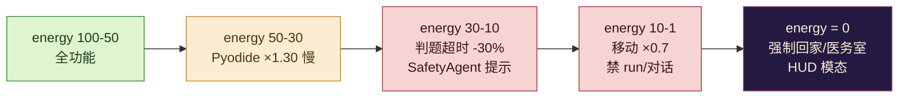

# Pythontopia 能量与疲劳曲线设计

> 版本：v1.0 · 起草日期：2026-05-24 · 适用版本：R-12 起 · 状态：Draft（待 W5 验收转 Active）
> 目标读者：玩法工程师、教学策划、画像分析师、后端节奏 owner、班级教师
> 平级文档：`docs/gameplay/economy-system.md` §7（balance 总表，Energy/day 一行）、`docs/gameplay/world-clock-calendar.md` §2/§9（时段与晚睡警告）、`docs/gameplay/player-progression.md` §7（流失风险）、`docs/mastery_formula.md`（mastery 权威源）、`docs/product/profile_schema.md` §8（8 维画像）

## 0. 文档定位

`HudMeta.energy` 在 W4 已经作为 0-100 的整型 chip 出现在 `HudShell.vue` 顶部状态条（参见 `frontend/src/stores/hud.ts:32`），但目前**只是一个空数字**——既没有消耗规则，也没有回复机制，更没有与教学事件耦合。本文负责把这条"占位状态条"升级为完整的**能量与疲劳曲线系统**：定义数值、消耗 / 回复来源、惩罚曲线、过劳保护、与画像 / 经济 / 时钟 / 教学事件的全部耦合点。

文档严格遵守 `AGENTS.md` 的三条硬约束：

1. **画像即真相**：每一次能量变化必须可追溯到一条 `world_event(type='energy_changed', payload={delta, source})`，画像维度才有可信观测数据。
2. **后端是唯一真相**：前端 HUD 实时展示，后端 `world_session.energy` 是最终值；多设备 / 跨日同步以服务端为准。
3. **教育优先于游戏化**：能量不是 KPI 收割工具，而是"主动休息节奏"的可视化抽象——低能量 = 教学上的"该换换脑子"。

> **参考行业基线**：
>
> - 星露谷物语 stamina 上限 270，单日"全肝"≈ 4 现实小时即归零；Pythontopia 选用 100 是因为我们的"游戏天"只有 24 真实分钟（`world-clock-calendar.md` §1），单日能量预算更小、节奏更紧凑，整数刻度对学生心算友好。
> - RuneScape / Path of Exile 等长寿 MMO 的"连续 6 小时强制登出"是欧美监管下的成年玩家心理学共识；教育版进一步收紧为 4 小时降上限、6 小时强制存档退出。

---

## 1. 能量与教育对齐

能量条不是装饰，它把"学习疲劳-休息节奏"直接量化进玩法：

| 教育现象 | 能量映射 | 触发的玩法行为 |
| --- | --- | --- |
| 专注力耗尽，看课件走神 | energy 50-30 区间 | Pyodide 卡顿，提示玩家"换换脑子" |
| 疲劳积累，做题反复出错 | energy < 30 | 判题超时阈值缩短，逼玩家停手或求助 NPC |
| 严重过劳，不该继续学 | energy = 0 | 强制走回家 / 医务室，对应"主动休息"的元认知训练 |
| 健康作息 | energy 80-100 | 全功能解锁，Pyodide / 判题 / 跑步 / 对话全开 |

**核心立场**：能量 = 玩家当日剩余可消耗的"专注力 + 体力"，而不是单纯的"体力条"。设计的成功标志不是"玩家把能量用到 0"，而是"玩家自发在 30 之前停下来吃饭 / 午休"，这就是教育层面的元认知信号。

> 与星露谷的差异：星露谷耗尽 stamina 后会扣血并强制睡到第二天 10 点，惩罚是粗暴的"睡过头"；Pythontopia 不扣 mastery，只关掉部分玩法功能，并触发 `SafetyAgent` 提示，避免把"学不动"等同于"玩不下去"的反教育隐喻。

---

## 2. 能量数值定义

| 字段 | 类型 | 范围 | 含义 |
| --- | --- | --- | --- |
| `world_session.energy` | INT | 0-100 | 当前能量值，DB 持久化，权威源 |
| `world_session.energy_cap` | INT | 60-110 | 当日上限（节日 / 过劳浮动） |
| `HudMeta.energy` | number | 0-100 | 前端 HUD 实时显示，由 `useHudStore.syncMeta` 同步 |
| `EnergyEvent.delta` | INT | -100..+100 | 单次变化量，正值=回复、负值=消耗 |

### 2.1 起床能量规则

| 上一晚行为 | 起床时间 | 起床 energy | 当日 energy_cap |
| --- | --- | --- | --- |
| 22:00-01:00 前点 F 睡觉（健康作息） | 次日 06:30 | **100** | 100 |
| 01:00-04:00 才睡（晚睡） | 次日 07:30 | **80** | 100 |
| 04:00 后睡 / 通宵 | 次日 09:00 | **60** | **90**（疲劳累积） |
| 离线超过 1 真实天（强制 sleep 弹窗） | bootstrap 推日时 | **100** | 100，按"假期回顾"处理（参考 `world-clock-calendar.md` §11） |

> 触发逻辑由后端 `WorldAdvanceService.sleep()` 在写库时同步计算：根据 `world_session.last_active_at` 距 `sleep` 调用的真实分钟差判定"上一晚行为"，写入 `world_event(event_type='ENERGY_REFRESH', payload={reason, new_energy, new_cap})`。前端不参与该判定，避免学生通过改本地时钟刷满能量。

### 2.2 下限与封顶

- **下限**：硬性 0，不允许为负。`MasteryEvaluator` 也不允许"负能量换 mastery"。
- **上限**：默认 100；过劳触发时（§6）动态下调至 80 / 60，但已有 energy **不会被立刻削减**，只影响后续回复封顶。
- **整数化**：所有 delta 强制 round 到整数，避免出现 `energy=83.4` 这种花里胡哨的数字让玩家心算崩溃。

---

## 3. 消耗速率表

每个动作的消耗写入 `frontend/src/game/core/energyTuning.config.ts`（待 W5 创建），由前端读取后通过 `POST /api/world/energy/consume` 上报到后端，后端校验后写 `world_session.energy` + `world_event`。前端**不允许直接修改本地 energy**（这是 `world-clock-calendar.md` §8.1 同款"后端是唯一真相"约束）。

### 3.1 移动类（按时间累计）

| 动作 | 消耗 | 计费窗口 | 备注 |
| --- | --- | --- | --- |
| `walk`（4 向 / 8 向） | **-2** | 每 30 真实秒（30 游戏分钟） | 站立不耗能 |
| `run`（Shift 加速） | **-5** | 每 30 真实秒 | energy < 10 时禁用（§5） |
| `idle` | 0 | - | 站立 / 对话冷却 / 进店都不耗能 |

### 3.2 农事类（按动作次数）

| 动作 | 消耗 | 触发位点 |
| --- | --- | --- |
| `water` 浇水 1 块田（= 阅读对应 KC 1 页课件） | **-3** | `WorldScene` 浇水回调 |
| `hoe` 翻地（开新 KC 种植位） | **-4** | 同上 |
| `harvest` 收获（mastery ≥ 0.8 触发） | **-2** | 同上 |
| `mine` 矿洞挖 1 次 Bug 矿石 | **-10** | `MineScene` 进入 / 攻击 |
| 矿洞 Boss 战胜利 | **-25** | Boss 击杀回调，含战斗全部消耗 |

### 3.3 学习类（按教学事件）

| 动作 | 消耗 | 后端事件 |
| --- | --- | --- |
| 提交一次正式判题（无论通过 / 失败） | **-8** | `practice_submission.created_at` |
| 阅读课件 1 页（duration ≥ 30s 才计） | **-2** | `page_read` |
| 查看一份学习资源（MindMap / Storyboard 全文展开） | **-2** | `learning_resource.viewed_at` |
| 完成 1 次 CodeLab Pyodide 预览 | **-1** | 前端本地计，每分钟封顶 -5 |

### 3.4 社交类

| 动作 | 消耗 | 备注 |
| --- | --- | --- |
| 与 NPC 对话累计 5 真实分钟 | **-3** | 由 `npc_state.last_talk_at` 推算 |
| 单次班级 PK 任务 | **-15** | 任务起点扣，无论胜负 |
| 班级公告板浏览 | 0 | 信息流不耗能 |

### 3.5 防刷条款

| 触发条件 | 额外消耗 | 教育意图 |
| --- | --- | --- |
| 同一 KC **第 3 次连续浇水** | **-15**（在常规 -3 之上叠加） | 防止"刷阅读 page_read 换 mastery"，强制玩家轮换 KC |
| 同一题 24h 内 **第 6 次提交** | **-20**（在常规 -8 之上叠加） | 防止"枪毙式刷题"，配合 `PRACTICE_FAIL` 双重惩罚 |
| 同一 NPC 24h 内对话 > 5 次 | **-10** / 次 | 防"刷好感度刷礼物" |

> 防刷条款是 §5 疲劳惩罚之外的"经济性反作弊"，与 `economy-system.md` §8 的拍卖行价格监控同构。

---

## 4. 回复机制

### 4.1 食物与药水（消耗品）

对齐 `economy-system.md` §2.4 `consumable` 类道具，所有食物 / 药水回复都按"每日首次双倍 / 后续半价"递减，避免单一刷食物。

| 道具 | 基础回复 | 当日首次 | 后续 | 上限 |
| --- | --- | --- | --- | --- |
| `consumable_coffee_basic` 现磨咖啡 | +5 | +10 | +5 | 4 次 / 日 |
| `consumable_bread_whole` 全麦面包 | +10 | +20 | +10 | 3 次 / 日 |
| `chef_meal_today` 厨师当日推荐菜 | +20 | **+20**（不递减） | 当日不再卖 | 1 次 / 日 |
| `consumable_pomodoro_potion` 番茄钟续命水 | +25 | +25 | +25 | 1 次 / 日（昂贵） |

### 4.2 休息场景

| 场景 | 触发动作 | 回复 | 时长 | 副作用 |
| --- | --- | --- | --- | --- |
| 家中沙发 / 医务室坐席 | 玩家进入并按 F | **+30** | 真实 5 分钟（动画 lerp） | 时段流逝 5 游戏小时（与 `WorldClock.tick(300_000, 60)` 一致） |
| 家中午休（11:00-13:00） | 玩家在床上按 F | **+50** | 真实 1 分钟 | 时段直接推进到 13:00（noon 结束） |
| 长椅 / 公园石凳 | 玩家进入并按 F | **+15** | 真实 2 分钟 | 时段流逝 2 游戏小时 |
| 教室自习 | 进入并按 F | **+0**（不回复，但暂停所有消耗 2 分钟） | 真实 2 分钟 | 用来配合"复盘"，避免边读课件边掉能量 |

> 午休是唯一"推时段 + 回大量能量"的合并操作；故意只开 11:00-13:00 窗口，是要把现实学生"中午回宿舍小睡"的健康作息内化为玩法。

### 4.3 节日特殊回复

参考 `docs/gameplay/r12-deepen/05-festival-events.md`，下列为本期约定的能量加成：

| 节日 | 当日 effect | 教学意图 |
| --- | --- | --- |
| `spring_opening` 开学集会 | 全日 `energy_cap` +10（封顶 110） | 新学期高能 |
| `summer_marathon` 编程马拉松 | 提交 1 次额外 +5 energy | 高强度补偿 |
| `harvest_festival` 丰收祭 | 收获自动 +2 energy | 正反馈节日 |
| `class_review` 课程总评 | 阅读课件 +1 energy（部分抵消） | 鼓励冲刺复盘 |

### 4.4 被动回复

| 来源 | 回复 | 触发 |
| --- | --- | --- |
| 雨天户外站立 | +1 / 真实分钟 | 仅 RAINY 天，封顶累计 +10 |
| 晴天农田站立 | +1 / 真实分钟 | 仅 SUNNY 天（与 `world-clock-calendar.md` §3.1 NPC 对话密度联动） |
| 跨日 sleep | 见 §2.1 | 后端独占 |

---

## 5. 疲劳惩罚曲线

能量越低，惩罚越大，**前端立刻可感**。所有惩罚都是"功能性递降"，不直接扣 mastery，避免反教育。



### 5.1 详细分档

| 区间 | Pyodide 执行 | 判题超时 | 移动速度 | run | 新对话 | 视觉反馈 |
| --- | --- | --- | --- | --- | --- | --- |
| 100-50 | ×1.00 | 100% | ×1.00 | OK | OK | 绿色 HUD bar |
| 50-30 | **×1.30** | 100% | ×1.00 | OK | OK | 黄色 HUD bar，每 5 分钟 toast 一次"该换换脑子" |
| 30-10 | ×1.30 | **缩短 30%**（5s → 3.5s） | ×1.00 | OK | OK | 橙色 HUD bar，SafetyAgent 推送 1 条系统消息 |
| 10-1 | ×1.30 | 缩短 30% | **×0.70** | **禁用** | **禁用** | 红色 HUD bar 闪烁 1Hz |
| 0 | n/a | n/a | **强制 walk** | 禁用 | 禁用 | **HUD 弹"小睡一下吧"模态**，唯一可点击的目标是"回家 / 医务室" |

### 5.2 惩罚的"无 mastery 损失"原则

- **不扣 mastery**：能量惩罚只影响"操作流畅度"，不写 `kc_mastery_event`。
- **不扣 Pythoco**：能量与经济解耦，避免"穷得连饭都吃不起"的死循环。
- **不掉好感**：能量低时退出对话不算"冷落 NPC"，`npc_state.friendship` 不变。

> 与星露谷"过劳扣血"的本质区别：我们不惩罚学习者的"想学但学不动"，只在 UI 层让玩家**自然停手**。

### 5.3 强制走回家模态

`energy = 0` 时弹出全屏模态（`HudShell.vue` 新增 `emergency` slot）：标题「小睡一下吧」、文案「你已经很努力了。回家或医务室坐 5 分钟就能满血复活。」按钮二选一——「回家」自动寻路且路上 NPC 不再触发对话，「去医务室」自动寻路且路过 NPC 强制 mood = 'CONCERNED'。**无关闭按钮**，玩家必须二选一才能继续操作。

---

## 6. 过劳保护（防肝玩家）

教育版伦理底线：杜绝"通宵刷小镇"的反健康行为。所有阈值以"单日连续会话"为准（`world_session.last_active_at` - `started_at` 真实分钟差）。

| 累计时长 | 触发 | 强制度 | 教学意义 |
| --- | --- | --- | --- |
| 120 分钟 | 顶部 toast「你已游戏 120 分钟，建议休息眼睛」 | **软提醒**，可关闭 | 类比番茄钟休息提醒 |
| 180 分钟 | 顶部 toast「已 180 分钟，能量上限会受影响」 | **预告**，可关闭 | 给玩家自主退出窗口 |
| 240 分钟 | energy 上限锁 **80**（已超额部分按 80 截断），HUD bar 上方显示「过劳」徽章 | **硬限制** | 鼓励玩家退出 / 切到看课件 |
| 300 分钟 | 弹模态「建议保存进度退出，明天再来」+ 提供「再玩 30 分钟」按钮（30 分钟后再次弹） | **半硬**，玩家可点继续但被记录 | 抵抗 sunk-cost 心理 |
| 360 分钟 | **强制存档退出**：自动调 `SaveSlotService.save` + 跳登录页 | **硬退出** | 教育版伦理 / 监管侧无可妥协 |

### 6.1 后端落库

| 阈值 | 写入 |
| --- | --- |
| 120 / 180 | `world_event(event_type='FATIGUE_TOAST', payload={minutes})` |
| 240 | `world_event(event_type='FATIGUE_CAP', payload={cap:80})` 并把 `world_session.energy_cap` 改为 80 |
| 300 | `world_event(event_type='FATIGUE_MODAL', payload={extension_chosen})` |
| 360 | `world_event(event_type='FATIGUE_FORCE_SAVE', payload={total_minutes})` + `SaveSlotService.save` 标记 `reason=FATIGUE` |

### 6.2 隔日重置

每次 `sleep` 推日时，`energy_cap` 重置回 100；`world_event(type='FATIGUE_*')` 不会跨日累积惩罚，玩家明天回来仍是一个"满格新生"。这是与商业游戏"防沉迷月累计"最大的区别——教育版只管单日健康，不做长期记账。

> 教师视角看不到具体过劳分钟，只看到聚合"过去 7 天触发 FATIGUE 阈值的次数"，避免老师"按时长打分"的反教育用法。

---

## 7. 跨日规则

`WorldAdvanceService.sleep()` 是当前唯一的"推日"入口（见 `world-clock-calendar.md` §0），能量恢复在它里面以**单事务**完成。

### 7.1 sleep 时的能量重算伪代码

```text
input:  current_energy, sleep_at (real time), last_active_at, energy_cap
steps:
  1. 判定"上一晚行为"（见 §2.1 表格）
  2. new_energy = min(energy_cap_after_reset, refresh_value)
     - 健康作息: refresh_value = 100
     - 晚睡:    refresh_value = 80
     - 通宵:    refresh_value = 60, 同时 energy_cap_next_day = 90
  3. energy_cap 重置为 100（除通宵 → 90）
  4. write world_session.energy, world_session.energy_cap
  5. write world_event(type='ENERGY_REFRESH', payload={old, new, reason})
  6. PassiveProfileService 接受 energy_persistence 增量（§9）
```

### 7.2 离线 > 1 真实天的处理

- 进入 BootScene 时强制弹「假期回顾」（参考 `world-clock-calendar.md` §11 离线穿越约束）。
- 玩家手动确认后，按 §2.1 的"离线超过 1 真实天"规则给 100 满能量。
- **不补推过劳惩罚**：离线期间不会触发 240 / 300 / 360 阈值。

### 7.3 跨日的过劳上限消除

如 §6.2 所述，所有 `FATIGUE_CAP` 在 sleep 时清空；玩家不会"带着昨天的过劳进入今天"。这是与 PoE 的 6 小时强制登出最大的差异——教育版强调"每天都是新的一天"。

---

## 8. 后端字段对齐

### 8.1 数据库 schema 新增

需要在 R-12 W5 落地一份新迁移 `V115__world_session_energy.sql`（不在本文创建，仅约束）：

```sql
ALTER TABLE world_session
  ADD COLUMN IF NOT EXISTS energy INTEGER NOT NULL DEFAULT 100,
  ADD COLUMN IF NOT EXISTS energy_cap INTEGER NOT NULL DEFAULT 100;

ALTER TABLE world_session
  ADD CONSTRAINT world_session_energy_range CHECK (energy BETWEEN 0 AND 100),
  ADD CONSTRAINT world_session_energy_cap_range CHECK (energy_cap BETWEEN 60 AND 110);
```

`game_bootstrap_view` 同步追加 `ws.energy AS energy, ws.energy_cap AS energy_cap` 两列，供前端 bootstrap 一次性拉取。

### 8.2 world_event 事件类型扩展

| event_type | payload schema | 触发来源 |
| --- | --- | --- |
| `energy_changed` | `{delta:int, source:string, new_energy:int, new_cap:int}` | 任意能量增减都写一行 |
| `ENERGY_REFRESH` | `{old:int, new:int, reason:'healthy'/'late'/'overnight'/'offline'}` | `sleep` 时 |
| `FATIGUE_TOAST` | `{minutes:int}` | 120 / 180 阈值 |
| `FATIGUE_CAP` | `{cap:int}` | 240 阈值 |
| `FATIGUE_MODAL` | `{extension_chosen:boolean}` | 300 阈值 |
| `FATIGUE_FORCE_SAVE` | `{total_minutes:int}` | 360 阈值 |

> 所有 `energy_*` 与 `FATIGUE_*` 事件都遵守 V107 `world_event(is_processed)` 模式，前端 `useCalendarStore.markEventProcessed` 复用同一接口。

### 8.3 API 端点

| 路径 | 方法 | 用途 |
| --- | --- | --- |
| `POST /api/world/energy/consume` | POST | 前端上报消耗，body `{delta:int, source:string}`，后端校验 ≤ 0 |
| `POST /api/world/energy/restore` | POST | 前端上报回复（道具 / 场景），body `{delta:int, source:string, source_id?:long}`，后端校验 source 合法 |
| `GET /api/world/energy/state` | GET | 拉取当前 `{energy, energy_cap, last_event_at}`，60 秒心跳同步用 |

后端 `EnergyService.applyDelta` 是唯一写入点；其他业务（农事、判题、对话）都通过它走，禁止业务层直接 update `world_session.energy`。

### 8.4 画像维度推断挂钩

`PassiveProfileService` 订阅 `world_event(type='energy_changed' OR type LIKE 'FATIGUE_%')`：

- 7 天内累计 `walk` / `run` / `water` / `mine` 类消耗占比高 → `practice_capability.execution_focus` ↑
- 7 天内累计 `practice_submission` 类消耗占比高 → `practice_capability.depth_focus` ↑
- 累计触发 `FATIGUE_CAP` 次数 → `emotion_persistence.recent_mood` 漂移到 `neutral` / `negative`

---

## 9. 画像影响

把"能量行为"绑到画像 8 维上，是这套系统避免退化为"装饰条"的关键。

| 画像维度 | 来源信号 | 计算窗口 | 更新动作 |
| --- | --- | --- | --- |
| `emotion_persistence.resilience` 韧性 | 在 energy < 30 时仍完成至少 1 次 `PRACTICE_PASS` | 单日 | `resilience +0.02`；连续 3 天触发 → `narrative_summary` 添加"耐力型学习者"标签 |
| `learning_preference.rest_seeking` 休息偏好（新增字段） | 连续 ≥ 3 天主动午休 / 坐医务室 | 滚动 7 天 | `rest_seeking +0.05`；上限 1.0；用于 `PathPlannerAgent` 调度"低强度任务" |
| `learning_preference.session_minutes_per_day` 会话长度 | 单日实际在线分钟数（fatigue 触发即截断） | 单日累计，滚动 14 天均值 | 维持 30-90 分钟健康区间；> 120 分钟 5 次 / 周触发 SafetyAgent 提示 |
| `emotion_persistence.recent_mood` 心情 | 当日 `FATIGUE_CAP` / `FATIGUE_MODAL` 出现 → `negative` 候选 | 单日 | 配合 `learning_preference.disable_night_warning` 决定是否触发心情提示 |
| `practice_capability.endurance` 续航（新增） | energy < 50 时正确率 vs ≥ 50 时正确率的差值 | 滚动 14 天 | 差值 < 10% → endurance ↑；> 30% → endurance ↓，PathPlannerAgent 推荐拆任务 |

> `rest_seeking` 与 `endurance` 是本系统在 `learning_preference` / `practice_capability` 下新增的子字段，需要在 R-12 W5 与 `docs/product/profile_schema.md` 同步扩展（不在本文修改）。

---

## 10. 验收方法

### 10.1 自动化测试

| 文件 | 内容 | 通过条件 |
| --- | --- | --- |
| `frontend/tests/game/core/energy.spec.ts`（**新增**） | 单测覆盖：默认能量、消耗 round 取整、回复递减、上限封顶、防刷叠加、模态触发 | 100% 覆盖 §3-§5 表格中每一行规则 |
| `frontend/tests/stores/hud.spec.ts`（扩展） | 测试 `syncMeta({energy:0})` 后 `HudShell` 闪烁 / 模态 | 模态 DOM 出现且唯一可点击按钮 = 2 |
| `frontend/tests/game/core/WorldClock.spec.ts`（已存在，扩展） | 1 个新 it：连续 tick 7200 真实秒后，业务层应能监听到 `FATIGUE_*` 事件触发条件 | 业务层独立模块，不污染 WorldClock 纯逻辑 |
| `backend/src/test/java/.../WorldAdvanceServiceTest.java`（扩展） | 测试 `sleep` 时按"健康作息 / 晚睡 / 通宵"分类回复 energy | 三种用例各断言 `world_session.energy` 与事件 type 正确 |
| `backend/src/test/java/.../EnergyServiceTest.java`（**新增**） | 测试 `applyDelta` 上限、下限、`FATIGUE_CAP` 状态、事件追加 | 全部边界 + 反作弊 case |

### 10.2 人工 / 体验

1. 玩家连玩 30 真实分钟（≈ 1.25 游戏天），中途完成 3 次浇水 + 2 次提交 + 1 次矿洞，能感知到能量从 100 降到约 60，且 HUD bar 平滑过渡。
2. 玩家在 energy = 25 时打开 CodeLab，能感受到 Pyodide 执行明显变慢、提交按钮 tooltip 提示"判题超时已缩短"。
3. 玩家挂机 6 真实小时不睡觉，能依次看到 120 / 180 / 240 / 300 / 360 分钟的 5 个阶梯提示，并在 360 分钟时被强制存档退出，再登录时 `world_session.energy = 100`。
4. 同一 KC 连续 3 次浇水，第 3 次明显多扣 15 能量，HUD 浮动文字 `-18`（= -3 + -15）。

### 10.3 验收指标（Beta 上线第 1-4 周）

| 指标 | 目标 | 告警阈值 |
| --- | --- | --- |
| 单日玩家平均 energy 谷值 | 20-50 | < 5（疑似过度榨干）或 > 80（系统失效，玩家不在意） |
| 触发 `FATIGUE_FORCE_SAVE` 的玩家占比 | < 3% | > 10% 必须复盘节奏 |
| 午休（11-13 点睡床）使用率 | ≥ 15% | < 5% 提示 UI 引导失败 |
| 连续 3 天主动午休的玩家占比 | ≥ 8% | < 2% 提示 `rest_seeking` 信号稀薄 |
| `endurance` 中位数 | ≥ 0.5 | < 0.3 系统过度惩罚低能量 |

---

## 11. 可调清单

所有数值集中在 `frontend/src/game/core/energyTuning.config.ts`（**待创建**），后端镜像在 `backend/src/main/resources/application.yml` 的 `pythontopia.energy.*` 命名空间。Beta 跑 2 周后允许 ±20% 调整，超过范围必须经教学策划评审。

| 分组 | 配置 key | 默认值 | 可调范围 |
| --- | --- | --- | --- |
| 移动消耗 | `costs.walkPer30s` / `runPer30s` | -2 / -5 | -1..-4 / -3..-8 |
| 农事消耗 | `costs.waterPerTile` / `minePerSwing` | -3 / -10 | -2..-5 / -6..-15 |
| 学习消耗 | `costs.submissionFormal` / `pageReadPerPage` | -8 / -2 | -5..-12 / -1..-3 |
| 社交消耗 | `costs.dialogPer5min` | -3 | -1..-5 |
| 防刷叠加 | `costs.kcRepeatThirdPenalty` | -15 | -10..-25 |
| 食物回复 | `restores.chefMealFirst` | +20 | +15..+30 |
| 场景回复 | `restores.homeRest5min` / `napNoon30min` | +30 / +50 | +20..+40 / +40..+60 |
| 惩罚阈值 | `thresholds.pyodideSlow` / `judgeTimeoutShrink` / `movementSlow` | 50 / 30 / 10 | 40..60 / 20..40 / 5..15 |
| 过劳阈值（分钟） | `fatigue.toast1Min` / `toast2Min` / `capMin` / `modalMin` / `forceSaveMin` | 120 / 180 / 240 / 300 / 360 | 各档 ±25% |

---

## 12. 风险与开放问题

| 风险 | 描述 | 缓解 |
| --- | --- | --- |
| 能量系统压抑学习节奏 | 学生想多刷一道题但能量不够 | 食物 / 午休 / 道具回复链路充足；同时 `endurance` 维度奖励"低能量仍坚持"的玩家 |
| 玩家放弃午休直接喝咖啡刷数据 | 数据上看着像"工作狂"，画像被误导 | `chef_meal_today` 设硬上限 1 次 / 日；咖啡递减；`rest_seeking` 只奖励真实场景休息 |
| 6 小时强制退出引起家长投诉 | 学生说"游戏不让我学" | 教师视角说明文档明确"6 小时不是惩罚而是健康伦理"；可在班级设置里关闭"过劳"提醒（但 360 分钟硬退出不允许关闭） |
| 多端登录的能量同步漂移 | 设备 A 打满能量，设备 B 旧 cache 看到 50 | 60 秒心跳同步（`world-clock-calendar.md` §8.3）扩展拉取 energy；切换设备时 BootScene 强拉一次 |
| 能量上限锁住后玩家被劝退 | 240 分钟降到 80，新玩家不理解 | HUD bar 上方"过劳"徽章悬停 tooltip 解释「这是教育版伦理设定」；首次触发额外弹 1 次提示模态 |
| 防刷条款误伤刻苦学习者 | 学生确实想精读同一 KC 5 遍 | 第 3 次 -15 后停止叠加，第 4-N 次回 -3；同时 `RESOURCE_READ` mastery 收益本身有 30 秒 / 页冷却，刷不出 mastery |
| `endurance` / `rest_seeking` 字段未在 profile_schema.md 中存在 | 直接落库会破坏画像 schema 校验 | R-12 W5 先在 `docs/product/profile_schema.md` 扩展，再由 `learner_profile` JSONB 落库；不阻塞本文设计 |
| 节日 +10 上限可能让玩家"过度肝"开学集会 | 110 能量配合马拉松翻倍提交可能日肝 6 小时 | 节日 effect 与 §6 过劳保护**并存**：能量 110 但 360 分钟仍强制存档退出 |

---

-- 子代理生成于 2026-05-24 (UTC+08:00)
