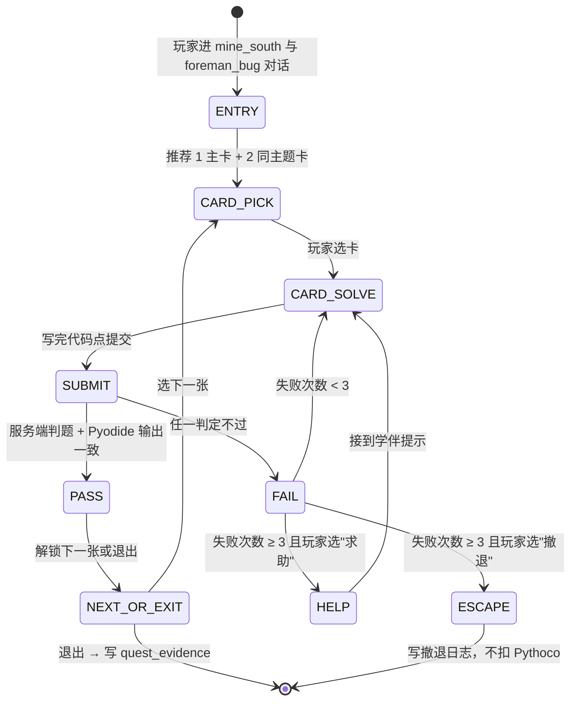

# Bug 矿洞 5 层谜题卡牌库（50 张）

## 1. 文档定位

R-12 解冻 Web 后，`mine_south` 地图常驻 NPC `foreman_bug`（矿头 Bug）把"学生 Pyodide / 服务端判题失败"转化为可下副本的 5 层 Bug 矿洞。本文档是 **副本谜题卡牌**（puzzle deck）的权威定义：

- **卡牌 ≠ 提示**：`BugMinePanel.spec.ts` 已落 6 张"提示型"卡（CounterExample / VariableTrace / WrongAssumption / Layer 1/2/3 Hint），它们是**单道题内**的辅助卡；本文档的 50 张是**关卡题目卡**——每张就是一道带错误的小代码题，玩家在副本里要把它修对。
- **题目源真实**：50 张卡的 KC 编号一律以 `data/course-pack-43/json/course_kc.json` 为准（PY43-KC-NNN），错误代码均可直接灌进 Pyodide 复现，禁止伪造 traceback。
- **奖励单向链**：每张卡的 Pythoco 奖励严格遵守 `docs/gameplay/economy-system.md` §8 "经济 → KC 反向伪造禁止"原则——`bug_mine_session` 关卡通过必须先写 `quest_evidence`（含 `submission_id` 或 `kc_mastery_delta`），再由 `EconomyBalanceService` 结算入账。
- **里程碑接 player-progression**：5 层全通关即 `player-progression.md` §1 第 3 层"调得对"里程碑，触发 `achievement.code = DEBUG_MASTER_PACK_43`。

> 50 张卡 ID 与附录 A 一一对应；任何卡牌增删必须同步改 `data/bugmine/deck.json`（M3 阶段实装）与后端 `BugMineCardCatalogService`，禁止前端 hardcode。

---

## 2. 5 层结构总览

| 层 | 主题（错误大类） | 高发 KC | 卡数 | 难度系数 | 单卡 Pythoco | 平均通关时长目标 | 解锁条件 |
| -- | ---- | ---- | -- | -- | -- | -- | -- |
| B1 | NameError / 未定义变量 | PY43-KC-010 变量与运算符、PY43-KC-013 控制台输入与类型转换 | 10 | 1.0 | 5–8 | 8 分钟 | 入门：完成 1 次提交失败 |
| B2 | IndentationError / 缩进 SyntaxError | PY43-KC-033 分支结构、PY43-KC-034 分支语句嵌套 | 10 | 1.4 | 6–10 | 12 分钟 | B1 完成 ≥ 7 张 |
| B3 | IndexError / KeyError | PY43-KC-040 列表基本操作、PY43-KC-041 字典在实际问题中的应用 | 10 | 1.8 | 8–12 | 15 分钟 | B2 完成 ≥ 7 张 |
| B4 | TypeError / ValueError | PY43-KC-013 类型转换、PY43-KC-022 字符串处理方法、PY43-KC-024 字符串索引与切片 | 10 | 2.2 | 10–15 | 18 分钟 | B3 完成 ≥ 7 张 |
| B5 | RecursionError / 无限循环 | PY43-KC-032 while、PY43-KC-037 循环控制语句、PY43-KC-061 函数递归 | 10（含 1 boss） | 2.8 | 12–80 | 25 分钟 | B4 完成 ≥ 7 张 + 技能 `M3 抗 Boss I` |

> 难度系数用于后端 `EconomyBalanceService.calcBugMineReward(card, profile)`：基础奖励 × 难度系数 × （1 + 0.1 × 一次过 buff）。70% 通过率门槛在 §8 详述。

每张卡字段：**故事场景** / **错误代码** / **期望输出** / **最小修复** / **教学要点** / **关联 KC** / **通过条件** / **Pythoco**。运行环境=Pyodide + 服务端判题双轨；服务端为权威。

---

## 3. B1 NameError / 未定义变量（10 张）

### B1-01 无名魔兽
矿洞标牌写着调用魔咒，咒语本子却是空的，魔兽无名而暴走。

```python
print(magick)
```
期望 `spell`；修复在前一行补 `magick = "spell"`。**教学**：变量必须先定义后使用。**KC** PY43-KC-010。**通过** `stdout == "spell\n"`。**奖励** 5。

### B1-02 老鼠偷字母
矿鼠偷走 `print` 的 `n`，把它写成 `priint`。

```python
priint("hello, mine")
```
期望 `hello, mine`；修复 `priint` → `print`。**教学**：拼写错误本质是 NameError，看 traceback 第一行即可定位。**KC** PY43-KC-010。**通过** `stdout == "hello, mine\n"`。**奖励** 5。

### B1-03 大写小写之争
Bug 把 `print` 改成首字母大写的 `Print`，妄图冒充内建函数。

```python
Print("python is case sensitive")
```
期望 `python is case sensitive`；修复 `Print` → `print`。**教学**：Python 大小写敏感；引出 PEP 8 命名风格。**KC** PY43-KC-010。**通过** stdout 一致。**奖励** 6。

### B1-04 影子作用域
`give_score` 想报告分数，但 `score` 只在外面的世界点亮过烛火。

```python
def give_score():
    print(score)

give_score()
```
期望 `88`；修复推荐参数化 `def give_score(score):` + 调用 `give_score(88)`，或用 `global`。**教学**：函数作用域；优先参数化，给画像 `cognitive_style.functional_thinking` 加信号。**KC** PY43-KC-010 + PY43-KC-058。**通过** `stdout == "88\n"`。**奖励** 7。

### B1-05 输入悄无声息
你叩问 `input("矿洞口令：")`，却没把它接住，名字就掉进了深渊。

```python
input("矿洞口令：")
print(passphrase)
```
期望（stdin=`open_sesame`）：`open_sesame`；修复 `passphrase = input(...)`。**教学**：`input()` 返回字符串，要用变量接住才能后续引用。**KC** PY43-KC-013。**通过** stdout 末行 == `open_sesame`。**奖励** 6。

### B1-06 拼写陷阱 lenght
矿石袋标签写着 `lenght`，老仓管只认 `len`。

```python
ores = ["铜", "铁", "金"]
print(lenght(ores))
```
期望 `3`；修复 `lenght` → `len`。**教学**：英文常见错拼 length；推荐 lint 扩展。**KC** PY43-KC-010。**通过** `stdout == "3\n"`。**奖励** 5。

### B1-07 模块认错亲
你向数学之神献礼，却把祭坛叫成了 `maths`。

```python
import math
print(maths.pi)
```
期望 `3.141592653589793`；修复 `maths.pi` → `math.pi`，或改 import 别名 `import math as maths`。**教学**：import 名与引用名要一致；引出 `as` 别名。**KC** PY43-KC-010 + PY43-KC-012。**通过** `stdout.startswith("3.14159")`。**奖励** 6。

### B1-08 for 循环散场后
循环结束后小矿工 `j` 早回家了，你却还在喊它的名字。

```python
for i in range(3):
    print(i)
print(j)
```
期望 4 行 `0/1/2/2`；修复末行 `print(j)` → `print(i)`。**教学**：for 循环结束后循环变量仍在作用域内，但要确认引用对了。**KC** PY43-KC-010 + PY43-KC-031。**通过** stdout 严格一致。**奖励** 7。

### B1-09 类里的孤胆英雄
勇者 `Hero` 想说自己叫什么，方法里却没带 `self` 的护身符。

```python
class Hero:
    def __init__(self, name):
        self.name = name
    def greet():
        print("我是" + self.name)

Hero("Py").greet()
```
期望 `我是Py`；修复 `def greet():` → `def greet(self):`。**教学**：实例方法必须显式 `self`。**KC** PY43-KC-010。**通过** `stdout == "我是Py\n"`。**奖励** 8。

### B1-10 多翻一页字典
你以为字典里有 `silver` 这个全局变量，可它只是 dict 的 key。

```python
inventory = {"silver": 12}
total = silver + 5
print(total)
```
期望 `17`；修复 `silver` → `inventory["silver"]`。**教学**：变量名 vs 字典 key 是新手高发混淆。**KC** PY43-KC-010 + PY43-KC-041。**通过** `stdout == "17\n"`。**奖励** 8。

---

## 4. B2 IndentationError / 缩进 SyntaxError（10 张）

进入前 `foreman_bug` 广播："Python 用缩进定义代码块，4 空格、别混 tab。" 编辑器强制 `expandtab`。

### B2-01 站门口的 if
if 喊"进来"，print 却站在洞口不动。

```python
x = 7
if x > 0:
print("positive")
```
期望 `positive`；修复 `print` 前加 4 空格。**教学**：if 体必须缩进，Python 没有 `{}`。**KC** PY43-KC-033。**通过** stdout 一致。**奖励** 6。

### B2-02 tab 与空格的暗战
上一行 tab、下一行空格，矿洞墙体悄然开裂（示意：`\t` 表 tab）。

```python
def shout(msg):
	print(msg)
    print("done")

shout("hello")
```
期望 `hello\ndone\n`；修复全部统一为 4 空格。**教学**：PEP 8 4 空格；混用触发 `TabError`。**KC** PY43-KC-033 + PY43-KC-034。**通过** stdout 一致 + 代码内 tab 出现 0 次。**奖励** 8。

### B2-03 多走一格的 else
else 多踩了一步矿车踏板，跌出了块。

```python
score = 60
if score >= 60:
    print("pass")
 else:
    print("fail")
```
期望 `pass`；修复 `else:` 前去掉多余空格、对齐 `if`。**教学**：`if/elif/else` 必须列对齐，空一格也算错。**KC** PY43-KC-033。**通过** stdout 一致。**奖励** 7。

### B2-04 函数体首行裸奔
def 签字画押了，函数体首行却忘了系腰带。

```python
def square(n):
return n * n

print(square(5))
```
期望 `25`；修复 `return n * n` 缩进 4 空格。**教学**：函数体首行必缩进且与本函数体其他行一致。**KC** PY43-KC-033 + PY43-KC-012。**通过** stdout 一致。**奖励** 6。

### B2-05 elif 漂浮
分数说"良"，elif 却飘在空中。

```python
score = 75
if score >= 90:
    print("excellent")
  elif score >= 60:
    print("good")
else:
    print("fail")
```
期望 `good`；修复 elif 与 if 同列。**教学**：elif 必须与同级 if 严格对齐。**KC** PY43-KC-033。**通过** stdout 一致。**奖励** 7。

### B2-06 for 体丢失
for 循环喊话"全员集合"，下面没人站出来。

```python
for i in range(3):
print(i)
```
期望 3 行 `0/1/2`；修复 `print(i)` 缩进 4 空格。**教学**：`IndentationError: expected an indented block` 是 B2 最常见错。**KC** PY43-KC-033 + PY43-KC-031。**通过** stdout 一致。**奖励** 6。

### B2-07 嵌套 if 套娃
if 里套 if，内层却跳了一格半。

```python
score = 95
if score >= 60:
    if score >= 90:
       print("A")
    else:
        print("B")
```
期望 `A`；修复 `print("A")` 缩进改为 8 空格、与 `print("B")` 对齐。**教学**：嵌套每多一层缩进必须严格统一；3 vs 4 空格也算不同层。**KC** PY43-KC-034。**通过** stdout 一致。**奖励** 9。

### B2-08 def 与 return 同居一行
函数图省事，把声明和返回挤在一根矿柱上。

```python
def double(x): return x * 2 print("ok")

print(double(4))
```
期望 `ok\n8`；修复把 `print("ok")` 拆到下一行。**教学**：单行 def 只能写一条简单语句，多条必须换行。**KC** PY43-KC-033 + PY43-KC-012。**通过** stdout 一致。**奖励** 8。

### B2-09 行末多了个空格
某行末尾粘了颗肉眼不可见的"尘粒"（NBSP `\u00A0`，副本用 `␣` 表示）。

```python
def hi():
    print("hi")␣
hi()
```
期望 `hi`；修复删除第 2 行末的 `␣`。**教学**：肉眼不可见的特殊字符是高级缩进陷阱；推荐编辑器装 `Render Whitespace`。**KC** PY43-KC-033。**通过** stdout 一致 + 代码 ASCII 化。**奖励** 10。

### B2-10 with 体缺失
你打开矿洞档案，却没读就锁上了门。

```python
with open("note.txt", "w") as f:
f.write("hello")
print("done")
```
期望 `done`；修复 `f.write(...)` 缩进 4 空格。**教学**：`with` 块缩进规则同 if/for；Pyodide 用虚拟 FS，不会真落盘。**KC** PY43-KC-033 + PY43-KC-048。**通过** stdout 一致、不抛缩进错。**奖励** 8。

---

## 5. B3 IndexError / KeyError（10 张）

### B3-01 越界的矿石袋
你伸手抓第 5 块矿石，可袋子里只装了 3 颗。

```python
ores = ["铜", "铁", "金"]
print(ores[5])
```
期望 `金`；修复 `ores[5]` → `ores[-1]` 或 `ores[len(ores) - 1]`。**教学**：列表索引从 0 起；越界 IndexError；用 -1 取尾。**KC** PY43-KC-040。**通过** stdout 一致。**奖励** 8。

### B3-02 空袋开门红
刚领到的空袋你就要往里掏，矿头当场叹气。

```python
bag = []
print(bag[0] if False else "empty")
```
期望 `empty`；修复加 `if bag:` 守卫，否则打印 `empty`。**教学**：空列表访问任意索引即 IndexError；用 `if seq:` / `len()` 守卫。**KC** PY43-KC-040。**通过** stdout 一致。**奖励** 9。

### B3-03 倒着挖太远
你想从尾部数第 10 个，可袋子里只有 3 个。

```python
ores = ["铜", "铁", "金"]
print(ores[-10])
```
期望 `铜`；修复 `ores[-10]` → `ores[-len(ores)]` 或 `ores[0]`。**教学**：负索引绝对值要 ≤ len。**KC** PY43-KC-040 + PY43-KC-024。**通过** stdout 一致。**奖励** 9。

### B3-04 缺页的档案柜
你查 `gold`，档案柜里只立着 `silver`。

```python
record = {"silver": 12}
print(record["gold"])
```
期望 `0`；修复 `record["gold"]` → `record.get("gold", 0)`。**教学**：`dict.get(key, default)` 安全取值；`[]` 缺 key 即 KeyError。**KC** PY43-KC-041。**通过** stdout 一致。**奖励** 10。

### B3-05 一锄删过头
你想清掉第 11 个矿位，可总共只有 5 个。

```python
spots = list(range(5))
del spots[10]
print(spots)
```
期望 `[0, 1, 2, 3, 4]`；修复加 `if len(spots) > 10:` 守卫或改 `spots.pop()`。**教学**：`del` 也会 IndexError；常用 `pop()` 或长度守卫。**KC** PY43-KC-040。**通过** stdout 一致、不抛异常。**奖励** 9。

### B3-06 二维矿层走错
你下到 `grid[2]`，向右又走了 3 步，可这一层只有 2 个矿位。

```python
grid = [[1, 2], [3, 4], [5, 6]]
print(grid[2][3])
```
期望 `6`；修复 `grid[2][3]` → `grid[2][-1]` 或 `grid[2][1]`。**教学**：二维每一维都有自己长度；嵌套索引需要分别守卫。**KC** PY43-KC-040 + PY43-KC-044。**通过** stdout 一致。**奖励** 10。

### B3-07 字符串第 5 个字符
你想看魔咒第 5 个字符，可它只有 3 个音节。

```python
spell = "abc"
print(spell[5])
```
期望 `?`；修复加 `if len(spell) > 5: print(spell[5]) else: print("?")`。**教学**：字符串本质是字符序列，索引规则同列表。**KC** PY43-KC-024。**通过** stdout 一致。**奖励** 9。

### B3-08 in 判断后用错 key
你确认了 `silver` 在册，却伸手去拿 `gold`。

```python
record = {"silver": 12, "iron": 8}
if "silver" in record:
    print(record["gold"])
```
期望 `12`；修复 `record["gold"]` → `record["silver"]`。**教学**：`in` 判断的 key 必须与取值时的 key 一致——典型"看了门牌进错门"。**KC** PY43-KC-041。**通过** stdout 一致。**奖励** 10。

### B3-09 嵌套字典套娃
你想查"小七"的 Python 分数，可花名册只录了语文。

```python
roster = {"小七": {"语文": 90}}
print(roster["小七"]["Python"])
```
期望 `未录`；修复 `roster["小七"].get("Python", "未录")`。**教学**：嵌套 dict 每层都可能缺 key；推 `.get` 链式或 `try/except KeyError`。**KC** PY43-KC-041。**通过** stdout 一致。**奖励** 11。

### B3-10 enumerate 偏移
你给矿石编号，可第 1 块就被你当成了第 0 块。

```python
ores = ["铜", "铁", "金"]
for i, ore in enumerate(ores):
    print(ores[i + 1], ore)
```
期望 3 行 `铁 铜 / 金 铁 / 末 金`；修复 `ores[i + 1]` → `ores[i + 1] if i + 1 < len(ores) else "末"`。**教学**：循环内 +1 是经典差一错误；要么改 range 要么补守卫。**KC** PY43-KC-040 + PY43-KC-031。**通过** stdout 严格一致。**奖励** 12。

---

## 6. B4 TypeError / ValueError（10 张）

### B4-01 整数加字符串
金币 3 枚加上写着 "5" 的纸条，账房怒摔算盘。

```python
print(3 + "5")
```
期望 `8`；修复 `3 + int("5")`。**教学**：Python 强类型，`+` 不隐式转换；显式 `int()` / `str()`。**KC** PY43-KC-013。**通过** stdout 一致。**奖励** 10。

### B4-02 input 直接做数学
input 默默套了引号，你再加 1 就翻车。

```python
x = input("number: ")
print(x + 1)
```
期望（stdin=`7`）`8`；修复 `x = int(input(...))`。**教学**：`input()` 永远返回字符串，做数学前必 `int()` / `float()`。**KC** PY43-KC-013。**通过** stdout 末行 == `8`。**奖励** 11。

### B4-03 int 想吃字母
你拿 "abc" 塞进 int 漏斗，漏斗当场报警。

```python
n = int("abc")
print(n)
```
期望 `0`；修复用 `try/except ValueError` 包住并赋 0。**教学**：`int("abc")` 抛 `ValueError` 而非 TypeError；区分两者。**KC** PY43-KC-013。**通过** stdout 一致。**奖励** 12。

### B4-04 列表乘字符串
你想"列表重复 3 次"，却把 3 写成了 "3"。

```python
print([1, 2] * "3")
```
期望 `[1, 2, 1, 2, 1, 2]`；修复 `[1, 2] * 3` 或 `* int("3")`。**教学**：`list * int` 是重复，`list * str` 是 TypeError。**KC** PY43-KC-040 + PY43-KC-013。**通过** stdout 一致。**奖励** 10。

### B4-05 拆包数量不对
袋里掉出 3 颗矿石，你只伸出 2 只手。

```python
a, b = (1, 2, 3)
print(a, b)
```
期望 `1 5`（按本题剧情，B 重新赋为 5）；修复 `a, _, _ = (1, 2, 3); b = 5`，或用 `a, *_ , last = (...)`。**教学**：解包数量必须严格一致，或用 `*rest`。**KC** PY43-KC-044。**通过** stdout 一致。**奖励** 11。

### B4-06 None 喊话
你对着空房间喊"上线"，得到的只有回音。

```python
def get_name():
    pass

name = get_name()
print(name.upper())
```
期望 `MINER`；修复 `def get_name(): return "miner"`。**教学**：函数无 return 默认 None，对 None 调方法即 AttributeError；提示始终显式 `return`。**KC** PY43-KC-012。**通过** stdout 一致。**奖励** 12。

### B4-07 评分单 + 整数
你写"分数："然后想加上数字 100，连接不通。

```python
score = 100
print("score: " + score)
```
期望 `score: 100`；修复 `f"score: {score}"` 或 `"score: " + str(score)`。**教学**：字符串拼接同型；推 f-string。**KC** PY43-KC-013 + PY43-KC-022。**通过** stdout 一致。**奖励** 10。

### B4-08 切片步长 0
你想用步长 0 切矿石带——它原地打转了。

```python
s = "pythontopia"
print(s[::0])
```
期望 `pythontopia`；修复步长改 1 / `s[:]`。**教学**：切片 step 不能为 0，否则 `ValueError: slice step cannot be zero`。**KC** PY43-KC-024。**通过** stdout 一致。**奖励** 11。

### B4-09 format 参数缺
模板留了两个位，你只递交一份证明。

```python
print("{} {}".format("hello"))
```
期望 `hello mine`；修复 `format("hello", "mine")`。**教学**：`str.format` 参数个数必须匹配占位符，否则 `IndexError: tuple index out of range`。**KC** PY43-KC-022。**通过** stdout 一致。**奖励** 10。

### B4-10 类型大乱斗
你比较列表和字符串大小，账房拒绝服务。

```python
print([1] < "a")
```
期望 `True`；修复 `str([1]) < "a"` 或 `len([1]) < len("a")`。**教学**：Python 3 禁止不同类型间 `<`/`>` 比较，必须显式转换；引出 `functools.total_ordering`。**KC** PY43-KC-013 + PY43-KC-022。**通过** stdout 一致。**奖励** 13。

---

## 7. B5 RecursionError / 无限循环（10 张，含终关 Boss）

### B5-01 阶乘缺基准
你写阶乘，却忘记告诉它"到 1 就停"。

```python
def fact(n):
    return n * fact(n - 1)

print(fact(5))
```
期望 `120`；修复加 `if n <= 1: return 1`。**教学**：递归必须有基准；栈深 ≤ 1000 即 RecursionError。**KC** PY43-KC-061。**通过** stdout 一致。**奖励** 13。

### B5-02 while True 缺 break
你点亮永恒灯，灯笼没安开关。

```python
i = 0
while True:
    print(i)
    i += 1
```
期望 3 行 `0/1/2`；修复 `if i >= 3: break`。**教学**：`while True` 必配 `break`；副本超 1.5 秒自动判失败防 Pyodide 挂死。**KC** PY43-KC-032。**通过** stdout 严格 3 行。**奖励** 12。

### B5-03 不动的 while 条件
你说"x>0 就继续"，可 x 永远不减。

```python
x = 5
while x > 0:
    print("still here")
```
期望 5 行 `still here`；修复体内补 `x -= 1`。**教学**：循环变量必须在体内更新。**KC** PY43-KC-032。**通过** stdout 严格 5 行。**奖励** 12。

### B5-04 边遍历边改
你点名时一边念一边把名册改了，最后没人答应。

```python
lst = [1, 2, 3]
for x in lst:
    print(x)
    lst.append(x + 10)
```
期望 3 行 `1/2/3`；修复 `for x in lst[:]:`（副本）或先收集 `to_append` 再 `extend`。**教学**：边遍历边改集合 → 无限循环 / RuntimeError；快照法。**KC** PY43-KC-031 + PY43-KC-040。**通过** stdout 严格 3 行。**奖励** 14。

### B5-05 递归调错变量
你想累加 n，递归里写成了原值。

```python
def sum_to(n):
    if n == 0:
        return 0
    return n + sum_to(n)

print(sum_to(5))
```
期望 `15`；修复 `sum_to(n - 1)`。**教学**：递归参数必须向基准收敛；写错 1 字符即栈溢出。**KC** PY43-KC-061。**通过** stdout 一致。**奖励** 14。

### B5-06 互递归不归
A 喊 B，B 又喊 A，矿洞回声永不停歇。

```python
def a(n):
    return b(n)

def b(n):
    return a(n)

print(a(3))
```
期望 `3`；修复在 `a` 或 `b` 中加基准 + 收敛（如 `b(n - 1)` 并在 `a` 中 `if n <= 0: return n`）。**教学**：互递归同样需要基准；调用图分析。**KC** PY43-KC-061。**通过** stdout 一致、不抛异常。**奖励** 15。

### B5-07 终止条件用错符号
你设的判退条件其实永远不满足。

```python
def countdown(n):
    if n > 0:
        return "done"
    print(n)
    return countdown(n - 1)

print(countdown(3))
```
期望 4 行 `3/2/1/done`；修复 `if n > 0` → `if n <= 0`。**教学**：基准方向写反是 RecursionError 第二高发原因；默念"什么时候停"。**KC** PY43-KC-061。**通过** stdout 严格一致。**奖励** 14。

### B5-08 计数方向反
你想从 5 数到 0，可每次反而 +1。

```python
i = 5
while i > 0:
    print(i)
    i += 1
```
期望 5 行 `5/4/3/2/1`；修复 `i += 1` → `i -= 1`。**教学**：循环变量更新方向必须与终止条件相容。**KC** PY43-KC-032。**通过** stdout 严格一致。**奖励** 13。

### B5-09 嵌套 while 不退出
外层喊 break，内层永远在转。

```python
i = 0
while i < 2:
    j = 0
    while True:
        print(i, j)
        j += 1
    i += 1
```
期望 6 行 `0 0/0 1/0 2/1 0/1 1/1 2`；修复内层 `while True` → `while j < 3:`，或 `if j >= 3: break`。**教学**：嵌套 break 只跳当前层；需要标志位或重构。**KC** PY43-KC-032 + PY43-KC-037。**通过** stdout 严格一致。**奖励** 15。

### B5-10 Fibonacci 双递归之渊（Boss）
矿洞最深处的双头巨虫——它用最朴素的递归吃光你所有内存。

```python
def fib(n):
    return fib(n - 1) + fib(n - 2)

result = []
for n in range(35):
    result.append(fib(n))
print(result[-1])
```
期望 `5702887`；修复补基准 + memoization 或迭代：

```python
def fib(n, memo={0: 0, 1: 1}):
    if n not in memo:
        memo[n] = fib(n - 1, memo) + fib(n - 2, memo)
    return memo[n]

print(fib(34))
```
**教学**：递归既要基准也要懂复杂度（裸 Fib 指数级）；引出"剪枝 / memoization / DP"。Boss 考"基准 + 算法 + 资源"三连。**KC** PY43-KC-061 + PY43-KC-032 + PY43-KC-037。**通过** `stdout == "5702887\n"` 且运行时长 ≤ 1 秒（防裸递归通过）。**奖励** 30–80 Pythoco + 必触发"调得对"成就 + 5% 掉落 `heirloom_dp_recipe`。

---

## 8. 难度模型与流转

### 8.1 解锁规则

- 每层完成 ≥ 70% 卡（≥ 7 张）才解锁下一层。
- 单卡可选"跳过"，扣 2 Pythoco 提示费；跳过卡不计入 70%。
- 同张卡 **连续失败 3 次** 自动召唤"协助 NPC"——town_hub 的同学 `student_diligent`（勤勉小柒）出现在卡牌右下角气泡，给"思路提示卡"（**不是答案**）。

### 8.2 解锁算法

```text
unlock_next_level(level) = (
  level.passed_card_count >= ceil(level.total_cards * 0.7)
  AND profile.practice_capability.debug_speed >= level.required_debug_speed
)
```

`level.required_debug_speed` 取自 `data/bugmine/balance.json`，默认 B1=0、B2=0.2、B3=0.4、B4=0.6、B5=0.8。同时校验"画像维度"，防止刷卡通关而 debug 能力不真实成长。

### 8.3 状态机



> ESCAPE 是"不强留玩家"原则的硬保障：连续 3 次失败仍允许撤退，撤退不扣 Pythoco 但记录到 `learner_profile.emotion_persistence.recent_mood`，由 SafetyAgent 决定是否触发"放松一下"提示。

---

## 9. 奇货系统

### 9.1 调试工具卡（B1–B3 通关掉落）

| itemKey | displayName | 掉率 | 能力 |
| ------- | ----------- | ---- | ---- |
| `tool_lint_mirror` | lint 镜 | 5% | 装备后自动高亮当前代码的 PEP8 错（仅样式，不改业务逻辑） |
| `tool_stack_staff` | 调用栈杖 | 5% | 失败提交时额外展示完整 traceback；默认副本只显示前 3 行 |
| `tool_diff_lens` | 输出对比放大镜 | 3% | 把 expected 与 actual 的 diff 渲染为字符级彩色对照 |

### 9.2 传家宝代码（B4–B5 通关掉落）

| itemKey | displayName | 掉率 | 能力 |
| ------- | ----------- | ---- | ---- |
| `heirloom_safe_int` | 安全 int 模板 | 3% | 装备时给 PY43-KC-013 mastery +0.05 一次（源 `BUG_MINE_HEIRLOOM`） |
| `heirloom_get_or_default` | 字典安全取值秘籍 | 3% | 装备时给 PY43-KC-041 mastery +0.05 一次 |
| `heirloom_dp_recipe` | 动态规划方子 | 1%（B5-10 必触 5%） | 装备时给 PY43-KC-061 mastery +0.05 一次 |

> 传家宝同时只能装备 1 件，装备后冷却 7 游戏日不可换装，避免刷 mastery；切换通过 `inventory.equip(heirloom_*)`，后端校验冷却。

---

## 10. 生成器规则

`BugMineCardSelectorService` 在玩家踏入矿洞时按以下顺序选卡：

1. **真实失败入口**：玩家有 `practice_submission.status = FAILED` 且 24h 内，提取其 `error_type`（NameError/IndentationError/IndexError/KeyError/TypeError/ValueError/RecursionError）；选最贴近的 1 张主卡 + 2 张同 `error_type` 同主题卡，构成 3 卡套餐。
2. **教师任务入口**：班级公告板有 `classroom_quest.kind = BUG_MINE_PACK` 时，教师指定具体 5 张卡（按附录 A 卡 ID），系统直接组装，70% 规则照常生效。
3. **空闲入口**：玩家无近期失败且无班级任务时，按当前 mastery 矩阵推荐"该补强的 KC"对应卡（如 PY43-KC-041 mastery < 0.4 → 推 B3-04/B3-08/B3-09）。
4. **去重**：单次副本 5 卡不重复；24h 内已通过的卡不再出现。

数据契约：

```json
{
  "sessionId": 12345,
  "userId": 7,
  "entry": "FAILED_SUBMISSION",
  "sourceSubmissionId": 9981,
  "cards": [
    { "deckCardId": "B3-04", "weight": 1.0, "isPrimary": true },
    { "deckCardId": "B3-08", "weight": 0.6 },
    { "deckCardId": "B3-09", "weight": 0.6 }
  ],
  "createdAt": "2026-05-24T10:00:00Z"
}
```

`deckCardId` 与 §3–§7 卡牌编号一一对应；后端 `BugMineCardCatalogService.findByDeckCardId(String)`。

---

## 11. 画像耦合

| 玩家行为 | 画像写入字段 | delta |
| -------- | ------------ | ----- |
| 反复失败同一张卡（≥ 3 次） | `error_pattern.frequent_kc` 中该卡 KC 计数 +1 | +1 |
| 首次提交即 PASS | `practice_capability.debug_speed` | +1 |
| 三次内通过 | `practice_capability.debug_speed` | +0.5 |
| 跳过（消耗 Pythoco） | `practice_capability.persistence` | -0.2 |
| 接受协助 NPC 提示 | `learning_preference.collaboration_orientation` | +0.3 |
| 撤退（ESCAPE） | `emotion_persistence.recent_mood = neutral_negative` | +1（计入近 7 日波动） |
| B5 boss 通关 | `practice_capability.algorithm_design` | +5（一次性） |

> 上述写入全部走 `PassiveProfileService.onBugMineEvent(...)`，禁止前端直写画像；任何脱出审计的 dimension 写入均判反作弊事件。

---

## 12. 防作弊

- **修复方案不在前端暴露**：每张卡的"最小修复"只存在后端 `BugMineCardCatalogService`，前端通过 `revealHintTier(1..3)` 按 Layer 1/2/3 解锁（对齐 `BugMinePanel.spec.ts`）；Layer 3 仍不展示完整答案，只展示"思路 + 关键 API"。
- **Pyodide 仅作运行环境**：所有通过判定必须经过服务端判题（`practice_submission.status = ACCEPTED`），与 `docs/architecture/system_design.md` 双轨执行约束一致；Pyodide PASS 但服务端 FAIL 时以服务端为准。
- **执行时长校验**：每卡 `runtime_limit_ms` 默认 1500，B5 boss 1000；超时即判失败，专防裸递归 / 死循环"假通过"。
- **教师 dashboard 可见**：班主任在 `port_west` `class_president` 看板里查看本班每张卡的"平均尝试次数 / 平均通关时长 / 跳过率"，便于教学介入。
- **奖励上链**：通关后端先写 `quest_evidence(kind=BUG_MINE_PASS, deck_card_id, submission_id, kc_mastery_delta)`，再写 `pythoco_ledger(source=BUG_MINE)`；ledger 无 evidence 即清零。

---

## 13. 奖励 & 经济

| 项 | 取值 | 备注 |
| -- | ---- | ---- |
| 单卡基础奖励 | 5–15 Pythoco | 详见附录 A |
| B5-10 终关 Boss | 30–80 Pythoco | 30=4 次内通过；80=1 次过 |
| 一次过 buff | × 1.1 | 仅首次提交即 PASS |
| 协助 NPC buff | × 0.7 | 接受提示后通关 |
| 跳过卡 | -2 Pythoco | 不计入 70% |
| 调试工具卡 | 无 Pythoco，inventory 永久持有 | §9.1 |
| 传家宝代码 | 无 Pythoco，触发 KC mastery +0.05 一次 | §9.2 |
| 5 层全通关里程碑 | 200 Pythoco + `achievement.DEBUG_MASTER_PACK_43` | 触发玩家成长曲线第 3 层"调得对" |

> 与 `economy-system.md` §1.3 单日 500 / 单周 2000 Pythoco 上限叠加：B5 一次过的 80 Pythoco 仍计入日上限，不予豁免。

---

## 14. 验收

### 14.1 测试覆盖

- 已有 `frontend/tests/components/BugMinePanel.spec.ts` 覆盖单题 6 张提示卡。
- **本文档要求新增** `frontend/tests/game/bugmine/deck-loader.spec.ts`，覆盖：50 张谜题卡 JSON 解析（成功率 100%）；按 deckCardId（B1-01 … B5-10）查找；单层 70% 解锁门槛；连续失败 3 次触发协助 NPC 的事件 emit；跳过卡扣 2 Pythoco 的 store mutation。
- 后端新增 `BugMineCardCatalogServiceTest`（50 卡的 KC 关联校验，每卡 ≥ 1 KC）、`BugMineSelectorServiceTest`（失败提交 → 3 卡套餐去重）、`EconomyBalanceServiceBugMineTest`（基础 + 一次过 + 协助 buff 合成）、`BugMineHeirloomCooldownTest`（传家宝 7 日冷却）。

### 14.2 教学侧指标

| 指标 | 目标 | 数据源 |
| ---- | ---- | ------ |
| 第 1 周 B1 通关率 | ≥ 80% 触发玩家 | `bug_mine_session.level=B1.status=COMPLETED` |
| 单卡平均尝试次数 | 1.4–2.5 次 | 过低疑似抄答；过高难度失衡 |
| 协助 NPC 召出率 | 5–15% | 过低=没人卡住；过高=难度过载 |
| B5-10 boss 一次过率 | < 10% | 防止过简单 |
| 5 层全通关玩家数 | 学期末 ≥ 30% 注册学生 | `achievement.DEBUG_MASTER_PACK_43` 持有率 |

---

## 15. 附录 A：50 张卡清单总览

> 编号 / 标题 / KC / 错误类型 / 关键修复点 / Pythoco 奖励。按层顺序排列。

| ID | 标题 | KC | 错误类型 | 关键修复点 | 奖励 |
| -- | ---- | -- | -------- | ---------- | ---- |
| B1-01 | 无名魔兽 | PY43-KC-010 | NameError | `magick = "spell"` | 5 |
| B1-02 | 老鼠偷字母 | PY43-KC-010 | NameError | `priint` → `print` | 5 |
| B1-03 | 大写小写之争 | PY43-KC-010 | NameError | `Print` → `print` | 6 |
| B1-04 | 影子作用域 | PY43-KC-010 + 058 | NameError | 函数参数化或 `global` | 7 |
| B1-05 | 输入悄无声息 | PY43-KC-013 | NameError | `passphrase = input(...)` | 6 |
| B1-06 | 拼写陷阱 lenght | PY43-KC-010 | NameError | `lenght` → `len` | 5 |
| B1-07 | 模块认错亲 | PY43-KC-010 + 012 | NameError | `maths.pi` → `math.pi` | 6 |
| B1-08 | for 循环散场后 | PY43-KC-010 + 031 | NameError | `print(j)` → `print(i)` | 7 |
| B1-09 | 类里的孤胆英雄 | PY43-KC-010 | NameError | `def greet(self):` | 8 |
| B1-10 | 多翻一页字典 | PY43-KC-010 + 041 | NameError | `silver` → `inventory["silver"]` | 8 |
| B2-01 | 站门口的 if | PY43-KC-033 | IndentationError | if 体加 4 空格 | 6 |
| B2-02 | tab 与空格的暗战 | PY43-KC-033 + 034 | TabError | 统一为 4 空格 | 8 |
| B2-03 | 多走一格的 else | PY43-KC-033 | IndentationError | else 列对齐 if | 7 |
| B2-04 | 函数体首行裸奔 | PY43-KC-033 + 012 | IndentationError | return 缩进 4 空格 | 6 |
| B2-05 | elif 漂浮 | PY43-KC-033 | IndentationError | elif 列对齐 if | 7 |
| B2-06 | for 体丢失 | PY43-KC-033 + 031 | IndentationError | for 体加 4 空格 | 6 |
| B2-07 | 嵌套 if 套娃 | PY43-KC-034 | IndentationError | 嵌套层缩进 8 空格 | 9 |
| B2-08 | def 与 return 同居一行 | PY43-KC-033 + 012 | SyntaxError | print 换行 | 8 |
| B2-09 | 行末多了个空格 | PY43-KC-033 | TabError/Indent | 删除 NBSP | 10 |
| B2-10 | with 体缺失 | PY43-KC-033 + 048 | IndentationError | with 体加 4 空格 | 8 |
| B3-01 | 越界的矿石袋 | PY43-KC-040 | IndexError | `ores[-1]` | 8 |
| B3-02 | 空袋开门红 | PY43-KC-040 | IndexError | `if bag:` 守卫 | 9 |
| B3-03 | 倒着挖太远 | PY43-KC-040 + 024 | IndexError | `ores[0]` 或 `ores[-len(ores)]` | 9 |
| B3-04 | 缺页的档案柜 | PY43-KC-041 | KeyError | `record.get("gold", 0)` | 10 |
| B3-05 | 一锄删过头 | PY43-KC-040 | IndexError | `del spots[-1]` 或守卫 | 9 |
| B3-06 | 二维矿层走错 | PY43-KC-040 + 044 | IndexError | `grid[2][-1]` | 10 |
| B3-07 | 字符串第 5 个字符 | PY43-KC-024 | IndexError | `if len(spell) > 5:` | 9 |
| B3-08 | in 判断后用错 key | PY43-KC-041 | KeyError | `record["silver"]` | 10 |
| B3-09 | 嵌套字典套娃 | PY43-KC-041 | KeyError | `.get("Python", "未录")` | 11 |
| B3-10 | enumerate 偏移 | PY43-KC-040 + 031 | IndexError | 守卫 `i + 1 < len` | 12 |
| B4-01 | 整数加字符串 | PY43-KC-013 | TypeError | `3 + int("5")` | 10 |
| B4-02 | input 直接做数学 | PY43-KC-013 | TypeError | `int(input(...))` | 11 |
| B4-03 | int 想吃字母 | PY43-KC-013 | ValueError | try/except + 默认 0 | 12 |
| B4-04 | 列表乘字符串 | PY43-KC-040 + 013 | TypeError | `[1, 2] * 3` | 10 |
| B4-05 | 拆包数量不对 | PY43-KC-044 | ValueError | `a, _, _ = (...)` | 11 |
| B4-06 | None 喊话 | PY43-KC-012 | AttributeError | `return "miner"` | 12 |
| B4-07 | 评分单 + 整数 | PY43-KC-013 + 022 | TypeError | `f"score: {score}"` | 10 |
| B4-08 | 切片步长 0 | PY43-KC-024 | ValueError | `s[::1]` | 11 |
| B4-09 | format 参数缺 | PY43-KC-022 | IndexError | `format("hello", "mine")` | 10 |
| B4-10 | 类型大乱斗 | PY43-KC-013 + 022 | TypeError | `str([1]) < "a"` | 13 |
| B5-01 | 阶乘缺基准 | PY43-KC-061 | RecursionError | `if n <= 1: return 1` | 13 |
| B5-02 | while True 缺 break | PY43-KC-032 | TimeoutError | `if i >= 3: break` | 12 |
| B5-03 | 不动的 while 条件 | PY43-KC-032 | TimeoutError | `x -= 1` | 12 |
| B5-04 | 边遍历边改 | PY43-KC-031 + 040 | TimeoutError | `for x in lst[:]` | 14 |
| B5-05 | 递归调错变量 | PY43-KC-061 | RecursionError | `sum_to(n - 1)` | 14 |
| B5-06 | 互递归不归 | PY43-KC-061 | RecursionError | 加基准 + 收敛 | 15 |
| B5-07 | 终止条件用错符号 | PY43-KC-061 | RecursionError | `if n <= 0` | 14 |
| B5-08 | 计数方向反 | PY43-KC-032 | TimeoutError | `i -= 1` | 13 |
| B5-09 | 嵌套 while 不退出 | PY43-KC-032 + 037 | TimeoutError | 内层 `while j < 3` | 15 |
| B5-10 | Fibonacci 双递归之渊（Boss） | PY43-KC-061 + 032 + 037 | RecursionError + Timeout | memoization 或迭代 | 30–80 |

> 50 张合计 Pythoco 区间约 **500–650**；学期内全通关玩家平均可获 ≈ 600 Pythoco 矿洞收入，配合 §13 全通关 200 Pythoco 里程碑，总和接近 1 周 Pythoco 上限的 40%（800 / 2000），既能感受到经济回报又不破坏 §1 经济平衡。

---

-- 玩法策划工程师 · Pythontopia R-12 · 2026-05-24
