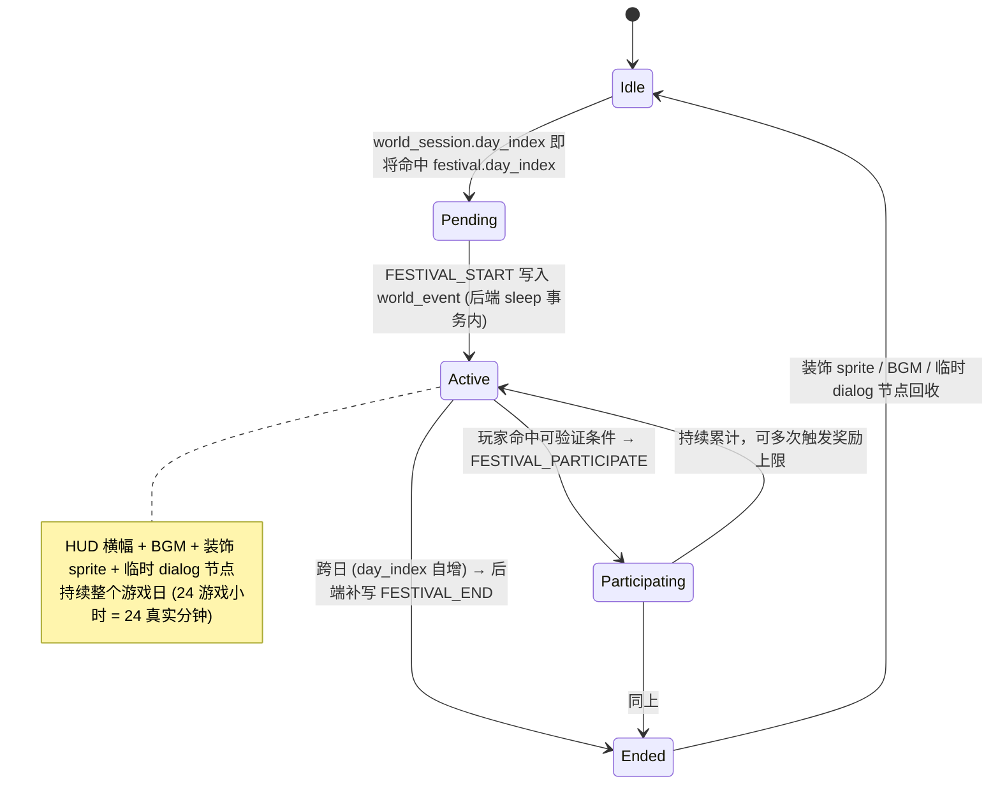

# Pythontopia 节日活动系统设计（R-12 Deepen · 第 05 篇）

> 版本：v1.0 · 起草日期：2026-05-24 · 适用版本：R-12 W5 起 · 状态：Draft（待 W7 验收转 Active）
> 目标读者：玩法策划、教学策划、班主任视角运营、画像分析师、后端节奏 owner、前端 HUD owner、像素美术
> 上游：`docs/gameplay/world-clock-calendar.md`（4 季节 + WorldAdvanceService.sleep 推日入口 + `world_event` 表骨架） / `docs/gameplay/player-progression.md`（16 周教学断面） / `docs/gameplay/economy-system.md`（Pythoco 货币、节日特殊额度） / `docs/gameplay/npc-ecosystem.md`（20 NPC 名册 + friendship 系统）

## 0. 文档定位

`world-clock-calendar.md` §7 已给出"16 节日骨架表"（每 7 天 1 个），`economy-system.md` §6 给出"4 季节大节日 + 周限小活动"的经济视角。本文是 **R-12 Deepen 阶段对节日玩法层的细化**，把上游骨架收敛到 **11 个里程碑级节日**，并对齐 `player-progression.md` 的 5 个教学断面（30 min / 3 天 / 7 天 / 30 天 / 16 周）。

**节日不是装饰，是"教学里程碑的玩法外壳"**。每个节日必须同时满足三条：

1. 锚定一个具体的 **章节进度断面**（开课 / 入门 / 期中 / 期末 / 答辩 / 跨年），与 `kc_mastery` 推进节奏同步。
2. 给予 **画像可观测信号**（参与 → `emotion_persistence +`，复盘对话 → `cognitive_style` 主动更新等），禁止"纯抽奖、纯装饰"。
3. 提供 **可验证的玩家行为锚**（如"集合中央广场" = `player.tileX/tileY` 折算的像素坐标 60s 命中），禁止"过场动画看完就算参加"。

文档严格遵守 `AGENTS.md` 三条硬约束：

- **后端是唯一真相**：节日触发时机由 `world_session.day_index == X` 写入 `world_event(event_type='FESTIVAL_START')`，前端 WorldClock listener 只负责消费，不允许本地补推。
- **不复制商业像素游戏官方素材**：所有节日装饰 sprite 来源必须列在 §8 资产清单，并经 `LICENSE-ART.md` 收录。
- **不为展示效果牺牲教育目标**：节日特殊奖励的天花板与 `economy-system.md` §1.3 / §7 的日上限 / 周上限 / 通胀控制保持兼容，禁止单节日发金量级跳出 ±20% 调整窗口。

---

## 1. 节日总表

下表是本文 R-12 Deepen 阶段唯一权威的节日清单；与 `world-clock-calendar.md` §7 的 16 节日骨架表的差异：保留里程碑（开学 / 春末 / 期中 / 期末 / 跨年）、合并"阅读日 / 提交日 / 复盘日"这类小型周礼为 §5 班级扩展的"班级节日任务"模板，专项推 11 个"全镇级"节日。

| Day | 季节-日 | name_key | 节日名 | 教学绑定（章节·KC） | 参与 NPC | 特殊掉落 / 奖励 |
|----:|--------|----------|--------|----------------------|----------|----------------|
| 1 | 春 1 | `spring_opening` | 开学典礼 | Ch1 开课 / KC-001..007 解锁种子 | mayor_py · gardener · postman · class_president | 100 Pythoco + `gift_class_pin` + 章 1 任选 1 颗 `seed_input_print` / `seed_branch_struct` / `seed_for_loop` |
| 14 | 春 14 | `spring_quiz` | 入门考 | Ch1 通关 boss 题 / KC-001/003/005/006/007 | coach_q · librarian_doc · class_president | 50 Pythoco + 章 1 整章 `classroom_kc_snapshot` + "新生通过"徽章 |
| 28 | 春 28 | `spring_finale_race` | 春末赛跑 | farm KC 主题接力 / KC-008..016 提交累计 | farmer_kc · gardener · class_president | 排名 1-10 名 200 Pythoco + "春神种子礼包"（3 颗高级农作物种子） |
| 35 | 夏 7 | `midterm_festival` | 期中节 | Ch4 完成 + 矿洞 boss 副本 / KC-031/032/033/035 错误模式合集 | foreman_bug · coach_q · mayor_py | 通关 300 Pythoco + `tool_pickaxe_steel` 兑换券 + boss 限定徽章 |
| 56 | 夏 28 | `port_fair` | 港口集市 | Ch5 / Ch6 衔接 / KC-040..049 外文档案 | merchant · craftsman · postman | merchant 全场 -50%（含 `book_*` / `consumable_hint_scroll_*`）+ 限定外文文档礼包 |
| 60 | 秋 4 | `bug_carnival` | Bug 节 | 失败提交集中曝光 / KC-031/032/033/041 高频误区 | foreman_bug · mayor_py · craftsman | 当日 `PRACTICE_FAIL` 免扣 Pythoco + 每条 fail 兑 5 Pythoco（≤ 100/日）+ `gift_bug_specimen` 必掉 |
| 70 | 秋 14 | `final_warmup` | 期末预热 | Ch6 / Ch7 复盘 / KC-048..065 串讲 | librarian_doc · sage_review · coach_q | 当日 `RESOURCE_READ × 2.0` 权重 + 模考通过 100 Pythoco + 期末复习手册（`book_chapter_7_*` 临时副本） |
| 84 | 秋 28 | `finals_festival` | 期末庆 | Ch7 完成 + 毕业答辩 / KC-054..065 抽 3 题 | mayor_py · sage_review · coach_q · class_president | 答辩通过 500 Pythoco + `quest_kc_certificate` 章 7 全套 + `graduation_pin` 装饰 |
| 90 | 冬 2 | `winter_showcase` | 答辩展 | 玩家自创 Python 小项目 / Ch1..7 综合 | craftsman · mayor_py · merchant | 入选 200 Pythoco + "自由徽章" + 项目可挂玩家主页 |
| 100 | 冬 12 | `silent_night` | 雪夜冥想 | 画像 8 维复盘 / Ch6 学习偏好被动更新 | sage_review · mayor_py · librarian_doc | 复盘对话完成 → `emotion_persistence +0.05` + 限定壁炉皮肤 |
| 112 | 冬 28 | `new_year_eve` | 新年 | 学期结业 + 第二年学期预热 | mayor_py · all NPCs（节日变体） | 转生加成（+10% 起始 Pythoco 或起始技能点 +1）+ 年度回顾 PDF + 限定新年徽章 |

> **节奏说明**：11 节日均匀落在 16 周断面上——前 4 周 3 节（开学 / 入门 / 春末），中间 8 周 5 节（期中 / 港口 / Bug / 期末预热 / 期末），最后 4 周 3 节（答辩展 / 雪夜 / 新年）。与 `player-progression.md` §1 的 16 周 4 季节框架一一咬合，平均每 10.2 天 1 节，既不密到挤压日常 KC 推进，也不疏到学生忘记节奏。

---

## 2. 11 节日详细设计

每个节日小节统一格式：**日期 → 触发条件 → 参与 NPC → 玩家可做的事（3–5 项，每项可由 `player_state` / `practice_submission` / `quest_evidence` 等真实事件验证） → 特殊奖励 → 教学绑定 → 通讯（公告 / 邮件 / 对话提示）**。

坐标约定：所有"集合"动作均以像素坐标表达（`town_hub` 50×40 tile × 16 px/tile = 800×640 px，中央广场约位于 (400±20, 320±20)），玩家 `player.position.x/y` 命中区域 + 持续时长才计参与；前端在 `WorldScene.update()` 中累计 `gameTimeMs`，到阈值后 POST `FESTIVAL_PARTICIPATE` 事件。

### 2.1 Day 1 · 开学典礼（`spring_opening`）

- **日期**：春 1（`day_index == 1`，首登录玩家在 BootScene 完成画像后立即触发）。
- **触发条件**：`world_session.day_index == 1` AND `learner_profile.dimensions IS NOT NULL`（避免画像未填充就走仪式）。
- **参与 NPC**：mayor_py（主，中央讲话台 X=500,Y=300）/ gardener（花坛布置）/ postman（投递欢迎信）/ class_president（合影摄影师）。
- **玩家可做的事**：
  1. **集合中央广场**：玩家 `X∈[480,520] && Y∈[320,360]` 持续 60s → 计入参与。
  2. **听镇长讲话**：触发 mayor_py 的 `opening_speech` dialog 节点（覆盖 `greet`），全长 4 节台词。
  3. **班级合影**：站到合影锚 `X∈[480,520] && Y∈[300,320]` ≥ 30s，截图自动入相册。
  4. **领新生礼包**：从 mayor_py 接 `quest_first_kc` 任务，可三选一颗章 1 种子。
  5. **选第一颗 KC**：种下种子立即触发 §2 的"首循环"路径。
- **特殊奖励**：100 Pythoco + `gift_class_pin`（NPC 全员 friendship +1） + 选中的 KC 种子 + "新生入学"成就。
- **教学绑定**：章 1《计算工具与计算思维》开课；与 `player-progression.md` §2「前 30 分钟首循环」无缝衔接。
- **通讯**：HUD 顶部金色横幅 `春日序章 · 第一年开学典礼`；邮箱：`mayor_py.opening_letter`；town_hub BGM 切换到 `bgm_spring_ceremony`（节日 BGM 列表见 §8）。

### 2.2 Day 14 · 入门考（`spring_quiz`）

- **日期**：春 14（`day_index == 14`）。
- **触发条件**：`day_index == 14` AND `world_clock.hour ∈ [12, 22)`（仅在午后到夜间开放，给学生选择时间窗）。
- **参与 NPC**：coach_q（主，campus_east 课堂 X=200,Y=180）/ librarian_doc（章 1 副本随借）/ class_president（成绩榜张贴）。
- **玩家可做的事**：
  1. **签到课堂**：玩家 `X∈[180,220] && Y∈[160,200]` ≥ 30s → 接 coach_q 的 `entry_quiz` 任务。
  2. **完成 5 道章 1 关键题**：KC-001/003/005/006/007 各 1 道，单题限时 8 分钟。
  3. **失败可借副本**：与 librarian_doc 对话借 `book_chapter_1_compute_thinking` 临时阅读。
  4. **提交后看榜**：与 class_president 对话查看班级排名（限定当日可见）。
- **特殊奖励**：50 Pythoco + 章 1 整章 mastery 写入 `classroom_kc_snapshot`（教师视角可见）+ 通过率徽章（≥80% → 金 / ≥60% → 银 / 其余 → 铜）。
- **教学绑定**：章 1 通关 boss 题；与 `player-progression.md` §4「首周窗口」7 天断面校准。
- **通讯**：邮箱：`coach_q.quiz_open_letter`；公告板新增"章 1 入门考开考"；campus_east BGM 切 `bgm_exam_hall`；钟声 SFX `sfx_exam_chime` 12:00/22:00 各 1 次。

### 2.3 Day 28 · 春末赛跑（`spring_finale_race`）

- **日期**：春 28（`day_index == 28`，春季最后一日）。
- **触发条件**：`day_index == 28` AND `season == 'SPRING'`（防御性二次校验）。
- **参与 NPC**：farmer_kc（主，赛道发令处 farm_north X=300,Y=200）/ gardener（沿途布置赛道彩旗）/ class_president（团体积分台）。
- **玩家可做的事**：
  1. **签到发令**：玩家 `X∈[280,320] && Y∈[180,220]` ≥ 15s → 接 farmer_kc 的 `race_start` 任务。
  2. **完成 farm KC 提交**：当日每完成 1 道 KC-008..016 区段题（ACCEPTED）累计 1 分。
  3. **跑动加成**：当日 `player_state.tile` 更新次数 / 100 取整作为补充分。
  4. **班级合作模式**：与 class_president 报名"班级接力" → 同班玩家分数共享一档加成（×1.1）。
  5. **查看终局**：23:00 自动结算，邮箱推送排名。
- **特殊奖励**：1-10 名 200 Pythoco + "春神种子礼包"（`seed_list_basic` / `seed_dict_apply` / `seed_file_io` 各 1）；11-50 名 80 Pythoco + 1 颗高级种子；其余 30 Pythoco + 1 颗 `seed_input_print`。
- **教学绑定**：章 2 / farm KC 主题收尾，全班 mastery snapshot 公告。
- **通讯**：邮箱：`farmer_kc.race_invitation` 在 Day 27 22:00 提前 1 天预告；HUD 横幅 `春末赛跑 · 田野争先`；farm BGM 切 `bgm_race_drum`。

### 2.4 Day 35 · 期中节（`midterm_festival`）

- **日期**：夏 7（`day_index == 35`）。
- **触发条件**：`day_index == 35` AND 玩家 `mastery ≥ 0.5` 的 KC ≥ 15（避免新手被强推 boss）。未达条件玩家收到"观摩票"，可旁观不参战。
- **参与 NPC**：foreman_bug（主，mine_south boss 房间 X=80,Y=80）/ coach_q（题目押注）/ mayor_py（颁奖词）。
- **玩家可做的事**：
  1. **进入矿洞**：玩家 `X∈[60,100] && Y∈[60,100]` ≥ 10s → 接 foreman_bug 的 `boss_challenge` 任务。
  2. **班级组队**：3-5 人小队（同 `classroom_id`）共享 boss 血条；单人模式 boss 血量 × 0.4 缩放。
  3. **击败 boss**：通关时间换排名，超时不淘汰但不入榜。
  4. **失败安慰**：失败 → mayor_py 提供 `midterm_comfort` 对话节点。
  5. **班级 PK 结算**：与 `classroom_quest.kind = PK` 联动写入班级名望榜。
- **特殊奖励**：通关 300 Pythoco + `tool_pickaxe_steel` 兑换券 + "矿洞征服者"徽章；班级 PK 前 3 班 +500 班级名望。
- **教学绑定**：章 4 完成 boss 题（KC-031/032/033/035 错误模式合集）；与 `player-progression.md` §7「Week 8 期中压力」挽留窗口配合，把高压转成"节日仪式"。
- **通讯**：HUD 红色横幅 `期中节 · 矿洞 boss 副本`；邮箱：`foreman_bug.boss_alert`；矿洞 BGM 切 `bgm_boss_drum`。

### 2.5 Day 56 · 港口集市（`port_fair`）

- **日期**：夏 28（`day_index == 56`）。
- **触发条件**：`day_index == 56` AND `season == 'SUMMER'`；触发后 port_west 全图昼夜营业（夜间 NPC 不下班）。
- **参与 NPC**：merchant（主，摊位主 X=200,Y=300）/ craftsman（副项目接单）/ postman（限定文档投递）。
- **玩家可做的事**：
  1. **逛市集**：玩家 `X∈[180,260] && Y∈[280,340]` 累计 ≥ 120s → 解锁集市奖励池。
  2. **半价采购**：merchant 全场 -50%（含 `book_*` / `consumable_hint_scroll_*` / `consumable_pomodoro_potion`），单玩家上限 500 Pythoco 折扣额度。
  3. **限定外文档案**：领取 `book_chapter_5_data_struct` + `book_chapter_6_*`（KC-040..049 配套，仅当日免费）。
  4. **接 craftsman 副项目**：`quest_side_project_lambda`（写一个用 lambda + 列表推导式的小工具）。
  5. **寄售拍卖行**：当日上架费免除。
- **特殊奖励**：merchant 全场 -50% + 港口限定外文档案 + 副项目通过 200 Pythoco + craftsman friendship +5。
- **教学绑定**：章 5《数据结构》/ Ch6《数据存取》衔接预热。
- **通讯**：邮箱：`merchant.fair_invitation`；港口 BGM 切 `bgm_port_carnival`；HUD 横幅 `港口集市 · 半价日`。

### 2.6 Day 60 · Bug 节（`bug_carnival`）

- **日期**：秋 4（`day_index == 60`）。
- **触发条件**：`day_index == 60`。
- **参与 NPC**：foreman_bug（主，mine_south 入口摆摊 X=120,Y=120）/ mayor_py（开场致辞 town_hub）/ craftsman（Bug 标本回收）。
- **玩家可做的事**：
  1. **签到摊位**：玩家 `X∈[100,140] && Y∈[100,140]` ≥ 30s → 接 foreman_bug 的 `bug_swap` 任务。
  2. **提交失败 → 换 Pythoco**：当日 `practice_submission.status = WRONG_ANSWER / RUNTIME_ERROR` 每条兑 5 Pythoco（上限 100）。
  3. **失败免疫**：当日所有 `PRACTICE_FAIL` 不触发 `economy-system.md` §1.3 的"未登录 / 翻车扣 Pythoco"。
  4. **矿洞翻倍**：通关任意 Bug 矿洞层，掉落（含 `gift_bug_specimen`）× 2。
  5. **craftsman 回收**：上交 ≥ 3 个 `gift_bug_specimen` → 解锁限定"Bug 收藏家"徽章。
- **特殊奖励**：当日 `PRACTICE_FAIL` 免扣 + 每条 fail 兑 5 Pythoco（≤ 100/日） + `gift_bug_specimen` × 必掉 + 收藏家徽章。
- **教学绑定**：把"失败"重构为节日核心，配合 `player-progression.md` §7 的「难度自适应」缓解学生挫败感；KC-031/032/033/041 高频错误模式当日在 mine_south 入口弹出"错题灯墙"装饰，玩家可点击展开错误说明。
- **通讯**：HUD 黑色横幅 `Bug 节 · 失败无罪`；邮箱：`foreman_bug.bug_carnival_invite`；矿洞 BGM 切 `bgm_bug_carnival`（轻快节奏，反差化"恐怖矿洞"刻板印象）。

### 2.7 Day 70 · 期末预热（`final_warmup`）

- **日期**：秋 14（`day_index == 70`）。
- **触发条件**：`day_index == 70`。
- **参与 NPC**：librarian_doc（主，campus_east 图书馆 X=160,Y=200，24h 不下班）/ sage_review（复盘殿延长 8h）/ coach_q（模考出题）。
- **玩家可做的事**：
  1. **进图书馆**：玩家 `X∈[140,180] && Y∈[180,220]` ≥ 30s → 解锁 24h 通宵阅读模式。
  2. **章节副本任翻**：当日 `page_read.duration_ms ≥ 30s` 单页 5 次仍计 mastery（平日单页限 1 次）。
  3. **复盘香 8 折**：sage_review 处 `consumable_retro_incense` 价格 × 0.8。
  4. **领模考 5 题**：与 coach_q 接 `final_mock_exam` 任务，5 题随机覆盖 Ch6 / Ch7 关键 KC。
  5. **领期末手册**：完成模考 ≥ 3 道 AC → 解锁 `book_chapter_7_*` 临时副本（仅当日 + 次日有效）。
- **特殊奖励**：当日 `RESOURCE_READ × 2.0` 权重 + 模考通过 100 Pythoco + 期末复习手册 + librarian_doc friendship +3。
- **教学绑定**：章 6 + 章 7 关键 KC 复盘；与 `player-progression.md` §7 的「考前一周自动减低日任务量」机制叠加。
- **通讯**：邮箱：`librarian_doc.all_night_invite`；HUD 横幅 `图书馆通宵开放`；campus_east BGM 切夜读版 `bgm_night_study`。

### 2.8 Day 84 · 期末庆（`finals_festival`）

- **日期**：秋 28（`day_index == 84`，秋季最后一日）。
- **触发条件**：`day_index == 84` AND `season == 'AUTUMN'`。
- **参与 NPC**：mayor_py（主，campus_east 礼堂 X=140,Y=240）/ sage_review（答辩主持）/ coach_q（题库抽题）/ class_president（毕业合影）。
- **玩家可做的事**：
  1. **礼堂集合**：玩家 `X∈[120,160] && Y∈[220,260]` ≥ 60s → 进入毕业流程。
  2. **三题答辩**：sage_review 从 KC-054..065 随机抽 3 题，玩家在 CodeLab 限时 30 分钟。
  3. **听毕业演讲**：mayor_py 的 `graduation_speech` 节点（含 12 节台词，可跳过）。
  4. **班级合影**：合影锚 `X∈[120,160] && Y∈[260,280]` ≥ 30s，截图入"年终相册"。
  5. **领 KC 结业证**：通过答辩 → 自动颁发 `quest_kc_certificate` 章 7 全套。
- **特殊奖励**：答辩通过 500 Pythoco + `quest_kc_certificate` 章 7 全套（7 张）+ `graduation_pin` 装饰 + 年度评优入榜。
- **教学绑定**：章 7 完成 + 全章节毕业题答辩；与 `player-progression.md` §6 的「学期末门槛 / 毕业流程」对接。
- **通讯**：邮箱：`mayor_py.graduation_invitation` 在 Day 82 22:00 提前 2 天预告；HUD 横幅 `期末庆 · 毕业典礼`；校园 BGM 切 `bgm_graduation`；当日 23:00 触发烟花粒子（详见 §8）。

### 2.9 Day 90 · 答辩展（`winter_showcase`）

- **日期**：冬 2（`day_index == 90`）。
- **触发条件**：`day_index == 90` AND 玩家已完成 `finals_festival`（用 `world_event.event_type = 'FESTIVAL_PARTICIPATE'` AND `payload.name_key = 'finals_festival'` 判定）；未完成者可旁观但不能提交项目。
- **参与 NPC**：craftsman（主，town_hub 中央广场展位 X=420,Y=320）/ mayor_py（开幕致辞）/ merchant（展位赞助）。
- **玩家可做的事**：
  1. **报名展位**：玩家 `X∈[400,440] && Y∈[300,340]` ≥ 30s → 接 craftsman 的 `showcase_register` 任务。
  2. **提交项目**：上传自创 Python 小项目（`quest_side_project_*` 系列任务的产出），由后端 `submission` 关联 `repo_url`。
  3. **参观打分**：玩家间可互相投票（1 票 / 1 人 / 1 项目，限当日）。
  4. **craftsman 评审**：top 10 项目由 craftsman 给出"工匠点评"长文。
  5. **领自由徽章**：所有提交者都可领"自由探索者"徽章。
- **特殊奖励**：票数前 3 入选 200 Pythoco + "自由徽章" + 项目可挂玩家主页 + 全玩家可见。
- **教学绑定**：综合应用 Ch1..7 + 创造力；与 `player-progression.md` §9 的「探索型 B 路径 / 挑战型 D 路径」末段呼应。
- **通讯**：邮箱：`craftsman.showcase_call` 在 Day 87 提前 3 天预告；HUD 横幅 `答辩展 · 自由创造`；town_hub BGM 切 `bgm_expo`。

### 2.10 Day 100 · 雪夜冥想（`silent_night`）

- **日期**：冬 12（`day_index == 100`）。
- **触发条件**：`day_index == 100`；当日 `weather` 强制 SNOWY（覆盖 `world-clock-calendar.md` §3.2 概率矩阵的随机掷骰）。
- **参与 NPC**：sage_review（主，town_hub 限定壁炉 X=480,Y=380）/ mayor_py（壁炉旁夜话）/ librarian_doc（赠送年度阅读统计）。
- **玩家可做的事**：
  1. **mine_south 关闭**：当日 mine_south 入口由 guard NPC 锁门，矿洞 boss 副本无法触发（避免和"冥想"叙事冲突）。
  2. **壁炉集合**：玩家 `X∈[460,500] && Y∈[360,400]` ≥ 30s → 进入壁炉对话锚。
  3. **画像复盘对话**：与 sage_review 进行 `dimensions_self_review` 多轮对话，玩家可主动调整 4 个主观维度（专业背景 / 学习目标 / 认知风格 / 学习偏好）。
  4. **围炉夜话**：所有在 town_hub 的 NPC 切到节日变体对话（neutral 表情切 happy + 减速 idle）。
  5. **领阅读统计**：与 librarian_doc 对话，弹出"我这一年读了 X 页"年度报告卡片。
- **特殊奖励**：完成 sage_review 复盘对话 → `emotion_persistence +0.05` + 限定"壁炉皮肤"（玩家家中可摆放）；PK / 矿洞当日全禁，避免被高强度玩法稀释。
- **教学绑定**：画像 8 维复盘 + Ch6 学习偏好被动维度更新；与 `npc-ecosystem.md` §8.3 师徒制中的 sage_review 高级节点联动。
- **通讯**：邮箱：`sage_review.silent_night_letter`；全图 BGM 切 `bgm_fireside`（低频壁炉炉火白噪音）；HUD 横幅改"雪夜冥想 · 不评分日"提示节日属性。

### 2.11 Day 112 · 新年（`new_year_eve`）

- **日期**：冬 28（`day_index == 112`，学年最后一日 + 跨年）。
- **触发条件**：`day_index == 112`。
- **参与 NPC**：mayor_py（主，town_hub 中央倒计时台 X=500,Y=300）/ all 20 NPCs（当日切节日变体 sprite + 对话节点）。
- **玩家可做的事**：
  1. **倒计时集合**：玩家 `X∈[480,520] && Y∈[320,360]` ≥ 60s → 解锁烟花粒子大全屏。
  2. **23:00 烟花**：自动触发全屏烟花粒子（详见 §8.4），持续 15 分钟。
  3. **转生加成选择**：与 mayor_py 对话二选一——「+10% 起始 Pythoco」或「起始技能点 +1」（写入 `learner_profile.dimensions.rebirth_bonus`）。
  4. **清账与回放**：弹出"年度总结"PDF，由 `player-progression.md` §6 的"学生年度总结报告"多智能体串联生成。
  5. **推下一年**：玩家睡觉时 `WorldAdvanceService.sleep()` 将 `day_index` 推到 113（折回春 1，第二学年开启）。
- **特殊奖励**：转生加成（+10% 起始 Pythoco 或起始技能点 +1）+ 年度回顾 PDF（含 8 维画像演化曲线）+ 限定"新年徽章"。
- **教学绑定**：学期结业 + 第二学年学期预热；与 `player-progression.md` §6 的「毕业证 + 3 榜公示」呼应。
- **通讯**：邮箱：`mayor_py.new_year_letter`；大屏全屏倒计时 5..1；跨年 BGM `bgm_new_year`；HUD 横幅 `新年 · 推到第二年`。

---

## 3. 节日触发与状态机

节日生命周期由后端 `WorldFestivalService` + 前端 `WorldClock` listener 协作驱动，全程由 `world_event` 表落审计。

### 3.1 触发链路

1. **数据源**：`world_festival(day_index, name_key, status='enabled')` 静态表（详见 §8）+ 教师可在 `festivalCalendar.json` 微调。
2. **后端写库**：`WorldAdvanceService.sleep()` 推日时（即 `world_session.day_index` 即将变为 X），事务内查询 `world_festival WHERE day_index = X AND status = 'enabled'`，命中则向 `world_event` 写：
   - `event_type = 'FESTIVAL_START'`，`payload = {name_key, theme, npcs[], rewards{}}`
   - 同时为前一日"开放节日"（若存在）补写 `event_type = 'FESTIVAL_END'`
3. **前端消费**：`WorldClock` 订阅 `day-changed` 事件 → `useCalendarStore().load()` 拉取 `unprocessedEvents` → 若含 `FESTIVAL_START` → `useFestivalStore().begin(payload)`：
   - 弹 HUD 横幅（金边、5s 自动收起）
   - 切换 BGM 到节日列表 §8
   - 加载节日装饰 sprite（彩灯 / 雪夜壁炉等）
   - 给对应 NPC 注入临时 dialog 节点（不污染源 JSON）
4. **参与上报**：玩家满足节日玩法的"可验证条件"（如 `X∈[480,520] && Y∈[320,360] 60s`）时，前端 POST `FESTIVAL_PARTICIPATE` 事件，后端校验后写入 `world_event`，并触发对应奖励（Pythoco / 道具 / 徽章 / 画像维度更新）。
5. **节日结束**：下一日午夜后端写 `FESTIVAL_END`，前端收回 HUD 横幅、还原 BGM、清除装饰 sprite、移除临时 dialog 节点。

### 3.2 状态机



### 3.3 与 WorldClock 事件总线对齐

| WorldClock 事件 | FestivalService 响应 |
|----------------|---------------------|
| `day-changed` (from=X-1, to=X) | 调 `GET /api/world/calendar/today` → 若 `unprocessedEvents` 含 `FESTIVAL_START` → `begin(payload)` |
| `time-of-day-changed` (from=NIGHT, to=DAWN) | 检查当前节日是否仍有效（防御性二次校验，避免横幅卡死） |
| `weather-changed` (to=SNOWY) | 若当日为 `silent_night`，注入壁炉特效；其他节日忽略 |
| `season-changed` | 节日装饰按季节贴图二次校准（春樱 / 夏绿 / 秋金 / 冬雪） |

---

## 4. 画像影响

节日是画像 8 维的"社交锚"采样点，但不允许造成 FOMO 焦虑。规则严格遵循 `player-progression.md` §11 第 4 条「挽留任务的教学价值审查」原则。

| 行为 | 画像维度 | 调整 | 备注 |
|------|---------|------|------|
| 参与节日（任意 FESTIVAL_PARTICIPATE 命中） | `emotion_persistence` | +1（社交锚定，封顶 5/年） | 不论玩什么节日，都给一份"我在场"的肯定信号 |
| 错过节日 | 不扣分 | 0 | 防 FOMO 焦虑；学生选择不参与不应被惩罚 |
| 节日特定任务完成（如 `entry_quiz` AC ≥ 3 / `boss_challenge` 通关 / `silent_night` 复盘对话） | 对应章节 KC | mastery 加成 ×1.20（封顶单次 +0.35，沿用 `world-clock-calendar.md` §11 cap） | 仅当任务有 `quest_evidence.kc_mastery_delta` 凭证才生效 |
| `silent_night` 完成 `dimensions_self_review` | `cognitive_style` / `learning_preference` 等 4 个主观维度 | 玩家可主动调整 ±0.10 | 唯一允许玩家"主动"调画像的入口；写 `learner_profile_event(reason='silent_night_review')` 审计 |
| `bug_carnival` 当日 `PRACTICE_FAIL` ≥ 5 | `emotion_persistence.resilience` | +0.05（"愿意失败"信号） | 仅这一天免疫"挫败感扣分"，反向把失败转成正向画像 |
| `winter_showcase` 提交项目 | `practice_capability.creativity` | +0.10（写入 `dimensions.practice_capability.creativity`） | 唯一的创造力维度采样点 |
| `new_year_eve` 选转生加成 | `learner_profile.dimensions.rebirth_bonus` | 写入选择记录 | 用于次年起始画像偏移；可在第二年 `silent_night` 复盘对话撤销 |

> 节日画像信号的总原则是**「正向 > 负向」**：节日只加分不扣分，避免学生因为"考不好"或"错过节日"被画像系统打上烙印。所有加分必须有 `quest_evidence` 凭证落库，与 `economy-system.md` §8 的"道具 → KC mastery → 经济"单向证据链一致。

---

## 5. 班级节日扩展

教师可在 `classroom_quest.kind = 'CLASSROOM_FESTIVAL'` 之下发布"班级节日任务"，挂靠在系统节日同一日触发，提供专属奖励。

### 5.1 班级节日任务模板

| 模板 key | 挂靠系统节日 | 班级任务玩法 | 教师可调字段 | 班级专属奖励 |
|----------|-------------|--------------|--------------|-------------|
| `class_opening_pledge` | `spring_opening` | 班级合影 + 学习宣誓 | 宣誓词文本 / 截图截止时间 | 班级名望 +200 / `gift_class_pin` ×N（按出席数） |
| `class_midterm_pk` | `midterm_festival` | 两班对抗 boss 副本 | 对手班级 / boss 难度 ×0.8~1.2 | 胜方班级 500 Pythoco / 班 + "期中之冠"班旗 |
| `class_bug_swap` | `bug_carnival` | 班内同学互改 Bug | 配对策略 / 评分维度 | 配对成功 +50 Pythoco / 班级名望 +100 |
| `class_finals_speech` | `finals_festival` | 班级集体毕业演讲 | 演讲主题 / 时长 | 出席 ≥ 80% → 全班 graduation_pin |
| `class_showcase_jury` | `winter_showcase` | 班级互评项目 | 评分表 / 评委名单 | 班级 top 3 项目 +100 Pythoco / 项目 |
| `class_new_year_letter` | `new_year_eve` | 班级跨年信 | 信件模板 / 截止时间 | 全班 emotion_persistence +1 |

### 5.2 班级节日规则

- **发布时机**：教师需在系统节日前 ≥ 7 真实天（≥ 7 游戏天）发布，避免学生临时被通知。
- **奖励额度**：单班单节日奖励总额 ≤ 1000 Pythoco（沿用 `economy-system.md` §8「单班单周 5000 Pythoco」约束的细化版）。
- **画像审计**：班级节日任务的完成事件写 `classroom_quest_evidence`，与系统节日的 `world_event(FESTIVAL_PARTICIPATE)` 双轨落库，教师视角和系统视角都可看。
- **覆盖范围**：班级节日任务不允许覆盖 / 抢走系统节日的核心玩法（如 `bug_carnival` 的失败免疫规则），只能"附加"专属玩法。

---

## 6. 网络 / 异步

节日是**世界级事件**，所有玩家同一天触发，**不依赖玩家在线**。

| 场景 | 行为 |
|------|------|
| 玩家在节日当日在线 | 后端 `sleep()` 推日写 `FESTIVAL_START` → 60s 同步节拍内前端拉到 → 立即触发 HUD 横幅 |
| 玩家在节日当日离线 | 下次登录 BootScene → `useCalendarStore().load()` 拉到当日所有 `unprocessedEvents` → 若有 `FESTIVAL_START` AND `FESTIVAL_END` 已成对 → 弹"昨日节日回顾"卡片（不补 HUD 横幅） |
| 玩家离线穿越多天（> 1 真实天） | 沿用 `world-clock-calendar.md` §8.3 的"主动确认睡眠"机制 → 节日按顺序逐一在 BootScene 内"假期回顾"剧情播报 → 节日参与奖励**仅按"在线参与"结算**，未在线者不补发（避免一觉醒来吞 11 个节日全奖） |
| 多设备登录 | 节日事件以服务端 `day_index` 为准；先登录的设备触发 HUD，后登录的设备拉到 `unprocessedEvents` 后弹"另一端已触发节日"提示 |
| 节日参与 idempotent | 同一 `(user_id, name_key, day_index)` 的 `FESTIVAL_PARTICIPATE` 仅记 1 次；重复 POST 后端返回 200 + `idempotent_skip=true`，前端不重复发奖 |

---

## 7. 资产清单（必须 CC0 / CC-BY 3.0/4.0 / CC-BY-SA 3.0 / OFL-1.1）

每个节日需要的像素装饰 / 粒子 / BGM，全部走 `assets/pixel/festivals/` 子目录管理，并在 `LICENSE-ART.md` + `frontend/public/assets/pixel/LICENSE.md` 同步更新。

| 节日 | 装饰 sprite | 粒子 | BGM | 来源（建议） |
|------|------------|------|-----|-------------|
| `spring_opening` | 彩旗串 / 鲜花拱门 / 讲话台 | 樱花瓣（春季通用） | `bgm_spring_ceremony` | OpenGameArt CC0 LPC Festive Pack + Kenney Pixel Banners CC0 |
| `spring_quiz` | 考场木桌 / 黑板 | 无 | `bgm_exam_hall` | Kenney Furniture Pack CC0 |
| `spring_finale_race` | 赛道彩旗 / 起跑线 / 终点拱门 | 灰尘扬起 | `bgm_race_drum` | OpenGameArt CC0 Sports Pack |
| `midterm_festival` | boss 房间黑色横幅 / 火盆 | 火花 | `bgm_boss_drum` | LPC CC-BY-SA 3.0 Boss Room Tiles |
| `port_fair` | 摊位帐篷 / 灯笼串 / 商品木箱 | 灯笼光晕 | `bgm_port_carnival` | Kenney Pixel Market Stall CC0 |
| `bug_carnival` | 错题灯墙 / Bug 摊位 / 黑色横幅 | 紫色虫光 | `bgm_bug_carnival` | OpenGameArt CC0 Halloween Pack（去除版权角色后使用） |
| `final_warmup` | 通宵图书馆灯 / 模考桌 | 油灯光晕 | `bgm_night_study` | LPC Interior CC-BY-SA 3.0 |
| `finals_festival` | 礼堂红地毯 / 毕业旗帜 / 烟花架 | 烟花（爆裂 + 落灰 2 段） | `bgm_graduation` | Kenney Pixel Graduation Pack CC0 + OpenGameArt Particle Pack CC0 |
| `winter_showcase` | 展位木板 / 投票箱 | 无 | `bgm_expo` | Kenney Pixel Market Stall CC0（复用） |
| `silent_night` | 壁炉 / 雪夜窗户 / 围炉椅 | 雪花（已有 weather.ts SNOWY） + 炉火 | `bgm_fireside` | LPC Interior CC-BY-SA 3.0 + OpenGameArt CC0 Fire Particle |
| `new_year_eve` | 倒计时台 / 跨年灯笼串 / 大屏 | 全屏烟花（5 色 × 8 形态） | `bgm_new_year` | OpenGameArt Particle Pack CC0 + Kenney Pixel Lantern CC0 |

> 节日装饰统一用 16×16 px / tile 像素尺寸，与 town_hub 主图统一；任何新增 sprite 必须先经 `scripts/check-asset-license.mjs`（详见 `assets/LICENSE-ART.md` §3 验证脚本）扫描后才能 commit。**禁止从星露谷 / 牧场物语 / 像素小镇等商业游戏复刻节日装饰原版**。

---

## 8. 后端字段对齐

### 8.1 新增静态表 `world_festival`

```sql
-- V11x__world_festival_seed.sql
CREATE TABLE IF NOT EXISTS world_festival (
  day_index INTEGER PRIMARY KEY,
  name_key VARCHAR(64) UNIQUE NOT NULL,
  status VARCHAR(16) NOT NULL DEFAULT 'enabled',
  override_payload JSONB NOT NULL DEFAULT '{}'::jsonb,
  created_at TIMESTAMPTZ NOT NULL DEFAULT now(),
  updated_at TIMESTAMPTZ NOT NULL DEFAULT now(),
  CONSTRAINT world_festival_day_index_check CHECK (day_index BETWEEN 1 AND 112),
  CONSTRAINT world_festival_status_check CHECK (status IN ('enabled','disabled','draft'))
);

COMMENT ON TABLE world_festival IS '节日静态时间表，每 day_index 至多 1 个节日；status 控制启用，override_payload 允许班级 / 教师视角微调';

INSERT INTO world_festival (day_index, name_key) VALUES
  (1,   'spring_opening'),
  (14,  'spring_quiz'),
  (28,  'spring_finale_race'),
  (35,  'midterm_festival'),
  (56,  'port_fair'),
  (60,  'bug_carnival'),
  (70,  'final_warmup'),
  (84,  'finals_festival'),
  (90,  'winter_showcase'),
  (100, 'silent_night'),
  (112, 'new_year_eve');
```

### 8.2 扩展 `world_event.event_type`

`V107__world_calendar.sql` 已定义 `event_type VARCHAR(32)`，本文新增 3 个枚举值（实际为软枚举，由 service 层强约束）：

| event_type | 写入时机 | payload 字段 |
|-----------|----------|--------------|
| `FESTIVAL_START` | `WorldAdvanceService.sleep()` 推到节日 day_index 时 | `{name_key, theme, npcs[], rewards{}, started_at}` |
| `FESTIVAL_END` | 跨日（即 day_index 自增到节日 +1）时 | `{name_key, ended_at, participate_count}` |
| `FESTIVAL_PARTICIPATE` | 玩家命中可验证条件后 POST | `{name_key, action, evidence{tile_x?, tile_y?, dwell_ms?, quest_id?, submission_id?}}` |

> 推荐 R-12 W5 同时给 `world_event` 加偏函数索引 `idx_world_event_festival ON world_event(user_id, event_type) WHERE event_type LIKE 'FESTIVAL%'`，加速教师视角"班级节日参与率"聚合查询。

### 8.3 服务层落点

| 类 | 职责 |
|----|------|
| `WorldFestivalService` | 节日查询 / 触发 / 参与上报 / idempotent 校验；唯一允许写 `FESTIVAL_*` 事件的入口 |
| `WorldAdvanceService.sleep()` | 在推日事务内调用 `WorldFestivalService.tryEmitStartEnd(userId, fromDay, toDay)` |
| `CalendarController` | 在 `GET /api/world/calendar/today` 响应里附 `activeFestival: FestivalDto | null` 字段 |
| `FestivalRewardDispatcher` | 监听 `FESTIVAL_PARTICIPATE` 事件，按 `name_key` 路由到 Pythoco / 道具 / 徽章 / 画像维度更新 |

---

## 9. 验收

### 9.1 自动化测试

| 测试 | 目标 | 工具 |
|------|------|------|
| `WorldFestivalServiceTest.shouldEmitStartOnTargetDay` | `sleep()` 推到 day_index ∈ {1,14,28,35,56,60,70,84,90,100,112} 时写 1 条 `FESTIVAL_START` | Spring MockMvc + Testcontainers Postgres |
| `WorldFestivalServiceTest.shouldEmitEndOnNextDay` | 节日次日自动写 `FESTIVAL_END` | 同上 |
| `WorldFestivalServiceTest.idempotentParticipate` | 同一 (user_id, name_key, day_index) 上报 5 次 仅 1 条 `FESTIVAL_PARTICIPATE` | 同上 |
| `WorldFestivalServiceTest.rewardCapEnforced` | `bug_carnival` 失败兑换 ≤ 100 Pythoco/日 / 班级单节日 ≤ 1000 Pythoco | 同上 |
| `FestivalBanner.spec.ts` | `day-changed` 事件触发后 5s 内 HUD 出现 `[data-testid=festival-banner]` 且文本含节日名 | Vitest + Vue Testing Library |
| `FestivalBanner.spec.ts.dismissOnEnd` | `FESTIVAL_END` 事件触发后横幅在 3s 内消失 | 同上 |
| `useFestivalStore.spec.ts` | store 状态 idle → pending → active → ended 顺序正确 | Vitest |
| 数据完整性 | 11 个 `world_festival.name_key` 唯一且全部 enabled | mvn test `WorldFestivalRepositoryTest` |

### 9.2 人工验收

1. 玩家从 day_index = 1 推到 day_index = 112 共 16 周，11 节日全部按预期日期触发，HUD 横幅 / BGM / 装饰 sprite 都能正常加载与卸载。
2. 节日特定玩法的"可验证条件"（如 `X∈[480,520] && Y∈[320,360] 60s`）能精确触发 `FESTIVAL_PARTICIPATE`；玩家退出再进入仍能继续累计 dwell 时间。
3. 教师视角能在班级看板看到"班级 N 名学生参与了 X 节日"聚合数据。
4. 离线穿越节日的玩家，登录后能看到"昨日节日回顾"卡片，但不会被补发奖励。

---

## 10. 可调清单（`festivalCalendar.json`）

教师 / 运营可在 `data/world/festivalCalendar.json` 微调节日时间表与奖励参数，后端 `WorldFestivalService` 启动时读入并覆盖 `world_festival` 表的 `override_payload`。

```json
{
  "version": "v1.0",
  "festivals": [
    {
      "day_index": 1,
      "name_key": "spring_opening",
      "status": "enabled",
      "reward_override": { "pythoco": 100, "items": ["gift_class_pin"] },
      "banner_text_zh": "春日序章 · 第一年开学典礼",
      "bgm_key": "bgm_spring_ceremony"
    },
    {
      "day_index": 14,
      "name_key": "spring_quiz",
      "status": "enabled",
      "reward_override": { "pythoco": 50, "snapshot_chapter": 1 },
      "banner_text_zh": "章 1 入门考开考"
    }
  ],
  "constraints": {
    "max_pythoco_per_festival_per_user": 500,
    "max_pythoco_per_classroom_per_festival": 1000,
    "festival_min_gap_days": 6
  }
}
```

可调字段范围：

| 字段 | 调整范围 | 备注 |
|------|---------|------|
| `status` | `enabled` / `disabled` / `draft` | `disabled` 跳过触发；`draft` 仅教师视角可见用于预演 |
| `reward_override.pythoco` | 0–500 Pythoco | 不可超 `max_pythoco_per_festival_per_user` |
| `reward_override.items[]` | 任意 `inventory_item.item_key` | 必须在 `economy-system.md` §2 道具表内 |
| `banner_text_zh` / `banner_text_en` | 任意文本 | ≤ 32 字符；空字符串表示不显示横幅 |
| `bgm_key` | `assets/pixel/festivals/bgm/*` 内 key | 必须经 `LICENSE-ART.md` 验证 |
| `day_index` | 1..112 | 不允许两个节日同 day_index；调整后 W7 验收人工 review |

---

## 11. 风险与开放问题

| 风险 | 描述 | 缓解 |
|------|------|------|
| 节日扎堆压力 | Day 14 / 28 / 35 春末到夏初节日相对密集（21 天 3 节） | 通过 `festival_min_gap_days = 6` 约束 + 班级节日任务必须提前 7 天发布的规则双重缓冲 |
| 离线玩家被剥夺 | 学生整周不上线 → 错过节日核心奖励 | 节日参与画像信号"不扣分"；核心 KC 加成走 `player-progression.md` §8 自适应难度补偿 |
| 节日 BGM / 装饰版权风险 | 用错素材导致 LPC CC-BY-SA 3.0 传染失控 | §7 资产清单全部走 `scripts/check-asset-license.mjs` 扫描；新增节日时强制走 PR review |
| 跨年转生加成滥用 | 玩家反复"跨年"刷 +10% Pythoco | `WorldAdvanceService.sleep()` 在 `day_index == 112 → 113` 时一次性结算，并把 `rebirth_bonus` 写入 `learner_profile.dimensions`（不可重复触发） |
| 多设备节日参与重复发奖 | 双端同时在线 → 双倍兑换 | §8.3 idempotent 校验 + Redis 分布式锁（key=`festival:participate:{user_id}:{name_key}:{day_index}`）兜底 |
| 班级 PK 单方占优 | `midterm_festival` 班级 PK 永远某班赢 | R-13 引入"班级 ELO 匹配"机制，本文 R-12 阶段先按 `classroom_id` 字典序配对 |
| `silent_night` 强制 SNOWY 与天气矩阵冲突 | `world-clock-calendar.md` §3.2 矩阵冬季 SNOWY 概率 40%，强制 100% 可能破坏概率统计 | `WorldFestivalService` 在 Day 100 推日时 override `world_session.weather = 'SNOWY'`，并在 `world_event` 记 `WEATHER_OVERRIDE_BY_FESTIVAL` 审计；统计层（教师视角天气分布）排除当日 |
| 烟花粒子性能 | `new_year_eve` 23:00 全屏烟花在低端机掉帧 | 前端按设备性能分级（依据 `navigator.hardwareConcurrency` < 4 或 `devicePixelRatio` < 2）渲染减帧版本（粒子数 ÷ 3） |

---

-- 子代理生成于 2026-05-24（UTC+8）· R-12 W5 节日玩法策划稿
