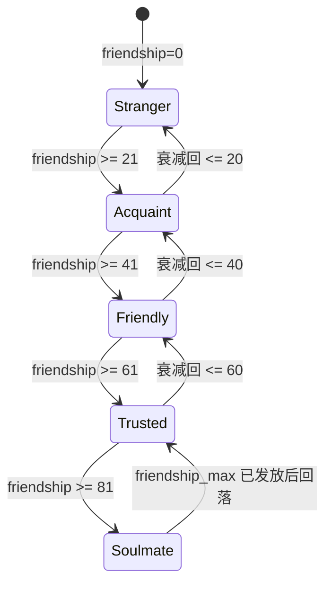

# Pythontopia R-12 送礼表与 NPC 好感度系统

> 本文是 R-12 解冻 Web 期间 20 NPC × 9 道具好感度的唯一玩法策划权威来源。
> 一切送礼后端字段、前端 store 行为、UI 触发、教育耦合都必须能映射回本文。
> 本文不引入恋爱要素、不开放婚姻线，所有"好感"都是"学习投入隐喻"。

## 0. 文档定位

Pythontopia 的"送礼"系统是 **NPC 关系深度** 的玩法承载，不是恋爱要素。教育版伦理硬约束：

- **禁止任何亲密 / 恋爱 / 婚姻线**。所有 NPC 都以"老师 / 同学 / 路人"身份与玩家建立关系，最高阶称"知己"而非"伴侣"，与 AGENTS.md「教育优先，游戏承载」一致。
- **送礼是学习投入的隐喻**：玩家挑选合适的道具送给合适的 NPC，本质上是在练习"了解学习对象的需求"——这与"理解题目"、"针对画像选择资源"是同构的认知行为。
- **不引入抽卡式随机好感跳点**：每次送礼好感增减都是可解释的离散值；好感主要来源是 **完成 NPC 发布的学习任务**（+5~+10），送礼仅是其中 1 条次要来源（+1~+8）。
- **不允许花钱买好感速通**：单 NPC 每周好感净增量上限 **±10**，刷礼物到这个数后当周无法再涨；要继续推进必须做任务 / 等下周。
- **不存在"讨厌→憎恨"的负向人格塑造**：好感最低 0，不会变成负数；NPC 不会拒绝玩家进入区域、不会扣 KC mastery。"送错礼"的最坏代价是 -3 friendship + NPC sad 表情 2 秒，不影响学习进度。

整体定位见 `docs/gameplay/npc-ecosystem.md §6 friendship 系统` 与 `docs/gameplay/social-classroom.md §7` 排行设计：好感度只是个体—NPC 关系深度的衡量，**不参与班级排行**，**不显示给同班同学**，更不会作为教师 Dashboard 的考核指标，避免变成"刷礼物社交压力"。

---

## 1. 好感度数值定义

### 1.1 数值范围与状态分段

| 阶段 | friendship 区间 | 文案 | NPC 行为变化 |
| --- | --- | --- | --- |
| 陌生 | 0–20 | "我们好像见过？" | 仅 `greet` / `lore` 节点；不主动发任务 |
| 认识 | 21–40 | "又见面啦，今天怎么样" | 解锁 `daily_chat` 节点，每日首次对话 +1 |
| 友善 | 41–60 | "你这事儿能帮我看看吗" | 解锁 **专属任务 1 个**（详见 §5.1） |
| 信任 | 61–80 | "上次的事我得跟你说说" | 解锁 **个人故事对话分支**（详见 §5.2） |
| 知己 | 81–100 | "你算是真懂我" | 解锁 **专属赠礼 / 永久 buff**（详见 §5.3） |

数值存储在 `npc_dialog_state.friendship`（V101 已建表，`INTEGER` + `CHECK (friendship BETWEEN 0 AND 100)`），与 `docs/gameplay/npc-ecosystem.md §6.1` 一致。

### 1.2 每周净增上限（防刷）

- 单 NPC 单周 `friendship` 净增量 **±10**（含送礼、对话、任务、节日所有来源的代数和）。
- "周"定义：以游戏内 `WorldClock.weekIndex` 为单位（每 7 游戏日 = 1 周），周一 06:00 重置。
- 触达上限后：当周内再送对礼仍消耗道具，但 `friendship_delta = 0`，UI 显示 ❤️🚫 "本周心意已收到"。
- 节日加成（§3 行 6 / §7.3）**不计入** 周上限，是设计给"错过日常的人一个补偿窗"。

### 1.3 衰减规则（已存在，本文复述对齐）

沿用 `docs/gameplay/npc-ecosystem.md §6.3`：连续 7 天未对话起，每周 `-1`，下限 0，不为负。生日错过当年仅"NPC sad 表情 1 次"，**不扣 friendship**——避免把"忘记记忆点"惩罚化（与 §0 教育版伦理一致）。

### 1.4 状态机



---

## 2. 好感度获取与损失途径

送礼**不是**主要途径。下表按教育权重排序，权重越高代表"越能反映真实学习投入"。

| 途径 | 增减幅 | 单 NPC 每日上限 | 来源事件 | 教育权重 |
| --- | --- | --- | --- | --- |
| 完成该 NPC 发布的任务 | +5 ~ +10 | 不限（按任务发放） | `student_quest.status=COMPLETED` 且 publisher=NPC | ★★★★★ |
| 参加该 NPC 主持的节日活动 | +3 | 1 次/节日 | `world_session.festival_event.participated_npcs[]` | ★★★★ |
| 偏好礼物（love） | +8 | 受周上限 ±10 卡 | `NpcDialogService.gift(tier=love)` | ★★★ |
| 偏好礼物（like） | +4 | 受周上限 ±10 卡 | `NpcDialogService.gift(tier=like)` | ★★★ |
| 中性礼物（neutral） | +1 | 受周上限 ±10 卡 | `NpcDialogService.gift(tier=neutral)` | ★★ |
| 每日首次对话 | +1 | 1 次/NPC/日 | `NpcDialogService.talk` + 当日 `last_talked_at` 校验 | ★★ |
| 生日当天送对礼（love/like） | 礼物 delta + **5 加成** | 当日单次 | 见 §7.3 | ★★★★ |
| 送错（dislike） | -2 | 不上限（但触发周上限保护） | `NpcDialogService.gift(tier=dislike)` | - |
| 送厌（hate） | -5 | 不上限 | `NpcDialogService.gift(tier=hate)` | - |
| 连续 7+ 天未对话 | -1/周 | - | `WorldClock` 周扫描 | - |

> 数值与 `NpcDialogService.TIER_DELTAS` 完全对齐（V102 已硬编码 love=+8 / like=+4 / neutral=+1 / dislike=-2 / hate=-5）。本文新增的"任务完成 +5~+10"由 `QuestService.markCompleted(...)` 调 `NpcDialogService.applyFriendshipDelta(npcKey, +n, reason='QUEST_COMPLETE')`，复用同一通道。

### 2.1 周上限实现

`NpcDialogService.gift(...)` 在 `incrementFriendship` 前先查 `npc_gift_log` 中过去 7 游戏日的 `SUM(friendship_delta)`，若 |sum + delta| > 10 则把 delta 钳制到 ±10 - sum 的范围（仍消耗物品，仍写日志，但 friendship 增量按钳制后的值）。逻辑实现在 `NpcDialogService` 内部，不引入新 service 类。

---

## 3. NPC × 道具好感矩阵（20 × 9 主表）

> 道具仅使用 `frontend/src/components/hud/InventoryPanel.vue::ITEM_KEY_ICONS` 现有 9 个 `itemKey`：`watering_can / hoe / axe / pickaxe / fertilizer / bread / coffee / flower / bug_jar`。**禁止虚构新道具**。
> 每个 NPC：3 个偏好（love / like 混合）+ 1 个讨厌（dislike）+ 5 个中性默认。
> 矩阵单元含义：L=love(+8) · K=like(+4) · -=neutral(+1) · X=dislike(-2)。本文未出现 hate(-5)，留作 R-13 风险道具扩展。

| NPC \ 道具 | watering_can | hoe | axe | pickaxe | fertilizer | bread | coffee | flower | bug_jar |
| --- | :---: | :---: | :---: | :---: | :---: | :---: | :---: | :---: | :---: |
| mayor_py 镇长 Py | - | - | X | - | - | K | L | L | - |
| farmer_kc 田老 | L | K | X | - | K | - | - | - | - |
| foreman_bug 矿头 Bug | - | - | K | L | - | - | - | X | L |
| librarian_doc 馆长 Doc | - | - | X | - | K | - | L | K | - |
| coach_q 教务 Q | - | - | - | - | K | K | L | X | - |
| sage_review 复盘师 Sage | - | - | - | X | - | K | K | L | - |
| student_diligent 勤勉小柒 | - | - | - | - | K | K | L | - | X |
| student_procrast 拖延小迟 | - | - | - | - | - | L | L | X | K |
| student_anxious 焦虑小安 | - | - | - | - | - | K | K | L | X |
| student_late_starter 后赶小赶 | - | - | - | - | K | K | L | X | - |
| student_top 拔尖小尖 | - | - | - | K | - | - | K | X | L |
| student_hobby 兴趣小好 | - | - | - | - | X | - | K | L | K |
| craftsman 工长 | - | L | L | K | - | - | - | X | - |
| class_president 班长 | - | - | - | - | - | K | K | L | X |
| merchant 商人 | - | - | - | - | - | K | L | K | X |
| nurse 医务 | - | - | - | - | - | K | K | L | X |
| postman 邮差 | - | - | - | X | - | K | L | K | - |
| gardener 园丁 | L | K | - | X | K | - | - | L | - |
| chef 厨师 | - | - | - | - | - | L | K | K | X |
| guard 守门 | - | - | K | - | - | L | K | X | - |

> 注意：farmer_kc 与 gardener 同时把 watering_can 设为 love，是因为两人都把"浇水=读课件"作为本职；craftsman 把 hoe / axe 设为 love，是因为木工房需要原始工具；foreman_bug 是唯一把 bug_jar 设为 love 的核心教师（Ch5 IndexError/KeyError 的隐喻具象化）。

### 3.1 每 NPC 偏好与忌讳速查

下表是上方矩阵的"宽行"展开版，便于策划在 NPC `meta.json.favoriteGifts` 与 `item_catalog.gift_tier_map` 双向校对（`NpcDialogService.resolveGiftTier` 读 `giftTierMap.<npcKey>` 与 `default` 回退）。**仅本表与上方矩阵互为唯一权威**，meta.json 的 `favoriteGifts` 字段在 R-12 由 `sync-npc-data.mjs` 重写时以本文为准回填。

| NPC | love | like #1 | like #2 | dislike | 人设理由 |
| --- | --- | --- | --- | --- | --- |
| mayor_py | coffee | flower | bread | axe | 镇长喜欢清茶花艺，斧头太硬不入府 |
| farmer_kc | watering_can | hoe | fertilizer | axe | 农人三件套，斧头会砍掉作物 |
| foreman_bug | pickaxe / bug_jar | axe | (二 love) | flower | 矿洞挖掘工 + Bug 收藏家，花娇气 |
| librarian_doc | coffee | flower | fertilizer | axe | 馆长爱书爱花，斧头危及书架 |
| coach_q | coffee | bread | fertilizer | flower | 教务白班需要咖啡，花艺无效 |
| sage_review | flower | bread | coffee | pickaxe | 复盘殿静谧，镐子破坏氛围 |
| student_diligent | coffee | bread | fertilizer | bug_jar | 学霸怕脏，bug 标本是负担 |
| student_procrast | bread / coffee | bug_jar | (二 love) | flower | 拖延少年只关心吃喝与猎奇 |
| student_anxious | flower | bread | coffee | bug_jar | 焦虑型怕虫，温柔系治愈 |
| student_late_starter | coffee | bread | fertilizer | flower | 后赶型务实，花艺奢侈 |
| student_top | bug_jar | coffee | pickaxe | flower | 拔尖型把 bug 当藏品，鄙视装饰 |
| student_hobby | flower | bug_jar | coffee | fertilizer | 兴趣型搞像素艺术，化肥太粗 |
| craftsman | hoe / axe | pickaxe | (二 love) | flower | 工长三件套，花在木工房无地放 |
| class_president | flower | bread | coffee | bug_jar | 班长清雅，bug 影响场合 |
| merchant | coffee | flower | bread | bug_jar | 商人重外表，bug 影响成交 |
| nurse | flower | bread | coffee | bug_jar | 医务所要洁净，bug 是污染源 |
| postman | coffee | bread | flower | pickaxe | 邮差跨地图疲惫，镐子太沉 |
| gardener | watering_can / flower | hoe | fertilizer | pickaxe | 花园主三件套，镐子破坏地表 |
| chef | bread | coffee | flower | bug_jar | 厨师把面包当本职信仰，bug 是禁忌 |
| guard | bread | coffee | axe | flower | 守门要管饱，斧头是兵器辅助 |

> 注：foreman_bug / student_procrast / craftsman / gardener 各有 **双 love**（pickaxe+bug_jar / bread+coffee / hoe+axe / watering_can+flower），即第 2 个 love 项替代第 1 个 like 槽，矩阵已对应反映。

### 3.2 道具覆盖度自检

| 道具 | 被 love 数 | 被 like 数 | 被 neutral 数 | 被 dislike 数 | 总赠送活路 |
| --- | :---: | :---: | :---: | :---: | :---: |
| watering_can | 3 | 1 | 16 | 0 | 20/20 |
| hoe | 1 | 2 | 17 | 0 | 20/20 |
| axe | 1 | 2 | 14 | 3 | 17/20 |
| pickaxe | 1 | 2 | 14 | 3 | 17/20 |
| fertilizer | 0 | 6 | 13 | 1 | 19/20 |
| bread | 3 | 8 | 9 | 0 | 20/20 |
| coffee | 7 | 8 | 5 | 0 | 20/20 |
| flower | 6 | 4 | 4 | 6 | 14/20 |
| bug_jar | 2 | 3 | 7 | 8 | 12/20 |

> coffee / bread 是"万能社交礼"，flower / bug_jar 风险高（讨厌 NPC 多）但回报高，鼓励玩家先做 §5 解锁的"NPC 个人故事"了解再送。

---

## 4. 后端字段对齐

R-12 不重复造表。当前 V101 / V102 已经覆盖原计划的 `npc_relationship` / `npc_gift_record` 语义，本文显式做映射：

| 计划字段 | 实际复用 | 字段类型 | 来源 |
| --- | --- | --- | --- |
| `npc_relationship.user_id` | `npc_dialog_state.user_id` | BIGINT FK users | V101 |
| `npc_relationship.npc_key` | `npc_dialog_state.npc_key` | VARCHAR(64) | V101 |
| `npc_relationship.friendship` | `npc_dialog_state.friendship` | INTEGER 0–100 | V101 |
| `npc_relationship.last_gift_day` | `npc_dialog_state.flags->>'last_gift_day_index'` | JSONB key (整数化) | V101 (新逻辑) |
| `npc_gift_record.user_id` | `npc_gift_log.user_id` | BIGINT FK users | V102 |
| `npc_gift_record.npc_key` | `npc_gift_log.npc_key` | VARCHAR(64) | V102 |
| `npc_gift_record.item_key` | `npc_gift_log.item_key` | VARCHAR(64) | V102 |
| `npc_gift_record.given_at` | `npc_gift_log.given_at` | TIMESTAMPTZ | V102 |
| `npc_gift_record.friendship_delta` | `npc_gift_log.friendship_delta` | INTEGER | V102 |

### 4.1 V115 轻量补强（本文授权的新增）

仅一份迁移，**不引入新表、不引入新 service 类**：

```text
V115__npc_friendship_weekly_cap.sql
- ALTER TABLE npc_dialog_state
    ADD COLUMN weekly_delta_sum INTEGER NOT NULL DEFAULT 0,
    ADD COLUMN weekly_window_start_day INTEGER;
- 注释: weekly_delta_sum 缓存"当前游戏周已累计的 friendship 净变化"，
        配合 weekly_window_start_day (= dayIndex/7*7+1) 做按周滚动重置。
- 触发器/视图均不引入；重置由 NpcDialogService 在 talk/gift 入口
  惰性判断"是否跨周"，跨周则原子归零。
```

迁移文件头按 `AGENTS.md`「数据库迁移文件必须说明目的、影响表和不可逆风险」规范填写。

### 4.2 服务层改造

`NpcDialogService` 既有 `talk(...)` / `gift(...)` 内部新增两个 private helper：

- `clampWeeklyDelta(userId, npcKey, requestedDelta)`：返回钳制后的 delta，并写 `weekly_delta_sum`；
- `resetWeeklyIfRolled(state, currentDayIndex)`：若当前 dayIndex - weekly_window_start_day ≥ 7，则归零。

`QuestService.markCompleted(...)` 完成 NPC 任务奖励 friendship 时也调用同一 clamp 接口，避免被任务+礼物联合刷穿。

---

## 5. 好感度解锁内容

### 5.1 友善（41）：专属任务 1 个

每 NPC 在 friendship ≥ 41 时解锁 1 个专属任务（`quest.kind='NPC_DEDICATED'`），由 NPC 主动在 dialog `friendly_quest_offer` 节点提供。任务奖励统一：**+30 Pythoco · friendship +5 · 一次性章节副本片段**。下表只列 6 教师 + 6 学生的代表任务，剩余 8 个生活 NPC 任务命名规则 `quest_friendly_<npcKey>`，内容由 ResourceDesignerAgent 生成 + GroundingCriticAgent 审。

| NPC | 任务 questKey | 任务一句话 |
| --- | --- | --- |
| mayor_py | `quest_friendly_mayor_py` | "陪我巡视一次小镇，标记 3 个新生最常迷路的路口" |
| farmer_kc | `quest_friendly_farmer_kc` | "把你最得意的 3 块田 (KC ≥ 0.8) 拍照给我归档" |
| foreman_bug | `quest_friendly_foreman_bug` | "解决我矿洞这 3 个老 traceback (IndexError / KeyError / TypeError)" |
| librarian_doc | `quest_friendly_librarian_doc` | "帮我核对这 5 个 KC 对应的课件页码是否还准" |
| coach_q | `quest_friendly_coach_q` | "在 24h 内做完我挑的 3 道分支题，全 AC" |
| sage_review | `quest_friendly_sage_review` | "用 lambda 把你这周的失败提交分类，写成一句心得" |
| student_diligent | `quest_friendly_student_diligent` | "跟我对一次进度卡片，看看哪些 KC 我落后" |
| student_procrast | `quest_friendly_student_procrast` | "明早 8 点叫我起床，连续 3 天" |
| student_anxious | `quest_friendly_student_anxious` | "陪我重做这道我已经做错 5 次的题" |
| student_late_starter | `quest_friendly_student_late_starter` | "推我 3 道你最近 AC 的题让我跟上" |
| student_top | `quest_friendly_student_top` | "用 2 种解法 AC 同一道我挑的题" |
| student_hobby | `quest_friendly_student_hobby` | "陪我把这个像素小动画的 Python 脚本调通" |

### 5.2 信任（61）：个人故事分支

每 NPC 解锁 1 个 `personal_lore_<npcKey>` dialog 节点，**长 4 段台词**，讲一个能映射到课程 KC 的私人故事。这是"NPC 立体化"的关键，避免成为"行走 quest 发放机"。下表为故事一句话 + 对应教育呼应。

| NPC | 故事一句话 | 教育呼应 KC |
| --- | --- | --- |
| mayor_py | "我刚来 Pythontopia 时，第一行代码也是 `print('hello world')`" | KC-001 计算思维入门 |
| farmer_kc | "我种坏的第一块 KC 田，是因为忘了浇水（没读课件）" | KC-013 输入输出 |
| foreman_bug | "我第 1 个 NameError 卡了我整整一周" | KC-031 for 循环 / 命名作用域 |
| librarian_doc | "这本《Python 语言基础》561 页，我手抄过两遍" | KC-048 文件读写 |
| coach_q | "我设计第一道题，因为太难被自己 AC 不了" | KC-033 分支 |
| sage_review | "我开复盘殿是因为我曾经不复盘，错过整整一年" | KC-054 lambda / 抽象 |
| student_diligent | "我其实也偶尔想偷懒，是看到拖延小迟才警醒" | KC-Misc 元认知 |
| student_procrast | "我每次熬夜，心里都在骂自己" | KC-Misc 时间管理 |
| student_anxious | "我做错题不敢提交，怕被看到分数" | KC-Misc 心理 |
| student_late_starter | "我前半学期摸鱼，期中那一刻才醒" | KC-Misc 节奏 |
| student_top | "我做完 39 题反而不知道下一步" | KC-064 类 / 进阶探索 |
| student_hobby | "我学 Python 是为了做我妹妹想玩的像素小游戏" | KC-040 列表 |
| craftsman | "我做的第一个木桌，是用 for 循环算钉子位置" | KC-031 for 循环 |
| class_president | "我当班长是因为想看到大家一起走完一学期" | KC-Misc 协作 |
| merchant | "我跨过 7 个港口才知道哪种课件值得买" | KC-049 数据存取 |
| nurse | "我每天提醒你休息，是因为我曾经熬到晕在键盘上" | KC-Misc 节奏 |
| postman | "我每封信都亲手写，因为字符串拼接我也想认真写" | KC-015 字符串格式化 |
| gardener | "花园=列表，每株花是 list[i]，季节是 for 循环" | KC-040 列表 |
| chef | "菜单是字典，KC 是键，菜是值" | KC-041 字典 |
| guard | "我守门 10 年，一直在跑 while True" | KC-032 while 循环 |

### 5.3 知己（81）：专属赠礼 / 永久 buff

friendship ≥ 81 触发一次性 `friendship_max` 节点，NPC 把"自己最珍视的东西"送给玩家，落地两类回报：**专属物品 1 件**（叙事道具，无属性）+ **永久 buff（与某 KC 强绑定）**。每 NPC 知己礼对应 1 个 KC 的 `mastery += 0.05`（见 §6）。

| NPC | 知己叙事道具 itemKey（叙事层占位） | 永久 buff | 关联 KC |
| --- | --- | --- | --- |
| mayor_py | `gift_mayor_signature_zen` | 全章节学习速度 +3% | KC-001 |
| farmer_kc | `gift_farmer_old_can` | 农业种子成长 +5% | KC-013 |
| foreman_bug | `gift_foreman_lamp` | Bug 矿洞掉率 +5% | KC-031 |
| librarian_doc | `gift_librarian_first_pageref` | 课件页阅读 +5% Pythoco | KC-048 |
| coach_q | `gift_coach_whistle` | 题库推荐准确率 +5% | KC-033 |
| sage_review | `gift_sage_first_journal` | 周复盘心得 +5% Pythoco | KC-054 |
| student_diligent | `gift_diligent_planner` | 每日签到 +5% energy | KC-Misc-Plan |
| student_procrast | `gift_procrast_alarm` | deadline 提醒早 1 小时 | KC-Misc-Time |
| student_anxious | `gift_anxious_chamomile` | 失败提交 frustration 缓冲 ×0.8 | KC-Misc-Emo |
| student_late_starter | `gift_late_starter_note` | 期中后 mastery 增速 +5% | KC-Misc-Catch |
| student_top | `gift_top_pendant` | 高级 KC 解锁门槛 -5% | KC-064 |
| student_hobby | `gift_hobby_canvas` | side project 任务 +5% Pythoco | KC-040 |
| craftsman | `gift_craftsman_blueprint` | 工具耐久 +5% | KC-031 |
| class_president | `gift_president_pin` | 班级声望 ×1.05 | KC-Misc-Coll |
| merchant | `gift_merchant_coin` | 商人折扣 +2% | KC-049 |
| nurse | `gift_nurse_token` | 每日 energy 上限 +5 | KC-Misc-Rhy |
| postman | `gift_postman_stamp` | 邮件附带签到题 +5% Pythoco | KC-015 |
| gardener | `gift_gardener_seed` | 花卉装饰季节 buff ×1.05 | KC-040 |
| chef | `gift_chef_recipe` | 餐食学习速度 +5% | KC-041 |
| guard | `gift_guard_torch` | 地图入口提示更详尽 | KC-032 |

> 知己叙事道具是 `inventory_item.kind='cosmetic'`，仅作徽章展示，不可交易。永久 buff 全部 +5% 上限，避免数值膨胀。同一玩家最多可达成 20 个知己（理论），但单学期实际可达成 ≤ 5 个（受周上限 ±10 与衰减约束），与 `social-classroom.md §10` 验收指标"班级日均互助 ≥ 5"形成正交。

---

## 6. 教育绑定：知己礼 → KC mastery +0.05

每 NPC 的"知己礼"在 §5.3 触发时，由 `NpcDialogService.deliverFriendshipMaxGift(userId, npcKey)` 发起：

1. 写 `inventory_item`（叙事道具）；
2. 写 `learner_kc_mastery` 一次性 `mastery_delta = +0.05`（cap 至 1.0）；
3. 写 `kc_mastery_event(source='NPC_SOULMATE_GIFT', npc_key, kc_code)`；
4. 写 `learner_flag.soulmate_<npcKey> = true`。

mastery +0.05 是"小但可感"的奖励——单 NPC 一次性，不可重复，与 `docs/gameplay/economy-system.md §1.3` 单日 mastery 上限 +0.10/天 共用计数池，避免成为 friendship 刷分捷径。

> **教育版边界**：上述 mastery 加成依赖 §5 的"友善任务完成 + 信任故事对话听完 + 知己阈值达成"三步证据链；任何 1 步缺失（如绕过任务直接刷礼物到 81），后端会拒发 mastery，仅发徽章。逻辑见 `NpcDialogService.canDeliverSoulmateGift(userId, npcKey)` 的三段断言。

---

## 7. 生日系统

### 7.1 设计原则

- **每 NPC 1 个游戏内生日**，按 `WorldClock.dayIndex` 落点（1–112）；
- **20 个生日均匀分散** 在 112 天里，**不与 11 节日**（dayIndex 1/14/28/35/56/60/70/84/90/100/112）冲突；
- **生日当天**送 love/like 礼物：在原 delta 基础上 **+5 加成**（不计入周上限，§2.1）；
- **误了生日**：好感度 **不变化**（不送也不扣，避免"忘记惩罚"）。NPC 当天对话会出现 sad 表情 1 次 + 一句"今天我生日呢"。

### 7.2 20 NPC 生日表

| dayIndex | 季节-日 | NPC | 现实月-日（meta.json 兼容） | 生日"对的礼" |
| ---: | --- | --- | --- | --- |
| 5 | 春 5 | mayor_py | 4-1 | coffee / flower |
| 8 | 春 8 | nurse | 5-12 | flower / bread |
| 11 | 春 11 | postman | 1-25 | coffee / bread |
| 18 | 春 18 | gardener | 4-22 | flower / watering_can |
| 22 | 春 22 | farmer_kc | 5-20 | watering_can / fertilizer |
| 25 | 春 25 | student_diligent | 7-7 | coffee / bread |
| 31 | 夏 3 | chef | 11-11 | bread / coffee |
| 38 | 夏 10 | student_anxious | 3-14 | flower / bread |
| 42 | 夏 14 | coach_q | 9-1 | coffee / fertilizer |
| 47 | 夏 19 | craftsman | 6-13 | hoe / axe |
| 52 | 夏 24 | librarian_doc | 10-11 | coffee / flower |
| 59 | 秋 3 | guard | 7-30 | bread / axe |
| 64 | 秋 8 | foreman_bug | 8-10 | bug_jar / pickaxe |
| 68 | 秋 12 | class_president | 9-10 | flower / bread |
| 75 | 秋 19 | merchant | 10-1 | coffee / flower |
| 78 | 秋 22 | student_hobby | 8-25 | flower / bug_jar |
| 81 | 秋 25 | student_top | 2-29 | bug_jar / pickaxe |
| 95 | 冬 7 | sage_review | 12-31 | flower / bread |
| 105 | 冬 17 | student_procrast | 11-15 | bread / coffee |
| 109 | 冬 21 | student_late_starter | 6-6 | coffee / bread |

> dayIndex 列是运行期权威字段；"现实月-日"列与 `data/npcs/<key>/meta.json::birthday` 完全对齐，由 `WorldClockService.realDateToGameDay(month, day)` 在游戏启动时计算映射，无需修改 meta.json。

### 7.3 生日加成计算

```text
deltaFinal = deltaTier (love=+8 | like=+4 | neutral=+1 | dislike=-2)
           + (isBirthday AND tier in {love, like} ? 5 : 0)
           - clampedByWeeklyCap(deltaTier)
           // 周上限只钳制 base，不钳制生日加成
```

例：生日当天送 love 礼，weekly_delta_sum 已 +9 → base=+8 钳为 +1，加成 +5，最终 **+6**。

### 7.4 生日 NPC 行为

生日当天 06:00–22:00：

- NPC 头顶 16×16 蛋糕图标贴图（emoji 🎂 占位，由 sprite 后续接管）；
- `WorldClock` 在 dayIndex 切换时广播 `npc_birthday_today` 事件，HUD 顶部金色横幅 `今天是 <NPC 名> 的生日` 持续 8s；
- 邮差 postman 当天会在 `town_hub` 投递"生日提醒"信件（如果玩家未上线则次日补送，仅 1 次）；
- NPC 当天 dialog 多 1 个 `birthday_today_lore` 节点（仅当天可见），讲一段生日相关短叙事。

---

## 8. 前端 store 扩展

### 8.1 `useNpcStore` 仅加 getter，不重写

`frontend/src/stores/npc.ts` 已有 `friendship(npcKey)` getter（见现有实现 line 34–43）。本文授权新增 4 个 getter，**不改任何 action**：

```text
getters:
  friendshipTier(npcKey: string): 'stranger' | 'acquaint' | 'friendly' | 'trusted' | 'soulmate'
  isBirthdayToday(npcKey: string, dayIndex: number): boolean
  weeklyDeltaRemaining(npcKey: string): number   // 10 - |weekly_delta_sum|
  giftTierFor(npcKey: string, itemKey: string): 'love' | 'like' | 'neutral' | 'dislike' | 'hate'
```

`giftTierFor` 的数据源：bootstrap 时由 `world store` 一并下发 `item_catalog.gift_tier_map`，缓存在 `useInventoryStore.catalog[itemKey].giftTierMap`，避免每次送礼往返后端。

### 8.2 新增 selector（非 store）

`frontend/src/game/selectors/giftSelectors.ts`（新文件，单纯函数）：

```text
export function suggestTopGiftFor(
  npc: NpcMeta,
  catalog: ItemCatalog,
  inventory: InventoryItemDto[],
): InventoryItemDto | null;
// 返回背包内当下 NPC 偏好等级最高（love > like > neutral）的第一件 itemKey，
// 用于 §9 UI 高亮。
```

---

## 9. 送礼 UI：长按背包物品

### 9.1 触发流

1. 玩家在 `WorldScene` 打开背包面板（`hud.toggleSlot('inventory')`）；
2. **长按** 物品格子（≥ 350 ms）→ 进入"送礼模式"：背包面板缩小到屏幕右下角 40%，物品图标"举起"光圈；
3. 玩家在地图上 **点击附近 NPC**（距离 ≤ 2 tile = 64 px），UI 弹"送给 <NPC 名> 吗？"模态框；
4. 确认后 emit `gift` 事件 → `useNpcStore.gift(npcKey, itemKey, 1)` → 后端 `NpcDialogService.gift(...)`；
5. NPC 头顶弹出对应表情（love=happy / like=happy / neutral=neutral / dislike=sad），同时 floating text `+8` (love) 或 `-2` (dislike) 持续 1.5s 上飘；
6. 周上限触达时 floating text 显示 `本周心意已收到`，仍消耗物品但 friendship 不动。

### 9.2 长按手势细节

- 短按 (<350 ms) = `emit('use', { itemId })`（保持现有 `InventoryPanel` 行为不变）；
- 长按 (≥350 ms) = `emit('gift-mode', { itemId })`，由父级 Page 把模式同步给 `WorldScene` 高亮邻近 NPC；
- 长按可中途取消：手指未抬起前移出格子区域 → 取消进入送礼模式。

### 9.3 不需要的 UI

- **不做** "好感排行榜"、"送礼次数榜"——避免社交压力（§0 / `social-classroom.md §7`）；
- **不做** "送礼动画庆典"——避免抽卡感；表情 + floating text 足够。

---

## 10. 画像影响

送礼分布参与 `learner_profile.dimensions` 的两个细分维度更新，由 `PassiveProfileService` 每周扫描 `npc_gift_log` 计算：

| 行为模式 | 触发条件（过去 4 周窗口） | 画像维度 patch |
| --- | --- | --- |
| 集中送礼 | 单 NPC `gift_count` 占总 `gift_count` ≥ 60% | `learning_preference.depth_seeking += 1` |
| 均匀送礼 | 送礼 NPC 数 ≥ 8 AND 单 NPC 占比 ≤ 25% | `learning_preference.breadth_seeking += 1` |
| 偏好任务而非礼物 | `friendship_delta_from_quest / total_friendship_delta ≥ 0.7` | `learning_preference.task_oriented += 1` |
| 偏好礼物而非任务 | `friendship_delta_from_gift / total_friendship_delta ≥ 0.7` | `learning_preference.social_oriented += 1` |

**冷却**：同一维度 patch 后 14 天内不再触发，避免短期波动污染画像。

---

## 11. 验收与测试

### 11.1 后端

| 测试类 | 关键断言 |
| --- | --- |
| `NpcRelationshipServiceTest`（新建，挂 `backend/src/test/java/com/pythontopia/world/npc/`） | 1) gift 100 次 love 给 farmer_kc，friendship 仍 ≤ 100；2) 周上限触发后 `weekly_delta_sum` 不再增加；3) 生日加成 +5 在 weekly 触顶时仍生效；4) 知己礼三段证据链断 1 步则不发 mastery |
| `NpcDialogServiceTest`（已存在，本文新增 6 个用例） | gift_tier 5 档 delta 精确等于 TIER_DELTAS / dislike 不触发 mastery 加成 / 生日 +5 仅适用 love+like / postman 送 pickaxe 触发 dislike -2 / 周上限钳制后 inventory 仍正常扣减 / friendship cap 0/100 双向 |

`mvn -pl backend test -Dtest=NpcRelationshipServiceTest,NpcDialogServiceTest` 为本文交付前置门。

### 11.2 前端

| 测试文件 | 关键断言 |
| --- | --- |
| `frontend/tests/components/gift.spec.ts`（新建） | 1) 长按 350ms 触发 gift-mode；2) 点击 2 tile 内 NPC 才弹模态框；3) friendship +8 后顶部 floating text 渲染；4) 周上限到 `本周心意已收到` 显示 |
| `frontend/tests/stores/npc.spec.ts`（扩展） | 1) friendshipTier getter 在 0/20/21/40/41/60/61/80/81/100 各档断言正确；2) isBirthdayToday(farmer_kc, 22) === true |

`npm run test -- gift.spec.ts npc.spec.ts` 通过。

### 11.3 数据自检

启动 `npm run dev` 后浏览器控制台执行：

```text
const npc = useNpcStore();
const inv = useInventoryStore();
console.table(inv.items.map(i => ({
  item: i.itemKey,
  farmer_kc: npc.giftTierFor('farmer_kc', i.itemKey),
})));
```

应输出 9 行，watering_can/hoe/fertilizer 落点正确（love/like/like），axe 落 dislike。

---

## 12. 风险与缓解

| 风险 | 触发场景 | 缓解 |
| --- | --- | --- |
| 周上限 ±10 导致玩家"早送完早结束" | 玩家把所有 NPC 一次性送到知己 | 信任阈值 (61) 强依赖 §5.2 故事对话 4 段台词听完；故事对话每周限 2 NPC（前端 store 校验） |
| 知己 mastery +0.05 被刷 | 玩家专攻同一 NPC 反复触发 | §6 三段证据链 + `learner_flag.soulmate_<npcKey>` 唯一性约束 |
| 送礼 UI 长按与现有"使用物品"短按混淆 | 玩家误送出关键工具 | 模态框二次确认；watering_can / hoe / pickaxe 等工具类设 `requiresConfirm=true` |
| flower / bug_jar 风险道具被滥用刷 dislike | 玩家试图通过 dislike 测试 NPC 偏好 | 单 NPC 单日仅记录 ≤ 3 次 dislike，超出仅消耗物品不写 log（节省 audit 行数 + 避免 PassiveProfileService 误判负面情绪） |
| 生日提醒错过仍被玩家投诉 | 邮差补送窗只 1 次 | 邮箱信件不消失（永久存档），HUD 顶栏在生日次日仍显示"昨天是 X 的生日"提示 4s |
| 知己永久 buff 数值膨胀 | 20 个知己全达成 → 多重叠加 | 单学期 ≤ 5 个达成（§5.3 备注）+ 同类 buff 取最大 1 个，由后端 `BuffStackService` 在 dispatch 时去重 |

---

> 本文是 R-12 送礼系统**唯一**玩法策划权威。`data/npcs/<key>/meta.json::favoriteGifts`、`item_catalog.gift_tier_map`、`docs/gameplay/npc-ecosystem.md §6 friendship`、`docs/gameplay/economy-system.md §2.3 gift 类道具` 在 R-12 期间均以本文为修订基准。
> 若需要新增第 10 件 `itemKey`，必须先在本文 §3 矩阵补全 20 行，再回写到 `InventoryPanel.vue::ITEM_KEY_ICONS`。
