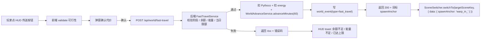

# Pythontopia 快速旅行网络设计

> 版本：v1.0 · 起草日期：2026-05-24 · 适用版本：R-12 起 · 状态：Draft（W4 验收后转 Active）
> 目标读者：玩法工程师、教学策划、画像分析师、场景切换 owner、班级教师
> 配套上游：`docs/game-tilemap-conventions.md` §6（场景跳转契约）、`docs/gameplay/world-clock-calendar.md` §6（时间流速）、`docs/gameplay/economy-system.md` §1（Pythoco）、`docs/gameplay/npc-ecosystem.md`（guard / merchant）

---

## 1. 文档定位

R-12 解冻后小镇被切成 5 张大地图：中央 `town_hub` 与 4 个外围 `farm_north / mine_south / campus_east / port_west`。当前玩家**只能依赖步行 + 地图边缘 fade 切换**（已落地 `frontend/src/game/core/SceneSwitcher.ts`）。Beta 走查数据：

| 场景 | 单趟典型步行耗时 | 玩家心智反馈 |
|------|-----------------|--------------|
| town_hub → farm_north 浇水 1 块田 | 38 秒走 + 12 秒浇 + 38 秒走 ≈ **1 分 28 秒** | 浇水本身只占 12 秒，"通勤税"88% |
| port_west → mine_south 跨外围 | 必须先回 town_hub 中转 ≈ **2 分 50 秒** | 玩家放弃跨图任务，退回刷 KC 单图 |
| 一日内完成 4 大外围全部任务 | 步行总耗时 ≈ **3 分 10 秒**（占游戏 8 小时 22%） | 通勤挤占学习窗口 |

直接砍掉移动会让学习节奏失真（玩家把"等浇水"变成"等弹窗"）。因此本文设计的快速旅行网络遵守两条硬约束：

1. **不能让玩家瞬移逃避学习**：每一次传送必须挂在学习证据链上（Pythoco / 能量 / 已读课件 / 章节通过），与 `economy-system.md` §8 的"单向证据链"原则同构。
2. **不能破坏 SceneSwitcher 真相**：传送本质上只是给 `SceneSwitcher.switchTo(targetSceneKey, opts)` 加一层"前置代价校验"，**不引入第二条场景切换管线**。`fadeOut → cleanup → start` 全流程复用现有实现，避免 W1 已验收的稳定性退化。

> **为什么不一刀切允许传送**：星露谷 Beta 测试过自由 warp，结论是玩家"做完一件事立刻 warp，永远不会顺路对话"，NPC 生态因此塌缩。Pythontopia 的 NPC 是教学耦合（见 `npc-ecosystem.md` §8），通勤路上的偶遇是被动学习窗口，必须保留一部分。

---

## 2. 分阶段解锁

按学期 dayIndex（`world-clock-calendar.md` §1：1 学年 = 112 游戏天 = 16 周）分 4 阶段。`unlock_phase` 入库到 `fast_travel_route.unlock_phase` 静态枚举，由后端校验，前端只用于 HUD 隐藏未解锁路线。

| 阶段 | dayIndex 区间 | 解锁条件 | 可用传送方式 | 教育意图 |
|------|---------------|----------|--------------|----------|
| 0 | Day 1–7 | 学期初默认 | 仅步行 + 地图边缘 `scene_link_*` fade 切换 | 让玩家用脚画一张心智地图，记住每张图的位置关系 |
| 1 | Day 8–27 + Ch1 KC 平均 mastery ≥ 0.6 | `mayor_py` 颁发"传送石" `quest_warp_stone_intro` | 中央广场 `town_hub.warp_circle` → 任一**已访问过**的外围地图 | 鼓励玩家先把 Ch1 学到"能自证存在感"，再奖励通勤折扣 |
| 2 | Day 28+ + Ch4 通过（KC-031/032/033 全部 ≥ 0.7） | `merchant` 处购"船票卡" `consumable_port_pass`（300 Pythoco 一次性投入） | `port_west.dock` ↔ `farm_north.river_pier` / `mine_south.mine_bay` 跨外围 | 流程控制学好了，奖励"跨外围免回中转" |
| 3 | Day 70+ + Ch6 通过（KC-048/049 ≥ 0.8） | `librarian_doc` 处接受主线"图书馆密道勘察" | `campus_east.library_basement` ↔ `town_hub.archive_well` 双向自由穿 | 数据存取学到位才能"读懂老地图"，叙事-知识对齐 |

> **为什么以章节通过为门槛**：阶段-章节-传送权限是同构线性增长，与 `player-progression.md` 的"7 章 = 1 学期"心智模型一致。学生看到"我学完 Ch4 就能解锁船"会主动赶进度，而不是为了赶进度去刷分。

> **"已访问过"的判定**：服务端 `world_event(event_type=SCENE_ENTERED, payload={mapKey})` 历史里出现过即视为访问过；阶段 1 不允许"凭空传送到没去过的图"，避免新生绕开第一次寻路。

---

## 3. 传送代价表

代价分**三档主路线** + 1 档**应急回家**，所有数值都写入 `fast_travel_route` 静态表，比赛前两周允许 ±20% 调参（与 `economy-system.md` §7 同口径）。

| 路线类型 | from → to | 代价 Pythoco | 代价 energy | 代价游戏分钟 | 备注 |
|----------|-----------|-------------:|------------:|-------------:|------|
| 传送石（阶段 1） | `town_hub.warp_circle` → 任一已访问外围 | **10** | **5** | **60**（1 游戏小时） | 一次性扣，到达即起算 |
| 传送石返程 | 任一外围 `warp_runestone` → `town_hub` | 5 | 3 | 30 | 返程半价，鼓励"先去再回" |
| 船票（阶段 2） | `port_west.dock` ↔ `farm_north.river_pier` / `mine_south.mine_bay` | **3** | **3** | **60** | 票卡 `consumable_port_pass` 可重复用，购卡时已支付 300 |
| 密道（阶段 3） | `campus_east.library_basement` ↔ `town_hub.archive_well` | **0** | 2 | 15 | 免 Pythoco，但**当日必须已读 ≥1 页课件**（`page_read.count_today ≥ 1`） |
| 应急回家 | 任意地图 → 玩家床位（无需阶段） | 20 | 0 | 0（瞬时） | 仅夜间 21:00 之后 OR 能量 = 0 时可用，每日 1 次 |

### 3.1 代价计算时机



> **为什么"扣代价"在后端做、不在前端**：与 `economy-system.md` §8 反作弊条款一致——所有 Pythoco 进出账必须经服务端审计，前端 Pyodide 预览不计经济、传送也不计。任何客户端篡改最多让 UI 显示错位，写不进 `learner_wallet`。

> **为什么传送也消耗 1 游戏小时**：直接瞬时到达会让"赶时间"压力消失，玩家会在 NIGHT 时段 5 秒环游 5 张图，把 `WorldClock` 的时段-能量耦合（`world-clock-calendar.md` §9 晚睡警告）旁路。1 游戏小时（= 60 真实秒，按 `gameMinutesPerRealSecond=1`）足够触发 1 次 `time-of-day-changed` 边沿。

---

## 4. 传送 UI 流程

### 4.1 HUD 入口

复用 W3 已实现的 `frontend/src/components/hud/MiniMap.vue`，在其右下角扩展一个 **`快速旅行`** chip 按钮（图标使用像素化传送门 sprite，CC0 来源见 §9）。按钮 disabled 状态：阶段 0 或当前场景没有可达路线时灰色置灰，tooltip 显示"完成 Ch1 解锁"。

### 4.2 路线选择 dialog

点击按钮后弹出 `FastTravelDialog.vue`（W5 新组件，本文不实现，仅契约）。布局：

| 区域 | 内容 |
|------|------|
| 标题栏 | 当前阶段徽章（如"阶段 2 · 船票"） |
| 路线列表 | 每行 1 条可用路线：图标 + `from → to` + 代价摘要 + `选择` 按钮 |
| 代价详情 | 选中后右侧高亮：Pythoco / energy / 游戏分钟，余额不足项目红字 |
| 限制提示 | 黄字提示："当前在战斗中无法传送" / "今日已传送 7/10 次" |
| 操作栏 | `确认传送` 主按钮 + `取消` 次按钮 |

`确认传送` 后调用 `useWorldStore().fastTravel({ routeId })`，store action 内部走 §3.1 流程图，成功后透传 `spawnAnchor` 给 `SceneSwitcher.switchTo`，让目标场景在 `init(data)` 中用 `data.spawnAnchor === 'warp_in_<from>'` 找到落点（沿用 `game-tilemap-conventions.md` §6.2 约定）。

### 4.3 视觉与音效

| 节点 | 效果 |
|------|------|
| `确认传送` 点击 | SFX `sfx_warp_charge.ogg`（0.6s 充能音）+ 屏幕中心像素粒子收束动画 |
| `fadeOut` 中 | SFX `sfx_warp_release.ogg`（0.3s 释放音）+ 黑屏 |
| 目标场景 `fadeIn` 中 | 落点处粒子绽放 sprite 1 帧（贴在 `overlay` layer，depth=9999） |
| 失败回弹 | SFX `sfx_warp_fail.ogg` + HUD toast 抖动 |

> **为什么用 dialog 而不直接点 MiniMap 上的"目标地图"**：MiniMap 是缩略图，点击精度差；用 dialog 列条目可读性更好，并且能逐条显示"代价不足"原因，是教育产品对**透明性**的基本要求（学生需要知道为什么不能传送）。

---

## 5. 限制规则

下表用于 `FastTravelService.canFastTravel(playerCtx, route)` 的前置校验，按从强到弱顺序短路：

| 优先级 | 规则 | 触发条件 | 错误码 | UI 提示 |
|--------|------|----------|--------|---------|
| 1 | 强剧情锁 | `world_session.story_lock=true`（教师讲话、节日开幕动画、boss 战中场） | `STORY_LOCKED` | "正在剧情中，按 ESC 跳过对话后再试" |
| 2 | 战斗锁 | 玩家在 Bug 矿洞 boss room（`current_scene.is_combat=true`） | `IN_COMBAT` | "战斗中无法传送" |
| 3 | 节日锁 | `world_event.festival_id ∈ {spring_opening, summer_marathon, year_end_defense}` 且 dayIndex 在节日窗口内 | `FESTIVAL_LOCKED` | "节日期间请步行参与，错过即遗憾" |
| 4 | 能量底线 | `learner_energy < 10` | `LOW_ENERGY` | "能量不足 10，请回家睡觉或吃饭" |
| 5 | 矿洞深层锁 | 当前位于 `mine_south.B2 ~ B5` 任一层 | `DEEP_MINE_LOCKED` | "矿洞深层信号屏蔽，只能往上一层走" |
| 6 | 当日上限 | `world_event.fast_travel_count_today >= 10` | `DAILY_CAP` | "今日已传送 10 次，请明日再来" |
| 7 | 阶段未解锁 | `route.unlock_phase > learner_phase` | `PHASE_LOCKED` | "完成 Ch{n} 后解锁此路线" |
| 8 | 经济不足 | `wallet.balance < route.cost_pythoco` | `INSUFFICIENT_FUND` | "Pythoco 不足，请先去做题" |

### 5.1 矿洞深层为何特殊

`mine_south` B1 是地表入口（允许双向传送 1 次），B2 起强制"挖回地面才能走"——这是 `economy-system.md` §3 矿洞 boss 战奖励链条的关键约束：如果允许从 B5 直接 warp 出来，玩家会"打 boss 一半摸 boss 信息后 warp 出来查资料再回去"，把战斗变成查百度。深层信号屏蔽的叙事自洽（地下信号衰减）兼顾教学（强制完成战斗循环）。

### 5.2 每日上限 10 次的来源

按 Beta 走查目标"日均传送 ≤ 8 次 + 步行 ≥ 4 次"反推，10 是上限缓冲。10 也覆盖最坏情况：早上 1 次去农场、1 次去校园、1 次回家吃饭、下午 1 次去矿洞、1 次去港口、晚上 1 次回家睡觉 = 6 次，留 4 次给突发任务。**超过 10 几乎一定是 bug 或刷分**，硬封顶后通知服务端日志便于排查。

---

## 6. 教师视角控制

班级任务（`classroom_quest`）允许教师在创建时勾选 **"必须步行到达"** flag，存入 `classroom_quest.requires_walk = true`。该标记在玩家接任务后下发到前端 `useQuestStore().active.requiresWalk`。

| 阶段 | 教师面板配置 | 学生端行为 |
|------|--------------|------------|
| 创建任务 | 教师勾选"必须步行到达 `farm_north.kc_anchor_for_loop`" | 任务卡显示步行图标 |
| 学生接任务 | `requiresWalk = true` 写入 quest 上下文 | HUD 传送按钮在此任务激活期间灰化，tooltip："教师要求步行" |
| 学生强行 API 调传送 | 服务端 `FastTravelService` 二次校验 `active_quest_walk_only` | 返回 `WALK_REQUIRED`，前端 toast 提示 |
| 学生完成步行 | `quest_evidence.scene_path` 记录从接任务到完成的连续 SCENE_ENTERED | 评分包含"通勤完成度" |

> **为什么把"步行强制"权放教师**：班级任务是教师设计教学的工具，有时教师希望学生"路上遇见 `student_diligent` 听一次励志对话"或"路过 `gardener` 看见秋季田景"，这种被动学习的设计权应该保留给教师。学生默认仍可传送，仅在 `requires_walk` 时禁用。

> **为什么不全局禁用**：全局禁用会逼教师每个任务都勾，劣化体验；默认放行 + 显式禁用是符合最少惊讶原则的开关方向。

---

## 7. 后端字段

### 7.1 新增静态配置表 `fast_travel_route`

迁移文件 `backend/src/main/resources/db/migration/V115__fast_travel_route.sql`（迁移号占位，按 V11x 顺延）。**无前缀**沿用 V100–V110 约定。

| 字段 | 类型 | 必填 | 含义 |
|------|------|:----:|------|
| `id` | bigint PK | 是 | 路线唯一 ID |
| `route_key` | varchar(64) | 是 | snake_case 业务键（如 `warp_town_to_farm`） |
| `from_scene` | varchar(32) | 是 | 起点 `mapKey`（与 tilemap 对齐） |
| `to_scene` | varchar(32) | 是 | 终点 `mapKey` |
| `from_anchor` | varchar(64) | 是 | 起点 object 名（如 `warp_circle`），落点用 |
| `to_anchor` | varchar(64) | 是 | 终点 object 名（如 `warp_in_town_hub`） |
| `unlock_phase` | smallint | 是 | 0/1/2/3，与 §2 一致 |
| `cost_pythoco` | int | 是 | ≥ 0 |
| `cost_energy` | int | 是 | ≥ 0 |
| `cost_minutes` | int | 是 | ≥ 0 |
| `requires_visited` | boolean | 是 | 是否需要"已访问过"（阶段 1 = true） |
| `requires_daily_page_read` | boolean | 是 | 是否需要当日先读 1 页课件（阶段 3 = true） |
| `description_i18n_key` | varchar(64) | 是 | 国际化文案 key |
| `created_at` | timestamptz | 是 | 默认 `now()` |

种子数据由同迁移 `INSERT` 注入约 10 条路线（5 个 warp 双向 + 2 个船票双向 + 2 个密道双向 + 1 个应急回家虚拟路线）。

### 7.2 扩展 `world_event` 事件类型

`world_event.event_type` 既有 `FESTIVAL / WEATHER_CHANGE / SCENE_ENTERED` 等枚举，本表新增 `FAST_TRAVEL` 一项，`payload` JSONB 结构：

```json
{
  "routeKey": "warp_town_to_farm",
  "fromScene": "town_hub",
  "toScene": "farm_north",
  "costPythoco": 10,
  "costEnergy": 5,
  "costMinutes": 60,
  "playerLevel": 4,
  "dailyCountAfter": 3
}
```

不新增独立表，避免与 `world_event` 重复造审计基础设施。

### 7.3 新增 REST 端点

| Method | Path | 请求 | 响应 |
|--------|------|------|------|
| GET | `/api/world/fast-travel/routes` | 无 | `FastTravelRouteDto[]`（仅返回当前玩家可见路线） |
| POST | `/api/world/fast-travel` | `{ routeKey }` | 成功：`FastTravelResultDto{ targetScene, spawnAnchor, balanceAfter, energyAfter }`；失败：4xx + `errorCode` |

DTO 命名沿用 `frontend/src/api/dto/` 既有风格（`SaveSlotDto` 同款）。`FastTravelService` 是 R-12 W5 新增服务类，单测落在 `backend/src/test/java/com/pythontopia/world/fast_travel/FastTravelServiceTest.java`。

---

## 8. 画像影响

按 `AGENTS.md` 硬约束"每个机制必须在画像或 KC 上留下痕迹"。快速旅行作为高频行为，向 `learner_profile.dimensions` 写入 2 个被动信号，由 `PassiveProfileService` 每周日 23:00 滚动重算（与 `world-clock-calendar.md` §9 同节拍）。

| 画像维度 | 子字段 | 触发条件 | 更新动作 |
|----------|--------|----------|----------|
| `learning_preference.efficiency_seeking` | float [0, 1] | 滚动 7 真实天内 `FAST_TRAVEL` 事件 > 30 次 | `+0.05`（封顶 1.0），并在画像报告写"偏好节省通勤时间" |
| `learning_preference.efficiency_seeking` | 同上 | 同期 < 5 次但完成 ≥ 4 张外围地图任务 | `-0.03`（不为负），并写"享受步行散步式探索" |
| `emotion_resilience.steady_walker` | float [0, 1] | 阶段 1 已解锁但 7 日内主动选择步行的比例 > 70% | `+0.05`（封顶 1.0），并在 `sage_review` 复盘对话推送"持之以恒" |
| `emotion_resilience.steady_walker` | 同上 | 阶段 1 解锁后 7 日内传送占比 > 95% | `-0.02`，不触发负面提示，仅作为数据点 |

> **为什么把传送频率挂在 `learning_preference` 而非 `learning_goal`**：这是**风格信号**（偏好快还是偏好慢），而非**目标信号**（要不要急着考完）。强行映射到 goal 会污染 `PathPlannerAgent` 的排序权重，让传送多的人被错误推"赶进度密集复盘"。

> **为什么"拒绝传送"也加分**：教育产品的画像维度必须是**双向的**——把步行偏好打成"不够效率"会驱使学生为了画像分硬传送，反而扭曲学习节奏。`steady_walker` 是给"愿意慢"的学生的正向反馈。

---

## 9. 资产

所有新增资产必须同步进 `assets/pixel/LICENSE.md` 与根 `LICENSE-ART.md`（沿用 `AGENTS.md` 项目硬约束）。本节列资产清单与候选来源（**实际收编由 W6 资产 owner 完成审计**，本文仅给出方向）。

| 资产 | 用途 | 类型 | 候选来源 | License |
|------|------|------|----------|---------|
| `sfx_warp_charge.ogg` | 传送充能音（0.6s） | SFX | Kenney "Sci-Fi Sounds" pack | CC0 |
| `sfx_warp_release.ogg` | 传送释放音（0.3s） | SFX | OpenGameArt "Magic Spell SFX" | CC0 |
| `sfx_warp_fail.ogg` | 传送失败回弹音 | SFX | Kenney "UI Audio" pack | CC0 |
| `sprite_warp_circle.png` | `town_hub.warp_circle` 地面光圈（32×32, 4 帧 anim） | tile | 自绘 / OpenGameArt LPC 兼容资产 | CC-BY-SA 3.0+（与 LPC 同链） |
| `sprite_port_dock.png` | `port_west.dock` 船坞像素（64×48） | tile | OpenGameArt "Pirate Pack" | CC-BY 3.0（注明作者） |
| `sprite_secret_passage.png` | `library_basement` / `archive_well` 入口贴图 | tile | 自绘 / Kenney "Roguelike Pack" | CC0 |
| `icon_warp_chip.png` | HUD 传送按钮图标（16×16） | UI icon | 自绘 | CC0 |
| `sprite_warp_particles.png` | 落点粒子绽放 sprite sheet（32×32, 6 帧） | particle | 自绘 / Kenney "Particle Pack" | CC0 |

### 9.1 NPC 协调

| NPC | 现有定位（npc-ecosystem.md） | 本文新增交互 |
|-----|------------------------------|---------------|
| `town_hub.mayor_py` | 教师，整体路径建议 | 阶段 1 解锁时颁发 `quest_warp_stone_intro` 主线 |
| `town_hub.guard` | 守门，地图入口要求提示 | 阶段未解锁时玩家走近 `warp_circle` 触发对话："你还需要先学完 Ch1 才能用传送石" |
| `port_west.merchant` | 商人，卖技能书 / 消耗道具 | 阶段 2 解锁船票卡 `consumable_port_pass` 售价 300 Pythoco |
| `campus_east.librarian_doc` | 馆长，课件索引 | 阶段 3 主线任务"图书馆密道勘察" `quest_library_passage_survey` 发布者 |
| `port_west.sailor_io` *(规划中)* | **当前不存在**；R-13 计划独立的港口船票 NPC | 本文先由 `merchant` 兼任，待 npc-ecosystem v1.1 把 `sailor_io` 加入 20 NPC 名册后再拆分 |

> 关于 `sailor_io`：`docs/gameplay/npc-ecosystem.md` v1.0 没有此 NPC，强行加入会破坏"20 NPC 实际编制"约束。本文采用**兼任过渡**策略，未来 R-13 若 NPC 名册扩张到 21+，再把"船票售卖"从 `merchant.dialog.shop` 拆出独立的 `sailor_io.dialog.ticket`。

---

## 10. 验收

### 10.1 自动化

| 指标 | 测量 | 目标 |
|------|------|------|
| `FastTravelServiceTest.canFastTravel_phaseLocked` | Spring MockMvc + 模拟阶段 0 玩家请求阶段 2 路线 | 返回 403 + `errorCode=PHASE_LOCKED` |
| `FastTravelServiceTest.fastTravel_deductsCostsAtomically` | 模拟"扣 Pythoco / 扣 energy / 推时间" 任一失败 | 整个事务回滚，余额不动 |
| `FastTravelServiceTest.dailyCap_blocksEleventh` | 同玩家同日 11 次连续调用 | 第 11 次返回 `DAILY_CAP` |
| `FastTravelServiceTest.deepMineLocked` | 玩家位置 `B3` 时调传送 | 返回 `DEEP_MINE_LOCKED` |
| `FastTravelServiceTest.walkRequired_blocksWhenQuestActive` | active quest `requiresWalk=true` 时调传送 | 返回 `WALK_REQUIRED` |
| `frontend/tests/fast-travel.spec.ts` 组件级 | 模拟 useWorldStore → FastTravelDialog 渲染 | 阶段 0 时 chip 灰化、阶段 1 时显示 5 条 warp 路线 |
| `frontend/tests/fast-travel.spec.ts` E2E | Playwright 全流程：选路线 → 弹窗 → 确认 → fadeOut → 落点 | 落点坐标等于 `warp_in_<from>` 锚点 ± 1 tile |
| 画像写入验证 | `PassiveProfileServiceTest` 注入 31 次 FAST_TRAVEL 事件 | `learning_preference.efficiency_seeking` 上升 ≥ 0.04 |

### 10.2 人工 / 体验

1. 阶段 1 解锁瞬间，玩家 HUD 上 MiniMap 右下角的传送 chip 从灰色变金色，**无需刷新页面**（事件总线驱动）。
2. 在战斗 / 节日 / 矿洞深层时尝试传送，HUD toast 提示文案准确对应错误码（不出现裸 `error_code: XXX`）。
3. 完成 7 真实天连续传送 ≥ 30 次的体验流，画像报告卡片在第 8 天显示"偏好节省通勤时间"勋章。

---

## 11. 回归（不退化 W1 SceneSwitcher）

W1 已验收的 `SceneSwitcher` 测试是项目场景切换的安全网，本文严禁触动其行为。本节列**必须维持绿灯**的回归项：

| 现有测试 | 现有断言 | 本文影响评估 |
|----------|----------|--------------|
| `SceneSwitcher.switchTo` fade-out 超时兜底 | `setTimeout(fadeMs + 200)` 必触发 | **不变**。传送只增加前置代价校验，未触碰 `waitForFadeOut` |
| `SceneSwitcher.switchTo` 目标场景不存在回 fallback | 走 `BootScene` + `onError` 回调 | **不变**。传送目标都是 5 张固定地图，必然 registered |
| `SceneSwitcher.cleanupScene` 时间 / tween / loader 清理 | 三处 `safeInvoke` 都被调用 | **不变**。传送复用相同清理路径 |
| `WorldScene` 边缘 `scene_link_*` 步行切换 | 落点对齐 `from_<sourceMap>` | **不变**。传送使用不同前缀 `warp_in_<sourceMap>`，与步行 anchor 互不冲突 |
| `WorldScene.parseObjects` 按 object layer 名分发 | `triggers / npc_spawn / kc_anchor / scene_link` 各自处理 | **新增**：`warp_anchor` object layer 解析路径，落在 `triggers` 之外的独立 layer，**不修改既有 4 个 layer 的解析逻辑** |

回归命令（每次涉及本文实现的 PR 必须全绿）：

```bash
cd /home/cypress/Pythontopia/frontend && npm run test -- --run tests/game/core/SceneSwitcher.spec.ts
cd /home/cypress/Pythontopia/frontend && npm run test -- --run tests/game/scenes/WorldScene.spec.ts
cd /home/cypress/Pythontopia/backend && mvn test -Dtest='WorldAdvanceServiceTest'
```

> **为什么单列回归章节**：快速旅行表面看是新功能，本质是给 `SceneSwitcher` 加一条平行管线。一旦回归 W1 测试，下游所有场景切换（包括步行 / 节日剧情 / 班级任务跳转）会一起塌。这条红线必须在 PR 模板内固化，由 reviewer 强制检查。

---

-- 子代理生成于 2026-05-24（UTC+08:00），随 R-12 W5 实装迭代
