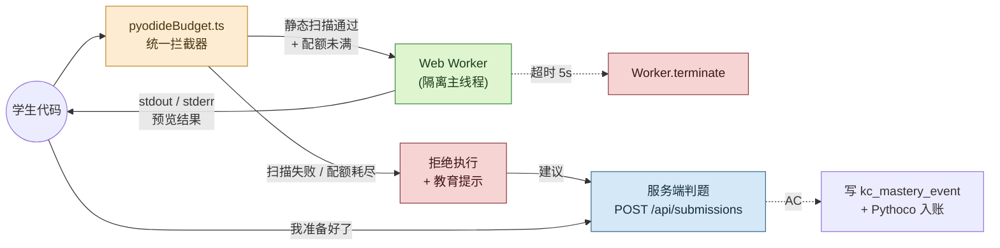

# Pythontopia Pyodide 预算与防滥用设计

> 版本：v1.0 · 起草日期：2026-05-24 · 适用版本：R-12 起 · 状态：Draft（待 W4 自动化验收转 Active）
> 目标读者：玩法工程师、前端 Pyodide owner、后端判题 owner、班级教师视角策划、画像分析师
> 上游约束：AGENTS.md「Python 练习与判题」「双轨执行」「不允许把 Pyodide 预览结果当作正式判题结果」；`docs/system_design.md` §7「Pyodide 预览只是开发体验」
> 平级文档：`docs/gameplay/economy-system.md` §8「Pyodide 预览不结算」、`docs/gameplay/r12-deepen/03-energy-fatigue-curve.md`（能量低时 Pyodide 性能 ×1.3 减速）

---

## 1. 文档定位

Pyodide 是浏览器内 WebAssembly Python 解释器，Pythontopia 把它定位为**学习辅助工具**，单一目的：让学生在 CodeLab / Bug 矿洞 / 班级任务的编辑器里**即时看到自己代码的输出**，验证语法是否正确、流程是否符合预期。它**不是**：

- 不是正式判题环境（正式提交一律走 `POST /api/submissions` + Docker 沙箱，见 `plan/阶段09-训练场Pyodide与服务端判题.md`）。
- 不是无限算力沙箱（学生不能在小镇里跑机器学习训练、爬虫、加密货币挖矿、长时间数据处理）。
- 不是科学计算平台（不预装 numpy/pandas/matplotlib 的 wheel，避免冷启动膨胀到 30MB+）。
- 不是 ACID 持久化层（Pyodide 内任何文件 IO 即使开放也不入库，刷新即清空）。



> 一句话边界：**Pyodide 输出 = 学生自己看的草稿；服务端判题结果 = 教学事件单一真相。**两者之间用 `pyodideBudget.ts` 这道闸门做硬隔离，禁止前端把 Pyodide 结果"冒充"为提交回路。

---

## 2. 资源预算

预算分四档：单次执行 → 单分钟 → 单日 → 全班，逐级收口，确保单个学生最坏行为不会拖垮浏览器，也不会让一个班 200 人在 5 分钟内打爆 Beta 单 worker 资源。

| 维度 | 默认值 | 触发上限的处理 | 后端审计 |
| ---- | ------ | -------------- | -------- |
| 单次 CPU 时长 | 5 秒 | `Worker.terminate()` + Toast "代码可能死循环，已强制停止；常见原因：while 没有 break、循环条件未变" | `pyodide_execution(status='TIMEOUT', duration_ms=5000)` |
| 单次内存 | 64 MB（Pyodide 默认 heap） | OOM 时 Pyodide 自身抛 `MemoryError` → adapter 捕获并提示"内存不足，尝试缩小输入" | `pyodide_execution(status='OOM', error_type='MemoryError')` |
| 单次输出长度 | stdout ≤ 64 KB、stderr ≤ 32 KB | 截断 + 末尾追加 `... [output truncated]`；不视为错误但记录 | `pyodide_execution(status='TRUNCATED')` |
| 单分钟执行次数 | ≤ 20 次/分钟 | 第 21 次起 1 秒节流提示"操作过于频繁，1 秒后再试"，不计入日配额 | 仅前端节流，不入库 |
| 单日累计执行 | ≤ 200 次/UTC+8 自然日 | 弹模态框"今日 Pyodide 配额用完，去服务端判题吧（结果会入库 + Pythoco 入账）"，按钮直跳 `/api/submissions` 流程 | `world_event(type='pyodide_quota_blocked')` |
| 单日配额预警 | 第 150 次时一次性提醒 | Toast "Pyodide 还剩 50 次，建议把成熟代码改走服务端判题" | `world_event(type='pyodide_quota_warning')` |
| 全班单分钟 Pyodide load 次数 | ≤ 80（按 200 人班的 40% 同时活跃估算） | 客户端 CDN 缓存 + Service Worker；后端仅观测不限频 | Prometheus `pyodide_worker_init_total` |

> **为什么 5 秒**：星露谷物语单帧 16ms 的体感惯例下，5 秒已经是"明显卡顿"的上限。任何合法的教学题（39 道题、最长 Ch7 综合题）在 Pyodide WebAssembly 下实测 ≤ 1.2s，5 秒留足 4× 安全余量同时硬切死循环。
>
> **为什么 200 次/日**：粗算单次执行 + 编辑思考 ≥ 30 秒，200 次 ≈ 100 分钟纯练习，远超 `learning_preference.session_minutes_per_day` 中位数（45 分钟）。耗尽配额几乎等价"今天 Pyodide 已不能再帮你学习更多"，引导转服务端判题正向沉淀 mastery。

---

## 3. 白名单模块

Pyodide 预加载 stdlib 完整，但 Pythontopia 通过 `pyodideBudget.ts` 在用户代码 `import` 时执行白/黑名单校验，命中黑名单则在 AST 解析阶段拦截（见 §4），不实际执行。

### 3.1 默认白名单（覆盖 packId=43 全部 7 章）

| 模块 | 教学映射 | 备注 |
| ---- | -------- | ---- |
| `math` | KC-022/023 数值 / 浮点 | 常驻 |
| `random` | KC-031/032 循环 + 随机生成 | 常驻 |
| `re` | Ch6 字符串与正则 | 常驻 |
| `json` | Ch6 数据存取 | 常驻，仅纯字符串解析，无文件 IO |
| `collections` | Ch5 数据结构 | `Counter / deque / defaultdict / OrderedDict` |
| `itertools` | Ch4/5 迭代器 | 含 `chain / groupby / combinations` |
| `functools` | Ch7 高阶函数 | `reduce / lru_cache / partial` |
| `string` | Ch3 字符串 | `ascii_letters / Template` |
| `datetime` | Ch3 时间表示 | 仅纯计算，不联网授时 |
| `typing` | 全章 | 类型注解教学 |

### 3.2 默认黑名单（无论谁请求都禁止）

| 模块 | 拒绝原因 | 教育提示文案 |
| ---- | -------- | ---------- |
| `socket` | 网络 IO | "Pyodide 预览禁止联网，写网络代码请用服务端判题或本地 IDE" |
| `urllib` / `urllib.request` | 同上 | 同上 |
| `requests` | 同上（即使未安装也拦） | 同上 |
| `subprocess` | 进程逃逸 | "禁止启动子进程，这超出了 Python 课程范围" |
| `os` | 文件 IO 与环境逃逸 | "禁止访问浏览器外文件系统；如果是文件读写题，请用服务端判题" |
| `os.path` | 同上（默认禁，教师可临时白名单） | "需要 os.path 的题目请等待教师在班级任务里临时开启" |
| `shutil` | 同上 | "禁止文件批量操作" |
| `sys`（除 `sys.exit`） | 解释器内省 | "禁止访问 sys.argv / sys.path 等" |
| `threading` | Pyodide 不支持 | "Pyodide 单线程，多线程请用服务端" |
| `multiprocessing` | Pyodide 不支持 | 同上 |
| `asyncio` | Pyodide 内会阻塞主 Worker | "异步教学请等待 Ch7 综合阶段服务端开放" |
| `ctypes` | C 扩展逃逸 | "禁止调用 C 扩展" |

### 3.3 教师临时白名单

教师在班级任务 `classroom_quest.metadata.pyodideExtraAllow` 字段可临时加 1-3 个白名单模块（如 Ch4 字符串处理题需 `os.path`），仅对该任务的 Pyodide 执行生效；任务关闭自动失效。后端 `ClassroomQuestService.update` 强校验：临时白名单只能从"灰名单"（`os.path` / `pathlib.PurePath` / `csv` / `io.StringIO` 等纯计算子集）里选，永不可加入 `socket / subprocess`。

---

## 4. 代码静态扫描

执行前必经的三层闸门：词法检查 → AST 检查 → 模式启发。命中 Block 直接拒绝，命中 Warn 仍执行但在结果上方加黄色提示横幅。所有命中均记入 `pyodide_execution.error_type`（即使后续执行成功）以便教师与画像分析。

### 4.1 扫描规则表

| 规则 ID | 等级 | 检测内容 | 触发后行为 |
| ------- | ---- | -------- | ---------- |
| `PB-001` | Block | `import` / `from X import` 命中 §3.2 黑名单 | 拒绝执行 + 教育提示 |
| `PB-002` | Block | `eval` / `exec` / `compile` / `__import__` 动态调用 | 拒绝 + "禁止动态执行字符串代码" |
| `PB-003` | Block | `open(...)` 调用（除非教师临时白名单） | 拒绝 + "Pyodide 预览不支持文件读写" |
| `PB-004` | Warn | `while True:` 且函数体内无 `break / return / raise` | 黄条 "可能死循环；建议加退出条件" |
| `PB-005` | Warn | `for _ in range(N)` 中 N 字面量 ≥ 10^7 | 黄条 "循环次数 ≥ 1000 万，Pyodide 在浏览器里很慢" |
| `PB-006` | Warn | 单文件 LOC ≥ 300 | 黄条 "代码偏长，转服务端判题更稳定" |
| `PB-007` | Block | 函数嵌套深度 ≥ 30（防栈溢出 DoS） | 拒绝 + "嵌套过深，请重构" |
| `PB-008` | Warn | 出现 `[x for x in range(10**N)]` 且 N ≥ 7 | 黄条 "列表会占用大量内存" |
| `PB-009` | Block | 出现 `globals()[...]= ...` 或 `__builtins__` 篡改 | 拒绝 + "禁止修改解释器内置" |
| `PB-010` | Info | 出现 `print` 但代码 ≥ 50 行无函数定义 | 仅日志，不提示用户 |

### 4.2 实现选型

- **AST 层**：`ast.parse(code)` + 一组 `NodeVisitor` 子类（手写，无第三方依赖）；规则全部 < 100 行 Python 等价逻辑，前端用 TypeScript 重写为同语义检查器 `frontend/src/services/pyodideBudget/astLint.ts`。
- **辅助规则集**：参考 `ruff` 规则子集 `S102 (exec)` / `S307 (eval)` / `S605 (subprocess)`，但**不引入 ruff WASM**（体积 > 5MB），仅复制规则语义到本仓库。
- **执行顺序**：词法（trivial 黑名单字符串匹配，5ms）→ AST（中等开销 ≤ 20ms）→ 模式启发（按需）。整体扫描时延控制在 50ms 以内，否则放弃扫描直接放行（仅 dev 环境），生产环境扫描超时一律 Block 并日志。

---

## 5. 沙箱隔离

Pyodide WebAssembly 必须运行在 Web Worker 内，主线程只持有 `RPC` 通道，禁止任何阻塞操作泄漏到 UI 线程。

| 隔离层 | 实现 | 容错 |
| ------ | ---- | ---- |
| Pyodide 实例 | 单 Worker 单实例，懒加载（首次 CodeLab 打开才下载 ~12MB wasm） | Worker 异常自动 `terminate + respawn`，主线程仅记 `pyodide_execution(status='WORKER_CRASH')` |
| 主线程冻结时间 | 单帧 RPC 消息处理 ≤ 50ms | 超过 50ms 时下一帧切片继续，Toast 不会卡死 Phaser 游戏循环 |
| 跨 Worker 状态 | 每次执行前 `runner.reset()` 重置 `__main__` 命名空间 | 防止前一题污染下一题 |
| 终止机制 | 单次执行包装在 `AbortController`，5 秒到期 `worker.terminate()` 并下次执行重启 worker | 杀掉 Worker 比尝试中断 wasm 安全得多 |
| 跨标签页 | 每个标签页独立 Worker；不共享 Pyodide 实例 | 防止学生多标签页"借力"逃避 §2 单分钟限频（限频以 `localStorage` 计数全局共享） |

> Worker 文件名建议 `frontend/src/workers/pyodideWorker.ts`，Vite 用 `?worker` 后缀引入；构建产物落 `dist/assets/pyodide-worker.[hash].js`，与主 bundle 严格分离。

---

## 6. 反作弊

Pyodide 是反作弊的薄弱点：学生最直接的"作弊路径"是把别人答案复制进编辑器、跑通预览、然后正式提交。本节定义检测与教育性回应（不强制阻断），以保护学习闭环的真实性。

### 6.1 复制粘贴检测

| 检测信号 | 阈值 | 响应 |
| -------- | ---- | ---- |
| 单次粘贴的字符串长度 | ≥ 100 字符 | 软提示模态框（可关，不拦提交）："看起来是直接复制的，要不要先看一眼对应的课件页？"按钮：`查看 KC-xxx 课件` / `继续运行` |
| 粘贴后到首次执行间隔 | < 3 秒 | 上述提示文案末追加："建议读完再跑，会更扎实" |
| 粘贴后无任何编辑直接提交 | true | 同上 + 写画像 `learning_preference.copy_paste_count += 1`（详见 §11） |
| 同班同学 1 小时内提交相同代码 hash | ≥ 2 人 | 教师视角红色预警（不告知学生），写 `world_event(type='classroom_copy_alert', payload={problemId, userIds, similarity})` |

### 6.2 预览结果伪造提交的硬隔离

| 行为 | 后端校验 |
| ---- | -------- |
| 学生想把 Pyodide 输出当作正式提交 | 不可能，正式提交只取学生提交时间点的 `code` 字段，重跑 Docker 沙箱，Pyodide 结果**不会被序列化传到后端** |
| 学生用 DevTools 改 `/api/submissions` 请求体 | 后端 verdict 以 Docker 判题为准，前端伪造的字段全被忽略 |
| 学生想用 Pyodide 跑"假"测试用例骗自己通过 | 题目隐藏测试在后端 `course_problem.hidden_test_cases`，Pyodide 拿不到（仅公开样例可见） |

> 这是 AGENTS.md「不允许把 Pyodide 预览结果当作正式判题结果」的工程兜底：双轨从架构上断开，作弊路径不存在。

---

## 7. 降级与服务端转交

Pyodide 不是万能的；当玩家明显遇到 Pyodide 不擅长的场景，应自动建议转服务端判题或简单回退。

| 触发条件 | 自动行为 | 玩家提示 |
| -------- | -------- | -------- |
| 同题 Pyodide 连续失败 3 次 | 在结果区下方插入按钮"试试服务端判题" | "本题已尝试 3 次，服务端判题会给出更详细错误信息，结果会入库并奖励 Pythoco" |
| Pyodide 加载失败（CDN 不可达） | 直接禁用预览按钮 | "Pyodide 资源加载失败，建议直接走服务端判题" |
| 浏览器不支持 SharedArrayBuffer | 降级到单线程 fallback（性能 ×0.5） | "你的浏览器较旧，预览会变慢；建议升级或转服务端判题" |
| 服务端判题排队 > 10s | HUD 显示"判题信号灯"黄灯 | "判题繁忙，请稍候（保留你的提交）"，不允许重复提交 |
| 服务端判题排队 > 30s | HUD 信号灯红 + 服务端拒绝新提交 | "判题阻塞，10 分钟后再试；你的代码不会丢" |
| Pyodide 单次执行 > 30 秒（含网络/CDN） | adapter 主动 timeout | 同 §2 单次超时 |

> 信号灯逻辑落在后端 `SubmissionThrottleService`，前端通过 `GET /api/submissions/queue-status` 每 5 秒轮询；黄/红灯不阻 Pyodide 预览，只阻新提交。

---

## 8. 能量耦合

与 `03-energy-fatigue-curve.md` 联动：能量代表玩家当日"专注度预算"，低能量时给予硬性保护，避免学生在疲劳态下卡在 Pyodide 死循环里再扣画像分。

| `player_state.energy` | Pyodide 状态 | 行为 |
| --------------------- | ------------ | ---- |
| `[60, 100]` | 完全可用 | 单次超时 5s、单日 200 次（基准参数） |
| `[30, 60)` | 受限可用 | 提示"专注度下降，建议休息 5 分钟"；其余参数不变 |
| `[10, 30)` | 显著受限 | 单次超时缩到 3.5s；强制每 10 次执行后插入 30 秒冷却；HUD 提示"低专注度模式" |
| `[1, 10)` | 暂停可用 | 弹模态框"专注度过低，请去医务室 / 吃东西 / 睡一觉再继续，否则继续学习容易产生挫败感"；按钮：`去医务室` / `查看食谱` / `继续（不推荐，会扣 emotion_persistence -0.05）` |
| `0` | 不可用 | 完全禁用 Pyodide，必须先 §7 转服务端判题或进入 sleep 流程 |

> 能量阈值的"3.5s"硬编码来自单次执行均值 ×2.5 标准差的安全估算（实测均值 1.2s、std 0.8s）。能量越低，玩家越倾向选错路径并陷入死循环，硬切缩短反而能更快帮他们意识到"该改思路了"。

---

## 9. 后端字段

### 9.1 新增表 `pyodide_execution`

```sql
-- V117__pyodide_execution_audit.sql
-- Purpose: audit every Pyodide preview run for budget enforcement, teacher dashboard and profile feedback.
-- Tables affected: pyodide_execution (new).
-- Irreversible risk: dropping the table loses preview audit history; storage growth must be capped by §14 retention policy.

CREATE TABLE IF NOT EXISTS pyodide_execution (
  id BIGSERIAL PRIMARY KEY,
  user_id BIGINT NOT NULL REFERENCES users(id) ON DELETE CASCADE,
  classroom_quest_id BIGINT NULL REFERENCES classroom_quest(id) ON DELETE SET NULL,
  problem_id BIGINT NULL REFERENCES course_problem(id) ON DELETE SET NULL,
  started_at TIMESTAMPTZ NOT NULL DEFAULT now(),
  duration_ms INTEGER NOT NULL,
  status VARCHAR(24) NOT NULL,
  error_type VARCHAR(48) NULL,
  scan_block_rules VARCHAR(128) NULL,
  code_hash CHAR(64) NOT NULL,
  CONSTRAINT pyodide_execution_status_chk CHECK (
    status IN ('OK', 'TIMEOUT', 'OOM', 'WORKER_CRASH', 'BLOCKED', 'TRUNCATED', 'CANCELLED')
  )
);

CREATE INDEX IF NOT EXISTS idx_pyodide_execution_user_day
  ON pyodide_execution(user_id, started_at DESC);
CREATE INDEX IF NOT EXISTS idx_pyodide_execution_classroom
  ON pyodide_execution(classroom_quest_id)
  WHERE classroom_quest_id IS NOT NULL;
```

字段说明：

| 字段 | 类型 | 含义 |
| ---- | ---- | ---- |
| `status` | VARCHAR(24) | 来自 §2 / §4 / §5 的统一状态机：`OK` / `TIMEOUT` / `OOM` / `WORKER_CRASH` / `BLOCKED` / `TRUNCATED` / `CANCELLED` |
| `error_type` | VARCHAR(48) | Python 异常类名（`ZeroDivisionError`）或扫描规则 ID（`PB-001`） |
| `scan_block_rules` | VARCHAR(128) | 命中规则 ID 逗号分隔，便于教师筛查"班里谁在试 socket" |
| `code_hash` | CHAR(64) | `sha256(code)`，不存原文（防意外泄漏），仅供 §6.1 班内雷同检测 |

### 9.2 新增 `world_event.type` 枚举值

| event_type | payload | 触发时机 |
| ---------- | ------- | -------- |
| `pyodide_quota_warning` | `{used:150, limit:200}` | 单日第 150 次执行后一次性写入；前端弹 Toast |
| `pyodide_quota_blocked` | `{used:200, limit:200, suggestion:'switch_server_judge'}` | 第 201 次尝试被拒；前端弹模态框 |
| `classroom_copy_alert`（§6.1） | `{problemId, userIds:[u1,u2], similarity}` | 班内 1 小时内同 hash 提交 ≥ 2 人；仅写入教师 user_id 维度，学生侧不可见 |

---

## 10. 教师 dashboard

班级层 Pyodide 指标作为 KC 难度反馈信号，物化到 `classroom_kc_snapshot` 的扩展字段（V117 同次迁移补 `pyodide_metrics JSONB`），每日 02:00 cron 聚合。

| 指标 | 计算 | 教学解读 |
| ---- | ---- | -------- |
| 班级日均 Pyodide 执行次数 | `count(pyodide_execution) / count(distinct user_id)` | < 10 → 学生没进 CodeLab；> 80 → 可能在反复试错，需介入 |
| 班级日均单次时长 | `avg(duration_ms)` | > 2000ms 集中在某 KC → 该 KC 题目偏难，PathPlannerAgent 重排前置题 |
| 单题 BLOCKED 率 | `count(status='BLOCKED') / total` per problem_id | > 10% 说明题面诱导了禁止 API（如题目逼学生写文件读写）→ 教师审题 |
| 单生超限率 | `count(status='TIMEOUT') / total` per user_id | > 30% 触发学生侧"试试小输入"提示（详见 §11） |
| 班级 7 日复制粘贴次数 | `sum(copy_paste_count)` 来自画像聚合 | 高于全镇均值 2σ → 教师视角红色 chip "班级抄答风险" |

教师视角面板 `frontend/src/components/teacher/PyodidePanel.vue`（R-13 实装）展示上述指标的折线 + 热力图，仅教师可见；学生侧任何 dashboard 都不展示这些数据，避免"被监控"焦虑。

---

## 11. 画像影响

`PassiveProfileService` 在每次 `pyodide_execution` 写入后聚合到 `learner_profile.dimensions`，遵守"被动写入需 ≥ 5 次样本才更新"的画像反噪声原则。

| 信号 | 聚合窗口 | 画像更新 | 教育响应 |
| ---- | -------- | -------- | -------- |
| 7 日 `status=OK` 比例 ≥ 0.8 | 7 真实天 | `practice_capability.coding_speed += 1`（上限 10） | NPC `coach_q` 推荐进阶题 |
| 7 日 `status=TIMEOUT` 占比 ≥ 0.2 | 7 真实天 | `error_patterns.common_categories` 追加 `timeout`；`practice_capability.coding_speed -= 1` | 编辑器顶部插提示卡片"试试更小输入：先用 `range(10)` 验证再扩到 `range(10**6)`" |
| 单次 BLOCKED `PB-001/002/003/009` | 即时 | `error_patterns.frequent_kc_codes` 不变；新增 `error_patterns.unsafe_attempt_count` | 弹教育提示，详细解释为什么禁止（非冷拒），可附 RAG 课件页 |
| 7 日复制粘贴提示触发次数 | 7 真实天 | `learning_preference.copy_paste_count += 1`（无上限，长期跟踪） | 累计 ≥ 10 次 → SafetyAgent 写"沉浸式阅读"剧情任务，强制走完课件页后才解锁下一题 |
| 7 日单日配额耗尽次数 | 7 真实天 | `learning_preference.session_minutes_per_day` 估值上调 | 后续推荐题难度阶梯 +1，避免"为打满 200 次而反复试简单题"的刷量 |

> 画像更新必须落 `learner_profile_event(source='PYODIDE_BUDGET', confidence=0.6)` 审计，与主动问卷（confidence=0.9）区分；任何 Pyodide 写入的画像字段在 `narrative_summary` 内必须用"看起来"等低置信度措辞，避免"机器一句话定性学生"。

---

## 12. 前端实现要点

### 12.1 文件分层

```text
frontend/src/services/pyodideBudget/
├── index.ts                # 对外唯一入口 runWithBudget(code, ctx)
├── astLint.ts              # §4 静态扫描（TypeScript 实现，跨 worker 复用）
├── quota.ts                # §2 配额计数（localStorage + 服务端校对）
├── workerHost.ts           # §5 Worker 生命周期管理
├── pasteWatcher.ts         # §6.1 粘贴事件订阅
└── audit.ts                # 异步把 pyodide_execution 上报后端
```

### 12.2 调用约定

- **唯一入口**：`runWithBudget(code, ctx)`，所有 Pyodide 调用走此接口；旧 `getPyodideRunner().run()` 标记 `@deprecated`，编辑器组件 lint 禁止直接引用。
- **`ctx` 必填字段**：`{ problemId?, classroomQuestId?, source: 'codelab'|'bug_mine'|'class_quest', currentEnergy: number }`，缺一报错。
- **返回 schema**：`{ status, durationMs, stdout, stderr, blockedRules?, suggestedNextAction? }`，与 `pyodide_execution` 字段同构。

### 12.3 超时实现

```ts
// frontend/src/services/pyodideBudget/workerHost.ts (示意)
const controller = new AbortController();
const timeoutMs = energyAwareTimeout(ctx.currentEnergy);
const timer = setTimeout(() => {
  worker.terminate();
  controller.abort('timeout');
}, timeoutMs);
try {
  return await rpc(worker, 'run', { code, signal: controller.signal });
} finally {
  clearTimeout(timer);
}
```

### 12.4 配额持久化

- 单日配额计数主存 `localStorage.pyodideQuota.YYYY-MM-DD`，自然日 00:00 清；
- 同时每次 +1 时同步 `POST /api/pyodide/quota/tick`（轻量幂等），后端按 `pyodide_execution` 真实记录核对；
- 跨设备登录以服务端最大值为准（防本地清存储绕过）。

---

## 13. 验收

### 13.1 自动化测试

| 测试文件 | 关键断言 |
| -------- | -------- |
| `frontend/tests/services/pyodideBudget.spec.ts` | 单次超时 5s 时返回 `status='TIMEOUT'`；连续 21 次提交在 1 分钟内被节流；第 201 次返回 `status='BLOCKED'` 且发 `pyodide_quota_blocked` 上报 |
| `frontend/tests/services/astLint.spec.ts` | `import socket` 命中 `PB-001`；`while True: pass` 命中 `PB-004` 警告；`exec("...")` 命中 `PB-002` 阻断 |
| `frontend/tests/services/pasteWatcher.spec.ts` | 100 字符以上粘贴 → 弹模态框；不弹模态框时不写画像 |
| `backend/src/test/java/com/pythontopia/pyodide/PyodideExecutionServiceTest.java` | `record(...)` 写入 `pyodide_execution`；单日 200 次后触发 `world_event(type='pyodide_quota_blocked')`；班内 1 小时同 hash ≥ 2 → 写 `classroom_copy_alert` 仅教师可见 |
| `backend/src/test/java/com/pythontopia/pyodide/PyodideQuotaApiTest.java` | `POST /api/pyodide/quota/tick` 幂等；超出 200 返回 429 + `Retry-After: 86400` |

### 13.2 人工 / 体验

1. 学生在 CodeLab 输入 `while True: pass`，5 秒后被自动停止，文案明确解释"代码可能死循环"。
2. 学生输入 `import socket`，按运行后立即弹"Pyodide 预览禁止联网"教育模态框，可点击"了解原因"展开详细解释。
3. 学生连续提交 200 次后，第 201 次必弹"今日配额用完，去服务端判题"模态框，且按钮直跳服务端流程。
4. 教师登录 dashboard，能看到所选班级当日 Pyodide 执行总次数、单次时长分布、BLOCKED 规则 Top-3，且筛选某学生时只见聚合不见原始代码。

### 13.3 性能 baseline

| 项 | 目标 | 测量手段 |
| -- | ---- | -------- |
| Pyodide 冷启动（首次进 CodeLab） | ≤ 8s（含 CDN） | Lighthouse + 真实网络 |
| Pyodide 热启动（已缓存） | ≤ 600ms | Playwright 计时 |
| 单次预览端到端（含 §4 扫描） | ≤ 1.5s（中位数） | E2E 跑 39 道题样本 |
| AST 扫描时延 | ≤ 50ms p95 | Vitest 性能基准 |
| 主线程冻结最大值 | ≤ 50ms 单帧 | Chrome Performance Tab 抽样 |

---

## 14. 风险与开放问题

| 风险 | 描述 | 缓解 |
| ---- | ---- | ---- |
| AST 扫描误伤合法代码 | `eval` 在课件 Ch7 高阶函数章节合法出现（讲解危险性） | 课件类资源允许通过 `metadata.allowEval=true` 旁路，仅讲解模式，仍不能执行 |
| `localStorage` 配额被清 | 学生清浏览器缓存绕过 200 次/日 | 服务端 `pyodide_execution` count 是单一真相，客户端清缓存最多让本地丢提示，服务端仍拒第 201 次 |
| Pyodide 版本升级破坏白/黑名单 | 0.25 → 未来 0.30 模块路径可能变 | 固定 `PYODIDE_VERSION = '0.25.0'` 在 `pyodide.ts` 内；升级 PR 必带 §4 全规则回归 |
| 教师临时白名单滥用 | 教师把 `os` 整个加进去给学生跑爬虫 | `ClassroomQuestService` 白名单上限 3 个、必须从灰名单选；后端校验失败拒绝保存 |
| 画像反作弊误伤内向学生 | 复制粘贴提示对照抄课件示例的内向学习者过于敏感 | §6.1 阈值 100 字符 + 提示模态框可关；累计 ≥ 10 次才触发剧情任务，留缓冲 |
| 全班 80 并发冷启动雪崩 | 单 Beta 服务器 CDN 拉满 | Pyodide WASM 走 jsdelivr 公共 CDN + Service Worker 跨用户缓存；后端无瓶颈 |
| 班内雷同检测漏判 | 学生改变量名躲过 sha256 | 仅作为"教师视角弱信号"，不自动惩罚；R-13 升级到 AST normalize hash |
| 数据保留期 | `pyodide_execution` 每日 200 次 × 万级学生 = 月 6000 万行 | 90 天滚动归档：≥ 90 天的行迁到 `pyodide_execution_archive`，dashboard 默认查 30 天 |

---

-- 子代理生成于 2026-05-24
