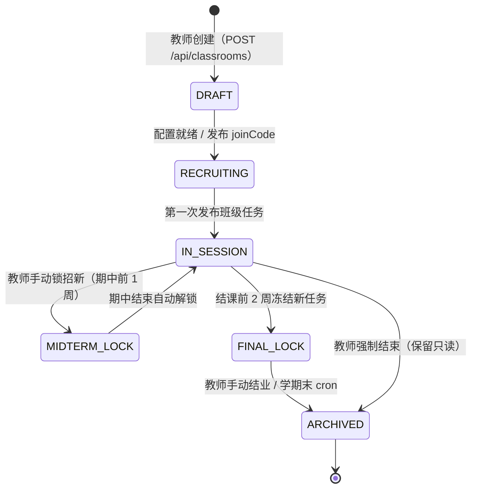
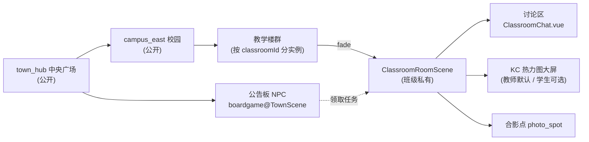
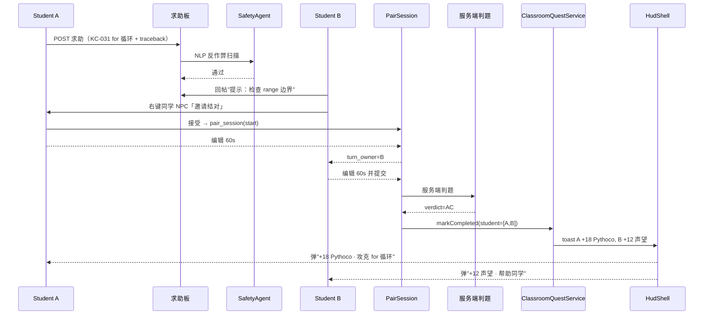

# Pythontopia 社交与班级系统设计

> 版本：v1.0 · 起草日期：2026-05-24 · 状态：Draft（R-13 实装基线）
> 目标读者：班级架构后端、教师端前端、社交玩法策划、教务对接 PM
> 上游约束：AGENTS.md「班级架构」「禁止事项」；`docs/gameplay/education-loop.md` §7「班级层教育数据」
> 下游接口：`com.pythontopia.classroom.*`、`frontend/src/api/dto/ClassroomQuest.ts`

## 0. 文档定位

Pythontopia 的"社交"必须**长在班级架构里**。AGENTS.md 已硬性声明：保留教师建班、学生加入、教师发布任务、KC 热力图、高频误区四件套；明确禁止"把班级架构删成单机游戏"，也禁止"完整课堂协作编码 / 复杂评分 / 多课程后台 / 实时屏幕监控"。本文以此为边界，定义 R-12 已实装功能的玩法包装与 R-13 计划的"班长视角拓展 + 教师课堂直播"的最小可行设计，不引入任何超出 `Python语言基础`（packId=43）单课程范围的能力。

后端已存在的契约（`backend/src/main/java/com/pythontopia/classroom/`）：`Classroom(id,name,teacherId,packId,joinCode,status)`、`ClassroomService.{create,mine,join,members,removeMember,update,regenerateJoinCode,membersByStatus}`、`ClassroomQuestDto`、`KcHeatmapEntryDto`、`ErrorHotspotDto`、`QuestCompletionDto`、`ResourceUsageDto`、`RecentActivityDto`。本文所有"新增"必须能映射回这些类或在文末「11. 新增表/接口清单」显式列出。

---

## 1. 班级架构总览

### 1.1 角色与权限层级

| 角色 | 系统权限 | 来源 | 数量约束 |
| ---- | -------- | ---- | -------- |
| `TEACHER` 教师 | 建班、改名、重生 joinCode、改状态、发任务、看 dashboard、移除学生 | `Role` 枚举 + `ClassroomService.requireRole(TEACHER)` | 单班 1 名主教师，不允许转让（R-13 可申请教务管理员转交） |
| `TA` 助教 | 看 dashboard（只读）、回复求助板、不可发任务 | R-13 新增 `classroom_member.role='TA'` | 0–N，由教师任命 |
| `MONITOR` 班长 | 在班级讨论区置顶 1 条/天、推荐"本周最佳互助"（教师审批后生效）、发布无 Pythoco 奖励的班级活动 | R-13 新增 `classroom_member.role='MONITOR'` | 0–3，由教师指定，可随时撤销 |
| `STUDENT` 学生 | 加入/退出、领任务、发求助、互评、看自己进度 | `Role.STUDENT` + `classroom_member` 行 | 单班 ≤ 200（软上限，超出需教务审批） |
| `ADMIN` 管理员 | 跨班审计、不参与教学 | `Role.ADMIN` | 教务侧人员 |

> 一个学生可同时加入多班级（兼修）：`classroom_member` 的 `(classroom_id, student_id)` 联合唯一即可，单 `student_id` 行数不设限。游戏内通过 HUD 上「班级切换器」`HudShell.vue` 切换"当前活动班级"，仅决定公告板默认筛选和教师视角入口，不影响个人 mastery。

### 1.2 班级生命周期

后端落库为 `classroom.status ∈ {DRAFT, RECRUITING, IN_SESSION, MIDTERM_LOCK, FINAL_LOCK, ARCHIVED}`。R-11 现有迁移仅支持 `ACTIVE/ARCHIVED` 二态，R-13 通过 `V120__classroom_lifecycle.sql` 扩展，并把存量 `ACTIVE` 默认迁为 `IN_SESSION`。`ARCHIVED` 状态下学生只读访问历史 KC 热力图，不再产生 `learning_event`。

---

## 2. 班级任务节奏

### 2.1 任务发布通路

`ClassroomQuestService.publish(...)` 已实现"教师创建一个 `ClassroomQuest` → fan-out 给班内全部 ACTIVE 学生 → 写入个人 `StudentQuest`"；返回 `ClassroomQuestPublishResponse{totalStudents, createdQuests, skippedDuplicates}`。学生在 `TownScene` 中央广场的 `boardgame` NPC 处交互（详见 `data/npcs/boardgame/meta.json`）打开公告板面板 `ClassroomQuestBoard.vue`，按 `dueDate` 升序列出所有班级任务。

### 2.2 任务类型与 evidence 映射

| 任务类型 | `nodeType` | `requiredEvidenceType` | payload 核心字段 | 完成证据 |
| -------- | ---------- | ---------------------- | ---------------- | -------- |
| 课件任务 | `READ_PAGE` | `PAGE_READ` | `{chapterId, pageIds[]}` | `PageReadEvent` 覆盖 ≥ 90% 页 |
| 示例任务 | `RUN_EXAMPLE` | `EXAMPLE_RUN` | `{exampleIds[], minRunCount}` | `ExampleViewEvent` + 至少 1 次 Pyodide 复制运行 |
| 练习任务 | `SOLVE_PROBLEM` | `SUBMISSION_PASS` | `{problemIds[], minPassRate}` | 服务端 `SubmissionEvent.verdict=AC` 数量 / 题数 ≥ `minPassRate`（默认 0.7） |
| Bug 任务 | `DEBUG_MINE` | `BUG_RESOLVED` | `{tracebackTypes[], mineLevel}` | `BugMineSession.completed_at` 非空且匹配 traceback 类 |
| 小组任务 | `GROUP_PROJECT` | `PEER_REVIEW` | `{teamSize, deliverableType}` | 全员 `peer_review` 评分均值 ≥ 3.0/5 |
| 挑战任务 | `TIME_BOXED` | `SUBMISSION_PASS` | `{problemIds[], deadlineHours=24}` | 24h 内 AC 题数 ≥ 80% 题量 |

> `ClassroomQuestService` 已强校验 evidence（来源 `docs/gameplay/education-loop.md` §6 反作弊）。新增 Bug/小组/挑战类型走 R-13 扩展，复用现有 `requiredEvidenceType` 枚举位（`BUG_RESOLVED` 与 `PEER_REVIEW` 由 V121 添加）。

### 2.3 推荐节奏表（16 周学期，单班）

| 周次 | 课件 | 示例 | 练习 | Bug | 小组 | 挑战 | 说明 |
| ---- | ---- | ---- | ---- | --- | ---- | ---- | ---- |
| W1（开学） | 2 | 1 | 1 | 0 | 0 | 0 | Ch1 介绍 + 环境检查 |
| W2 | 2 | 2 | 2 | 1 | 0 | 0 | 引入第一次 Bug 矿洞（语法错） |
| W3–W4 | 3 | 2 | 3 | 1 | 0 | 0 | Ch2 变量 / I/O |
| W5–W6 | 3 | 3 | 3 | 1 | 1 | 0 | Ch3 数值/字符串，引入 2 人结对小组 |
| W7（期中前） | 2 | 1 | 4 | 2 | 1 | 1 | 第一次挑战任务（24h 限时） |
| W8（期中） | 0 | 0 | 6 | 0 | 0 | 1 | 期中考周，仅练习 + 挑战 |
| W9–W11 | 3 | 3 | 3 | 2 | 1 | 0 | Ch4 流程 / Ch5 数据结构 |
| W12–W13 | 2 | 2 | 3 | 2 | 2 | 1 | Ch6 文件，4 人项目组 |
| W14–W15 | 2 | 2 | 3 | 1 | 1 | 1 | Ch7 lambda/包 综合 |
| W16（结课） | 0 | 0 | 4 | 0 | 1 | 1 | 期末庆典 + 结课项目 |

> 教师可在 Dashboard 的「任务节奏建议」卡片一键导入本表；表数据由 `ClassroomQuestRecommendationService` 按班级当前 KC 热力图微调（Mastery 落后 ≥ 1 周的 KC 优先注入额外练习任务）。

### 2.4 任务奖励

完成任务后由 `ClassroomQuestService.markCompleted(...)` 触发：

- **Pythoco**：基础 5–30 枚（按 nodeType），过截止日期减半，提前 ≥ 2 天 +20%。
- **班级声望**：写入 `classroom_member.reputation`（int，0~9999）。声望影响班长候选资格（≥ 500 才可被任命）。
- **Mastery boost**：每完成 1 个课件任务，相关 KC `+0.02` 一次性加成（封顶 +0.10/天），与教育闭环 §6 反作弊额度共用。
- **班长印章**：班长在任时发布的"班级活动"完成后，参与者获 `monitor_seal` 道具（仅装饰，无 Pythoco），由 `inventory_item.kind='cosmetic'` 区分。

---

## 3. 班级公共空间

### 3.1 班级地图：campus_east 上的"班级楼"

`campus_east` 已规划为校园主图。每个班级在地图东北角的「教学楼群」实例化一栋楼，进入门口触发 `SceneSwitcher.fadeTo('classroom_room', {classroomId})`，进入班级私有场景 `ClassroomRoomScene.ts`。场景内含：

- **公告板桌**：教师视角可拖拽任务卡至学生工位；学生视角点击查看个人任务清单。
- **讨论区角落**：异步聊天 UI 由 `ClassroomChat.vue` 渲染，教师可置顶 ≤ 3 条。
- **KC 热力图大屏**：教师视角实时刷新；学生视角默认隐藏，可由教师在 `/api/teacher/classrooms/{id}` 中切换 `student_can_see_heatmap=true` 暴露给班内。
- **合影点**：地图正中央 1 个 `photo_spot` tile，每月 1 号 19:00–20:00 触发「班级合影日」（详见 §8）。

> 私有场景**不允许**外班学生进入；`ClassroomGuard` 在 `ClassroomRoomScene` enter handler 中校验 `classroom_member.status='ACTIVE'`。

### 3.2 私有场景与公开广场的关系

---

## 4. 同学互助

### 4.1 同学 NPC 与"在场感"

当玩家进入 `TownScene` 或自己班级 `ClassroomRoomScene` 时，`WorldClock.ts` 拉取同班 ACTIVE 学生的最近 5 分钟心跳。每位在线同学渲染为像素 sprite，皮肤来源 `learner_profile.cosmetic.avatar_id`，头顶显示 username（教师可在班级隐私设置中关闭）。同学 NPC 仅承担"我不孤单"的情绪信号，**不**走对话树脚本，仅暴露三个右键交互：发求助、求结对、查看公开 mastery 概要。

### 4.2 协作机制

| 机制 | 触发入口 | 实现要点 | 反作弊 |
| ---- | -------- | -------- | ------ |
| **求助板** | 公告板右下角「求助」 tab | 玩家发题，附 KC 编码 + 错误 traceback；同班同学可回帖"提示"。后端 `help_thread` 表，帖子字段 `hint_text` 强制 ≤ 200 字 | `SafetyAgent` NLP 关键字检测「完整答案」「import this/`def solution`」等模式，命中则隐藏并扣帖主声望 5 |
| **结对编程** | 同学 NPC 右键「邀请结对」 | 双方共编同一 Pyodide 沙盒，**异步轮转**（一人编 60s 后切对方，由 `pair_session.turn_owner` 控制） | 提交时 verdict 写入双方的 `submission`，但 `practice_pass` 权重各 0.5 |
| **互评** | 教师任务 `nodeType=GROUP_PROJECT` 完成后 | 匿名打分 1~5 + 必填 50 字评语；同组互评互盲 | 单人评分极端值（全 1 或全 5）被自动权重 0.5，教师可抽查 |

> 求助板与结对编程的会话内容**纳入** `PassiveProfileService` 的「学习偏好」与「情绪与坚持度」维度更新：求助次数 ↑ → `learning_preference.collaborative_index` ↑；连续 3 次结对编程 AC → `emotion_persistence.frustration` ↓ 0.05。

---

## 5. 教师视角

教师登录后 `AppLayout.vue` 检测 `currentUser.role===TEACHER`，默认路由 `/teacher/classrooms`（即 `ClassroomMasterView.vue`），**不**自动进入游戏世界 `WorldScene`。教师如需巡视，可在 Dashboard 顶部按「以教师身份进入班级楼」临时进入 `ClassroomRoomScene` 的"上帝视角"分支（俯瞰 80×60，可见全部学生 sprite 实时位置，不可移动地图但可点击 sprite 弹出该生面板）。

### 5.1 Dashboard 模块映射

| 卡片 | 后端 DTO | 数据频率 | 教师操作 |
| ---- | -------- | -------- | -------- |
| 班级 KC 热力图 | `List<KcHeatmapEntryDto>` from `GET /api/teacher/classrooms/{id}/dashboard/kc-heatmap` | 每日 02:00 物化 + 30s 增量 | 点击 KC 块 → 一键发布"补练任务"（预填 `kcCodes`、`targetProblemIds`） |
| 学生雷达图 | `LearnerProfileDimensionsDto` 8 维 | 30s 刷新 | 点击 sprite → 弹"个体诊断"面板 |
| 高频误区 | `List<ErrorHotspotDto>` (含 `ErrorCategoryDto`) | 每日 02:00 物化 | 点击聚类 → 自动生成"班级公开课"待办（手动发起） |
| 任务完成率 | `List<QuestCompletionDto>` | 实时 | 点击未完成数 → 查看具体落后学生列表 |
| 资源使用排行 | `ResourceUsageDto` 7/30 日 | 每日 02:00 | 标记"推荐到首页" → 写 `learning_resource.is_teacher_picked=true` |
| 近期活动流 | `List<RecentActivityDto>` | 实时 | 仅查看，不可操作 |

### 5.2 教师权限白名单

`@PreAuthorize("hasAnyRole('TEACHER','ADMIN')")` + `ClassroomGuard.ownedClassroom(...)` 双重校验下，教师可以：

1. 创建 / 暂停 / 结业班级（R-13 状态机扩展）
2. 发布任务（`POST /api/teacher/classrooms/{id}/quests`），含 `dueDate`、`requiredEvidenceType`、`peerReviewEnabled`、`pythocoReward`
3. 任命 / 撤销班长与 TA（R-13 新增 `PUT /api/teacher/classrooms/{id}/members/{studentId}/role`）
4. 推送公告（最多 200 字，弹窗到全班 HUD，`HudShell.vue` toast 队列）
5. 移除违规学生（既有 `DELETE /api/classrooms/{id}/members/{studentId}`，写 `removed_reason`）
6. **不可**直接修改任何学生的 mastery、提交记录、画像维度——只能间接通过发布任务影响

---

## 6. 班长权限

班长是"学生中的领头羊"，权限介于 STUDENT 与 TA 之间，**不**接触教师 Dashboard。R-13 新增：

| 权能 | 入口 | 频次限制 | 反滥用 |
| ---- | ---- | -------- | ------ |
| 发布班级活动 | 讨论区「活动」tab → `POST /api/classrooms/{id}/monitor-events` | 每周 ≤ 2 个 | 活动无 Pythoco 奖励，仅写 `monitor_seal` 道具 |
| 置顶讨论 | 讨论区帖子右上「钉」按钮 | 每天 ≤ 1 条，置顶 24h 自动解除 | 教师可一键取消，扣班长声望 20 |
| 推荐本周最佳互助 | Dashboard「同学互助」tab → 提名 | 每周 1 次 | 进入教师审批队列，教师 48h 内通过才生效；通过后被提名学生 +50 声望 |

班长任命要求：`classroom_member.reputation ≥ 500` 且 `classroom_member.status='ACTIVE' ≥ 4 周`。任期一学期，期末自动卸任。

---

## 7. 社交反馈与排行

排行榜是双刃剑：用得好是激励，用得差变成同辈压力源（直接拉高画像 `emotion_persistence.frustration`）。Pythontopia 的排行设计如下：

| 排行 | 公开度 | 数据源 | 风险缓解 |
| ---- | ------ | ------ | -------- |
| Mastery 班级排行 | 仅显示分位段（`Top 10% / Top 30% / Mid / Bottom 30%`），**绝不显示具体姓名/数值** | 班级所有 `learner_kc_mastery` 均值 | 学生不知自己排第几名，仅知自己在哪个段位 |
| 任务完成率 | 公开姓名+完成数 | `student_quest.status='COMPLETED'` 计数 | 滚动榜（仅显示 Top 10），中位学生不上榜 |
| 互助次数 | 公开姓名+次数 | `help_thread.hint_count` + `pair_session.count` | 公开榜（推崇互助文化） |
| 班级声望积分 | 自查 | `classroom_member.reputation` | 仅自己看，用于班长候选条件 |

每次社交动作（互助回帖、结对完成 AC、互评提交、教师公告）触发后，`HudShell.vue` 通过 `Pinia store hud.ts` 弹 toast：`+12 班级声望 · 帮助同学解决了「for 循环」`，2s 自动消失。

---

## 8. 节日与社交活动

节日是"游戏感"与"班级凝聚力"的承载，**不**回写 `kc_mastery_event`（与教育闭环 §8 一致），只写 `world_session.cosmetic_event` 与 `classroom_member.reputation`。

| 活动 | 触发时机 | 玩法 | 奖励 |
| ---- | -------- | ---- | ---- |
| 开学集会 | 学期第 1 周周一 19:00 | 全班 sprite 在 `ClassroomRoomScene` 中央集合，教师 NPC 朗读 1 分钟班级目标 | 参与者 +50 声望 + 一张「开学纪念合影」道具 |
| 期中段考庆功 | 期中后第 1 周 | 班级 PK：与同期开课班级比 mastery 均值与任务完成率，全班通知前 3 名 | Top 1 班级全员 +100 Pythoco + 流动金旗（学期末展示在班级楼大门） |
| 期末庆典 | 结课周周五 20:00 | 班级合影 + 教师颁发个人奖项（最进步、最互助、最坚持） | 各奖项 +200 Pythoco + 限定头像框 |
| 月度合影日 | 每月 1 号 19:00–20:00 | 班级楼合影点拍像素照片，上传 `classroom_photo.png` 到 `s3://pyt-classroom-photos/` | 全员 +20 声望 |

班级 PK 仅按"班级平均"维度，**不**单独点名学生；流动红旗显示在 `campus_east` 入口巨型公告石。

### 8.1 一次"求助 → 互助 → 任务完成"的端到端时序

---

## 9. 反风险

### 9.1 学生侧

- **私密模式**：学生在「个人设置 → 隐私」勾选 `privacy.hide_from_rankings=true` 后，全部公开榜单不再出现其姓名（自身仍可看），班级合影也以"匿名 sprite"出现。
- **新生陪聊**：学生加入新班级 N=5 天后，若 `help_thread.posted_count==0 AND pair_session.count==0`，`SocialMatchService` 主动配对一位 reputation ≥ 300 的老学生 NPC 发送破冰消息（消息文本由 `ResourceDesignerAgent` 生成 + `GroundingCriticAgent` 审）。
- **挫败缓冲**：连续 3 次 PVE 挑战失败的学生，HUD 自动弹"班级 Top 解题思路"卡片（来自 `learning_resource.is_teacher_picked=true`），降低 frustration。

### 9.2 教师侧

- **AI 推荐任务**：Dashboard 顶部「智能建议」按钮调用 `ClassroomQuestRecommendationService`，基于 KC 热力图与 `error_hotspot` 自动推荐 3 条待发任务，教师一键确认即发布，避免 burnout。
- **截止日历**：教师可见全班 24 / 48 / 72 小时内将到期的任务卡，红黄绿三色标，避免临时抱佛脚通知。
- **不强制日活**：若教师连续 7 天未登录，系统**不**触发"未活跃"惩罚（不影响教师 KPI）；仅在第 14 天通过站内信温和提示「您的班级有 N 名学生在等」。

### 9.3 平台侧

- **班级数据隐私**：教师 Dashboard 默认只看 KC 级聚合；单条 `submission.code` 仅当学生在求助板主动发布或勾选「分享至班级」时才可见教师。
- **班级孤立**：单班招生数 < 5 持续 14 天，系统建议教务合并；不强制。
- **反外挂**：心跳频率限 12 次/分钟，超出自动降级为"离线"，sprite 从同学列表移除（防止脚本刷"在场感"）。

---

## 10. 验收指标

| 指标 | 目标值 | 测量来源 |
| ---- | ------ | -------- |
| 学生第 1 周内完成 ≥ 1 个班级任务 | ≥ 70% | `student_quest WHERE classroom_id IS NOT NULL AND status='COMPLETED' AND completed_at <= created_at + 7d` |
| 班级日均互助次数 | ≥ 5（30 人班级基准） | `help_thread.created_at` + `pair_session.started_at` 联合计数 |
| 教师每周登录 | ≥ 3 次 | `auth_session WHERE role='TEACHER'` 去重日数 |
| 班级排行参与度 | ≥ 80% 学生**不**开启私密模式 | `learner_profile.dimensions.privacy.hide_from_rankings=false` 占比 |
| 班长发起活动转化率 | 班长在任时，活动平均参与率 ≥ 40% 班级人数 | `monitor_event.participants / classroom_member.active_count` |
| 期末班级合影出图率 | 单班学期内 ≥ 4 张合影 | `classroom_photo` 行数 |

---

## 11. 新增表 / 接口清单（R-13 待迁移）

| 资源 | 路径 / 表名 | 用途 | 迁移文件 |
| ---- | ----------- | ---- | -------- |
| 班级生命周期扩展 | `ALTER classroom.status` 枚举值 | DRAFT/RECRUITING/IN_SESSION/MIDTERM_LOCK/FINAL_LOCK/ARCHIVED | `V120__classroom_lifecycle.sql` |
| 成员角色 | `ALTER classroom_member ADD COLUMN role VARCHAR(16) DEFAULT 'STUDENT'` | STUDENT/TA/MONITOR | `V121__classroom_member_role.sql` |
| 成员声望 | `ALTER classroom_member ADD COLUMN reputation INT DEFAULT 0` | 班长候选 / 排行 | `V121` |
| 班级讨论 | `classroom_chat(id, classroom_id, author_id, body, pinned_until, created_at)` | 异步讨论 + 置顶 | `V122__classroom_chat.sql` |
| 求助板 | `help_thread(id, classroom_id, author_id, kc_codes[], traceback, hint_count, created_at)` | 学生求助 | `V123__help_thread.sql` |
| 求助回帖 | `help_hint(id, thread_id, author_id, hint_text, safety_verdict)` | 提示帖 | `V123` |
| 结对会话 | `pair_session(id, classroom_id, student_ids[], started_at, ended_at, submission_id)` | 异步轮转结对 | `V124__pair_session.sql` |
| 班长活动 | `monitor_event(id, classroom_id, monitor_id, title, body, starts_at, ends_at, approved_by)` | 班长发布活动 | `V125__monitor_event.sql` |
| 班级合影 | `classroom_photo(id, classroom_id, taken_at, image_url, participant_ids[])` | 月度/学期合影 | `V126__classroom_photo.sql` |
| 班级 KC 物化视图 | `classroom_kc_snapshot` | 已在 R-11 实装，本文复用 | – |
| API：成员角色变更 | `PUT /api/teacher/classrooms/{id}/members/{studentId}/role` | 任命 / 撤销班长、TA | R-13 |
| API：班级讨论 | `GET/POST /api/classrooms/{id}/chat`、`PATCH .../chat/{messageId}/pin` | 异步聊天 | R-13 |
| API：求助板 | `GET/POST /api/classrooms/{id}/help-threads`、`POST .../{threadId}/hints` | 求助 + 回帖 | R-13 |
| API：结对邀请 | `POST /api/pair-sessions`、`PUT /api/pair-sessions/{id}/turn` | 结对开关 + 轮转 | R-13 |
| API：班长活动 | `POST /api/classrooms/{id}/monitor-events`、`POST .../monitor-events/{id}/approve` | 班长发起 / 教师审批 | R-13 |
| API：合影 | `POST /api/classrooms/{id}/photos`（multipart） | 上传合影图 | R-13 |
| API：智能建议任务 | `GET /api/teacher/classrooms/{id}/quest-recommendations` | Dashboard 一键建议 | R-13 |
| API：教师"上帝视角"快照 | `GET /api/teacher/classrooms/{id}/live-snapshot` | 班级楼内学生 sprite 位置 + 状态 | R-13（前置 R-13 教师课堂直播） |

> 以上接口均必须遵守 AGENTS.md「不做实时屏幕监控」「不做完整课堂协作编码」红线：`live-snapshot` 只返回 sprite 坐标与最近 30s 的事件统计，**不**返回 keyboard input、屏幕截图、代码字符流；结对编程是"异步轮转"，**不**实现实时光标共享。

---

-- 子代理生成于 2026-05-24 00:25:53 (UTC+8)
