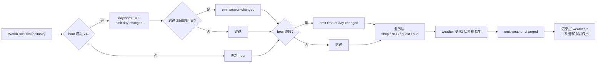
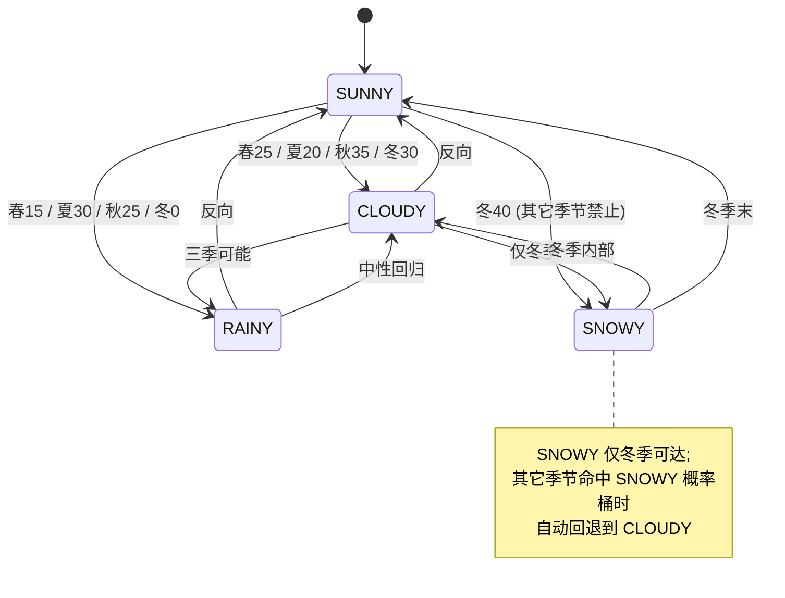
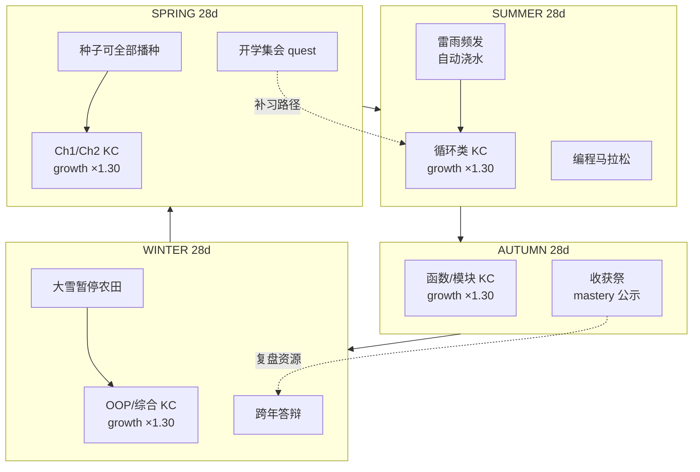

# Pythontopia 世界时钟与日历玩法规范

> 版本：v1.0 · 起草日期：2026-05-24 · 适用版本：R-12 起 · 状态：Draft（待 W4 验收转 Active）
> 目标读者：玩法工程师、教学策划、画像分析师、后端节奏 owner、班级教师

## 0. 文档定位

W3 已经在 `frontend/src/game/core/WorldClock.ts` 落地了「6 时段 + 4 天气 + 4 季节 + 事件总线」的基础设施，后端在 `V107__world_calendar.sql` + `CalendarMath.java` + `WorldAdvanceService.java` 提供了"睡觉一次推一天"的服务端真相。本文负责把这层基础设施**扩展成完整的时空玩法层**：节奏、事件、节日、视图、与画像/教学的耦合，以及双端一致性约束。

文档严格遵守 `AGENTS.md` 的两条硬约束：
1. **画像即真相**：每个时段/节日/天气都要在画像或 KC 上留下可观测的痕迹，禁止纯装饰系统。
2. **后端是唯一真相**：前端 WorldClock 是体验层，`world_session` + `world_event` 才是数据真相；多设备/离线必须以服务端为准。

代码侧已固化的事实（本文不再修改，只引用）：

- `WorldClock.timeOfDayOf(hour)`：`[5,7) DAWN / [7,11) MORNING / [11,13) NOON / [13,18) AFTERNOON / [18,21) EVENING / 其余 NIGHT`，左闭右开。
- `WorldClock.seasonOf(dayIndex)`：每 28 天换季，年 = 112 天，`SPRING → SUMMER → AUTUMN → WINTER` 循环。
- `WorldClock.tick(deltaMs, gameMinutesPerRealSecond=1)`：默认流速 1 真实秒 = 1 游戏分钟。
- 后端 `world_session.season` ∈ `{spring,summer,autumn,winter}`，`time_of_day` ∈ `{dawn,morning,noon,afternoon,dusk,evening,night}`，**小写**；前端枚举大写。约定见 §8.2。
- 后端 `WorldAdvanceService.sleep()` 是当前唯一的"推日"入口；前端 `tick` 流逝小时但**不写库**，跨日由 `sleep` 触发。

---

## 1. 时间体系总览

| 颗粒度 | 数值 | 折算 | 用途 |
|--------|------|------|------|
| 1 游戏分钟 | 1 真实秒 | `gameMinutesPerRealSecond = 1`（默认） | `WorldClock.tick` 基准 |
| 1 游戏小时 | 60 真实秒 | 60 游戏分钟 | 时段判定 |
| 1 游戏天 | 24 真实分钟 | 24 游戏小时 | `world_session.day_index` 自增 1 |
| 1 季节 | 11.2 真实小时 | 28 游戏天 | 季节切换、KC 加成换挡 |
| 1 游戏年 / 学期 | 44.8 真实小时 | 112 游戏天 = 16 周 × 7 天 | 与高校学期对齐 |
| 1 游戏周 | 2.8 真实小时 | 7 游戏天 | 节日轮转、班级周报 |

> **为什么 1:60**：星露谷与 Pokemon 牧场版本经验值约 1 秒 = 0.7~1.0 游戏分钟。1:60 整数比方便心算，且学生单次 25~45 分钟课堂正好走 1~2 个游戏天，节奏与教学课节一致，避免"上一节课只过了 5 个游戏小时"导致的体感停滞。
>
> **为什么 28 天/季 × 4 季**：与星露谷一致便于设计师借鉴节奏经验；112 天 / 7 = 16 周，恰好高校单学期周数，从"游戏年"到"现实学期"零认知成本切换。

---

## 2. 6 时段定义与事件触发

| 时段 | 时间范围 | 主要游戏事件 | 触发频率 | 画像 / KC 影响 | 画面变化 |
|------|----------|--------------|----------|----------------|----------|
| DAWN | `[5, 7)` | NPC 苏醒动画 / 鸟叫 SFX / 阳光渐入 lerp(0→0.6) | 每日 1 次（5:00 边沿） | 玩家在线 → `learning_preference.early_bird +0.02` | `daynight` overlay alpha 0.55→0.10 |
| MORNING | `[7, 11)` | 商店开门（`shop.is_open=true`）/ 教师备课 NPC 进入 `prepare` 态 / 每日任务刷新 | 边沿 1 次 + 每 30 游戏分钟轮询 NPC 行为 | 完成晨间任务 `kc_mastery_event +0.03` 加成 | 暖色调，HUD 时段图标切到太阳升 |
| NOON | `[11, 13)` | 玩家 `energy -10`（饥饿）/ 餐厅 NPC 集中 / 阳光最强 overlay alpha=0 | 边沿 1 次（11:00） | `energy<30` 且未补餐 → `emotion_persistence -0.01` | 全图无 overlay，阴影锐利 |
| AFTERNOON | `[13, 18)` | 商店营业高峰（`shop.discount=0.95`）/ 农田自动浇水（雨天联动 §3） | 每游戏小时 1 次轮询 | 黄金时段 `PRACTICE_PASS × 1.10` 权重 | 偏暖偏黄，长阴影 |
| EVENING | `[18, 21)` | NPC 回家（`npc_state.mood→RELAX`）/ 街灯 sprite 切 `lit` 帧 / 农田关门 | 边沿 1 次（18:00）+ NPC 巡逻刷新 | 夜读 `RESOURCE_READ × 1.10` 加成 | overlay alpha 0→0.45，色温偏冷 |
| NIGHT | `[21, 5)` 跨日 | 矿洞 NPC `miner_ghost` 出没 / 商店 `is_open=false` / 玩家睡眠回 `energy +60` | 边沿 1 次（21:00），持续 8 小时 | 在线 > 2 真实小时 → `emotion_persistence -0.03` + §9 晚睡警告 | overlay alpha=0.70，蓝紫色调 |

### 2.1 事件触发顺序

`WorldClock.emitDiff` 已固化广播次序：`day-changed → season-changed → time-of-day-changed → weather-changed`。下游消费者必须按此顺序订阅，避免季节切换前的 KC 加成被时段事件先消费一遍。



> **为什么这个顺序**：日期是最底层（驱动季节），季节驱动 KC 加成换挡，时段驱动 NPC/商店当日剧本，天气是最派生（依赖季节分布）。颠倒会出现"刚换到冬天还在用秋天的 KC 加成发奖"的脏数据。

---

## 3. 4 天气状态机

### 3.1 概率与影响

| 天气 | 年均概率 | 玩法影响 | 教学影响 |
|------|----------|----------|----------|
| `SUNNY` | 50% | 农田 `growth_multiplier = 1.20` / 玩家 `mood +5` | 户外 NPC 对话密度高，社交型 KC 触发概率 +10% |
| `CLOUDY` | 25% | 无加成 | 中性，作为概率"缓冲带" |
| `RAINY` | 20%（仅春夏秋） | 农田自动浇水（免点击）/ 矿洞掉落 +10% / NPC 撑伞 sprite | 阅读 / 反思类任务 `RESOURCE_READ × 1.05`（雨声白噪音设定） |
| `SNOWY` | 5%（仅冬季） | 农田暂停成长 / Bug 矿洞难度系数 ×1.20 / 雪人节日 SFX | 强制把 KC 加成压到只剩"类/异步"，倒逼学生攻克 Ch7 |

### 3.2 季节-天气概率矩阵

| 季节 | SUNNY | CLOUDY | RAINY | SNOWY |
|------|-------|--------|-------|-------|
| SPRING | 60% | 25% | 15% | 0% |
| SUMMER | 50% | 20% | 30%（雷雨增强） | 0% |
| AUTUMN | 40% | 35% | 25% | 0% |
| WINTER | 30% | 30% | 0% | 40% |

### 3.3 转移规则

天气转移**每天 5:00**（DAWN 边沿）由后端 `WorldAdvanceService.sleep()` 掷一次，写入 `world_session.weather` 与 `world_event(event_type=WEATHER_CHANGE, payload={from, to})`；前端通过 `bootstrap` 与 `calendar.load()` 同步，调用 `WorldClock.syncFromServer({ weather })` 触发 `weather-changed`。**前端不允许自己 roll 天气**，避免多设备掷出不同结果。



### 3.4 与已有代码的差异修复

> 后端 `WorldAdvanceService.WEATHERS = ["SUNNY","CLOUDY","RAIN","WIND"]` 当前与前端 `Weather = 'SUNNY' | 'CLOUDY' | 'RAINY' | 'SNOWY'` 不一致。R-12 W4 必须收敛到前端枚举：`RAIN → RAINY`，`WIND → 删除` 并新增 `SNOWY`；季节加权改成 §3.2 矩阵。本文约束这次收敛，迁移由后端节奏 owner 排期。

---

## 4. 4 季节与作物-KC 联动

### 4.1 季节 KC 加成

| 季节 | KC 加成范围 | 加成幅度 | 解锁节日 / 主线 |
|------|-------------|----------|------------------|
| SPRING | Ch1 / Ch2 入门 KC（KC-001~016） | `growth_multiplier × 1.30` | 开学集会节 + 新生入学 quest（强制完成 `learner_profile.bootstrap`） |
| SUMMER | 循环 / 迭代 KC（KC-031/032/035 + Ch5 KC-040~044） | `growth_multiplier × 1.30` | 编程马拉松节 + 24h 限时多题挑战（详见 §7） |
| AUTUMN | 函数 / 模块 KC（KC-033~038、KC-054~056） | `growth_multiplier × 1.30` | 丰收祭节 + mastery 全班排行榜公示 |
| WINTER | 类 / OOP / 异步 / 综合 KC（Ch6+Ch7 全段，含 KC-048/049/064/065） | `growth_multiplier × 1.30` | 跨年答辩节 + 教师视角学生总结报告 |

> 加成的实现路径：`PathPlannerAgent` 在 `season-changed` 事件回调里重排 `learning_path.nodes[].priority`；前端 `WorldScene` 把对应 KC 的田垄 sprite 切换为"季候增强"色调（Spring=嫩绿、Summer=金黄、Autumn=赭红、Winter=雪青）。

### 4.2 季节-作物联动图



> **为什么 1 季 1 章**：65 KC 一年内不可能全部精修；季节把 65 KC 自然分成 4 段 ≈ 16 KC/季，与 Ch1+Ch2 ≈ 16、Ch3+Ch4 ≈ 22、Ch5+Ch6 ≈ 15、Ch7 ≈ 12 的体量大致对齐。倒推教务进度，正好覆盖一学期。

---

## 5. 日历视图（HUD）

### 5.1 顶部状态条（已实现）

`HudShell.vue` 顶部 chip 已显示 `Day / 时段 / 季节 / 天气`，数据从 `useHudStore().meta` 读取，与 `WorldClock.snapshot()` 一致。本文不修改实现，仅约束**字段大小写**与 `world_session` 小写常量在前端转大写后写入 HUD（适配函数见 §8.2）。

### 5.2 新增日历面板（M 键打开）

- **入口**：`HudShell` 底部 `slot.map` 按钮（已存在）或 `M` 快捷键；切换 `hud.activeSlot = 'map'`。
- **网格视图**：28 天 × 4 季节 = 112 格的 4×28 矩阵（季节为行，日为列）。
- **单元信息**：每格显示天气 icon（彩色像素 8×8）+ 节日标记（金边）+ 玩家行为摘要：
  - 当日完成任务数（`questService.dailyCompleted`）
  - 当日 `mastery_avg` 增量（绝对值 ≥ 0.05 才显示 +0.x，避免噪声）
  - 是否睡觉（无 = 灰色边框，提示"未结算"）
- **未来 7 天预告**：从下一日起向后 7 格高亮浅金边框，悬停 tooltip 显示"X 天后是丰收祭"等；数据由 `calendar.events` 中 `dateIso > today` 的事件筛出。
- **历史回溯**：滚动到任意已过去日期，点击弹出 `WorldEventDto` 详情；`is_processed=false` 的事件在面板内"已查看"按钮调 `markEventProcessed`。

### 5.3 视觉与可访问性

- 字体沿用 `--pyt-font-pixel`（Ark Pixel 12），与 HudShell 一致。
- 当前日格 1.2× 缩放 + 金色脉冲边（`@keyframes pulseGold` 2s 循环）。
- `aria-label` 模板：`第{季节}季第{day}天，天气{weather}，{节日?}，{已完成 N 任务}`。
- 移动端：4×28 矩阵在 < 760px 下退化为单列 7 × 16 周视图，左右滑动切季节。

---

## 6. 时间流速控制

| 模式 | `gameMinutesPerRealSecond` | 触发条件 | 备注 |
|------|---------------------------:|----------|------|
| 默认 | 1.0 | 普通游历 | 玩家无操作也匀速流逝 |
| 睡觉跳过 | ∞（一次性） | 玩家在床上按 F | 前端只做动画 fade，真正推日由 `POST /api/world/advance/sleep` 完成，跳到下一天 06:30 醒来 |
| 副本暂停 | 0 | 进入 CodeLab / Bug 矿洞 / 对话面板 | `WorldClock.tick` 仍被调用但 `deltaMs` 不流逝（业务层传 0） |
| 教师视角 | 0（可手动跳天） | 教师角色登录看板 | 调试用 `worldClock.advanceDay()` 显式跳，不写后端，仅本地预览 |
| Debug 控制台 | 任意 | F12 输入 `window.__pythontopia.worldClock.advanceDay()` / `setWeather('RAINY')` / `tick(60_000, 60)` | 仅 `import.meta.env.DEV === true` 时挂载，生产构建剥离 |

> **为什么副本暂停**：答题 / debug 阶段一旦时间还在流逝，玩家会被"赶时间"压力分心；星露谷在矿洞、对话、菜单内同样停时，是单机 RPG 的工业惯例。
>
> **为什么不让睡觉直接客户端跳天**：跨设备登录 + 离线刷"睡 1000 次"会让 mastery decay 失控。统一由 `WorldAdvanceService.sleep` 写库，前端只播睡眠动画。

---

## 7. 节日清单（16 个 / 年，每 7 天 1 个）

按 dayIndex 排列（1 起算）。所有节日在 V107 + 新增 V11x__world_calendar_seed.sql 内静态生成 `world_event(event_type=FESTIVAL, payload={festival_key, theme})`，玩家无需主动触发；前端在 `evening` 时段提前 1 天预告。

| Day | 节日 key | 教育主题 | 主要奖励 |
|-----|----------|----------|----------|
| 1 | `spring_opening` | 开学集会 | 完成 `learner_profile.bootstrap` → `+50 coin`，解锁 Ch1+Ch2 八粒种子 |
| 7 | `reading_day` | 阅读日 | 当日 `RESOURCE_READ` × 1.50 权重，阅读 ≥ 5 页 → 解锁"勤奋小镇民"成就 |
| 14 | `submission_day` | 提交日 | 当日 `PRACTICE_PASS` × 1.30，AC ≥ 3 题 → 班级排行榜 +1 名次 |
| 21 | `reflection_day` | 复盘日 | 触发 `ResourceDesignerAgent` 生成"半月小报" MindMap + Storyboard |
| 28 | `spring_finale` | 春末测试 | 章节自动评测（Ch1+Ch2 整章 mastery）写入 `classroom_kc_snapshot` |
| 35 | `summer_kickoff` | 入夏小记 | 解锁"夏日泳装"装扮（cosmetic，不计 KC） |
| 42 | `loop_carnival` | 循环嘉年华 | KC-031/032 的 `growth ×2.0` 持续 24 真实分钟 |
| 49 | `data_picnic` | 数据野餐 | KC-040~044 触发 `PathPlannerAgent` 重排，自动安排 2 道列表题 |
| 56 | `summer_marathon` | 编程马拉松 | 24 真实小时限时挑战，6 题 AC 解锁"夏季优等生"徽章 + 班级 100 coin |
| 63 | `script_fair` | 脚本集市 | NPC `librarian_doc` 出售 LLM 资源（金币兑换） |
| 70 | `function_festival` | 函数节 | KC-033~038 `growth ×1.50`，AUTUMN 加成提前 14 天预演 |
| 77 | `oop_seed` | OOP 播种节 | 解锁 KC-054 lambda 田垄（提前进入 Ch7 试种） |
| 84 | `harvest_festival` | 丰收祭 | 全班 mastery 排行公开 + 班长视角解锁 |
| 91 | `winter_eve` | 冬至前夜 | NPC 围炉夜话，对话产出"故事化"Storyboard 资源 |
| 98 | `class_review` | 课程总评 | Ch6+Ch7 整章评测，结果同步教师视角 |
| 112 | `year_end_defense` | 跨年答辩 | 学生录制"我的小镇这一年"视频脚本，教师视角导出班级总结 |

> 总数 16 与 16 周课程对齐；偶数节日侧重"产出"（提交、答辩、马拉松），奇数侧重"输入与反思"（阅读、复盘、围炉），避免连续高压。

---

## 8. 后端时间对齐

### 8.1 数据真相边界

| 数据 | 真相所在 | 同步路径 |
|------|----------|----------|
| `dayIndex` | 后端 `world_session.day_index` | bootstrap + `WorldAdvanceService.sleep` 后端写库；前端只读 `calendar.today.dayIndex` |
| `hour`（小时浮点） | 前端 `WorldClock.currentHour` | 不入库；离线重新登录从默认 `08:00` 起算 |
| `weather` | 后端 `world_session.weather`（每天 5:00 由 sleep 掷骰） | 前端 `WorldClock.syncFromServer({ weather })` 回灌 |
| `season` | 后端 `world_session.season`（推日时计算） | 派生量，前端可重算（`WorldClock.seasonOf`）但以后端为准 |
| `world_event` | 后端表 + `CalendarController` | 前端 `useCalendarStore().load()` GET，POST `/events/{id}/process` 标记已处理 |

### 8.2 大小写适配层

后端：`spring/morning/SUNNY`；前端 WorldClock：`SPRING/MORNING/SUNNY`。在 `stores/world.ts` 的 `setBootstrap` 之后增加适配函数：

```ts
function normalizeSeason(s: string): Season { return s.toUpperCase() as Season; }
function normalizeTimeOfDay(t: string): TimeOfDay { return t.toUpperCase() as TimeOfDay; }
function normalizeWeather(w: string): Weather {
  const up = w.toUpperCase();
  if (up === 'RAIN') return 'RAINY';
  if (up === 'WIND') return 'CLOUDY';
  return up as Weather;
}
```

> WIND 暂兼容映射到 CLOUDY 是为了避免后端尚未收敛枚举时前端崩。一旦后端按 §3.4 完成迁移，删掉这条 fallback。

### 8.3 60 秒同步节拍

- 前端每 60 真实秒 POST 一次 `/api/world/state`（W3-CTRL 内已暴露），载荷仅含 `tileX/tileY/direction`；**不传 hour / day**，防止客户端时钟篡改。
- 60 秒内本地 `WorldClock.tick` 自由流逝；下一个 60 秒边界检查后端 `dayIndex` 是否 > 本地，若是则 `syncFromServer` 并发 `dayChanged` 事件，业务层可弹"昨夜发生的事"弹窗（沿用 `useCalendarStore.unprocessedEvents`）。
- 离线时长 > 1 真实天：进入 BootScene 时强制弹 `sleep` 弹窗，让玩家"主动确认睡眠"才推日，避免连续 30 天 mastery decay 把账号打废。

### 8.4 多设备登录

- 后端 `bootstrap` 返回的 `WorldSnapshotDto` 是单一真相，无设备 ID 概念。
- 多端同时在线：每个 60 秒同步节拍都以服务端 `day_index` 为准；先登录的设备如果睡觉，后登录的设备在下一次 60 秒同步时收到 `day_index` 跳变 + `unprocessedEvents`，前端弹"另一端推进了一天"提示。
- 不做"主备设备锁"，避免学生在教室换电脑被锁出。

---

## 9. 与画像 8 维耦合

| 画像维度 | 来源信号 | 计算窗口 | 更新动作 |
|----------|----------|----------|----------|
| `learning_preference` 上线时段偏好 | 玩家活跃时段的 6 时段直方图 | 滚动 7 真实天 | 早间高峰 `early_bird +`；夜间高峰 `night_owl +`；正午高峰 `lunch_break +`。直方图以 vec3 形式写入 `dimensions.learning_preference.time_profile` |
| `emotion_persistence` 晚睡警告 | `NIGHT` 时段累计在线 > 2 真实小时 | 单日 | `emotion_persistence -0.03`；`SafetyAgent` 弹"建议休息"提示；连续 3 天触发 → 教师视角红色预警 |
| `emotion_persistence` 连续在线奖励 | 连续 7 天有 `world_session.last_active_at` 更新 | 滚动 7 真实天 | `emotion_persistence +0.10`，盖戳"持之以恒"成就 |
| `practice_capability` 节日参与 | 编程马拉松 / 春末测试 / 跨年答辩三大节日的提交通过率 | 单节日 24 真实小时 | 通过率写入 `dimensions.practice_capability.festival_success_rate` |
| `learning_goal` 节奏匹配 | 玩家自定 deadline vs 当前 `dayIndex` 距离 | 持续 | `dayIndex` 距 deadline < 14 天且当前 mastery 进度 < 60% → `learning_goal.urgency = high`，触发 `deadline_mode`（详见 `education-loop.md` §10） |

> 画像绑定的目标：把"时间"从单纯的视觉装饰升级为**学习行为可观测的坐标轴**。一旦失去这层绑定，世界时钟就会退化为"装饰用日历"，违背 AGENTS.md「不做无教育目的的装饰系统」约束。

---

## 10. 验收指标

### 10.1 自动化

| 指标 | 目标 | 测量手段 |
|------|------|----------|
| 1 游戏天循环耗时 | 24 真实分钟 ± 1% | Vitest 模拟 `tick(1000, 1)` 调 1440 次（24×60），断言 `dayIndex` 从 1 → 2 |
| 6 时段广播次数 | 单日 6 次 | `WorldClock.on(listener)` 监听 24 小时模拟，断言 `time-of-day-changed` 事件总数 |
| 季节切换可感 | 4 次/年 | Vitest 跑 112 天，断言 `season-changed` 事件正好 4 次（spring→summer→autumn→winter→spring） |
| 后端推日幂等 | 单 sleep 仅 +1 day | Spring MockMvc 重复 POST `/api/world/advance/sleep` 不进入"双推"（事务隔离） |
| 节日触发率 | ≥ 95%（含前端补推） | Playwright 模拟 1 学期，断言 16 个 `FESTIVAL` 事件全部出现且 `payload.festival_key` 唯一 |
| 60s 同步漂移 | 客户端 vs 服务端 `dayIndex` 差距 ≤ 1 | E2E 在线 1 真实小时，每分钟断言 `Math.abs(client.dayIndex - server.dayIndex) <= 1` |

### 10.2 人工 / 体验

1. 玩家连玩 24 真实分钟，能清晰感知"早→中→晚→夜"的色温与音乐切换，并在结束时看到 dayIndex +1 且天气可能换了。
2. 跨季节时屏幕弹"春去夏来"过场（≤ 3 秒）+ 农田 sprite 自动换色阶，无需玩家手动刷新。
3. 节日当天，HUD 顶部状态条出现金边节日 chip，对应 NPC 会主动招呼玩家。

---

## 11. 风险与开放问题

| 风险 | 描述 | 缓解 |
|------|------|------|
| 客户端篡改时钟 | 玩家改系统时间 / 调浏览器 debugger 加速 `tick` | 真相在后端；客户端只能"早点看到下一时段"，无法用过时间换 mastery（后端按真实时间换算 decay 半衰期） |
| 节日扎堆挤压 | Day 49 数据野餐 + Day 56 马拉松间隔仅 7 天，学生疲劳 | 节日全部静态种子表，策划可在 V11x 迁移内调间距；新增节日必须经 §10 验收 |
| 季节加成过强 | KC ×1.30 + 节日 ×1.50 + 黄金时段 ×1.10 复合叠加 ≈ ×2.15 | `MasteryEvaluator` 顶层 cap 单次 delta ≤ 0.35，超出截断 |
| 夜间在线监控的伦理边界 | "晚睡警告 + 教师视角红色预警"是否过度家长式 | 学生可在 `learner_profile.preferences.disable_night_warning` 内关闭；教师视角仅看聚合次数，不看具体时刻 |
| 离线穿越问题 | 学生离线 30 真实天再回来 → 一次性补推 30 天会引发巨量 decay | 进入 BootScene 时把"补推"包装成"假期回顾"剧情，逐节日动画播报，但 mastery 只补 1 次衰减（不 ×30），避免账号"返校即报废" |
| 多端时钟漂移 | 浏览器 A `tick` 速度 ≠ B（节流、tab 后台），导致玩家 `hour` 不一致 | `hour` 不入库；玩家切设备后从默认 `08:00` 起算，1~2 真实分钟内追上服务端 `dayIndex` |

---

-- 子代理生成于 2026-05-24 00:25:38 (UTC+08:00)
