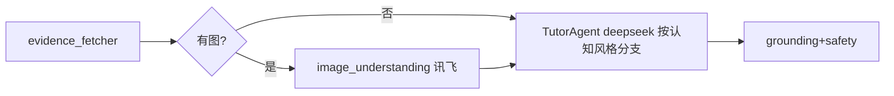

# 画像闭环三连 · 四层详细设计（可直接开工）

> 配套 design / plan / framework 三文件。本文件逐层给"可直接开工"的契约、算法、签名、组件树。顺序：数据 → 接口 → 智能体 → 前端。

---

## L1 数据层

### 1.1 表（沿用现状，无需新增表）
- `learner_profile(id, user_id UNIQUE, pack_id=43 CHECK=43, dimensions JSONB, major, base_level, learning_goal, cognitive_style, learning_preference, error_patterns, practice_capability, emotion_persistence, narrative_summary, updated_at)` — V012 + `dimensions` 列。
- `profile_revision(id, user_id, source CHECK∈{INTERVIEW,SUBMISSION,DEBUG,RESOURCE_FEEDBACK,QUEST,CLASSROOM,EVALUATION,PRACTICE_PASS,PRACTICE_FAIL,DEBUG_FIX}, diff JSONB, created_at)`。
- `kc_mastery(user_id, kc_code, mastery_score, updated_at)`、`learning_resource(...)`。

### 1.2 `dimensions` JSON 权威 schema（8 维统一形状）
```jsonc
{ "<dim_key>": {
  "score": 0.0,           // [0,1] 主量纲（raw，入库不衰减）
  "evidence_count": 0,    // 累计证据条数
  "tags": [],             // 多源离散信号去重累积
  "metadata": {},         // 任意子键（如 last_style_engaged）
  "last_updated": "ISO8601"
}}
```
`<dim_key>` ∈ DIMENSION_KEYS（professional_background, knowledge_base, learning_goal, cognitive_style, learning_preference, error_pattern, practical_ability, emotion_persistence）。

### 1.3 confidence（读时派生，不入库）
`confidence = min(1.0, evidence_count / EVIDENCE_SATURATION)`，`EVIDENCE_SATURATION = 8`。前端按 confidence 决定是否"敢断言"（<0.3 显示"信号不足"）。

### 1.4 decay（懒计算，仅 getDimensions 输出 effective，raw 不动）
`effectiveScore = 0.5 + (score - 0.5) * 0.5^(Δdays / HALF_LIFE_DAYS)`，`HALF_LIFE_DAYS = 14`，`Δdays = now - last_updated`。evidence_count 不衰减。落实"随学随新"，避免早期信号永久定型。

### 1.5 读写路径
- 写：`PassiveProfileService.applyDimensionUpdate(userId, key, DimensionDelta)`（已含 clamp[0,1]、evidence+、tags 去重、metadata 覆盖、revision 审计）。
- 读：`PassiveProfileService.getDimensions(userId)` → 在现有基础上**新增** confidence 派生 + decay 后的 effectiveScore，输出 `ProfileDimensionDto`（加 `confidence` 字段）。
- Repo：`ProfileRepository.findDimensions / saveDimensions / addRevision`。

### 1.6 迁移
信号全部复用 1.1 既有 source 枚举 → **无新迁移**。仅 `ProfileDimensionDto` 增 `confidence` 字段（非破坏）。

---

## L2 接口详设

### 2.1 新增 REST（均需 STUDENT 角色）
| 方法 | 路径 | 请求体 | 响应 | 错误码 |
|---|---|---|---|---|
| POST | `/api/learner/probe` | `{probeKey:string, choiceId:string}` | 204 | 400 PROBE_INVALID（probeKey/choiceId 不在目录）|
| POST | `/api/tutor/style-engaged` | `{style:"visual"\|"logical"\|"trial", kcCode?:string}` | 204 | 400 STYLE_INVALID |
| GET | `/api/learner/world-state` | - | `{mood:"sunny"\|"cloudy"\|"rainy", streak:int, emotionScore:number}` | - |

### 2.2 ProbeCatalog（服务端权威，防前端伪造信号）
后端常量表；前端只传 `choiceId`，服务端查表得 `dim` 与 `scoreDelta/tag`（学习科学：信号不可被客户端篡改）。
```
cog_intro   -> dim=cognitive_style   choices: visual(+0.03,tag=visual) | logical(+0.03,tag=logical) | trial(+0.03,tag=trial)
fail_react  -> dim=emotion_persistence choices: retry(+0.02,tag=retry) | hint(0,tag=hint) | skip(-0.02,tag=skip)
media_pref  -> dim=learning_preference choices: video(tag=video) | reading(tag=text) | interactive(tag=interactive)
```

### 2.3 LearningEvent 新 record（Java sealed 内部类签名）
```java
record ProbeChoiceMade(Long userId, String probeKey, String choiceId) {}
record TutorStyleEngaged(Long userId, String style, String kcCode) {}
record PracticeRetried(Long userId, Long problemId, String kcCode) {}
record PracticeAbandoned(Long userId, Long problemId, String kcCode) {}
record ComebackSolved(Long userId, Long problemId, String kcCode, int priorFails) {}
```

### 2.4 emotion 事件派生规则（在 Submission/Training 服务触发）
- `PracticeRetried`：对**同一 problemId** 在上次 FAIL 后再次提交。
- `ComebackSolved`：AC 且该 problem 此前累计 ≥2 次 FAIL（priorFails≥2）。
- `PracticeAbandoned`：失败后本会话内未重试即离开训练场 / 点"跳过"（前端在离开/跳过时上报，或后端按会话超时判定）。

### 2.5 graph 请求契约（后端 → /agents/tutor/ask/stream）
```
{ user_id, question, kc_codes?, context?, images?, profile_brief? }
profile_brief 格式: "认知风格: <tag>; 易错: <tag,tag,...>"（空串=无画像，graph 行为不变）
```
SSE 响应事件（已实现）：`trace` / `token` / `result` / `error`。

---

## L3 智能体编排（LangGraph）

### 3.1 tutor 子图节点流 + I/O 契约 + trace node

| 节点 | 输入 | 输出 | trace node |
|---|---|---|---|
| evidence_fetcher | {kc_codes, query, top_k} | {chunks[]} | evidence_fetcher |
| image_understanding | {imageBase64, prompt} | {desc} | image_understanding |
| TutorAgent | {messages(含 system+profile_brief+evidence+history+question)} | token 流 | TutorAgent |
| grounding+safety | {answer, chunks} | {grounding_result, safety_result} | grounding/safety |

### 3.2 PM 调度（orchestrator，可选 #4，强化"协同"观感）
新增/复用 `orchestrator_agent`：接意图 → 决定调度哪些子 Agent → 汇总。tutor 流以"调度阿管派单给资料员/识图员/导师/校对"在 SSE trace 中显形（前端 TutorCrew 已能渲染）。

### 3.3 资源生成多智能体（≥5 类，现状）
`resource_graph.py` 编排 ResourceDesigner/MindMap/Practice/CodeLab/Storyboard → 讲义/导图/题目/拓展/视频动画/代码实操（已满足赛题"≥5 类、多角色协作"）。

### 3.4 cognitive_style 分支注入点
`tutor_agent.py::_build_messages`：解析 profile_brief 命中 visual/logical/trial → 在 SYSTEM_PROMPT 后追加首屏呈现指令；保留防泄答 + `[页 X]` 引用规则。

---

## L4 前端组件

### 4.1 组件树
```
AppLayout
├─ WorldCanvas(Phaser 单 Game adapter)
│   ├─ MoodOverlay(tint/天气层，读 useMoodStore)
│   └─ ProbeCard(世界内探针，读 useProbeStore)
├─ TutorPanel
│   ├─ TutorCrew(props: traces,status,imageCount,grounding,cognitiveStyle,errorTags)
│   └─ 看图答疑/输入区(已存在)
└─ ProfilePage(雷达 + confidence + 纠偏)
```

### 4.2 新增/改动组件 props·events
| 组件 | 关键 props | emit/调用 |
|---|---|---|
| ProbeCard ✚ | `probeKey, choices[]` | `choose(choiceId)` → `api/learner.probe` |
| MoodOverlay ✚ | `mood` | - |
| TutorCrew ✎ | +`cognitiveStyle, errorTags` | - |
| TutorPanel ✎ | - | "换个讲法" → `api/tutor.styleEngaged(style)` |
| ProfilePage ✎ | - | 纠偏 → `selfUpdateDimension` |

### 4.3 Stores（Pinia）
- `useMoodStore`：`{mood, streak, emotionScore}`；`refresh()` 调 `GET /api/learner/world-state`；在做题结果回来后刷新。
- `useProbeStore`：`{shown:Set, answered:Set}`；`shouldShow(probeKey)`；`markAnswered`。

### 4.4 情绪世界渲染（Phaser）
- 复用 `frontend/src/game/adapters/phaserGame.ts` 单例（禁止新 Game 实例）。
- MoodOverlay 通过 adapter 给当前 Scene 加 tint/天气粒子层；`prefers-reduced-motion` 关动画；提供"关闭情绪氛围"。

### 4.5 探针卡 UI 契约
- 中性等价呈现（选项无优劣暗示）、可跳过；答完写 `useProbeStore.answered` + 调 `/api/learner/probe`。

---

## 横切
- 防幻觉：confidence<0.3 不强断言；cognitive_style 纠偏（#1 待定：加入 SELF_EDITABLE 或单独纠偏接口）。
- 降级：无 key/网→占位/纯文本；冷启动→预置画像；mood/probe 纯本地+后端派生，不依赖外网。
- 测试基线：见 plan 文件「验证基线」。
