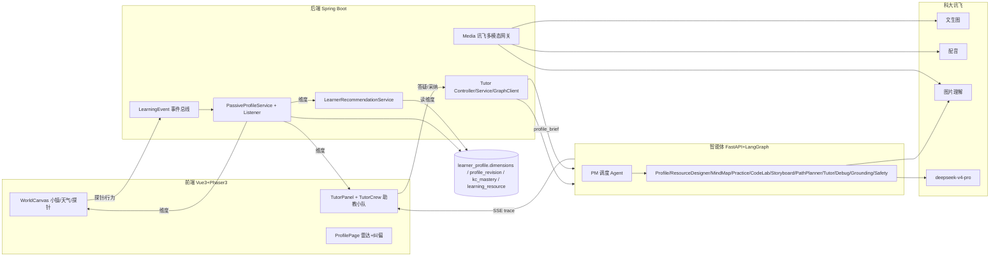
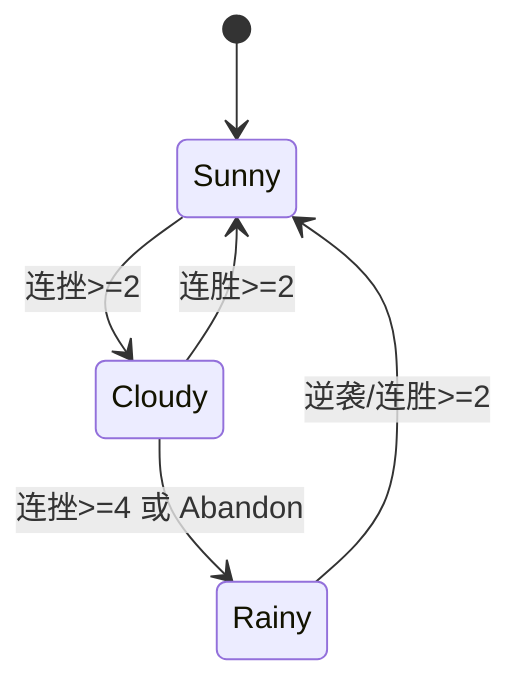

# 画像闭环三连 · 明确技术框架（Framework）

> 配套：`...-design.md`（方案）/ `...-plan.md`（任务）。本文件给"明确框架"：分层架构、数据契约、信号矩阵、智能体拓扑、模块框架、API/事件契约、文件落点、状态机。

## 0. 一句话闭环
行为/探针 → 事件总线 → 被动画像引擎（写维度+证据+审计）→ 动态画像 → 助教讲法 / 小镇情绪 / 资源推荐（读维度）→ 新行为。多智能体以「会说话的助教 NPC」可见化。

## 1. 分层架构


## 2. 画像数据契约（dimensions JSON，每维统一形状）
```jsonc
"cognitive_style": {
  "score": 0.0,            // 主量纲
  "confidence": 0.0,       // = f(evidence_count)，低置信不强断言（防幻觉）
  "evidence_count": 0,
  "tags": ["visual"],      // 多源离散信号累积
  "metadata": {},
  "last_updated": "ISO8601",
  "decayable": true         // 久未更新轻微回归 → 保证"随学随新"
}
```
8 维 key 见 `PassiveProfileService.DIMENSION_KEYS`（不变）。新增 `confidence` 派生 + `decay` 语义。

## 3. 画像信号矩阵（事件 → 维度）
| 来源事件 | 维度 | Δscore | tags | evidence | source | 状态 |
|---|---|---|---|---|---|---|
| PracticeSucceeded | practical_ability | +0.02 | - | +1 | PRACTICE_PASS | 已接 |
| PracticeFailed | error_pattern | +0.02 | failureKind | +1 | PRACTICE_FAIL | 已接 |
| DebugResolved | error_pattern | -0.02 | - | - | DEBUG_FIX | 已接 |
| ResourceConsumed | knowledge_base | +0.005 | - | +1 | RESOURCE_FEEDBACK | 已接 |
| MediaConsumed | learning_preference | +0.01 | mediaType | +1 | RESOURCE_FEEDBACK | 已接 |
| ProbeChoiceMade | cognitive_style/emotion/learning_preference | +0.01~0.03 | choice | +1 | RESOURCE_FEEDBACK | 新增③ |
| TutorStyleEngaged | cognitive_style | +0.02 | style | +1 | RESOURCE_FEEDBACK | 新增① |
| PracticeRetried | emotion_persistence | +0.02 | retry | +1 | PRACTICE_FAIL | 新增② |
| PracticeAbandoned | emotion_persistence | -0.03 | abandon | +1 | PRACTICE_FAIL | 新增② |
| ComebackSolved | emotion_persistence | +0.04 | comeback | +1 | PRACTICE_PASS | 新增② |

> 新事件 source 复用 V091 已有枚举（避免改迁移）；若要专属 source 再加 `V1xx__profile_signal_source.sql`。

## 4. 多智能体拓扑 + 协同契约
| 助教 NPC | Agent | 职责 | trace node |
|---|---|---|---|
| 调度阿管(PM) | Orchestrator | 拆解/分派/汇总 | orchestrator |
| 资料员小书 | EvidenceFetcher/RAG | 课件检索 | evidence_fetcher |
| 识图员小睛 | 讯飞图片理解 | 看图转描述 | image_understanding |
| 导师阿派 | TutorAgent(deepseek) | 因材施教答疑 | TutorAgent |
| 校对小核 | Grounding+Safety | 引用/防泄答 | grounding/safety |

SSE 契约（已实现）：`event: trace` + `{node,status,index?,total?,chars?}` → 前端 TutorCrew 按 node→NPC 状态映射。

## 5. 三连模块框架
### 建③ 玩中建画像（数据驱动探针）
`probeKey → {dim, choices:[{id,label,signal}]}`：
- `cog_intro`: cognitive_style → [图解=visual, 读码=logical, 跑例=trial]
- `fail_react`: emotion_persistence → [再试=+persist, 看提示=neutral, 跳过=-persist]
落点待 #2；UI 中性可跳过；`ProbeChoiceMade` → Listener → 维度。

### 用① 助教因材施教
profile_brief 契约（后端→graph）：`"认知风格: <tag>; 易错: <tag,tag>"`。
讲法策略表（TutorAgent）：visual→图解/mermaid 先行；logical→推理链先行；trial→最小可跑例先行；unknown→不强制。
采纳回写：前端"换个讲法"/停留 → `TutorStyleEngaged` → cognitive_style。

### 境② 情绪化小镇（状态机）

滑动窗口统计近 N 次成败/重试同步 emotion_persistence；Phaser tint/天气（范围待 #3），背景级、可关闭/纠偏。

## 6. API / 事件契约（新增）
- `POST /api/learner/probe` `{probeKey, choiceId}` → 204，发 ProbeChoiceMade
- `POST /api/tutor/style-engaged` `{style, kcCode?}` → 204，发 TutorStyleEngaged
- LearningEvent 新 record：ProbeChoiceMade / TutorStyleEngaged / PracticeRetried / PracticeAbandoned / ComebackSolved
- TutorGraphClient 请求体加 `profile_brief`（graph 已有字段）

## 7. 文件落点（modify ✎ / add ✚）
```
backend/.../learner/event/LearningEvent.java                 ✎ 新事件
backend/.../learner/profile/PassiveProfileRevisionListener.java ✎ 新映射
backend/.../tutor/TutorController.java                        ✎ /style-engaged
backend/.../tutor/TutorService.java + TutorGraphClient.java   ✎ profile_brief
backend/.../learner/profile/controller/ProfileController.java ✎ /probe (可选)
services/.../agents/tutor_agent.py                            ✎ 认知风格分支
services/.../agents/orchestrator_agent.py                     ✎ PM 调度 (可选 #4)
frontend/src/components/tutor/{TutorCrew,TutorPanel}.vue      ✎ 因材施教/采纳
frontend/src/components/world/WorldCanvas.*                   ✎ 探针/天气/心情 ✚
frontend/src/api/{learner,tutor}.ts                           ✎ probe/style-engaged
frontend/src/stores/(mood|probe).ts                           ✚
backend/.../db/migration/V1xx__profile_signal_source.sql      ✚ (若扩 source 枚举)
```

## 8. 横切关注
- 防幻觉：confidence+evidence，低置信不贴标签；cognitive_style 纠偏（待 #1）。
- 降级：无 key/网→占位/纯文本；冷启动→预置画像演示账号；情绪/探针纯本地。
- 演示：7 分钟脚本见设计文档 §9。
