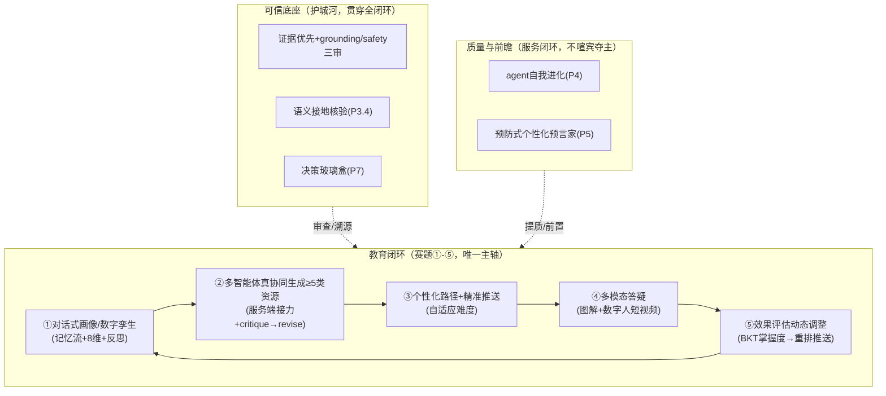

# Pythontopia ∞ ·《面向高校学生的个性化资源生成与学习多智能体系统》远景蓝图（详版 · 教育内核收敛版）

> **状态**：远景规划（教育内核收敛版，2026-06-08 修订删除跑偏项）· 对标中国软件杯 A3「基于大模型的个性化资源生成与学习多智能体系统开发」
> **For Claude / 实施者**：本文是“愿景 + 分阶段执行”的合并蓝图。落地时用 `executing-plans` / `subagent-driven-development`，**每个 Task 先写测试再实现，频繁提交**；每个阶段末尾「验收标准」为硬门槛，全绿才算完成。
> **关联既有计划**：本蓝图的 Phase 2 直接吸收并扩展 [`docs/plans/2026-06-08-generative-teaching-agents.md`](./2026-06-08-generative-teaching-agents.md)（记忆流/反思）与 [`docs/plans/2026-06-08-companion-study-assistant.md`](./2026-06-08-companion-study-assistant.md)（主动陪伴）。本蓝图是它们的“上位愿景”。

---

## 0. 北极星与差异化论点

**北极星**：把 Pythontopia 从「一个带多个 AI 按钮的教学游戏」升级为「一支**为每个真实学生服务、有记忆、会反思、会真协同、会自我纠错**的 AI 导师团队」。唯一主轴是赛题的教育闭环 **画像 → 多智能体协同生成资源 → 个性化路径推送 → 多模态答疑 → 效果评估动态调整**，把“多智能体”从架构图上的名词变成评委可追问、可溯源的真实行为。**游戏/像素小镇仅作承载，教育闭环永远是主体**（严守 AGENTS.md：不做无教育目的装饰、不为展示效果牺牲教育目标、不做假数据冒充业务）。

**差异化论点（Thesis）**：保留 Stanford《Generative Agents / Smallville》的认知架构（记忆流 → 检索 → 反思 → 规划 → 涌现协作），**剥离它的幻觉**——每条记忆锚定真实 `learning_event_log` 事件、每次反思强制引用 event id、每件资源强制 `evidence_page_ids` 并过 grounding/hallucination/safety 三审。**别人交“套壳 RAG 聊天框”，我们交“可追问、可溯源、自我进化的 AI 教育微世界”。**

**这套愿景为什么能赢 A3**：A3 评分 = 创新价值与实用性 35% + 功能实现及技术要求 45% + 文档 10% + 视频/PPT 10%。**80% 在“创新 + 功能”**，胜负手是“多智能体到底是不是真协同”。本蓝图把当前最致命的短板（播报式假协同）直接翻转成最大亮点。

---

## 0.1 教育本质守恒自查（2026-06-08 修订：已删除“跑偏/装饰/边缘”项）

> 第一版（登月版）堆了 5 Mega / 8 Phase，经自查有数处偏离“个性化学习辅助”本质、踩 AGENTS.md 红线，**本版已删除**。删除原则：不直接服务“一个真实学生走完 画像→生成→推送→答疑→评估 闭环”的，一律砍除或降级。

| 删除项 | 原定性 | 删除理由 |
| --- | --- | --- |
| 合成学生军团 + 课程优化（旧 P5.1/5.2） | 🔴 明显跑偏 | 是“教研/课程设计研究工具”，非帮真实学生学习；合成数据有“假数据当依据”风险，踩“不做假数据冒充业务”红线 |
| NPC 作息日程（旧 P4.1 装饰部分） | 🟡 装饰 | “清晨整理课件/傍晚复盘”无教育目的，踩“不做无教育目的装饰”；真 agent 接力的可视化已并入 P1.3 剧场 |
| 市政厅辩论治理可视化（旧 P4.2） | 🟡/◐ | 辩论提质已在 P1.4；独立“市政厅剧场”是装饰 |
| 涌现灾害天气（旧 P6.1：Bug 暴雨/概念迷雾） | 🟡 装饰 | 天气剧场是皮肤；底层“班级薄弱点→补救”已并入 P6 |
| 涌现课程自精炼（旧 P6.3） | ◐ 边缘 | 过度工程，且依赖已删的合成军团 |
| 镜像沙盒（旧 P7.1）/ 教研会直播（旧 P7.3） | ◐ 边缘 | 演示/教师向，非学生学习核心；演示用现成功能呈现即可，无需独立系统 |
| 跨端共享 AI 记忆（旧 P8.1） | ◐ 边缘 | 多端覆盖非赛题核心；后端 DTO 已端无关，无需专列阶段 |

**保留的全是教育内核**：真协同（②）、反思飞轮（①⑤）、自适应引擎（③⑤）、语义接地（防幻觉）、agent 自我进化（②质量）、预防式个性化（③⑤，grounded 真实历史）、班级补救包（②班级）、决策玻璃盒（可信）、多模态数字人（②④，赛题明列）。

---

## 1. 赛题对齐（A3 硬要求 → 评分 → 本蓝图落点）

| A3 要求 | 必做/加分 | 现状 | 本蓝图落点 |
| --- | --- | --- | --- |
| ① 对话式学习画像（≥6 维动态画像） | 必做 | ✅ 8 维被动+自评 | Phase 2 数字孪生深化 |
| ② **多智能体协同**生成 ≥5 种资源 | **核心(45%)** | ⚠️ 假协同（播报+前端深链） | **P1 真协同内核** + P4 agent 自我进化 |
| ③ 个性化路径规划 + 精准推送 | 必做 | ◐ PathPlanner 有拓扑排序 | Phase 3 自适应引擎 |
| ④ 智能辅导（多模态答疑） | 加分 | ◐ Tutor+RAG，多模态弱 | Phase 3 语义接地 + Phase 8 数字人 |
| ⑤ 学习效果评估（行为→评估→**动态调整**） | 加分 | ◐ 反思雏形未完成 | Phase 2 反思飞轮 + Phase 3 自适应 |
| 创新加成 | — | 护城河：证据优先+像素小镇+真判题 | P3.4 语义接地 + P5 预防式个性化 + P7 决策玻璃盒 |

---

## 2. 现状基线（三子代理实测真实代码，实施前必读）

> 来源：后端探索 `6dd0194f`、前端探索 `6f2f1f2e`、Python 探索 `b6439c8c`。**以下为磁盘真实状态，非文档宣称。**

### 2.1 后端（Spring Boot 3.3.6 / Java 21 / :18080 / `/api` / JWT）
- 17+ 领域模块；**63 个 Flyway 迁移，最高 V135**；46 REST 控制器；76 测试（含 Testcontainers PostgreSQL）。
- 🔴 **即时阻断**：工作区有未提交的 `V134` + **两个 `V135`**（`V135__drop_npc_friendship_and_gift.sql`、`V135__learner_insight_and_reflection_source.sql`）→ Flyway 启动直接报 *“Found more than one migration with version 135”*。
- 画像 8 维（`PassiveProfileService.DIMENSION_KEYS`）：`professional_background, knowledge_base, learning_goal, cognitive_style, learning_preference, error_pattern, practical_ability, emotion_persistence`；`profile_revision` 审计 + `ALLOWED_REVISION_SOURCES` 白名单。
- 记忆流：`LearningEvent`（sealed，11 事件）→ 三监听器（`MasteryEvaluator` / `PassiveProfileRevisionListener` / `MemoryStreamMirror`）→ `learning_event_log`（V134 加 `importance`）；`EventImportance`（1–5）；`MemoryRetrievalService`/`MemoryScorer`（recency×importance×relevance，**无向量**）；`ReflectionTrigger`（进程内计数，阈值 8/冷却 60min）。
- 掌握度：`MasteryEvaluator` 固定 delta 线性加减 + 半衰期 decay；`kc_review_state`（V133，FSRS-lite）。
- 判题：`SubprocessPythonSandbox`（`python3 -I -B` + 墙钟超时 + 清 env + 脱敏，**无内存/CPU/cgroup 限制**）；`StaticCodeChecker`（正则黑名单，可绕过）；**判题在请求事务线程内同步执行**。
- 跨服务：`GraphSseConsumer`（强制 HTTP/1.1）+ `SseRelayExecutor`（**无上界**线程池）；`graphRestTemplate = RestTemplateBuilder.build()` **未配超时**；后端→graph/rag **无鉴权**（`ragAdminToken` 定义了但 `RagClient` 未用）。
- 班级：`ClassroomDashboardService`（`kcHeatmap` / `copilotBrief` / `errorHotspots`）+ `ClassroomLiveService`（SSE 直播，进程内 emitter map）。
- 审计：`ResourceRunRecorder` 写 `resource_run`（agent_name / evidence_page_ids / safety_result / grounding_result / graph_trace）。

### 2.2 前端（Vue 3.5 + Vite 5 + TS strict + Pinia 2 + Phaser 3.87 + Vitest 2）
- 27 页 / 93 组件 / 20 store / 71 api / 31 game 文件；**1132 测试 / 139 文件**（代码内无 `.skip/.todo`）。
- 单一 `WorldScene` + `town_hub.json`（50×40，**12 NPC + 12 building**，其中 `/lighthouse /house-* /storage /coop` 6 个 building 是 `PlaceholderPage` **死路**）；`index.json` 声明 `town_hub.exits=["mine_south"]` 但地图无 `exit` 对象（契约不一致）。
- 🟡 **“活的小镇”名不副实**：`WorldScene` 注释明言 town_hub NPC 无 patrol、`npcFramework.update` 是 no-op；`NpcFramework`（巡逻/朝向/对话状态机）能力闲置。
- 剧场 `AgentOfficeScene.vue`：已能把 agent 演 NPC + 接力棒 + 想法气泡 + 总管走位 + 消费 SSE `plan/trace` + 交付证据卡（**舞台就绪，缺真后端 trace**）。
- 陪伴 `stores/companion.ts`：**仅 1 种 nudge**（FSRS 到期复习），无洞察/记忆驱动；`AgentNotebook.spec.ts` 已占位但 store/组件未实现。
- 主线：`stores/mainQuest.ts`（35 子任务+7 boss，全 ground 在 packId=43）、`dialog.ts`（`quest_recommend/open_panel/route`）、`chapters.ts`。
- 设计令牌 `styles/tokens.css`：`--pyt-*` 与遗留 `--pyt-r12-*` **双轨**；**暗色只覆写 r12 旧令牌**（规范令牌无暗色变体）。
- 死代码：`game/adapters/tilemap.ts` 旧农场期 `loadTownMap()`；`pages/TownPage.vue`/`FieldPage.vue` 已脱离路由仍有源码与测试。

### 2.3 Python 微服务（FastAPI + Pydantic v2 + mypy strict）
- graph ≈ **254 测试**；rag ≈ **18 测试**；依赖声明 `langgraph>=0.2,<0.3`。
- 🔴 **致命伤**：**全仓仅 `graph/orchestrator_graph.py` 一个真 LangGraph `StateGraph`**；其 `_dispatch_step` 只产出 *“已将…分派给 {agent}”* 文本，**从不在服务端 await 子 agent**——真正生成靠前端深链各自 SSE 端点。
- 🟡 资源流水线 `graph/resource_graph.py` 的重试是**盲重试**（`MAX_RETRIES=1`，不把 critic `reasons` 回灌设计师 prompt）→ 等于“再试一次必然同样失败”。
- ✅ 唯一真协同：`graph/debate_graph.py`（Solver→Critic→Referee，critic 意见真传 Referee），但**触发面极窄**（`should_debate` 窄词）。
- Agent：LLM 类（Orchestrator/IntentRouter/Tutor/Handout/Reading/MindMap/Practice/CodeLab/Storyboard/Profile/Reflection）+ 确定性类（CurriculumMapper/PathPlanner/Debug/EvaluationNarrative）+ Boss 子系统（5 审查链）。
- Provider：`llm/provider.py`：`DryRunProvider` / `OpenAiCompatProvider`（DeepSeek 兼容）/ `SparkProvider`（讯飞）；`provider_from_env()`。
- 防幻觉：`nodes/{grounding_critic,hallucination_detector,safety_critic,tutor_review}.py` **纯规则**（查页码命中/KC 白名单/`%`与 4 位数字/`ast` 语法）；**无语义接地**（`token_grounding_verifier` 在本仓不存在）。
- 个性化：`agents/personalization.py` + `ProfileSnapshot`（`major / python_self_rated_level / media_priority / cognitive_style / error_patterns`）→ `resource_personalization_directive`（仅 3 类认知风格 + 易错点关键词拼接）。
- 🔴 RAG：**HashEmbedder（词袋哈希）+ InMemoryVectorStore（内存余弦线性扫描）**，**完全没用 pgvector**（与 AGENTS.md 宣称不符）；`IflytekSparkEmbedder` 仍 `NotImplementedError`；`evidence_fetcher` 为绕开 hash 低余弦把 `min_score` 设 0。

---

## 3. 愿景架构（教育闭环优先）

---

## 4. 分期总览

| 阶段 | 标题 | 服务赛题点 | 顶层验收（硬门槛） |
| --- | --- | --- | --- |
| **P0** | 地基止血与对齐 | 全 | 服务可启（修双 V135）+ 全套测试基线绿 + 文档对齐 R-14 |
| **P1** | 真协同内核 | ②(核心45%) | 一次编排**服务端真产出**全套资源；剧场放**真 trace**；critique→revise 可复现 |
| **P2** | 数字孪生与反思飞轮 | ①⑤ | 攒够事件触发反思→引用 event id→回写画像；记忆注入生成；AI 周报 |
| **P3** | 自适应教学引擎 | ③⑤+防幻觉 | BKT 掌握度；难度自适应出题；动态推送；语义接地核验 |
| **P4** | agent 自我进化（meta-reflection） | ②质量 | 据真实反馈调策略并写审计；无反馈不动；规则兜底 |
| **P5** | 预防式个性化（预言家） | ③⑤ | 据真实历史预测薄弱 KC 并前置生成预防资源；可溯源 |
| **P6** | 班级薄弱点一键补救包 | ②班级 | 教师对班级薄弱 KC 一键生成补救全套资源（带证据） |
| **P7** | 决策玻璃盒（可信） | 创新/可信 | 每个决策可展开 agent 讨论 + 课件证据链 |
| **P8** | 多模态数字人讲师 | ②④ | 数字人讲解短视频；无 key 降级字幕；演示不断 |

**全局 DoD（每阶段都要满足）**：四端不受影响；`mvn -q -DskipTests compile` + 相关 `mvn test`、`python -m pytest -q`、`npm run typecheck` + 相关 `vitest`、`npx eslint` 全绿；业务层无 `any` 扩散；新增周期性 LLM 调用必须有“无网/无 key 规则兜底”，演示链路不断；每条 AI 产出可溯源（event id / evidence_page_ids）。

---

# Phase 0 · 地基止血与对齐

> 目标：让“活世界”有一块不塌的地基。**P0 不做完，后面全是流沙。**

## Task 0.1 修复双 V135 迁移冲突（最高优先）
**现状**：`backend/src/main/resources/db/migration/` 同时存在 `V135__drop_npc_friendship_and_gift.sql` 与 `V135__learner_insight_and_reflection_source.sql`。
**步骤**：
1. 先 `git log`/`\d` 确认两者真实内容与依赖顺序（`learner_insight` 依赖 `users`；drop friendship 依赖 V117）。
2. 将**较晚业务**（`learner_insight + 放宽 profile_revision.source`）重命名为 `V136__learner_insight_and_reflection_source.sql`；保留 `V135__drop_npc_friendship_and_gift.sql`。
3. 同步检查 `PassiveProfileService.ALLOWED_REVISION_SOURCES` 是否已含 `REFLECTION` 并与 V136 的 `profile_revision_source_check` 枚举一致。
**验收标准**：
- [ ] 空库 + seed 流程（`./dev.sh` 或 Flyway migrate）**零报错**，无 “more than one migration with version”。
- [ ] `mvn -q test` 中所有 Testcontainers 集成测试（真起 PG 跑 Flyway）通过。
- [ ] `profile_revision` 接受 `REFLECTION`，旧 source 仍合法。

## Task 0.2 跨服务韧性与鉴权
**现状**：`RestClientConfig` 未配超时；`SseRelayExecutor` 无上界线程池；`RagClient` 未用 `ragAdminToken`。
**步骤**：
1. `common/web/RestClientConfig.java`：给 `graphRestTemplate` 配 connect/read 超时（建议 3s/30s，可 `@ConfigurationProperties` 化）。
2. 8 个阻塞 GraphClient 增加统一超时 + 失败语义（保留 502），关键路径加一次重试 + 熔断阈值（可用简单计数）。
3. `SseRelayExecutor`：线程池设上界 + 拒绝策略 + 命名线程；超时清理 emitter。
4. 服务间 token：`RagClient` 与各 GraphClient 带 `X-Internal-Token`（复用 `GraphServiceProperties.ragAdminToken`，graph/rag 侧校验）。
**验收标准**：
- [ ] 单测：graph/rag 模拟超时，后端在阈值内返回 502 而非无限挂起（不占满 Tomcat 线程）。
- [ ] `SseRelayExecutor` 有界且拒绝策略可测；并发压测下不 OOM/不打满线程。
- [ ] rag 重建端点在缺 token 时 401；后端调用带 token 成功。
- [ ] `mvn -q test` 绿。

## Task 0.3 判题沙箱加固
**现状**：`SubprocessPythonSandbox` 无资源限制；`StaticCodeChecker` 正则黑名单可绕过；判题同步占用请求线程。
**步骤**：
1. 沙箱加 `ulimit`（内存/CPU/进程数/文件大小）或迁移到 nsjail/容器；只读临时目录。
2. `StaticCodeChecker` 从正则黑名单升级为 **AST 白名单**（`ast.parse` 后只放行白名单节点/导入）。
3. 判题异步化：引入有界队列 + worker，限频改为带唯一约束/原子计数防并发竞态。
**验收标准**：
- [ ] 新增 `SandboxResourceLimitTest`：内存炸弹/fork 炸弹/超长输出被限制，返回 TLE/SYSTEM_ERROR 而非拖垮宿主。
- [ ] `StaticCodeCheckerTest` 增绕过用例（`breakpoint()`/`getattr`/import 别名/`\t` 缩进）全部拦截。
- [ ] 并发 50 提交不超额、无竞态；`mvn -q test` 绿。

## Task 0.4 文档与死代码对齐 R-14
**步骤**：
1. 更新 `docs/execution_status.md`（去掉“Web 冻结在 R-11”）、`docs/sv-progress.md` 烟雾断言（`maps`/`npcs` 数）、`docs/release/known_issues.md`。
2. 删除死代码：`pages/TownPage.vue`、`pages/FieldPage.vue`（及 `FieldPage.spec.ts`）、`game/adapters/tilemap.ts` 的农场期 `loadTownMap()`/`DEFAULT_*`（确认无引用后删）。
3. 修 `town_hub` 契约：移除/激活 6 个占位 building；补 `exit` 对象或更正 `index.json` 的 `exits`。
**验收标准**：
- [ ] 文档与 R-14 单 hub 现实一致；无“5 图/20 NPC”过时断言。
- [ ] `npm run typecheck` + `vitest` + `eslint` 绿（删除死代码不破测试）。
- [ ] town_hub 无死路 building，exit 契约自洽。

---

# Phase 1 · 真协同内核（本蓝图的心脏）

> 目标：把“播报式假协同”炸掉，建成**服务端可观测的真·多智能体接力链**——这是 A3 的 45% 功能分 + 35% 创新分的胜负手。

## Task 1.1 Orchestrator 服务端真接力
**现状**：`orchestrator_graph.py::_dispatch_step` 只回文本，不调子 agent。
**步骤**：
1. 在 graph 内新增**内部调用层** `agents/dispatch.py`：把 ResourceGraph / PracticeAgent / PathPlannerAgent / TutorAgent / DebugAgent 暴露为可在进程内 `await` 的协程（不经 HTTP 自调）。
2. 改 `_dispatch_step`：根据 plan step 类型真正 `await` 对应子 agent，产物写入 `OrchestratorState.dispatch_results`（已是 `Annotated[list, operator.add]` reducer）。
3. 每个子 agent 调用前后 emit 真 `trace`（`phase=start/finish`、`status`、`elapsed_ms`、`agent_label`、`note`），保留 `plan` 开场事件。
4. 失败重规划：复用现有 `_node_replan_failures` 把失败 step 插 DebugAgent 后重跑。
**验收标准**：
- [ ] 新增 `test_orchestrator_real_dispatch`：一次 orchestrator turn **服务端真产出**讲义+题（断言 `dispatch_results` 含真 artifact，而非 summary 文本）。
- [ ] SSE 序列含每个子 agent 的真 start/finish trace（断言 node 名与 elapsed_ms 存在）。
- [ ] DryRun provider 下全链不报错（兜底草稿）；provider 抛错按 fail-fast 传播。
- [ ] `python -m pytest -q`（graph）绿。

## Task 1.2 critique → revise 自我纠错闭环
**现状**：`resource_graph.py` 盲重试，不回灌 critic reasons。
**步骤**：
1. 审查器（grounding/hallucination/safety）失败时收集结构化 `reasons`（页码缺失/数字幻觉/泄答词等）。
2. 设计师 `design()` 增可选入参 `revision_notes: list[str]`；prompt 追加“上一稿被打回原因：… 请针对性修订”。
3. `ResourceGraph` 提升 `MAX_RETRIES`（建议 2），第二/三次把 reasons 注入重生成，直到通过或耗尽 → FAILED（带 reasons）。
**验收标准**：
- [ ] 新增 `test_critique_revise_loop`：构造首稿故意引用越界页码 → 第二稿注入 reasons 后页码合法并通过（断言两稿不同 + 最终 PASS）。
- [ ] reasons 为空/通过时不触发额外 LLM 调用（成本守恒，断言调用计数）。
- [ ] `python -m pytest -q` 绿。

## Task 1.3 真 trace 喂剧场（前端可视真协同）
**现状**：`AgentOfficeScene.vue` 舞台就绪但吃的是流水线 trace。
**步骤**：
1. 后端 `OrchestratorGraphClient` / SSE 中继确认原样透传 Task1.1 的真 trace（含 handoff/replan/debate 节点）。
2. `AgentOfficeScene.vue`：当出现真接力 trace（A→B handoff、critique→revise 的 retry 节点）时，让 agent NPC **走到下一工位演接力**、被打回时演“退回修订”动画。
3. `WorkshopChat.vue` / `MarvisPanel.vue` 接 orchestrator SSE。
**验收标准**：
- [ ] `AgentOfficeScene.spec.ts`：注入含 handoff + retry 的真 traces → 断言接力棒/退回动画元素渲染；无相关 trace 退回普通流水线展示。
- [ ] `prefers-reduced-motion` 下无动画；窄屏单列；`--pyt-*` 令牌。
- [ ] `npm run typecheck` + `vitest` 绿。

## Task 1.4 辩论提质放大（DebateGraph 进主链）
**步骤**：
1. 扩大 `should_debate` 触发：关键教学决策（出题难度、讲法选择、是否跳关）也触发 Solver→Critic→Referee。
2. 辩论结论 emit 为 `trace{node:"debate"}`，剧场可视为“两个 agent 争论”。
**验收标准**：
- [ ] `test_debate_on_teaching_decision`：难度/讲法决策触发辩论且 critic 意见进 referee。
- [ ] 成本守恒：critic 无异议则跳过 referee（断言调用计数）。
- [ ] `python -m pytest -q` 绿。

---

# Phase 2 · 数字孪生与反思飞轮

> 目标：每个学生 = 持续演化的数字孪生（记忆流 + 8 维画像）；AI 团队“开教研会”反思并因材施教。**直接吸收 `2026-06-08-generative-teaching-agents.md` 的 Phase 0-3 为本阶段 Task 2.1-2.3。**

## Task 2.1 记忆流底座（importance + 检索）
**步骤**：落地既有计划的 Phase 0（`V134` importance、`MemoryStreamMirror`、`MemoryScorer`、`MemoryRetrievalService`、`GET /api/learner/memory`）。
**验收标准**：
- [ ] `EventImportance`/`MemoryScorer` 单测全绿；公式权重固化（0.4 recency / 0.3 importance / 0.3 relevance）。
- [ ] `GET /api/learner/memory` 返回 topK，每项含 recency/importance/relevance 分解，按 total 降序，仅本人。
- [ ] `mvn -q test` 绿。

## Task 2.2 反思 Agent + 触发 + 回写画像
**步骤**：落地既有计划 Phase 1（`ReflectionAgent` grounded、`ReflectionTrigger` 阈值/冷却、`ReflectionService` 回写 `source=REFLECTION` + 落 `learner_insight`、无 graph 规则兜底）。
**验收标准**：
- [ ] 空记忆 → 空洞察且 **0 次** LLM 调用；非法维度/空 evidence/越界 event_id 洞察被丢弃。
- [ ] 第 8 个事件触发一次反思；冷却内不重复；graph 不可用走规则兜底**不抛**。
- [ ] 洞察回写 `profile_revision(source=REFLECTION)` + `learner_insight(source=GRAPH|RULE)`。
- [ ] `pytest` + `mvn test` 绿。

## Task 2.3 记忆条件化生成
**步骤**：落地既有计划 Phase 2（topK 记忆要点注入资源/答疑 prompt；洞察驱动路径重排）。
**验收标准**：
- [ ] 传入 `memory_highlights` 时 directive 出现“近期学情”+要点；为空不变。
- [ ] 给定 `error_pattern` 洞察（弱 KC=X）→ 路径里 X 的练/复盘节点前移（可断言）；无洞察回退原排序。
- [ ] 不破坏既有 6 类资源结构化输出；`pytest` 绿。

## Task 2.4 AI 周报（数字孪生叙事化）
**步骤**：
1. 后端 `GET /api/learner/twin/weekly`：聚合本周记忆流 + 反思洞察 + 掌握度变化 + AI 团队为你做了什么（resource_run）。
2. 前端 `components/companion/TwinWeekly.vue`：可回放的“本周你的 AI 团队”时间线（复用 `--pyt-*`）。
**验收标准**：
- [ ] 周报 API 仅返回本人数据，含记忆/洞察/掌握度 delta/资源运行摘要。
- [ ] `TwinWeekly.spec.ts`：mock 数据渲染时间线；空态友好。
- [ ] `mvn test` + `vitest` + `typecheck` 绿。

---

# Phase 3 · 自适应教学引擎（千人千面 + 动态调整）

> 目标：把固定 delta 的掌握度升级为有难度加权/置信度的认知模型，驱动**难度自适应出题 + 动态推送**，并补上**语义接地核验**，吃满 A3 的“效果评估动态调整”加分。

## Task 3.1 掌握度建模升级（BKT/IRT）
**现状**：`MasteryEvaluator` 固定 delta 线性加减 + 半衰期 decay，无题目难度、无置信区间。
**步骤**：
1. 给 `course_problem` 引入/读取**难度系数**（迁移 `V137__problem_difficulty.sql`，从历史通过率估计或人工种子）。
2. `MasteryEvaluator` 升级为 **BKT**（贝叶斯知识追踪：先验/学习率/猜测/失误四参数）或轻量 IRT（题目难度 × 能力）；输出 `masteryScore` + `confidence` + 置信区间。
3. 保留半衰期 decay；事件 delta 改为难度加权（难题通过加得多，易题失败扣得多）。
**验收标准**：
- [ ] 新增 `BktMasteryEvaluatorTest`：相同 KC 下，通过**难题**比通过**易题**掌握度增益更大；连续失败置信度下降可断言。
- [ ] `V137` 空库迁移成功；难度缺省值不破坏既有 `MasteryEvaluatorTest`。
- [ ] `GET /api/learner/mastery` 返回含 `confidence`；`mvn -q test` 绿。

## Task 3.2 难度自适应出题
**现状**：`PracticeAgent` / Boss 不读掌握度做难度匹配。
**步骤**：
1. `ResourceProduceRequest` / Boss 请求增 `target_difficulty`（由后端按当前 `masteryScore`+`confidence` 计算：薄弱→稍易建立信心，临界→略高于当前促成长）。
2. `PracticeAgent` / `boss` prompt 注入目标难度区间，产出题标注难度；`hallucination_detector` 校验难度声明合理。
3. 后端 `WorkshopService` / `BossService` 计算并下发 `target_difficulty`。
**验收标准**：
- [ ] `test_practice_difficulty_adaptive`：低掌握度请求 → 生成题难度落在“稍易”区间；高掌握度 → “略高”区间（断言难度标签）。
- [ ] 不泄答（`safety_critic` 仍拦 `answer_key/hidden_test`）。
- [ ] `pytest` + `mvn test` 绿。

## Task 3.3 动态推送（孪生驱动）
**现状**：推荐未深度绑定孪生。
**步骤**：
1. `learner/recommendation` 读最新洞察 + 掌握度 + 记忆 topK，产出“今日推送”（资源类型/KC/难度三元组），随画像变化而变化。
2. 前端 `/home` 今日推荐卡片消费，展示“为什么推这个”（绑定洞察 evidence）。
**验收标准**：
- [ ] `RecommendationServiceTest`：改变画像/洞察 → 推送结果改变（可断言）；含推荐理由溯源。
- [ ] `mvn test` + `vitest`（推荐卡片）绿。

## Task 3.4 语义接地核验（补防幻觉最大洞）
**现状**：grounding 只查“页码命中”，防不住“页码对但论述歪曲证据”。
**步骤**：
1. 新增 `nodes/semantic_grounding_verifier.py`：对每个 `PageRef`，用轻量 LLM（可 DryRun 兜底）判断“该论述是否被该证据页支持”（entailment 风格），返回 `supported/unsupported + reason`。
2. 接入 `resource_graph` / `tutor_review`：unsupported 进 critique→revise（Task 1.2）回环。
3. 成本控制：仅对“带数字/强断言”的句子核验；DryRun 下规则降级。
**验收标准**：
- [ ] `test_semantic_grounding`：构造“页码对但论述歪曲”样本 → 被判 unsupported 并触发修订；正常论述通过。
- [ ] 无网/无 key 走规则降级不报错；成本守恒（仅强断言句核验）。
- [ ] `pytest` 绿。

---

# Phase 4 · agent 自我进化（meta-reflection）

> 目标：让生成资源的 agent 根据**真实反馈数据**改进自己的讲法策略，提升 ② 生成质量。grounded、有审计、可回退。

## Task 4.1 自我进化 agent（meta-reflection）
**现状**：agent 不读资源反馈数据调整自己。
**步骤**：
1. 落 `agent_strategy` 表（迁移 `V138`）：每个 agent 的可调策略参数（讲法偏好/详略/示例密度）+ 版本 + 调整理由。
2. 新增 `MetaReflectionService`：周期读 `resource_run` 的**真实反馈**（采纳率/重做率/学生评分）→ 调用轻量 LLM 或规则产出“我下次该怎么改”→ 更新 `agent_strategy`（带审计）。
3. 各资源 agent `_prompt` 读取当前 `agent_strategy` 注入。
**验收标准**：
- [ ] `MetaReflectionServiceTest`：低采纳率反馈 → 策略参数调整且写审计；无反馈不调整。
- [ ] `V138` 空库迁移成功；策略缺省不破坏既有资源测试。
- [ ] 无网/无 key 规则降级不抛；`pytest` + `mvn test` 绿。

---

# Phase 5 · 预防式个性化（预言家，grounded 真实历史）

> 目标：基于**真实学生**的画像/记忆流/掌握度趋势 + 先修依赖，预测“下一个最可能栽的 KC”，提前生成预防资源。**不做合成学生模拟、不造任何假数据**（已删旧 P5.1/5.2 合成军团+课程优化）。

## Task 5.1 预言家 / 预防式教学（仅基于真实数据）
**现状**：无前瞻；推送是事后补救。
**步骤**：
1. `OracleService`：仅用真实信号——当前 KC 掌握度 + `confidence`（P3.1）+ 记忆流高频 `failureKind`（P2.1）+ `course_kc.prerequisite_codes`（V125 真实 DAG）→ 规则/轻量打分预测“下一个高风险 KC”，**绑定证据**（event id + 依赖路径）。
2. 命中阈值则**提前**异步走 Phase 1 真协同链生成预防资源，存为“预防包”待学生抵达时推送。
**验收标准**：
- [ ] `OracleServiceTest`：构造“先修弱 + 高频某类错”→ 预测对应高风险 KC 并触发预防包；信号不足不触发（成本守恒）。
- [ ] 预测 **100% 可溯源到真实 event id / 掌握度 / 先修依赖**，无任何合成/模拟数据。
- [ ] 无网兜底走规则不抛；`pytest` + `mvn test` 绿。

---

# Phase 6 · 班级薄弱点一键补救包

> 目标：教师对班级薄弱 KC 一键生成补救全套资源。复用现成 `ClassroomDashboardService.errorHotspots`，**不做“涌现灾害”天气剧场，也不做依赖合成军团的自精炼课程**（已删旧 P6.1/6.3）。

## Task 6.1 班级薄弱点补救包
**现状**：`ClassroomDashboardService.errorHotspots` 有近 7 天高频误区，但无“一键生成补救资源”。
**步骤**：
1. 后端 `RemediationService`：读 `errorHotspots` 取班级薄弱 KC，教师“一键补救”触发 Phase 1 真协同链批量生成班级补救包（讲义 + 靶向题 + 短视频），全部带证据页。
2. 前端教师端按钮 + 学生端进入薄弱 KC 自动获补救资源。
**验收标准**：
- [ ] `RemediationServiceTest`：对班级薄弱 KC 产出全套资源且每件带 `evidence_page_ids`。
- [ ] 教师权限 + 班级归属校验（复用 `ClassroomGuard`）。
- [ ] `mvn test` + `pytest` 绿。

---

# Phase 7 · 决策玻璃盒（可信 / 防幻觉）

> 目标：把每个推送/出题/路径/补救决策摊开成“为什么”，可追溯到 agent 讨论 + 课件证据。直接服务可信与创新分。**不做镜像沙盒/教研直播**（已删旧 P7.1/7.3，演示用现成功能呈现即可）。

## Task 7.1 决策玻璃盒
**步骤**：
1. 每个推送/出题/路径/补救决策绑定 `decision_trace`（议题 + 参与 agent + 讨论摘要 + 证据页 + 结论），统一可查。
2. 前端任意决策点可展开“为什么”（agent 讨论 + 课件证据链）。
**验收标准**：
- [ ] 任一决策可展开完整讨论 + `evidence_page_ids`；无证据显式标注“通识知识”。
- [ ] `vitest`：玻璃盒展开渲染讨论+证据；`mvn test` 绿。

---

# Phase 8 · 多模态数字人讲师

> 目标：把短视频升级为会讲课的数字人，直接服务 ② 多模态教学视频 + ④ 多模态答疑（赛题明列）。

## Task 8.1 多模态数字人讲师
**现状**：`StoryboardAgent` + 讯飞 TTS + 课件帧 → 短视频；无数字人。
**步骤**：
1. `StoryboardAgent` 产出口型/分镜脚本；`media` 模块合成“数字人讲解”短视频（TTS 口型同步 + 课件帧 + 字幕），可降级为“立绘 + 字幕 + TTS”。
2. 接入答疑（图解 + 短视频解答）与班级补救包（P6）。
**验收标准**：
- [ ] `test_digital_human_storyboard`：产出含口型/分镜/字幕脚本；禁真实人物/品牌（`safety_critic`）。
- [ ] 无 TTS key 降级 `speechSynthesis`/字幕；演示链路不断。
- [ ] `pytest` + 前端播放器 `vitest` 绿。

---

# 全局收尾

## A. 一条龙演示故事线（教育闭环版，给评委）
1. 学生**对话画像**：3 轮自然语言访谈 → 8 维数字孪生雷达（①）。
2. 主线卡「列表推导式」连错两题 → 事件落记忆流（importance=4）。
3. 攒够阈值 → AI 团队**反思**：综合“在‘可变对象别名’反复栽”（**引用真实 event id**）→ 回写画像（⑤）。
4. **真协同链**（②核心）：设计师出讲义 → 出题官接力出**难度自适应**配套题 → 审查官**打回**（泄答/页码越界）→ 设计师**按意见修订** → 交付；剧场实时演接力/打回；每件锚定课件页。
5. **预言家**据真实历史预测“下一个栽在缩进”→ 提前备**数字人讲解短视频**（③④）。
6. 点开任一资源/推送 → **决策玻璃盒**展开 agent 讨论 + 课件证据（可信）。
7. 教师端：班级薄弱 KC 一键**补救包**。
→ 真协同 + 个性化 + 多模态 + 效果评估 + 防幻觉，全部 grounded、可溯源、**零假数据**。

## B. 务实回落（若需先保初赛 6/30）
若要先确保初赛硬分，最小可夺奖子集 = **P0 + P1 + P2 + P3**（真协同 + 反思飞轮 + 自适应/语义接地）；P5 预防式 / P7 玻璃盒 / P8 数字人作决赛 8 月加分。本回落不改变上文任何阶段定义，仅调整投入顺序。

## C. 成本 / 防幻觉 / 回退红线
- **LLM 成本**：新增周期性调用仅“反思 / meta-reflection / 语义接地”，全部 = 阈值 + 冷却 + 去抖 + 无网规则兜底；预言家（P5）仅用真实数据规则打分，零额外 LLM。
- **防幻觉**：每条资源/洞察/决策强制 `evidence_page_ids` 或 event id；新增语义接地核验（P3.4）补“页码对但歪曲”的洞；不伪造课件页码/KC/题目。
- **不启用 ReAct 循环**：所有反思/辩论/接力均为有界单次或固定轮次，非自治回环（遵 AGENTS.md）。
- **单 worker 进程内状态**：现状 `ReflectionTrigger`/`ClassroomLiveService`/会话记忆为进程内；横向扩展需迁 Redis/DB（P0.2 起逐步外置，注释标注）。
- **无假数据红线**：已删合成学生军团/课程优化；所有评估/预测/推送均 grounded 在真实 event/掌握度/画像；演示账号用 `demo-` 前缀虚构身份、不入提交包。

## D. 执行交接
- 建议独立 worktree；**P0 必须最先做完**（双 V135 不修则服务起不来）。
- 每个 Task 完成即跑对应 `pytest/mvn/typecheck/vitest/eslint` 并提交；阶段末跑该阶段验收清单。
- 迁移改动（V136-V138）一律“空库初始化 + 导入 seed”验证。
- 凡触碰 `orchestrator_graph.py` 分派逻辑（P1.1）属核心改动面，先写测试、小步提交。
