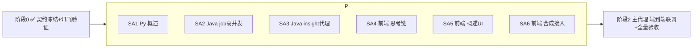

# 百晓工坊 · 视频能力多智能体方案（契约 + 6 路并行作战）

> 状态：阶段 0（契约冻结 + 讯飞验证）已完成；阶段 1（6 路 subagent 并行）待启动。
> 本文件是 6 路 subagent 的**唯一事实源**。契约冻结后不私改；要改先全局同步。

## 1. 目标（三件事，画像驱动）

1. **B站视频「基于学生问题的概述 + 关键时间点」**：不是写笔记，而是针对学生问题概述某视频、给出可点击跳转的关键时间点（时间戳）。
2. **百晓工坊视频合成**：几张图片 + TTS 语音讲解 → 短视频（异步、高并发）。
3. **思考链双层显示**：缩略=当前「工作室人物」在干什么；点击=全员流水线（任务进度/工具调用/中间产物/执行状态）。**不展示 LLM 原始 chain-of-thought。**

全程注入学生画像（`ProfileSnapshot`：认知风格/易错点/学情洞察/记忆/水平）。

## 2. 已定决策

| 决策点 | 选择 |
|---|---|
| 合成编排/高并发 | **Java 端** 异步 job 队列 + 线程池 worker + SSE 进度；Python 只管生成期 |
| B站时间点数据源 | **官方 AI 总结(get_ai_conclusion)+分P 优先**；拿不到只给概述、**不编造秒数** |
| 智能体粒度 | **lite**：只新增 `VideoInsightAgent`；插画师/配音师/剪辑师作「展示性人物」（重活仍走 Java 讯飞，不额外烧 LLM） |
| 工作室人物形象 | **复用小镇 NPC 头像**，缺图 emoji 兜底 |
| 调度 | 1 批 6 路并行（契约先行解耦） |

## 3. 阶段 0 已交付（本次完成）

| 产物 | 文件 | 状态 |
|---|---|---|
| DB 迁移 media_job | `backend/src/main/resources/db/migration/V160__media_job.sql`（原 V158，因工作区 mainline 已占 V158/V159 改名 V160） | ✅ 已落 |
| graph 概述 schema | `services/pythontopia-graph/pythontopia_graph/schemas/video_insight.py` | ✅ 已落，import 通过 |
| 前端 actor 注册表 | `frontend/src/data/agentActors.ts` | ✅ 已落 |
| 思考链双层骨架 | `frontend/src/components/workshop/AgentStudioStream.vue` | ✅ 已落，可用 |
| SSE 协议扩展 | `frontend/src/composables/useSseStream.ts`（trace 加 role_key/actor_label/message/percent/note；plan node 加 role_key） | ✅ 已落 |
| 讯飞验证脚本 | `scripts/verify_xfyun.py` | ✅ 已落 |
| 讯飞实测 | TTS=OK(17712B mp3, x4_yezi) / TTI=OK(396650B jpg) | ✅ 凭据有效、服务已开通 |

前端 `npm run typecheck` 通过；graph schema 导入通过。

## 4. 契约冻结（各端按此实现）

### 4.1 DB（已落 V160，原 V158 因撞号改名）
`media_job(id,user_id,kind,status,fingerprint,spec_json,progress_json,asset_id,error_code,created_at,updated_at)`。
`status∈{PENDING,RUNNING,SUCCESS,FAILED}`；`progress_json={phase,sceneIndex,sceneTotal,roleKey,message,percent}`；`asset_id→media_asset(id)`。

### 4.2 HTTP 端点

**视频概述**
- graph：`POST /agents/video/bilibili/insight`，body=`VideoInsightRequest`，resp=`VideoInsightResponse`（snake_case，见 `schemas/video_insight.py`）。
- Java 代理：`POST /api/videos/bilibili/insight`（需认证），body=`{bvid,question,kcCodes}`，resp camelCase=`{bvid,overview,keyPoints:[{tSec,label,source}],basedOn,degraded}`。

**视频合成 job**
- `POST /api/media/storyboard/video/jobs`（需认证），body=现有 `StoryboardVideoRequest` → `202 {jobId,status,cached,assetId?}`（命中幂等缓存时 `cached=true,status=SUCCESS,assetId` 直给）。
- `GET /api/media/jobs/{id}`（需认证）→ `{jobId,status,progress,assetId?,url?,errorCode?}`（轮询兜底）。
- `GET /api/media/jobs/{id}/stream`（需认证，前端用 `useSseStream` 走 fetch+JWT，非 EventSource）→ SSE `plan`/`trace`/`result`/`error`；`result={jobId,assetId,url}`。

### 4.3 SSE actor 协议（已扩展，向后兼容）
- `trace`：`{node,phase,status,elapsed_ms, role_key?,actor_label?,message?,percent?,note?}`
- `plan.nodes[]`：`{node,agent_label,kind, role_key?}`
- 后端发 `role_key` 时前端直接用；不发则前端按 `node` 经 `agentActors.nodeToRoleKey` 回退推断。

### 4.4 工作室人物 role_key（已落 `agentActors.ts`）
`video_navigator/timeline_checker/director/illustrator/narrator/editor/librarian/critic/safety/orchestrator/designer/tutor`。合成期后端 worker 必须用：`illustrator`(出图)/`narrator`(配音)/`editor`(合成)。概述期：`video_navigator`/`timeline_checker`。

### 4.5 防幻觉红线（所有相关 Track 必守）
- 视频时间点 `t_sec` 只能来自真实 outline/分P，`timeline_grounding` 剔除非法；拿不到→空、不编造。
- TTS/TTI 缺失/失败 → `degraded=true` 占位，不伪造。
- 不伪造课件页码/引用。

## 5. 六路 Subagent 任务单（1 批并行）

### SA1 · Python · 视频概述（Track A）
- 新建 `agents/video_insight_agent.py`：`VideoInsightAgent`，输入请求 + 视频元数据(标题/简介/pages/ai_conclusion outline) + 画像，LLM 产出 `overview` + 候选 `key_points`；注入 `personalization_messages(profile_snapshot)`。
- 新建 `nodes/timeline_grounding.py`：校验 `key_point.t_sec ∈ {outline timestamps ∪ pages 起始秒}`，剔除非法并定 `based_on`。
- 新建 `routes/video_insight.py`：`POST /agents/video/bilibili/insight`；取数复用 `routes/video.py` 的 bilibili-api 惰性 import 模式（`video.Video(bvid)`：`get_info`/`get_pages`/`get_ai_conclusion`，17.x API；拿不到 outline→`based_on=metadata_only`,`key_points=[]`）。
- `main.py` 注册 `video_insight_router`（append 一行）。
- 测试 `tests/test_video_insight_route.py`：monkeypatch 取数+provider，覆盖①有 outline→真实点 ②无 outline→空+overview ③LLM 不可用→degraded ④幻觉时间点被剔除。
- 验收：`pytest -q`。

### SA2 · Java · 媒体 job 高并发（Track B）
- `media/domain/MediaJob.java` + `MediaJobRepository`（JdbcTemplate，参考 `MediaAssetRepository`）。
- `MediaJobService`：fingerprint=sha256(spec)，命中 `user+fingerprint` 已 SUCCESS→直接 `cached`；否则入库 PENDING + 提交线程池。
- 并发：`ThreadPoolTaskExecutor`(core 2–3) + 讯飞 `Semaphore`（TTS/TTI 各限 2–3 路，配置 `pythontopia.media.compose.*`）。
- `StoryboardComposeWorker`：消费 job，逐镜 `imageService.generate`(illustrator)→`ttsService.synthesize`(narrator)→`buildClip`→`concat`(editor)；每步回写 `progress_json` 并发布 SSE 进度。**把 `StoryboardCompositionService.compose` 拆出 `ProgressSink` 回调重载**（旧 compose 调新重载传 no-op，保持向后兼容）。
- `MediaJobController`：3 个端点（见 4.2），SSE 用 `SseEmitter`，发 `plan(role_key)`+`trace(role_key,message,percent)`+`result/error`。
- 测试：`MediaJobServiceTest`（幂等命中、状态流转），mock imageService/ttsService 与 ffmpeg 不可用/可用两路径。
- 验收：`mvn test` + 空库迁移。

### SA3 · Java · B站 insight 代理（Track C）
- `video/BilibiliInsightController`：`POST /api/videos/bilibili/insight`，转发 graph（参考现有 `BilibiliVideoController` 怎么调 graph search + `GraphServiceProperties`）。
- DTO：请求/响应（snake→camel）。
- 测试：mock graph 响应。验收：`mvn test`。

### SA4 · 前端 · 思考链双层完善（Track D）
- 增强 `AgentStudioStream.vue`（阶段0 已给可用骨架）：动画、错误态、edge case。
- 在 `WorkshopChat.vue` 把现有 `ThinkingStream` 用法切到/并存 `AgentStudioStream`（resource 流 + orchestrator 流）。
- 单测 `tests/components/AgentStudioStream.spec.ts`：缩略/展开、role 映射、缺图 emoji 兜底、percent。
- 验收：`typecheck`+`test`。**只碰 AgentStudioStream + WorkshopChat 思考链挂载处**。

### SA5 · 前端 · B站概述 UI（Track E）
- `api/bilibiliVideo.ts` 增 `fetchBilibiliInsight(bvid,question,kcCodes)`。
- `BilibiliVideoCards.vue` 每卡加「AI 讲解/看点」按钮 → 展开新建 `VideoInsightView.vue`（overview + key_points，点击跳 `bilibili.com/video/{bvid}?t=秒`）。insight 用普通 http（loading 态即可）。
- 单测。验收：`typecheck`+`test`。

### SA6 · 前端 · 合成接入工坊（Track F）
- `api/media.ts` 增 job 端点（create/get；SSE 用 `useSseStream('/api/media/jobs/{id}/stream')`）。
- `StoryboardView.vue` 加「一键合成短视频」→ 创建 job → 订阅进度 → `AgentStudioStream` 显示插画师/配音师/剪辑师 → 完成内联 `<video src=/api/media/assets/{id}>`。
- 单测。验收：`typecheck`+`test`。

> 前端 3 路文件边界互不重叠：D=AgentStudioStream+WorkshopChat 思考链挂载；E=BilibiliVideoCards+VideoInsightView+api/bilibiliVideo；F=StoryboardView+api/media。共享的 `AgentStudioStream` 已由阶段0 提供可用骨架，E/F 直接引用不阻塞。

## 6. 调度

## 7. 验收矩阵
Python `pytest -q` ｜ Java `mvn test`+空库迁移 ｜ 前端 `typecheck`/`test`/`lint` ｜
端到端：①问视频→概述+可点时间点 ②STORYBOARD→一键合成→思考链见插画师/配音师/剪辑师→出 mp4 ③思考链缩略/展开双层 ④画像不同→产出不同。
