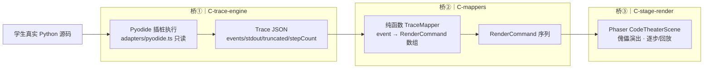
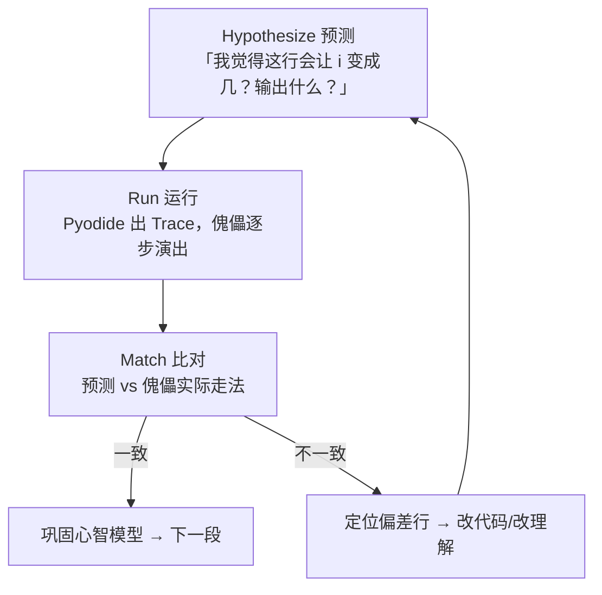
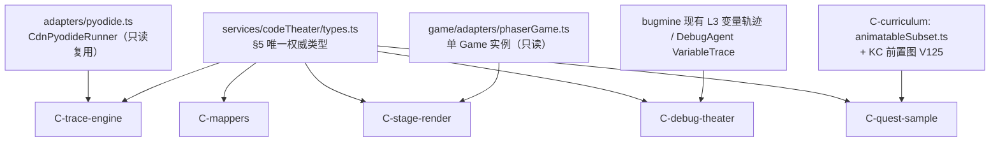

# 代码剧场（Code Theater）蓝图 — 2026-06-13

> 归属：`docs` agent（只写文档）。本文是**主契约**
> `docs/plans/2026-06-13-parallel-build-contracts.md` §5（代码剧场共享 TS 契约）的设计蓝图，
> 一切类型以编排者预置的 `frontend/src/services/codeTheater/types.ts` 为**唯一权威**，
> 本文不新增、不重定义任何类型；所有 C 系列 agent **import 该 types.ts**。

---

## 1. 一句话定位

**代码剧场**：把学生写的真实 Python 跑出来的「执行轨迹」翻译成像素小镇里一只**代码傀儡**的演出——
变量、循环、分支、函数栈、列表、字典、异常这些**看不见的 notional machine**，被傀儡一步步「走给你看」。
错题矿洞里的失败提交，则把这套演出接成**调试剧场**：让学生先看懂机器到底怎么执行的，再去改。

> 它不是「给代码配个动画装饰」。它是把抽象执行模型**外化为可见、可逐步、可重放**的舞台，
> 服务的是理解，不是好看（见 §3 Habgood 内在整合）。

---

## 2. 核心概念

### 2.1 trace 驱动的代码傀儡

- 学生代码先在 **Pyodide** 真跑（前端即时、不入库），过程被**插桩**记录成结构化 `Trace`。
- `Trace` 经一组**纯函数 mapper** 翻译成 `RenderCommand[]`。
- Phaser 的 `CodeTheaterScene` 顺序消费 `RenderCommand[]`，驱动傀儡在「机关广场」上演出。
- 学生可**逐步 / 回放 / 变速**，每一步都对得上源码的某一行（`step ↔ line`）。

### 2.2 错题矿洞 → 调试剧场

- 错题矿洞（`BugMinePanel.vue`）现有 **L3「变量轨迹」卡**已经在展示 `variableTrace.payload`（纯文本 JSON）。
- 调试剧场把这层升级：用同一套傀儡演出，把**失败提交的执行过程**演出来，
  尤其把「你以为的」与「实际跑的」差异**可视化对照**（呼应 L2 反例 / L4 错误假设卡）。
- 数据可来自前端 Pyodide 重放，或后端 `DebugAgent` 已产出的 `VariableTrace`（见 §7、§9）。

---

## 3. 理论锚点（为什么这样设计）

| 理论 | 主张 | 在代码剧场的落地 |
|---|---|---|
| **James Paul Gee**：情境化意义 | 词义/概念在**具体情境**中才被真正习得 | 「变量=架上的牌子」「循环=环形跑道」把抽象符号放进可操作情境 |
| **Gee**：身份 | 学习者以某种**身份**投入 | 学生是「指挥傀儡的人」，对自己的代码负责、有掌控感 |
| **Gee**：低成本失败 | 失败要**廉价且可重来** | 跑错只是傀儡绊倒（`stumble`），可立刻回放重试；错题矿洞天然是低成本失败场 |
| **notional machine** | 学习者需要一个**关于计算机如何执行**的正确心智模型 | 剧场就是 notional machine 的**外化实体**：可见数据、可见控制流 |
| **Bret Victor**：Learnable Programming | 程序要**可见数据、可见时间、无隐藏状态** | `Trace` 显式记录每步状态；舞台让「时间」可逐步可回放（types.ts 文件头已写明此原则） |
| **Sean Habgood**：内在整合（intrinsic integration） | 反对「巧克力裹西兰花」——玩法和学习若两张皮，学习被绕过 | 演出的**每个动作都承载一个执行语义**，没有纯装饰动画；看懂演出 = 看懂执行 |

> **反「巧克力裹西兰花」红线**：任何无执行语义的动画一律不做（呼应 AGENTS.md「不做无教育目的的装饰系统」）。
> 傀儡的每一步都必须能映射回 `Trace` 的某个事件。

---

## 4. 三段桥架构

三座桥**单向、无环、可独立测试**，与主契约 §2 文件归属一一对应：

| 桥 | agent | 产出/消费 | 关键约束 |
|---|---|---|---|
| 桥① 轨迹生成 | **C-trace-engine** | 产出 `Trace` | 只读 `pyodide.ts`、`types.ts`；不碰 scenes/mappers |
| 桥② 事件映射 | **C-mappers** | `TraceEvent → RenderCommand[]` | **纯函数、无副作用、可 fixture 测**；不碰 trace/game |
| 桥③ 舞台渲染 | **C-stage-render** | 消费 `RenderCommand[]` | Phaser 动态对象隔离在 adapter；不碰 services/codeTheater |

> 解耦红利：mapper 是纯函数，给定 `TraceEvent + MapContext` 必产出确定 `RenderCommand[]`，
> 可脱离 Pyodide 与 Phaser 用 fixture 单测（主契约 §6「自己模块单测跑绿」即可）。

### 4.1 关键数据结构（**引用** types.ts，不重定义）

- `Trace`：`{ version:1, source, events:TraceEvent[], stdout, truncated, stepCount }`。
- `TraceEvent`：含 `step`（0 基自增）、`line`（1 基），按 `kind` 带额外字段（§6 表）。
- `RenderCommand`：`{ step, action:RenderAction, payload:Record<string, string|number|boolean>, durationMs }`。
- `MapContext`（只读）：`{ variables, callDepth, defaultDurationMs }`，引擎维护、mapper 只读。
- `TraceMapper = (event, ctx) => RenderCommand[]`；`MapperRegistry = Partial<Record<kind, mapper>>`，
  **缺省 kind 回退单条 `move_to_line`**。

---

## 5. 步数预算与可观测的死循环（呼应 harness 预算理论）

- 轨迹生成默认上限 **`MAX_TRACE_STEPS = 2000`**（types.ts 已导出常量）。
- 超出即置 `truncated = true` 并**停止记录**，防死循环把内存/前端打爆。
- 死循环本身**必须可观测**：截断后由舞台演「傀儡原地无限踱步」的提示，而不是静默卡死或白屏。
- 这与 A 系列 `harness` 的「步数/预算」理论同源（主契约 §5.5）：**有限预算 + 越界可见**。

---

## 6. notional machine 映射表（事件 → 舞台隐喻）

> 左列 `TraceEvent.kind` 与右列 `RenderAction` 均为 types.ts 冻结值，本表只做语义对应，不引入新枚举。
> 任一未列/未知 kind → 回退 `move_to_line`（registry 缺省，§4.1）。

| `TraceEvent.kind` | 事件关键字段 | `RenderAction` | 舞台隐喻（notional machine 外化） |
|---|---|---|---|
| `line` | line | `move_to_line` | 傀儡走到「脚本梯」的该行，当前行发光 |
| `assign` | varName / value / scope | `set_var` | 在「变量架」上举牌/翻牌，显示该变量当前值 |
| `loop_iter` | loopId / loopType / iter / varName | `walk_loop` | 绕「环形跑道」跑一圈，圈数计数 +1，嵌套循环用 `loopId` 区分跑道 |
| `branch` | cond / result / lineTaken | `take_branch` | 在「岔路口」按 true/false 选一条路走，走向 `lineTaken` |
| `call` | funcName / args / depth | `enter_call` | 走进「调用侧屋」（调用栈 +1），门牌写函数名与实参 |
| `return` | funcName / value / depth | `exit_call` | 带返回值走出侧屋（调用栈 −1） |
| `list_op` | op / target / position / value / lengthAfter | `list_push` / `list_pop` / `list_index` | 列表是一排「箱子」：append 长出新箱、pop 移除箱、index/set 走到第 i 号箱 |
| `dict_op` | op / target / key / value | `dict_set` | 字典是「格子墙」：在 key 格写入 value（get/set/del 对应取/写/清格） |
| `output` | text | `speak` | 傀儡对「公告板」喊话（print → 写公告板） |
| `input` | prompt / value | `speak` | NPC 递纸条（prompt）→ 傀儡收下并填入（value）；无专用 action，用 `speak` 承载提示语 |
| `exception` | excType / message | `stumble` | 在出错行**绊倒冒火花**，显示异常类型与信息（低成本失败的可视化） |
| —（任务世界条件）| — | `world_effect` | 任务达成/世界状态变化的可见反馈（C-quest-sample 的世界条件检查器触发） |

> 说明：`input` 在 types.ts 中无独立 `RenderAction`，蓝图用 `speak`（递/收纸条）承载，
> 必要时由 mapper 追加一条 `set_var` 展示读入值——这属 mapper 内部组合，不改契约枚举。

---

## 7. HRM 式学习内循环

把代码剧场嵌进一个**紧致的内循环**，让「看懂」成为可重复的动作。HRM 在此读作
**Hypothesize → Run → Match**（预测 → 运行 → 比对修正）：

- **预测**先行，呼应 Bret Victor「先猜再验」；让学生对执行结果**有立场**，而非被动看动画。
- **低成本失败**（Gee）：不一致不是惩罚，是循环的燃料；错题矿洞天生处在这个循环里。
- 与 §5 预算呼应：每次 Run 都是有限步数的可重放片段，循环可无限次廉价重来。

---

## 8. 资产复用图

- **Pyodide adapter**（`pyodide.ts` 的 `PyodideRunner`/`CdnPyodideRunner`）：只读复用，C-trace-engine
  在其外层做插桩，不改 adapter（保持业务层无 Pyodide 直接依赖的既有隔离）。
- **Phaser 单例**（`phaserGame.ts`）：C-stage-render 复用单 Game 实例，禁止另起 `Phaser.Game`（AGENTS.md）。
- **错题矿洞**：C-debug-theater 复用 `BugMinePanel` 既有 L3 轨迹数据形态与 `DebugAgent` 的
  `VariableTrace`（`steps:[{line, locals}]` + `truncated`，见 `schemas/debug.py`），不改 bug-mine 核心逻辑。
- **可动画子集 + KC 前置图**：C-curriculum 维护 `animatableSubset.ts`，圈定哪些 KC 适合上剧场（§9）。

---

## 9. 可动画子集边界与诚实风险

代码剧场**不是**通用 Python 可视化器，只覆盖 `packId=43` 初学者**可动画子集**（types.ts 注释已点明）。

**纳入（MVP 子集）**：标量赋值、整数/字符串、`if/elif/else`、`for`/`while`、`range`、
一层函数调用与返回、`list` 基本操作、`dict` 基本操作、`print`/`input`、常见运行时异常。

**暂不动画（诚实划界，避免假装能演）**：

| 边界 | 原因 | 处理 |
|---|---|---|
| 深递归 / 大数据结构 | 步数爆炸、舞台拥挤 | 受 `MAX_TRACE_STEPS` 截断，演「截断提示」而非假装演完 |
| 类 / 对象 / 继承 / 装饰器 | 超出初学者子集，隐喻易误导 | 不纳入 MVP；mapper 回退 `move_to_line`（只走行，不强行演语义） |
| 多文件 / import 第三方 | Pyodide 环境与隐喻复杂 | 子集外，不支持 |
| 并发 / IO / 网络 / 随机 | 非确定性，破坏「可重放」 | 子集外；`input` 仅支持预置 stdin（adapter 已是逐行 stdin） |
| 浮点细节 / 大整数表现 | 可视化易误导精度直觉 | 仅展示 `repr` 字符串（types.ts 的 value 已是 repr 字符串），不演内部表示 |

> **诚实原则**：宁可某语义「只走行不演细节」（回退 `move_to_line`），也不编造一个看似合理但与真实执行
> 不符的动画——那会植入错误的 notional machine，比不演更糟。

---

## 10. MVP 切片

按「能端到端跑通一个最小演出」切，逐片可独立合入：

1. **MVP-0 类型就绪**（编排者已置 `types.ts`）：C 系列全部 import，约定锁定。
2. **MVP-1 轨迹引擎**（C-trace-engine）：插桩 `line/assign/loop_iter/branch`，产出 `Trace`，
   `MAX_TRACE_STEPS` 截断生效，fixture 单测绿。
3. **MVP-2 核心 mapper**（C-mappers）：覆盖 §6 表前 4 行 + `output/exception`，纯函数单测绿。
4. **MVP-3 舞台**（C-stage-render）：脚本梯 + 变量架 + 环形跑道 + 岔路口 + 公告板 + 绊倒，
   逐步/回放控制；消费 fixture `RenderCommand[]` 即可演。
5. **MVP-4 函数栈与容器**（C-mappers + C-stage-render）：`call/return`（侧屋/栈）、`list_op/dict_op`（箱子/格子墙）。
6. **MVP-5 调试剧场**（C-debug-theater）：错题矿洞失败提交接入，演「实际 vs 预期」对照（复用 L3/DebugAgent 数据）。
7. **MVP-6 样板任务 + 子集表**（C-quest-sample + C-curriculum）：用 `world_effect` 串起世界条件，
   `animatableSubset.ts` 圈定可上剧场的 KC。

---

## 11. 与契约 §5 的对应关系（核对清单）

| 主契约 §5 条目 | 本蓝图落点 | 一致性 |
|---|---|---|
| §5.1 事件类型 11 种 kind | §6 映射表逐行覆盖 | ✅ 未增删 kind |
| §5.2 `Trace` 结构 | §4.1 引用，§5 预算字段 `truncated/stepCount` | ✅ 原样引用 |
| §5.3 `RenderCommand` | §4.1 + §6 右列 `RenderAction` | ✅ payload 仅基元 |
| §5.4 `TraceMapper` 签名 + 缺省回退 | §4.1 + §6「未知 kind → move_to_line」 | ✅ |
| §5.5 `MAX_TRACE_STEPS=2000` + 死循环可观测 | §5 | ✅ |
| §5.6 observability no-op 降级 | 仅 A 系列实现；C 不强依赖，§7 内循环理念呼应预算 | ✅ 不越界引用 |
| §2 文件归属（5 个 C agent） | §4 表 + §8 复用图逐一标注归属 | ✅ 未跨域 |

---

## 12. 归属与边界声明（本文不越界）

- 本文仅为设计蓝图，**不含任何代码改动**，不创建/修改 `types.ts` 或任何 C 域代码文件。
- 所有类型、枚举、常量均**引用** types.ts 既有定义，未新增主契约 §5 未冻结的接口。
- 课程曲线（哪些 KC 何时上剧场）属 **C-curriculum** 的
  `docs/plans/2026-06-13-code-theater-curriculum.md`，本文不替其拍板，仅在 §9/§10 给出子集边界建议。
- 防幻觉/教育优先红线（§3、§9）与 AGENTS.md、主契约 §0 一致：无执行语义的装饰一律不做。
