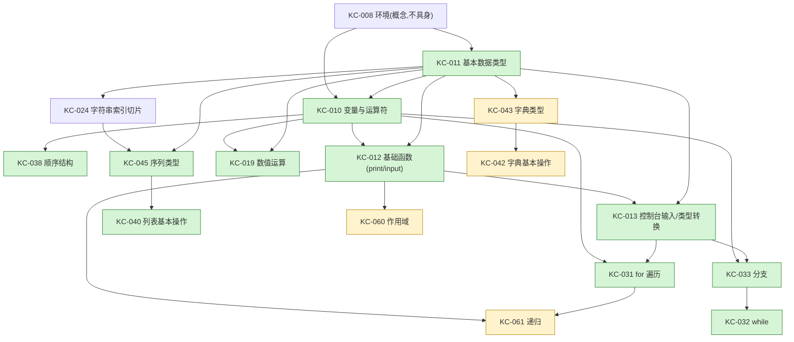

# 代码剧场课程映射（packId=43）与具身任务序列

> 归属：C-curriculum（见 `docs/plans/2026-06-13-parallel-build-contracts.md` §2）。
> 配套数据：`frontend/src/data/codeTheater/animatableSubset.ts`（本文件的可执行真相源）。
> 共享类型：`frontend/src/services/codeTheater/types.ts`（只读契约，§5）。
>
> 目标（C3+C4）：① 用真实 KC 给"可富动画的 Python 构造子集"定边界；
> ② 按 packId=43 的**前置图**把这些构造排成"在能力临界区引入新构造"的具身任务序列。
> 红线：只引用真实存在的 KC（PY43-KC-001..065），不伪造课件/知识点；只做数据+文档。

---

## 1. 数据来源与一个必须诚实声明的前置图分歧

| 来源 | 文件 | 内容 |
|---|---|---|
| KC 中文名 | `frontend/src/data/kcNames.ts` | 65 个 KC code→中文名（学生不见原始编码） |
| KC 元数据（**语义前置**） | `data/course-pack-43/json/course_kc.json` | 每个 KC 的 `prerequisite_codes`、`chapter_id`、`summary_markdown`、`page_refs` |
| 运行期前置图 | `backend/.../db/migration/V125__course_kc_prerequisite_seed.sql` | 回填 `course_kc.prerequisite_codes` |
| 图谱消费方 | `services/pythontopia-rag/.../index/kc_graph.py`、`services/pythontopia-graph/.../agents/path_planner_agent.py` | 沿前置边做 RAG 扩展 / DAG 拓扑排序 |

### ⚠️ 诚实声明：语义前置图 ≠ 当前 DB 运行期前置图

调研发现两份"前置图"并不一致，本文档**采用语义前置图**排序，理由与风险如下：

- **语义前置图**（`course_kc.json`）是人工标注、教育意义正确的 DAG。例如
  `PY43-KC-010 变量与运算符 ← [KC-008 环境, KC-011 基本数据类型]`、
  `PY43-KC-031 for 循环 ← [KC-010, KC-013]`、`PY43-KC-061 递归 ← [KC-012, KC-031]`。
- **运行期前置图**：种子迁移 `V006__course_pack_seed_43.sql` 把所有 KC 的
  `prerequisite_codes` 写成**空数组**（实测全仓 `ARRAY['PY43-KC...]` 出现 0 次），
  随后 `V125` 在"列为空"时回填了一条**线性链**（按 kc_code，KC-002←001、KC-003←002…
  KC-065←064）。故 PathPlanner / RAG 当前拿到的是**线性链，而非语义图**。

> 影响：本文档与 `animatableSubset.ts` 的任务排序基于**语义前置图**（教育正确）。
> 若希望 PathPlanner 的真实排序与本序列一致，**需要 Phase 2 用语义前置回填 DB**
> （重生成 V006 或新增一条迁移把 `course_kc.json` 的 `prerequisite_codes` 落库）。
> 见 §6 集成点。本 agent 不触碰后端迁移（非归属域），仅如实标注。

---

## 2. 可富动画构造 → 真实 KC 映射

下表 12 项即 `animatableSubset.ts::ANIMATABLE_SUBSET`，覆盖 `types.ts` 全部 11 种
`TraceEventKind`（line/assign/loop_iter/branch/call/return/list_op/dict_op/output/input/exception）。
「适合具身？」列回答 C4 的核心问题。

| # | 构造 | 主 `TraceEventKind` | 保真度 | MVP | 主锚 KC（真实） | 适合具身？为什么 | 世界隐喻 |
|---|---|---|---|---|---|---|---|
| 1 | 顺序执行（逐行） | `line` | rich | ✅ | KC-038 顺序结构 | 适合。执行流本身就是"位置"，傀儡走脚本梯天然可见 | 脚本梯（当前行发光） |
| 2 | 变量与赋值 | `assign` | rich | ✅ | KC-010 变量与运算符 / KC-011 / KC-038 | 极适合。"可见数据"的核心：值绑定=翻牌 | 变量名牌 |
| 3 | 算术运算 | `assign` | partial | ✅ | KC-010 / KC-019 数值类型与运算 / KC-025 | 部分适合。结果可演，但子表达式求值无独立事件 | 演算台→名牌 |
| 4 | 输入/输出 | `output` `input` | rich | ✅ | KC-012 基础函数 / KC-013 控制台输入 / KC-023 | 适合。print/input 是程序与小镇的可见接口 | 公告板 / NPC 递纸条 |
| 5 | 分支 if/elif/else | `branch` | rich | ✅ | KC-033 分支结构 / KC-035 / KC-034 | 极适合。"动态行为"的核心：条件真假→选路一目了然 | 岔路口 + 真假牌 |
| 6 | while 循环 | `loop_iter` `branch` | rich | ✅ | KC-032 while 循环 | 极适合。环形跑道+条件灯；**死循环可观测**是杀手级 | 环形跑道 + 条件灯 |
| 7 | for 循环/遍历 | `loop_iter` | rich | ✅ | KC-031 for 循环与遍历 / KC-037 / KC-036 | 极适合。逐格前进 + 循环变量翻值，具身 payoff 最高 | 站点跑道 |
| 8 | 列表与索引 | `list_op` | rich | ✅ | KC-040 列表基本操作 / KC-044 / KC-045 | 极适合。可变数据结构=长箱/搬箱/走到第 i 号箱 | 编号箱排 |
| 9 | 字典 | `dict_op` | rich | ⬜ Phase 2 | KC-043 字典类型 / KC-042 / KC-041 | 适合，但视觉系统更重、章节靠后 | 格子墙（key→value） |
| 10 | 函数与调用栈/递归 | `call` `return` | rich | ⬜ Phase 2 | KC-061 递归 / KC-060 作用域 / KC-059 / KC-012 | 适合且高价值（递归=嵌套侧屋），但最复杂 | 调用侧屋（栈 ±1） |
| 11 | 字符串基础 | `loop_iter` `assign` | partial | ⬜ | KC-024 索引切片 / KC-022 / KC-023 / KC-020 | 部分适合。遍历/索引可复用事件，方法内部不演 | 字符珠链 |
| 12 | 异常浮现 | `exception` | partial | ⬜ | KC-013 / KC-032 / KC-040（易错点） | 部分适合，且**非教学构造**：见下注 | 绊倒冒火花 |

**关于第 12 项（异常）的诚实边界**：packId=43 **没有 try/except/raise 的 KC**。
`exception` 事件只用于**运行时错误浮现**（傀儡在出错行绊倒），服务 Bug 矿洞 / debug-theater。
上列 KC 是"错误常发地"（KC-013 类型转换易 ValueError、KC-032 死循环、KC-040 列表越界
IndexError），**不是异常处理教学点**。不要把它当成"教 try/except"的任务。

---

## 3. 按前置图排出的具身任务序列（能力临界区引入）

下图为**语义前置图**投影到"可动画构造"的拓扑分层（箭头 = 前置依赖；只画相关 KC）。
分层 = "前置刚被满足"的时刻，正是引入新构造的能力临界区（ZPD）。

拓扑分层与对应具身任务：

| 阶 | 构造（任务） | 主 KC | 解锁条件（前置已掌握） | 章 |
|---|---|---|---|---|
| L0 | ①顺序+变量赋值+算术 | KC-038, KC-010, KC-011, KC-019 | 入口（KC-008 环境为概念，不具身） | 二 |
| L1 | ②输入/输出 | KC-012, KC-013 | KC-010/011 | 二 |
| L2 | ③分支 if/elif/else | KC-033, KC-035, KC-034 | KC-010, KC-013 | 四 |
| L2 | ④for 循环/遍历 | KC-031, KC-037 | KC-010, KC-013（与③同阶） | 四 |
| L3 | ⑤while 循环 | KC-032, KC-036 | KC-033（分支）→ 必在③之后 | 四 |
| L2–3 | ⑥字符串基础 | KC-024, KC-022, KC-023 | KC-011/024（富动画排在循环后，依赖"遍历"心智） | 三 |
| L3 | ⑦列表与索引 | KC-040, KC-044, KC-045 | KC-045 ← KC-011, KC-024 | 五 |
| L3 | ⑧字典 | KC-043, KC-042, KC-041 | KC-011（教学上接列表后） | 五 |
| L4 | ⑨函数与调用栈/递归 | KC-061, KC-060, KC-059 | KC-012 + KC-031（for） | 七 |
| 横切 | ⑩异常浮现 | KC-013/032/040（易错点） | 真实判题失败时触发（Bug 矿洞支线，非主线线性步） | — |

要点：
- **③分支与④for 同阶**（都只需 KC-010+KC-013）。先③后④是本教材"顺序→选择→循环"
  的经典框架；若以演示冲击力优先，可把④提到③之前（for 的逐格动画 payoff 更强）。
- **⑤while 必须在③分支之后**：语义前置 `KC-032 ← KC-033`（while 与循环分支结合）。
- **⑩异常**不进主线线性序列：它是横切的"错误浮现"，由真实失败提交在 Bug 矿洞触发。

---

## 4. 不适合具身的 KC（优雅降级，不编造动画）

`animatableSubset.ts::OUT_OF_SUBSET_DEGRADATION` 把这条边界做成可执行声明：
**凡不在子集内的语义 → 降级为 `line` 逐行高亮（move_to_line）+ 真实 stdout（speak），
不为其编造专属舞台动作。** 剧场承诺"演得诚实"，不承诺"演得全"。

代表性"教得到、但不富动画"的真实 KC：

| KC | 名称 | 为什么不富动画 |
|---|---|---|
| KC-064 / KC-065 | 类和对象 / OOP 三特性 | 对象图、方法解析、动态分派超出傀儡舞台原语 |
| KC-048 / KC-050 / KC-052 | 文件读写 | I/O 副作用无对应舞台道具，只演 stdout |
| KC-054 | lambda | 表达式级匿名函数，不单开调用屋 |
| KC-047 / KC-046 | 集合类型 | 无序去重语义，`list_op`/`dict_op` 均不贴切 |
| KC-062 / KC-056 / KC-057 | 模块/包/pip | 导入副作用、命名空间不富动画 |
| 第一、三章史/编码类 | KC-001..007、KC-017、KC-026..030 等 | 概念/历史/进制知识，本无"执行过程"可演 |

这条边界是诚实底线：学生写了任意代码，剧场也至少能正确"走完每一行 + 显示真实输出"，
绝不假装能把 OOP/文件/集合演成专属动画。

---

## 5. 结论：MVP 必达清单 + 建议首批 3 个具身任务

### MVP 必达构造（8 项，`mvpConstructs()`）

覆盖第 2~5 章"看→学"核心，足以独立讲清 notional machine 的"可见数据 + 动态行为"：

1. **顺序执行（逐行步进）** — `line` — KC-038
2. **变量与赋值** — `assign` — KC-010 / KC-011 / KC-038
3. **算术运算** — `assign`(partial) — KC-010 / KC-019 / KC-025
4. **输入/输出（print/input）** — `output` `input` — KC-012 / KC-013 / KC-023
5. **分支 if/elif/else** — `branch` — KC-033 / KC-035 / KC-034
6. **while 循环**（含死循环截断可观测） — `loop_iter` `branch` — KC-032
7. **for 循环/遍历（含 range）** — `loop_iter` — KC-031 / KC-037 / KC-036
8. **列表与索引** — `list_op` — KC-040 / KC-044 / KC-045

Phase 2（高价值后置）：字典（`dict_op`，KC-043/042/041）、函数调用栈/递归（`call`/`return`，
KC-061/060/059）。部分/降级：字符串基础（partial）、异常浮现（Bug 矿洞）。

### 建议首批 3 个具身任务（位于前置图入口，MVP，能力临界区）

| 任务 | 构造 | 真实 KC | 世界隐喻 | 验收（看得见什么） |
|---|---|---|---|---|
| **① 脚本梯与名牌** | 顺序 + 变量赋值 + 算术 | KC-038, KC-010, KC-011, KC-019 | 脚本梯 + 变量名牌 + 演算台 | 傀儡逐行走，每次赋值名牌翻出新值 |
| **② 公告板与纸条** | input / print | KC-012, KC-013 | 公告板(print) + NPC 递纸条(input) | print 文本贴上公告板；input 取值回填名牌 |
| **③ 岔路口** | 分支 if/elif/else | KC-033, KC-035, KC-034 | 岔路口 + 真假牌 | 条件真假牌亮起，傀儡按结果选一条路走 |

> 说明：①②③ 是语义前置图的最小入口闭包（① 无具身前置；② 依赖 KC-010/011；
> ③ 依赖 KC-010/013，刚在 ①② 掌握），严格落在"能力临界区"。
> **for 循环（任务④，KC-031）与③同阶且具身 payoff 最高**——若比赛演示要更强的
> "数据在动"观感，建议演示链路至少跑到①→④，或把④与③对调作为首批第 3 个任务。

---

## 6. 给 Phase 2 编排者的集成点与风险

1. **下游引用**：`quest`/`stage`/`mapper` 通过 `AnimatableConstructId`、`constructsForKc()`、
   `constructsForEventKind()`、`mvpConstructs()` 选材与做降级判定，import 自
   `@/data/codeTheater/animatableSubset`。`OUT_OF_SUBSET_DEGRADATION.fallback*` 是 C-mappers
   缺省回退（`move_to_line`+`speak`）的权威依据，应与 mapper 注册表的缺省分支对齐。
2. **前置图分歧（风险，需决策）**：当前 DB（V006 空 → V125 线性链）与本文档采用的语义前置图
   不一致。若要 PathPlanner 真实排序 == 本具身序列，需用 `course_kc.json` 的语义
   `prerequisite_codes` 回填 DB（重生成 V006 或新增迁移）。属后端迁移域，本 agent 未触碰。
3. **不伪造校验**：`ALL_REFERENCED_KC_CODES` 列出子集引用到的全部真实 KC code（去重升序），
   可与 `kcNames.ts::KC_NAMES` / `course_kc.json` 交叉校验"无伪造 KC"。
