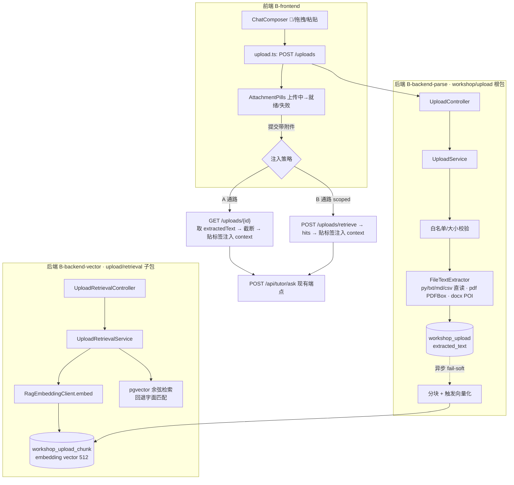

# 百晓工坊文件解析设计（A+B）— 2026-06-13

> 归属：`docs` agent（只写文档）。本文是**主契约**
> `docs/plans/2026-06-13-parallel-build-contracts.md` §3 的设计落地说明，
> 一切 schema / 接口以主契约为准；本文不新增任何主契约未冻结的接口。
> 实现分属 **B-backend-parse**（上传根包 + V162）、**B-backend-vector**
> （retrieval 子包 + V163）、**B-frontend**（工坊上传 UX）三个 agent，
> 跨域接线由编排者在 Phase 2 完成。

---

## 1. 目标与范围

百晓工坊（`/api/workshop` + `WorkshopChat.vue`）已是「16 工具分发中枢」。本特性给它补一条
**学生上传自己的文件**的能力，分两个目标：

| 代号 | 目标 | 落点 | 性质 |
|---|---|---|---|
| **A** | 解析上传文本，作为**单次答疑的临时上下文** | 注入 `/api/tutor/ask` 的 `context` 字段 | 即用即走，不要求持久检索 |
| **B** | 把上传内容沉淀为**个人语料**，按问题做 **scoped 语义检索**，常驻「我的书房」 | `workshop_upload` + `workshop_upload_chunk` + 检索端点 | 持久、可被多次问答复用 |

A 让「我贴段代码/报错/题面，你就着这个讲」成立；B 让「我上传的讲义/笔记，之后随时能被检索到」成立。
二者复用同一套上传与解析管线，只在「是否分块入库 + 是否向量检索」上分叉。

**非目标（本期不做）**：把上传内容当成课件 evidence、跨用户共享语料、OCR 图片、
音视频转写、整库重排（rerank）、上传内容写回画像。

---

## 2. 名词与边界

- **上传（upload）**：一次成功的文件解析产物，落 `workshop_upload` 一行，含 `extracted_text` 全文。
- **分块（chunk）**：B 通路把 `extracted_text` 切成若干段，落 `workshop_upload_chunk`，逐块向量化。
- **scoped 检索**：检索范围**永远限定在当前学生自己的上传**（`user_id` 过滤），可再用 `uploadIds` 收窄。
- **带标签 context 通道**：上传内容注入答疑时必须包裹成
  `【你上传的《{filename}》】\n{text}` 形式，与课件证据物理隔离（见 §9 红线）。

---

## 3. 架构与数据流



**关键点**：A、B 两条通路最终都只往**现有** `/api/tutor/ask` 的 `context` 注入文本，
**不新增、不修改任何 tutor 端点**（主契约 §3.5）。后端 graph 对「上传」无感知。

---

## 4. 复用资产盘点

本特性几乎全部能力都能从仓库已落地的「记忆流向量」栈平移，**不要重新发明**：

| 需求 | 复用资产（仓库现存） | 复用方式 |
|---|---|---|
| pgvector 扩展 + 余弦索引范式 | `V141__memory_embedding.sql`（`CREATE EXTENSION vector` + `vector(512)` + `ivfflat … vector_cosine_ops`） | V163 照搬建表与索引写法 |
| 文本向量化客户端 | `RagEmbeddingClient`（`POST {ragUrl}/embed`，`X-Internal-Token`，全异常降级 `Optional.empty()`） | B-backend-vector 直接注入 `EmbeddingClient` 接口 |
| embed 失败 fail-soft 旁路 | `MemoryEmbeddingWriter`（`@Async embedAndStore`，512 维校验，失败仅 `log.warn`） | 上传向量化沿用「异步 + 失败不阻断」结构 |
| 向量读写 / 余弦检索 SQL | `JdbcMemoryEmbeddingRepository`（`?::vector` 字面量写入、`embedding::text` 读出、`<=>` 距离、`1 - 距离` 相似度） | upload chunk 仓库照抄 literal/`<=>` 手法 |
| 学生鉴权范式 | `ResourceWorkshopController`（`@CurrentUser CurrentUserPrincipal` + `requireStudent` + `BusinessException`） | 上传/检索 controller 同款 `requireStudent` |
| 答疑上下文注入口 | `WorkshopChat.runAsk(question, kcCodes, context)` → `TutorAskRequest.context` | A/B 注入文本即拼进 `context` 实参 |
| 统一输入框契约 | `ChatComposer.vue` 的 `ComposerSubmitPayload`、`@`/`/` 菜单 | 扩 `attachments` 字段（向后兼容，默认 `[]`） |

> 维度对齐：`V141` 用 `vector(512)` 对齐 `BgeSmallEmbedder`，`MemoryEmbeddingWriter.MEMORY_EMBEDDING_DIM=512`、
> `model="pythontopia-rag/embed"`。因此 V163 的 `embedding vector(512)` 与 `model` 列与之同源，
> embed 服务一旦不可用时与记忆流同样退化（chunk 入库、向量留空、检索回退字面匹配）。

---

## 5. 表结构（迁移）

> 迁移号由主契约 §1 冻结：`V162__workshop_upload.sql`（B-backend-parse 独占）、
> `V163__workshop_upload_chunk.sql`（B-backend-vector 独占）。仓库现存最高为 `V161`，二者均未占用。
> 列名按主契约 §3.1 **冻结**，下方 DDL 为符合该冻结的建议写法（最终以建表 agent 落地为准）。

### 5.1 V162 — `workshop_upload`

```sql
-- Purpose: 学生上传文件的解析产物（A 通路上下文源 / B 通路分块源）。
-- Tables affected: 新建 workshop_upload。
-- Irreversible risk: 回滚 DROP TABLE workshop_upload；解析文本可由原文件重传重建，无判题/画像数据损失。
CREATE TABLE IF NOT EXISTS workshop_upload (
  id             BIGSERIAL PRIMARY KEY,
  user_id        BIGINT      NOT NULL,
  filename       VARCHAR(255) NOT NULL,
  ext            VARCHAR(16) NOT NULL,
  byte_size      BIGINT      NOT NULL,
  extracted_text TEXT        NOT NULL DEFAULT '',
  char_count     INTEGER     NOT NULL DEFAULT 0,
  line_count     INTEGER     NOT NULL DEFAULT 0,
  status         VARCHAR(16) NOT NULL,          -- PENDING | READY | FAILED
  error          TEXT,
  created_at     TIMESTAMPTZ NOT NULL DEFAULT now()
);

CREATE INDEX IF NOT EXISTS idx_workshop_upload_user
  ON workshop_upload (user_id, created_at DESC);
```

`status` 状态机：`PENDING`（已收文件、解析中）→ `READY`（解析成功，`extracted_text` 就绪）
／`FAILED`（解析失败，`error` 记原因，不抛 500）。

### 5.2 V163 — `workshop_upload_chunk`

```sql
-- Purpose: 上传文本分块 + 512 维向量，支撑 B 通路个人语料 scoped 余弦检索。
-- Tables affected: 依赖 vector 扩展（V141 已 CREATE EXTENSION）；新建 workshop_upload_chunk。
-- Irreversible risk: 回滚 DROP TABLE workshop_upload_chunk；向量可由 extracted_text 重新分块向量化重建。
CREATE TABLE IF NOT EXISTS workshop_upload_chunk (
  id          BIGSERIAL PRIMARY KEY,
  upload_id   BIGINT      NOT NULL REFERENCES workshop_upload(id) ON DELETE CASCADE,
  user_id     BIGINT      NOT NULL,
  chunk_index INTEGER     NOT NULL,
  text        TEXT        NOT NULL,
  embedding   vector(512),                      -- 可空：embed 离线时仍入库，检索回退字面匹配
  model       VARCHAR(64),
  created_at  TIMESTAMPTZ NOT NULL DEFAULT now()
);

CREATE INDEX IF NOT EXISTS idx_workshop_upload_chunk_cos
  ON workshop_upload_chunk USING ivfflat (embedding vector_cosine_ops) WITH (lists = 100);

CREATE INDEX IF NOT EXISTS idx_workshop_upload_chunk_user
  ON workshop_upload_chunk (user_id);
```

`embedding` **可空**是有意为之：对齐 `RagEmbeddingClient` fail-soft 语义——embed 服务不可用时，
chunk 文本照样入库（`embedding` 留 NULL），检索阶段对 NULL 向量行回退到 `text ILIKE` 字面匹配，
保证「上传成功 = 至少能字面命中」，不因下游 RAG 抖动而丢数据。

---

## 6. REST / DTO 契约

> 全部取自主契约 §3.2 / §3.3，前缀 `/api`、JWT、`requireStudent`（同 `ResourceWorkshopController`）。

### 6.1 端点

| 方法 & 路径 | 归属 | 入参 | 出参 |
|---|---|---|---|
| `POST /api/workshop/uploads` | B-backend-parse | multipart，字段名 `file` | `UploadDto` |
| `GET /api/workshop/uploads` | B-backend-parse | — | `UploadDto[]` |
| `GET /api/workshop/uploads/{id}` | B-backend-parse | path id | `UploadDetailDto`（含 `extractedText`） |
| `DELETE /api/workshop/uploads/{id}` | B-backend-parse | path id | 204 |
| `POST /api/workshop/uploads/retrieve` | **B-backend-vector**（独立 `UploadRetrievalController`） | `{query, uploadIds?, topK?}` | `{hits:[…]}` |

检索端点**独立 controller** 是主契约 §2 文件归属要求（B-backend-vector 不碰 upload 根包），
两个 agent 共享 `workshop_upload_chunk` 表列（§3.1）但代码物理隔离。

### 6.2 DTO（camelCase JSON）

```jsonc
// UploadDto（列表/创建返回）
{ "id": 12, "filename": "main.py", "ext": "py",
  "byteSize": 2048, "charCount": 1500, "lineCount": 60,
  "status": "READY", "error": null }

// UploadDetailDto = UploadDto + extractedText
{ "...UploadDto": "...", "extractedText": "def main(): ..." }

// POST /uploads/retrieve 请求
{ "query": "我那段排序为什么死循环", "uploadIds": [12], "topK": 5 }

// POST /uploads/retrieve 响应
{ "hits": [
  { "uploadId": 12, "filename": "main.py", "chunkIndex": 3,
    "text": "while i <= n: ...", "score": 0.83 }
] }
```

`error` 仅在 `status=FAILED` 时非空；`UploadDto` 的 `error?` 与 `UploadDetailDto` 的 `extractedText`
是仅有的两处差异（详情接口才回全文，列表不回全文以省带宽）。

---

## 7. 解析与限制（B-backend-parse）

> 全部取自主契约 §3.4。解析层建议命名 `FileTextExtractor`（接口）+ 各扩展名实现，置于上传根包。

| 项 | 约束 | 越界响应 |
|---|---|---|
| 扩展名白名单 | `.py .txt .md .csv .pdf .docx` | 其余 **415 Unsupported Media Type** |
| 文件大小 | ≤ 5 MB | 超出 **413 Payload Too Large** |
| 文本类（py/txt/md/csv）| UTF-8 直读 | 编码异常 → `status=FAILED` |
| `.pdf` | Apache **PDFBox** 抽取文本 | 抽取失败 → `status=FAILED` |
| `.docx` | Apache **POI** 抽取文本 | 抽取失败 → `status=FAILED` |
| 解析异常 | 一律落 `status=FAILED + error`，**不抛 500** | 前端 pill 显示错误 + 重试 |

`pom.xml` 由 B-backend-parse 在确需时新增 **PDFBox**、**POI** 两依赖，**取最新稳定版，禁止臆造版本号**
（主契约 §3.4：依赖版本由实现 agent 在落地时按仓库实际可用版本确定，本文不写死版本）。

### 7.1 char/line 统计与截断口径

- `char_count = extracted_text.length()`（字符数，非字节）；`line_count` 为换行计数。
- 全文存库**不截断**（`extracted_text TEXT`）；截断只发生在**注入答疑时**（前端，见 §8.A）。
- 这样 B 通路检索仍可命中长文档后半段，而 A 通路只取前 ~6000 字进单次对话。

---

## 8. 前端接线（B-frontend）

主契约 §3.5：**不需要改后端 tutor 端点**，全部在前端把文本拼进现有 `context`。

### 8.A 通路（即用即走）

1. 学生提交带附件的消息时，前端对每个就绪附件 `GET /uploads/{id}` 取 `extractedText`。
2. 截断到 **~6000 字**，超出在尾部追加「（已截断）」。
3. 包成 `【你上传的《{filename}》】\n{text}`，拼进 `WorkshopChat.runAsk` 的 `context` 实参，
   走现有 `/api/tutor/ask`。

### 8.B 通路（scoped 检索）

- **仅当**本会话有上传，或学生用 `@` 引用了某个上传时，才调 `POST /uploads/retrieve` 取 `hits`。
- hits 同样以带标签文本（`【你上传的《{filename}》片段】…`）拼进 `context`。
- **默认不每问都检索**：避免无关问答也塞进个人语料噪声、也省一次 embed 往返。

### 8.3 类型与气泡

- `ComposerSubmitPayload` 增加
  `attachments: { id:number; filename:string; ext:string; charCount:number }[]`（默认 `[]`，向后兼容；
  现有 `text/manualKcCodes/contextHint/forcedIntent` 不动）。
- `ChatMessage` 增加 `attachments` 字段：发送后 pill 渲染在**用户气泡上方**。

### 8.4 上传 UX（仿 Claude Code 网页版）

| 交互 | 行为 |
|---|---|
| 📎 按钮 | 打开系统文件选择（多文件） |
| 拖拽 | 全 composer 区覆盖层高亮，松手即上传 |
| 粘贴 | 粘贴板含文件时直接作为上传 |
| 每个文件一枚 pill | 类型图标 + 文件名 + 大小 |
| 上传中 | pill 显示 spinner |
| 就绪 | 显示行数 / 字数（来自 `UploadDto`） |
| 失败 | 显示错误 + 重试按钮 |
| 删除 | pill 上「×」移除（前端态；如已入库可调 `DELETE /uploads/{id}`） |

新文件：`frontend/src/api/upload.ts`（DTO 类型 + 调用）、
`frontend/src/components/workshop/AttachmentPills.vue`；改动 `ChatComposer.vue` / `WorkshopChat.vue`。

---

## 9. 防幻觉红线（全员，主契约 §0）

1. **上传内容只进带标签 context 通道**，永远不混入 `packId=43` 课件 evidence / `evidence_page_ids` / 引用页码。
   课件证据来自后端 RAG，与上传语料是两个物理隔离的来源。
2. 注入文本必须显式标注来源（`【你上传的《…》】`），让模型与学生都清楚「这是你给的料，不是教材」。
3. 上传检索（B）只在**当前学生自己的** `user_id` 范围内，绝不跨用户、不进班级聚合。
4. 上传内容**不写回画像**、不作判题依据；判题唯一权威仍是服务端 submission（主契约 §0）。
5. 解析失败 fail-soft，不得伪造内容兜底（宁可 `FAILED`，不可编造文本）。

---

## 10. 测试计划

> 各 agent 在自己范围内跑绿（主契约 §6）；下表为建议覆盖点。

| 层 | 用例 | 断言 |
|---|---|---|
| B-backend-parse | 上传 `.py/.txt/.md/.csv` | `status=READY`，`charCount/lineCount` 正确 |
| B-backend-parse | 上传 `.pdf`（PDFBox）/`.docx`（POI） | 抽到非空文本，`status=READY` |
| B-backend-parse | 上传 `.exe` 等非白名单 | **415** |
| B-backend-parse | 上传 >5 MB | **413** |
| B-backend-parse | 损坏 pdf | `status=FAILED + error`，**不抛 500** |
| B-backend-parse | 鉴权 | 非学生角色 **403**（`requireStudent`） |
| B-backend-vector | embed 可用 → 检索 | 命中相关 chunk，`score` 为 `1 - 余弦距离` |
| B-backend-vector | embed 离线 | chunk 仍入库、`embedding` NULL，检索回退字面匹配不报错 |
| B-backend-vector | scoped 隔离 | A 学生检索不到 B 学生上传 |
| B-frontend | typecheck | `npm run typecheck` 绿（`attachments` 默认 `[]` 不破坏现有提交） |
| B-frontend | 组件测试 | pill 上传中→就绪→失败重试三态；A 注入文本含 `【你上传的《…》】` 与截断标记 |

---

## 11. 剩余风险与 Phase 2 集成点

1. **`context` 长度上限冲突（高优先，必须在 Phase 2 拍板）**：
   主契约 §3.5 要求 A 通路截断到 **~6000 字**注入 `context`，
   但现存 `TutorAskRequest.context` 标注 `@Size(max = 2000)`（见
   `backend/src/main/java/com/pythontopia/tutor/dto/TutorAskRequest.java`）。
   6000 字注入会被后端校验**拒绝**。本文按主契约写 6000，但**如实标注此冲突**：
   Phase 2 需二选一——（a）B-backend 放宽该 `@Size`（属 tutor 域，非本期 B-parse/vector 归属），
   或（b）把 A 通路截断口径下调到 2000 以内。**本期 docs 不擅自改契约数值，留待编排者裁决。**

2. **向量化触发时机**：主契约 §3.4 要求向量化「异步、fail-soft」。
   B-backend-parse 解析成功后需触发分块+向量化，而 chunk 表 / 向量逻辑属 B-backend-vector 域。
   集成点：解析完成 → 发一个内部信号（如领域事件 / 直接调 vector 域的服务方法）触发分块入库。
   两 agent 的接缝（谁建 chunk 行、谁调 embed）需 Phase 2 明确，避免双写或漏写。

3. **`ivfflat` 索引与小数据量**：`lists=100` 在上传量很小时召回可能波动（与 V141 同问题）。
   首发数据量小，可接受；后续按量调 `lists` 或换 `hnsw`。

4. **删除一致性**：`workshop_upload_chunk.upload_id` 外键 `ON DELETE CASCADE`，
   `DELETE /uploads/{id}` 自动级联清 chunk，无需应用层补删。

5. **分块策略**：主契约只冻结了 chunk 表列，未冻结分块算法。建议按字符窗口（如 ~800 字、重叠 ~100 字）
   切分，具体由 B-backend-vector 落地，不属本文冻结范围。

6. **演示链路影响**：本特性为**增量**，A 通路只是把文本拼进现有 `context`，B 通路是独立新端点；
   不改 tutor graph、不改判题、不改画像。除风险 1 的 `@Size` 冲突外，对现有比赛演示链路无破坏性改动。

---

## 12. 归属与边界声明（本文不越界）

- 本文仅为设计说明，**不含任何代码改动**。
- 表/DTO/端点/限制全部对齐主契约 §3，未新增主契约未冻结的接口；DDL 为符合冻结列名的建议写法。
- 与契约的唯一「偏差标注」是 §11.1 的 `context` 长度冲突——这是**如实暴露既有代码与契约的不一致**，
  而非本文擅自改动契约，处置权交 Phase 2 编排者。
