# Pythontopia 中国软件杯 A3 提交文档

项目名称: Pythontopia

赛题方向: A3 基于大模型的个性化资源生成与学习多智能体系统开发

文档类型: 系统开发说明书 + 测试说明书 + 部署与演示说明

版本日期: 2026-07-04

赛题网页: https://www.cnsoftbei.com/content-3-1286-1.html

导出建议: A4 纵向, 中文宋体或思源宋体 10.5pt, Mermaid 图表导出为图片后插入。按本文件的章节、表格和图示导出, 预计约 55 到 65 页。

## 0. 文档定位

Pythontopia 是面向高校 Python 初学者的网页版像素学习小镇。系统以大模型、多智能体、学习者画像、课程 RAG、知识图谱、代码判题和游戏化任务为核心, 将 Python 语言基础课程改造成一个可以持续理解学生、生成资源、规划路径、评估效果并触发补救的个性化学习系统。

本文件严格对齐赛题网页中 文档及其他要求 的三层要求:

1. 需求层: 调研新时代大学生 Python 学习痛点, 明确技术需求结合点。
2. 技术开发层: 描述 Agent 设计、开发、测试、部署、UI、集成、优化、前沿 AI 融合方式和创新实践。
3. 表达层: 通过流程图、架构图、数据表、测试表和案例说明, 保证逻辑清晰、证据充分、可运行可验证。

本文以当前代码实现为依据, 不以历史文档为唯一依据。关键代码锚点包括:

- `backend/src/main/java/com/pythontopia/workshop/controller/ResourceWorkshopController.java`
- `backend/src/main/java/com/pythontopia/workshop/service/ResourceWorkshopService.java`
- `backend/src/main/java/com/pythontopia/learner/profile/service/ProfileService.java`
- `backend/src/main/java/com/pythontopia/learner/profile/service/PassiveProfileService.java`
- `backend/src/main/java/com/pythontopia/path/service/LearningPathService.java`
- `backend/src/main/java/com/pythontopia/recommendation/service/LearnerRecommendationService.java`
- `backend/src/main/java/com/pythontopia/submission/service/SubmissionService.java`
- `backend/src/main/java/com/pythontopia/bugmine/service/BugMineService.java`
- `backend/src/main/java/com/pythontopia/media/StoryboardCompositionService.java`
- `services/pythontopia-graph/pythontopia_graph/graph/resource_graph.py`
- `services/pythontopia-graph/pythontopia_graph/schemas/resource.py`
- `services/pythontopia-rag/pythontopia_rag/routes/query.py`
- `frontend/src/pages/workshop/WorkshopPage.vue`
- `frontend/src/pages/profile/ProfilePage.vue`
- `frontend/src/pages/mainline/StageLearnPage.vue`
- `frontend/src/app/router.ts`

<div style="page-break-after: always;"></div>

## 1. 页数规划与阅读地图

| 导出页码 | 内容主题 | 主要图表 |
|---:|---|---|
| 1 到 3 | 封面、摘要、赛题符合性 | 赛题符合性矩阵 |
| 4 到 8 | 需求分析、学生痛点、场景定义 | 用户画像表、痛点优先级图 |
| 9 到 14 | 总体架构、技术路线、数据流 | 总体架构图、闭环流程图 |
| 15 到 22 | 多智能体系统、资源生成、RAG | Agent 协作图、资源流水线图 |
| 23 到 29 | 学习者画像、个性化路径、推荐 | 画像维度表、路径规划图 |
| 30 到 36 | 学习闭环、练习判题、Bug 矿洞 | 状态机、评测闭环图 |
| 37 到 43 | 多模态、前端交互、教师端 | UI 导航图、教师数据表 |
| 44 到 50 | 数据库、接口、安全、反幻觉 | API 表、安全门控图 |
| 51 到 56 | 测试说明书、质量保障、验收 | 测试覆盖表、风险矩阵 |
| 57 到 60 | 部署、开源合规、AI Coding 说明、总结 | 部署拓扑图、评分映射表 |

### 1.1 一句话摘要

Pythontopia 用 大模型多智能体 + GraphRAG 证据链 + 8 维动态学习者画像 + 真实 Python 判题 + 游戏化任务, 把一次性课件浏览升级为可追踪、可补救、可解释的个性化学习闭环。

### 1.2 项目创新关键词

| 关键词 | 含义 | 对应代码或模块 |
|---|---|---|
| 教育数字孪生 | 用学习事件持续更新学生状态, 而不是只做一次问卷 | `PassiveProfileService`, `LearningEventListener` |
| 多智能体资源工坊 | 不同 Agent 生成讲义、导图、练习、代码实验、阅读、动画分镜 | `resource_graph.py`, `schemas/resource.py` |
| GraphRAG 证据引用 | 课程页、知识点图谱、向量检索、BM25 融合检索共同提供证据 | `pythontopia_rag/routes/query.py`, `index/fusion.py` |
| 反幻觉发布门 | 证据审查、幻觉检测、语义扎根、安全审查共同决定能否发布 | `resource_graph.py`, `safety_critic.py` |
| 学习闭环评估 | 看、学、练、测、补救、换资源、重规划串成闭环 | `ResourceWorkshopService`, `MasteryEvaluator` |
| 流式工具编排 | 工具调用、Agent 节点和结果流式展示, 提升可解释性 | `OrchestratorController`, `ToolCallTimeline.vue` |
| 多模态合成 | 文生图、TTS、分镜、ffmpeg 合成短视频或动画式学习资源 | `MediaAssetController`, `StoryboardCompositionService` |
| 班级弱点修复 | 教师端用 KC 热力图和一键补救包服务真实课堂 | `TeacherDashboardController`, `RemediationService` |

<div style="page-break-after: always;"></div>

## 2. 赛题要求符合性矩阵

赛题要求系统基于大模型和前沿 AI 技术, 自动生成多模态学习资源, 构建学习者画像, 提供个性化学习路径, 并具有良好 UI、安全、测试、部署和文档。本项目的逐项符合情况如下。

| 赛题要求 | Pythontopia 实现 | 证据模块 | 符合度 |
|---|---|---|---|
| 对话生成学习者画像, 至少 6 个维度 | 实现 8 维画像: 专业背景、知识基础、学习目标、认知风格、学习偏好、易错模式、实践能力、情绪与坚持度 | `ProfileService`, `PassiveProfileService`, `ProfileRadar.vue` | 高 |
| 学习画像动态更新 | 练习、调试、资源反馈、问答、视频观看、任务完成都会触发被动更新 | `LearningEvent`, `PassiveProfileRevisionListener` | 高 |
| 至少 5 类学习资源生成 | 实现 6 类: 讲义、思维导图、练习、代码实验、拓展阅读、动画分镜 | `ResourceType`, `ResourceWorkshopController` | 高 |
| 多智能体协同生成资源 | 资源图包含证据抓取、设计师 Agent、教育评论、证据审查、安全审查、发布决策 | `ResourceGraph` | 高 |
| 个性化学习路径和资源推送 | 基于画像、掌握度、前置关系、失败题、班级任务生成路径与今日推荐 | `LearningPathService`, `LearnerRecommendationService` | 高 |
| 智能辅导 | 提供百晓工坊、RAG 问答、Feynman 教学、Bug 矿洞调试辅导 | `OrchestratorService`, `FeynmanController`, `BugMineService` | 高 |
| 学习效果评估 | 掌握度增量、资源消费检查、正式判题、章测、班级统计 | `MasteryEvaluator`, `SubmissionService`, `ChapterTestPage.vue` | 高 |
| UI 美观、逻辑清晰 | Web 小镇、主线地图、工坊、训练场、画像雷达、教师看板 | `frontend/src/pages`, `router.ts` | 高 |
| 流式输出、Markdown、卡片 | SSE 流式接口、工具时间线、资源卡片、Markdown 渲染页面 | `OrchestratorController`, `ToolCallTimeline.vue` | 中高 |
| 反幻觉和安全 | Evidence page id、grounding result、safety result 入库并参与发布 | `ResourceWorkshopService`, `safety_critic.py` | 高 |
| 响应时间与进度追踪 | SSE、异步媒体任务、长任务状态查询 | `MediaJobController`, `ResourceWorkshopController` | 中高 |
| 开源项目和许可证说明 | 资产许可证、代码许可证、第三方依赖均可单独说明 | `LICENSE-ART.md`, `frontend/public/assets/pixel/LICENSE.md` | 高 |
| 演示视频 7 分钟以内 | 配套提供 6 分钟脚本, 覆盖核心操作和 AI 生成结果 | `docs/presentations/2026-07-04-cnsoftbei-a3-demo-script.md` | 高 |

### 2.1 评分映射

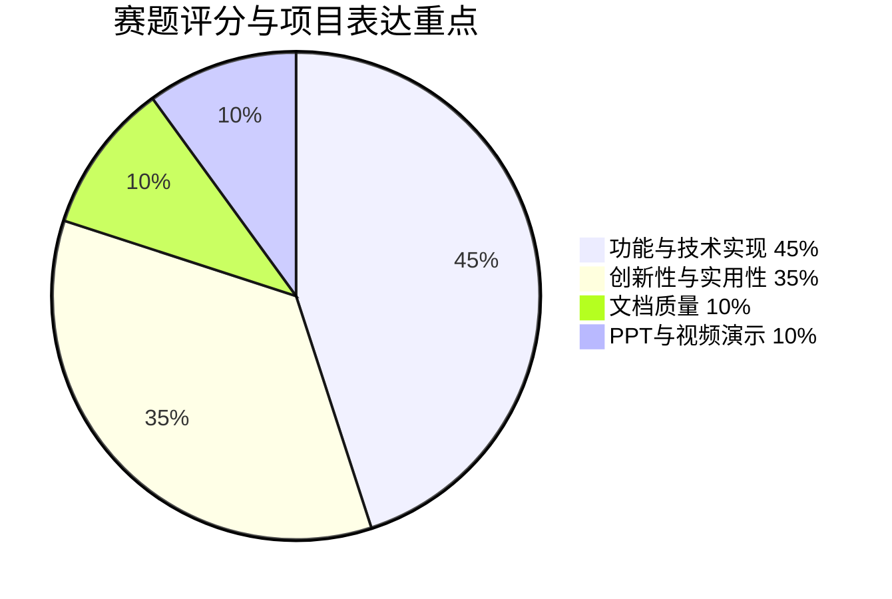

本项目的比赛叙事会把 45% 的功能技术和 35% 的创新实用合并表达为一条闭环: 学生画像驱动资源生成, 资源消费驱动掌握度评估, 掌握度变化反向更新路径和推荐。

<div style="page-break-after: always;"></div>

## 3. 需求分析

### 3.1 新时代大学生 Python 学习痛点

面向非计算机或低年级学生的 Python 课程通常存在以下矛盾:

| 痛点 | 典型表现 | 教学后果 | 系统需求 |
|---|---|---|---|
| 起点差异大 | 有人学过 C 或 Java, 有人第一次接触编程 | 同一讲义对部分学生太浅, 对部分学生太难 | 需要动态学习者画像 |
| 资源静态 | PPT、视频、题库固定 | 学生遇到具体错误时没有即时补救资源 | 需要个性化资源生成 |
| 练习反馈慢 | 学生只知道 WA 或报错, 不知道错在知识点还是思路 | 错误重复出现 | 需要错误模式识别和调试辅导 |
| 路径不清晰 | 学生不知道先补 input 还是 for 循环 | 学习顺序混乱 | 需要个性化路径规划 |
| 教师难以精细化干预 | 班级人数多, 只能看总分 | 难以及时发现共性弱点 | 需要 KC 热力图和补救包 |
| 大模型容易幻觉 | 直接聊天可能编造页码、题意或答案 | 教学可信度下降 | 需要证据链和安全门控 |

### 3.2 目标用户

| 用户 | 核心目标 | 使用入口 | 关键成功指标 |
|---|---|---|---|
| 学生 | 更快理解 Python 基础, 做对题, 修复薄弱点 | 主线小镇、百晓工坊、训练场、Bug 矿洞 | 掌握度提升、失败重试减少、资源完成率提升 |
| 教师 | 看清班级弱点, 快速生成补救材料 | 教师看板、班级任务、补救包 | KC 热力图可解释、任务完成率可追踪 |
| 评委 | 看到大模型系统的真实闭环, 而非单点 Demo | 6 分钟演示链路 | 画像、生成、证据、评估、路径都可操作 |

### 3.3 需求优先级

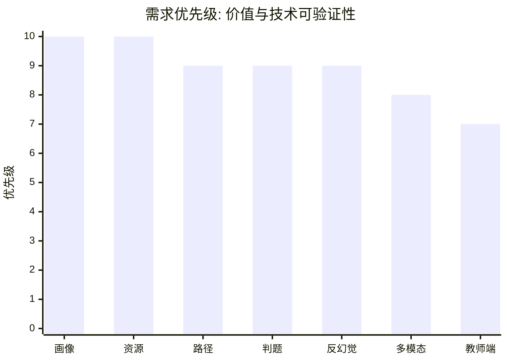

本项目优先保证能够真实改变学习过程的功能, 即画像、资源、路径、练习和评估。多模态与游戏化作为增强体验的入口, 服务于学习闭环, 不作为孤立装饰。

### 3.4 技术需求结合点

| 教育需求 | AI 技术切入点 | 工程实现 |
|---|---|---|
| 理解学生差异 | 对话画像 + 学习事件推断 + 维度雷达 | ProfileAgent, PassiveProfileService |
| 生成适合学生的资料 | 多智能体分工 + 结构化输出 Schema | ResourceGraph, ResourceType |
| 保证内容可信 | GraphRAG + 证据页引用 + 反幻觉节点 | RAG route, grounding critic |
| 根据错误补救 | 判题结果 + 错误模式识别 + DebugAgent | SubmissionService, BugMineService |
| 教师快速干预 | 班级聚合分析 + 一键补救包 | ClassroomDashboardService, RemediationService |
| 长任务可感知 | SSE 流式输出 + 任务进度 | OrchestratorController, MediaJobController |

<div style="page-break-after: always;"></div>

## 4. 总体系统目标

### 4.1 建设目标

Pythontopia 的建设目标不是做一个普通课程网站, 而是构建一个以大模型为核心调度器的学习操作系统。系统把课程内容、学生画像、知识点图谱、练习判题、学习事件和多模态生成统一到一个可追踪闭环中。

核心目标包括:

1. 对每个学生形成可更新的 8 维画像。
2. 根据画像和薄弱知识点自动生成至少 6 类学习资源。
3. 用课程证据和知识图谱约束生成过程, 降低幻觉。
4. 用真实 Python 练习判题作为掌握度评估依据。
5. 用路径规划和今日推荐把学生引导到下一步行动。
6. 用教师端数据把个体学习转化为班级教学决策。

### 4.2 业务闭环

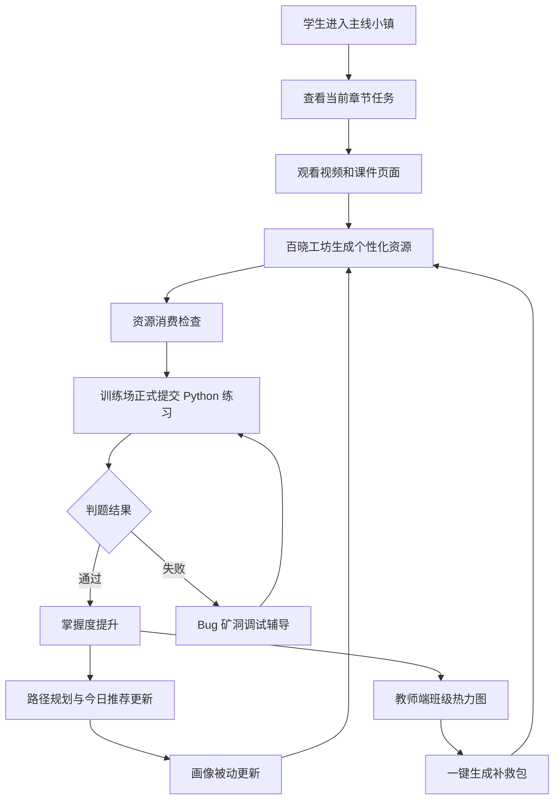

### 4.3 系统边界

本系统聚焦 Python 语言基础课程, 课程包来源为 packId=43。当前内置课程数据包括 7 份文档、561 页、7 章、65 个知识点、46 个示例、39 道题和 34 条视频清单。系统默认不依赖微调模型, 而是通过课程 RAG、结构化 Agent、知识图谱、判题和事件闭环实现可控生成。

<div style="page-break-after: always;"></div>

## 5. 总体架构设计

### 5.1 架构图

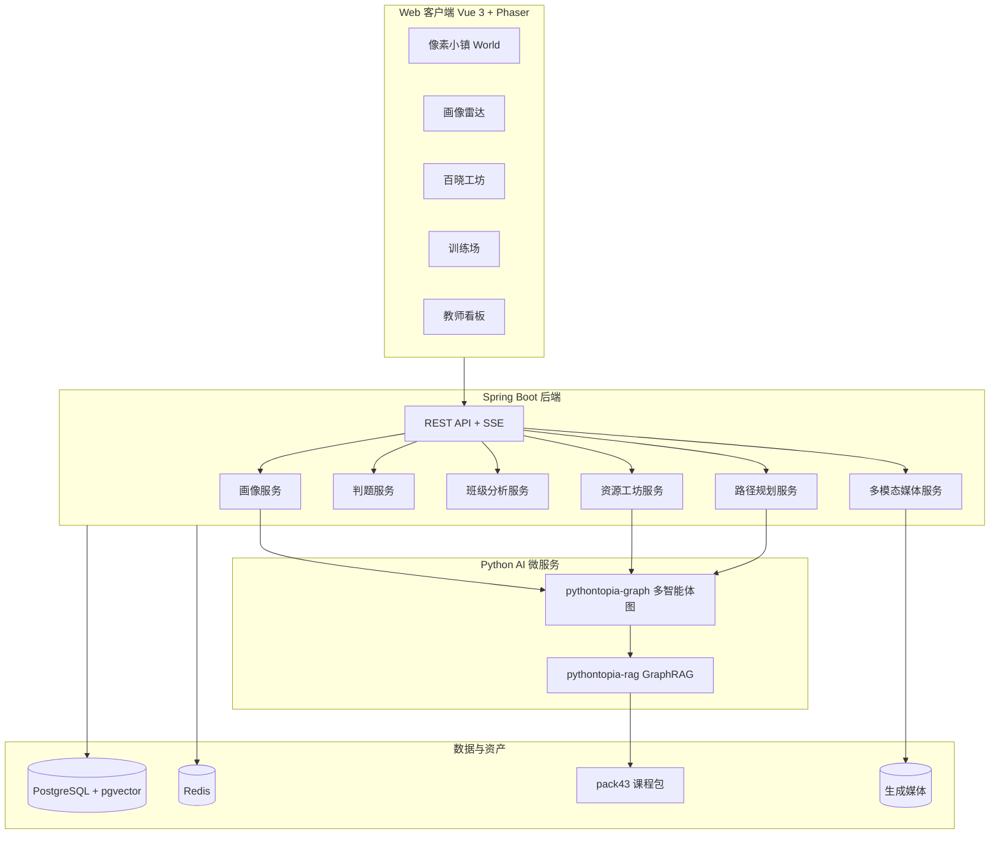

### 5.2 技术栈

| 层级 | 技术 | 说明 |
|---|---|---|
| 前端 | Vue 3, Vite, TypeScript strict, Pinia, Phaser 3 | 小镇、学习页面、工坊、教师端 |
| 后端 | Java 21, Spring Boot, Maven | API、业务服务、SSE、判题、班级统计 |
| AI 服务 | FastAPI, LangGraph 风格状态图, Pydantic Schema | 多智能体资源生成、路径规划、RAG |
| 检索 | pgvector, BM25, RRF, KC 图谱扩展 | GraphRAG 证据检索 |
| 数据 | PostgreSQL, Redis | 持久化画像、资源、学习事件、任务、缓存 |
| 多模态 | 文生图服务、TTS、ffmpeg | 动画分镜、短视频合成 |
| 部署 | Docker Compose, Nginx, ECS | 四应用镜像 + 数据服务 |

### 5.3 架构特点

1. 前后端分离, Web 端负责交互与可视化, 后端负责业务一致性。
2. AI 微服务与主业务解耦, 生成失败时不会破坏正式学习记录。
3. 课程证据统一从 RAG 服务获取, 资源发布必须保留 evidence page ids。
4. 判题结果是学习效果评估核心证据, 不用前端 Pyodide 预览冒充正式成绩。
5. 教师端和学生端共享同一套知识点、掌握度和任务数据。

<div style="page-break-after: always;"></div>

## 6. 数据流设计

### 6.1 资源生成数据流

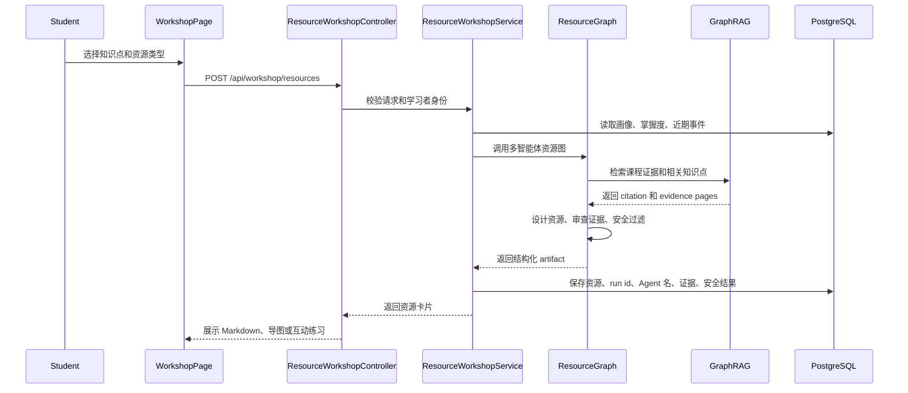

### 6.2 学习事件数据流

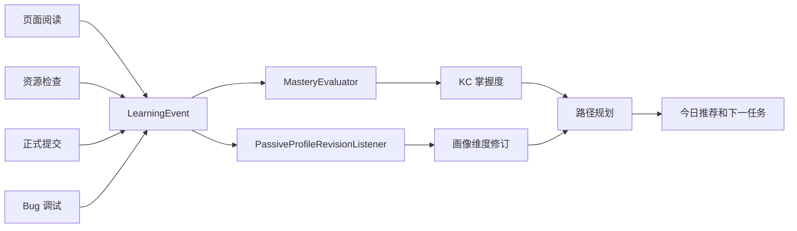

### 6.3 设计原则

数据流设计坚持一个原则: 任何学习状态变化都必须有 evidence。资源生成成功本身不代表学生掌握, 只有通过页面阅读、微测、练习提交、资源反馈等事件闭环后, 才改变掌握度和路径。

<div style="page-break-after: always;"></div>

## 7. 学习者画像系统

### 7.1 八维画像

赛题要求至少 6 个维度, 本系统实现 8 维画像, 覆盖学生背景、学习能力、目标、偏好和情绪坚持度。

| 维度 | 英文字段 | 更新来源 | 用途 |
|---|---|---|---|
| 专业背景 | `major_background` | 对话、自评、班级信息 | 选择解释类比和应用案例 |
| 知识基础 | `knowledge_foundation` | 练习、测验、主线进度 | 决定起点难度 |
| 学习目标 | `learning_goal` | 对话、自评 | 匹配项目案例和路径重点 |
| 认知风格 | `cognitive_style` | 资源反馈、问答偏好 | 决定图解、文字、例题比例 |
| 学习偏好 | `learning_preference` | 资源点击、停留、反馈 | 决定资源类型推荐 |
| 易错模式 | `error_pattern` | 判题失败、Bug 矿洞 | 生成针对性补救 |
| 实践能力 | `practice_ability` | 代码提交、调试记录 | 控制代码实验难度 |
| 情绪与坚持度 | `affect_persistence` | 放弃、重试、回归事件 | 触发鼓励、拆分任务和低压力练习 |

### 7.2 画像生成机制

画像有两个入口:

1. 主动入口: 学生通过自然语言对话回答 ProfileAgent 的问题, 系统提取画像草稿并审查。
2. 被动入口: 学生真实学习过程中产生事件, 系统根据事件类型更新画像维度。

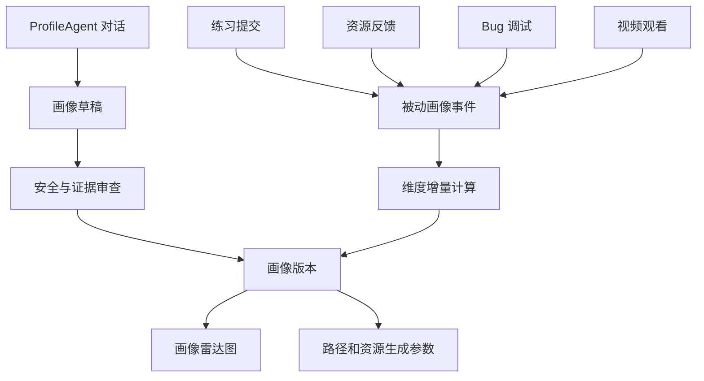

### 7.3 画像可解释性

系统不是只保存一个标签, 而是保存画像修订记录。每次修订都能说明来源: 是一次练习失败、一次资源检查通过、一次视频观看完成, 还是一次学生自评。这样教师和学生都能理解为什么系统推荐某种资源。

<div style="page-break-after: always;"></div>

## 8. 多智能体设计

### 8.1 Agent 列表

系统默认设计了面向学习资源、路径、评价和安全的多智能体集群。

| Agent | 职责 | 典型输入 | 输出 |
|---|---|---|---|
| ProfileAgent | 对话式画像提取 | 学生回答、历史画像 | 画像修订建议 |
| CurriculumMapperAgent | 知识点和课程结构映射 | KC、章节、课件页 | 学习目标与证据范围 |
| ResourceDesignerAgent | 讲义和阅读资源设计 | 画像、KC、证据 | 结构化讲义或阅读材料 |
| MindMapAgent | 思维导图生成 | KC、前置知识、证据 | Mermaid 或节点边结构 |
| PracticeAgent | 个性化练习生成 | KC、掌握度、易错模式 | 题目、提示、解析 |
| CodeLabAgent | 代码实验设计 | 学生实践能力、KC | 代码骨架、测试点、引导 |
| StoryboardAgent | 动画分镜生成 | 概念难点、证据 | 场景脚本、画面、旁白 |
| PathPlannerAgent | 学习路径规划 | 画像、掌握度、前置关系 | 7 天路径与任务 |
| DebugAgent | 错误定位与调试辅导 | 判题失败、代码、反例 | 诊断卡片和修复步骤 |
| GroundingCriticAgent | 证据扎根审查 | 资源草稿、citation | 证据覆盖结论 |
| SafetyAgent | 安全与答案泄露审查 | 资源、练习、代码 | 安全结果 |

### 8.2 资源智能体协作图

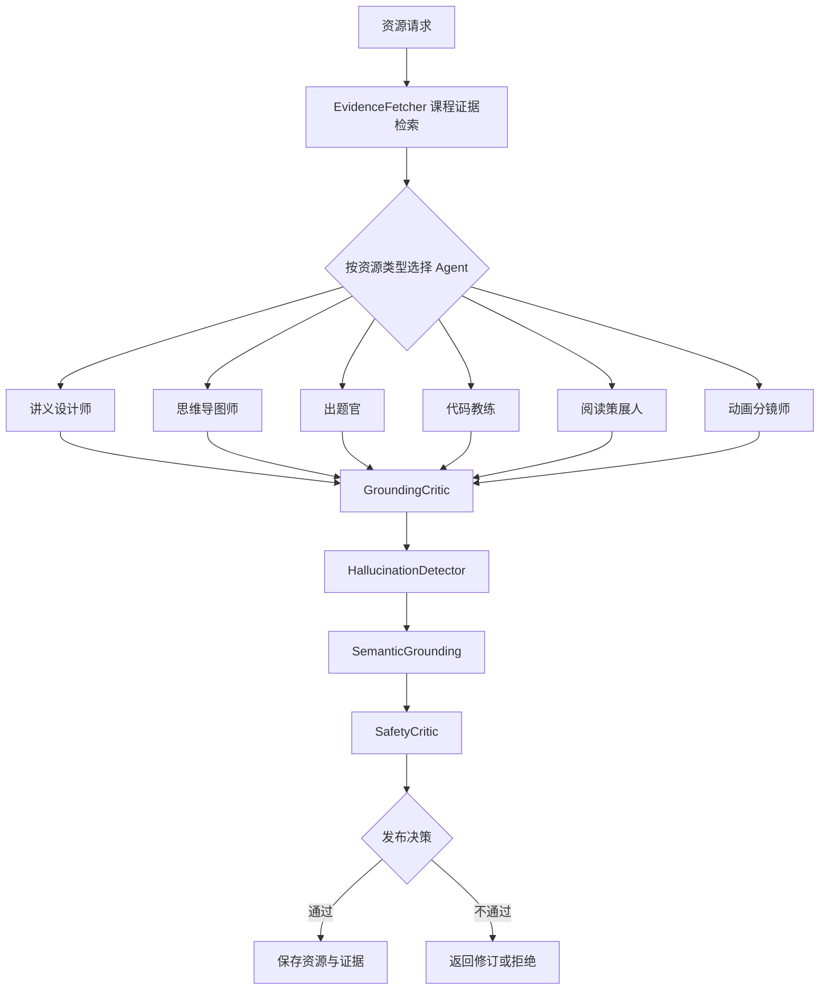

### 8.3 结构化输出

资源 Agent 不直接返回一大段自然语言, 而是按类型输出结构化 artifact。例如:

| 资源类型 | 结构化字段 |
|---|---|
| HANDOUT | 标题、学习目标、关键概念、步骤、例子、检查题 |
| MINDMAP | 节点、边、层级、前置关系 |
| PRACTICE | 题干、输入输出、提示、解析、难度 |
| CODE_LAB | 代码骨架、测试点、实验步骤、常见错误 |
| READING | 阅读材料、延伸链接、课程证据关联 |
| STORYBOARD | 场景、画面、旁白、时长、生成素材提示 |

这种设计让前端可以渲染成卡片、导图、练习、实验和分镜, 也让后端能够对字段进行安全和证据审查。

<div style="page-break-after: always;"></div>

## 9. GraphRAG 与证据链

### 9.1 课程知识底座

系统唯一课程知识底座是 Python 语言基础 packId=43。课程包包含:

| 类型 | 数量 |
|---|---:|
| 课程文档 | 7 |
| 课件页 | 561 |
| 章节 | 7 |
| 知识点 KC | 65 |
| 示例 | 46 |
| 题目 | 39 |
| 视频记录 | 34 |

### 9.2 GraphRAG 检索策略

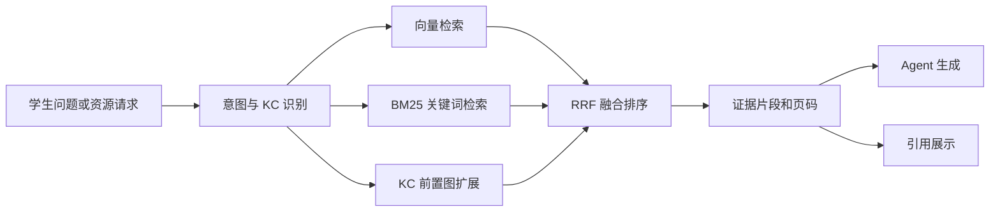

系统将向量检索、关键词检索和 KC 图谱扩展结合。这样可以同时解决三类问题:

1. 学生使用口语化表达时, 向量检索能捕捉语义相似性。
2. 学生提到具体函数或符号时, BM25 能精确命中关键词。
3. 学生当前知识点依赖前置概念时, KC 图谱能补充必要背景。

### 9.3 反幻觉约束

每个发布资源都需要保存:

| 字段 | 含义 |
|---|---|
| run id | 本次 Agent 调用唯一编号 |
| agent name | 产出资源的 Agent 名称 |
| input summary | 输入摘要 |
| output artifact | 结构化资源内容 |
| evidence page ids | 课件证据页 |
| grounding result | 证据扎根结果 |
| safety result | 安全审查结果 |
| graph trace | 智能体图执行轨迹 |
| created time | 生成时间 |

这种设计使资源可以审计、可以回放、可以复测, 也能回答评委关于大模型可信性的追问。

<div style="page-break-after: always;"></div>

## 10. 个性化资源生成

### 10.1 六类资源

赛题要求至少 5 类学习资源, 系统实现 6 类并且全部具备课程证据约束。

| 资源类型 | 面向学习问题 | 适合学生 |
|---|---|---|
| 讲义 HANDOUT | 概念不清, 需要系统解释 | 基础薄弱或首次学习 |
| 思维导图 MINDMAP | 知识结构混乱 | 视觉化学习偏好者 |
| 练习 PRACTICE | 需要巩固和迁移 | 已看过课件但掌握不稳 |
| 代码实验 CODE_LAB | 不会把概念写成代码 | 实践能力较弱者 |
| 拓展阅读 READING | 希望扩展应用场景 | 目标明确或进阶学生 |
| 动画分镜 STORYBOARD | 抽象概念难理解 | 需要多模态解释者 |

### 10.2 个性化参数

资源生成并不是只传入知识点, 而是同时使用以下上下文:

| 上下文 | 作用 |
|---|---|
| 8 维画像 | 控制解释方式、难度和例子风格 |
| 掌握度快照 | 决定补基础还是做进阶 |
| 近期提交记录 | 避免重复错误, 针对失败类型 |
| 最近资源消费 | 避免重复推送, 判断偏好 |
| 班级任务 | 保证个性化不脱离课堂节奏 |
| 课程证据 | 保证生成内容扎根课件 |

### 10.3 资源消费检查

资源生成后不会直接把学生判定为掌握。系统会要求学生完成微测、页面阅读、练习提交或反馈, 然后进入四种决策:

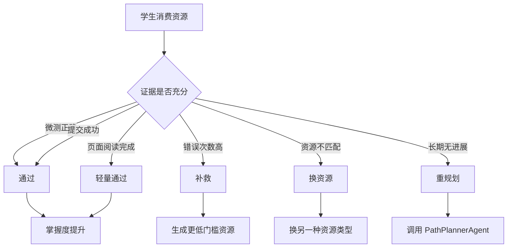

这条链路体现了系统的教育价值: 生成只是开始, 学习证据才决定下一步。

<div style="page-break-after: always;"></div>

## 11. 个性化路径规划

### 11.1 路径规划输入

`LearningPathService` 调用路径规划时会收集:

| 输入 | 说明 |
|---|---|
| 学生画像 | 8 维 profile snapshot |
| KC 清单 | 课程知识点和章节 |
| 前置关系 | KC prerequisites |
| 掌握度 | 每个 KC 当前状态 |
| 班级任务 | 教师发布的任务约束 |
| 最近资源 | 避免重复推送 |
| 最近提交 | 判断难度和错误类型 |
| 高频错误 KC | 优先安排补救 |

### 11.2 7 天路径结构

路径规划输出不是一段建议文字, 而是可执行路径节点和任务:

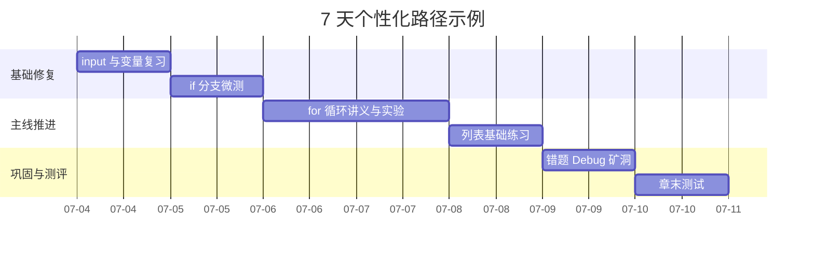

### 11.3 推荐系统

今日推荐不是随机资源列表, 而是教育数字孪生驱动的下一步行动:

1. 若某 KC 掌握度低且学生近期失败, 推荐练习或代码实验。
2. 若学生阅读完成但练习失败, 推荐 Bug 矿洞或低门槛讲义。
3. 若学生偏好图解, 推荐思维导图或动画分镜。
4. 若班级任务即将截止, 推荐与班级任务相关的最短补救路径。

<div style="page-break-after: always;"></div>

## 12. 主线学习与游戏化设计

### 12.1 R-14 中央小镇 Hub

当前版本收敛为单一中央小镇 hub。学习入口集中在同一地图, 避免学生在多地图中迷路。系统不做无教育目的的装饰玩法, 而是把游戏化服务于看、学、练、测。

| 小镇入口 | 学习含义 | 页面 |
|---|---|---|
| 主线地图 | 章节学习路径 | `/mainline-map` |
| 章节学习页 | 看视频、学 PPT、练示例 | `/mainline/stage/:stageId` |
| 百晓工坊 | 生成和消费个性化资源 | `/workshop` |
| 训练场 | 正式 Python 判题 | `/training` |
| Bug 矿洞 | 从失败提交进入调试辅导 | `/bug-mine` |
| 画像馆 | 查看和修订学习者画像 | `/profile` |
| 教师看板 | 班级分析与补救 | `/teacher` |

### 12.2 学习隐喻

系统不把 KC 隐喻成作物或金币, 而是直接以学习闭环表达:

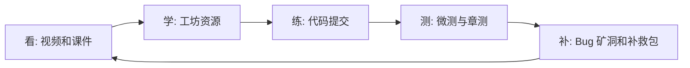

这种设计更符合高校课程场景, 也更容易在 6 分钟演示中让评委看见真实学习价值。

<div style="page-break-after: always;"></div>

## 13. Python 练习与判题系统

### 13.1 双轨执行

系统区分前端即时预览和后端正式判题:

| 执行方式 | 用途 | 是否计入成绩 |
|---|---|---|
| Pyodide 预览 | 学生快速试运行, 降低等待 | 否 |
| 服务端判题 | 正式提交、统计、掌握度、班级分析 | 是 |

正式提交由 `SubmissionService` 处理, 调用 `JudgeService` 完成静态检查、测试用例执行、沙箱运行和 verdict 归档。

### 13.2 判题结果进入学习闭环

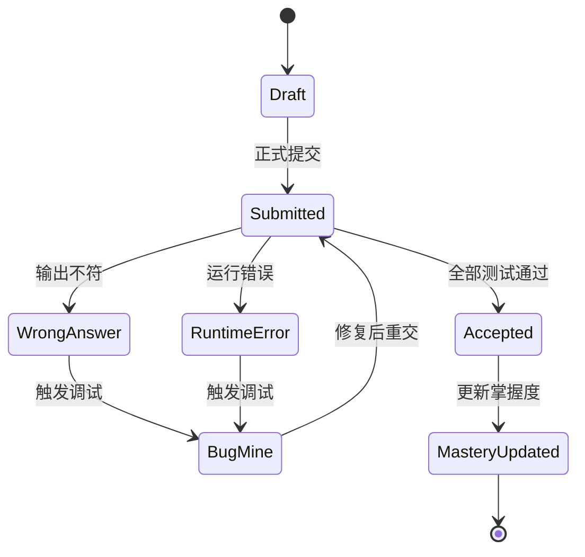

### 13.3 判题对画像的贡献

| 判题事件 | 画像影响 |
|---|---|
| 连续通过 | 实践能力和知识基础上升 |
| 多次语法错误 | 易错模式标记为语法细节 |
| 多次边界错误 | 易错模式标记为边界条件 |
| 失败后重试成功 | 情绪与坚持度上升 |
| 放弃或长时间无回归 | 触发低压力补救资源 |

<div style="page-break-after: always;"></div>

## 14. Bug 矿洞调试辅导

### 14.1 设计目的

Bug 矿洞不是小游戏支线, 而是失败提交后的调试学习空间。学生提交失败后, 系统从判题反例、变量轨迹、知识点和历史错误模式生成调试卡片, 引导学生自己定位问题。

### 14.2 状态机

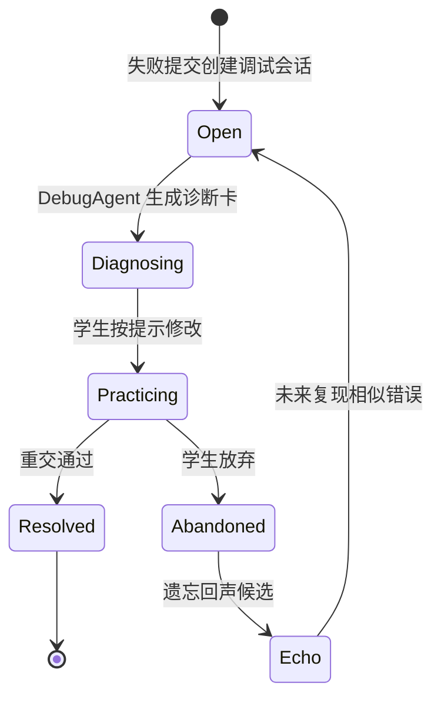

### 14.3 调试卡片内容

| 卡片 | 内容 |
|---|---|
| 失败现象 | verdict、错误类型、最小反例 |
| 变量轨迹 | 关键变量在循环或分支中的变化 |
| 可能原因 | 与 KC 和错误模式相关的诊断 |
| 修复提示 | 分层提示, 不直接泄露完整答案 |
| 再练题 | 同 KC 变式题或资源 |

这种设计符合赛题的智能辅导要求, 也能体现系统对学习效果的闭环追踪。

<div style="page-break-after: always;"></div>

## 15. 多模态学习资源

### 15.1 多模态能力

系统在普通文本资源之外, 支持图片、旁白、分镜和短视频式资源合成。对应模块包括:

- `MediaAssetController`
- `MediaJobController`
- `StoryboardCompositionService`
- `XfyunImageService`

### 15.2 动画分镜生成流程

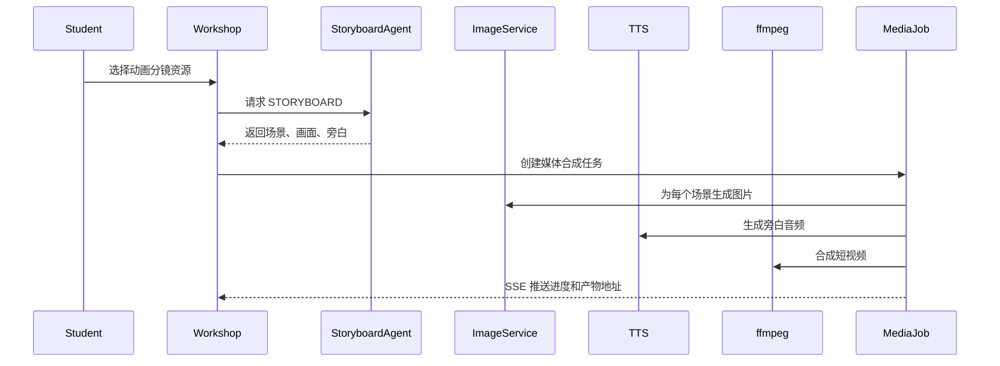

### 15.3 教育价值

多模态资源主要服务三类场景:

1. 抽象概念可视化, 如变量赋值、循环迭代、列表索引。
2. 降低初学者认知负荷, 把长文字拆成场景化解释。
3. 为教师生成可直接用于课堂的短素材。

<div style="page-break-after: always;"></div>

## 16. 前端 UI 与交互设计

### 16.1 页面结构

前端路由集中在 `frontend/src/app/router.ts`。核心页面如下:

| 路由 | 页面 | 功能 |
|---|---|---|
| `/world` | 小镇主入口 | 场景化导航 |
| `/profile` | 画像馆 | 画像雷达、自评、修订 |
| `/workshop` | 百晓工坊 | 资源生成、资源消费检查 |
| `/library` | 资源库 | 已生成资源浏览 |
| `/training` | 训练场 | Python 题目与提交 |
| `/bug-mine` | Bug 矿洞 | 调试辅导 |
| `/teacher` | 教师端 | 班级热力图和补救 |
| `/mainline-map` | 主线地图 | 学习进度 |
| `/chapter-test/:chapter` | 章末测试 | 章节评估 |
| `/feynman` | 费曼教学 | 学生讲给 AI 听 |

### 16.2 交互原则

| 原则 | 实现 |
|---|---|
| 行动优先 | 页面以进入学习、生成资源、提交练习为主按钮 |
| 证据可见 | 工坊和问答展示引用页和检查结果 |
| 过程透明 | 工具调用时间线展示 Agent 节点 |
| 学习状态清晰 | 画像雷达和掌握度卡片让学生知道自己在哪里 |
| 教师可扫描 | 热力图、任务摘要、高频误区降低阅读成本 |

### 16.3 UI 信息架构

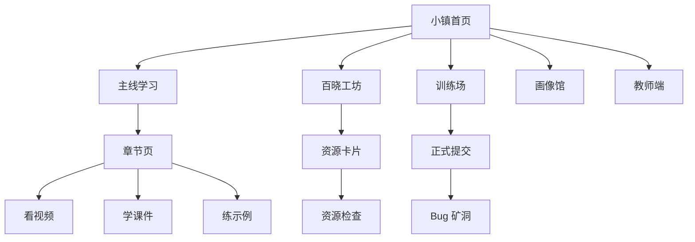

<div style="page-break-after: always;"></div>

## 17. 教师端与课堂应用

### 17.1 班级能力

Pythontopia 保留轻量但完整的班级架构:

1. 教师创建班级。
2. 学生加入班级。
3. 班级绑定 Python 语言基础课程。
4. 教师发布班级任务。
5. 学生在公告板领取任务。
6. 教师查看 KC 热力图、任务完成率、高频误区和资源使用。

### 17.2 教师数据看板

| 看板 | 指标 | 教学价值 |
|---|---|---|
| KC 热力图 | 每个知识点掌握度分布 | 找出共性薄弱点 |
| 任务摘要 | 已完成、进行中、未开始 | 管理班级节奏 |
| 高频误区 | 错误类型和关联 KC | 设计课堂讲解 |
| 资源使用 | 哪些资源被消费、是否有效 | 评价 AI 资源质量 |
| 最近活动 | 学生学习事件流 | 识别需要干预的学生 |

### 17.3 一键补救包

`RemediationService` 会根据班级弱点生成补救包, 通常包括讲义和练习。补救包仍走资源工坊的证据链、安全审查和发布流程, 避免教师端绕过质量控制。

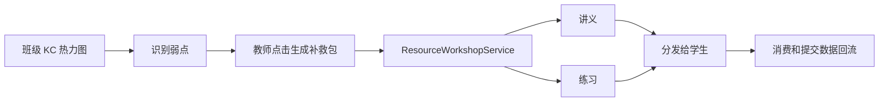

<div style="page-break-after: always;"></div>

## 18. 接口设计

### 18.1 关键 API

| 模块 | 接口示例 | 功能 |
|---|---|---|
| 画像 | `GET /api/learner/profile` | 获取画像 |
| 画像 | `PUT /api/learner/profile/dimensions/{key}` | 学生自评维度 |
| 工坊 | `POST /api/workshop/resources` | 创建学习资源 |
| 工坊 | `GET /api/workshop/resources` | 查询资源列表 |
| 工坊 | `POST /api/workshop/resources/{id}/checks` | 资源消费检查 |
| 编排 | `POST /api/orchestrator/turn/stream` | 流式智能问答 |
| 路径 | `POST /api/learning-paths` | 生成学习路径 |
| 判题 | `POST /api/submissions` | 正式提交 |
| Bug 矿洞 | `POST /api/bug-mine/sessions` | 创建调试会话 |
| 媒体 | `POST /api/media/assets/images` | 生成图片 |
| 媒体 | `GET /api/media/jobs/{id}/stream` | 媒体任务进度 |
| 教师 | `GET /api/teacher/classes/{id}/kc-heatmap` | 班级 KC 热力图 |

### 18.2 REST 设计原则

后端 API 使用资源名, 避免动作式路径。新增 API 必须有 DTO、校验、统一错误返回和测试。SSE 用于长任务和流式 AI 输出, 普通数据查询仍使用 REST。

### 18.3 结构化 DTO

前端 API client 使用明确 DTO 类型, 不在业务层扩散 `any`。AI 微服务输出使用 Pydantic schema, 以结构化字段交给后端和前端。

<div style="page-break-after: always;"></div>

## 19. 数据库与数据模型

### 19.1 核心数据对象

| 对象 | 说明 |
|---|---|
| learner_profile | 学生画像, dimensions JSONB 保存 8 维 |
| learner_profile_revision | 画像修订记录 |
| knowledge_component | 课程知识点 |
| kc_mastery | 学生对每个 KC 的掌握度 |
| workshop_resource | 工坊生成资源 |
| workshop_run | Agent 运行记录和证据 |
| learning_path | 个性化路径 |
| learning_path_node | 路径节点 |
| submission | 正式代码提交 |
| bug_mine_session | 调试会话 |
| classroom | 班级 |
| classroom_quest | 班级任务 |
| media_job | 多模态任务 |

### 19.2 画像 JSONB 设计

`learner_profile.dimensions` 使用统一 JSONB 聚合 8 维, 能在保持结构灵活的同时支持审计和版本记录。主观维度允许学生自评, 客观维度更多来自学习事件。

### 19.3 资源证据字段

资源保存时记录证据页、Agent 名称、安全结果和扎根结果。这样既满足比赛可展示性, 也满足长期教学中的质量追溯。

<div style="page-break-after: always;"></div>

## 20. 安全与反幻觉设计

### 20.1 反幻觉原则

系统不允许大模型伪造课件页码、章节、题目、作者或教材内容。若内容来自通识知识而非课件, 需要明确标注。

### 20.2 安全检查维度

| 检查 | 目的 |
|---|---|
| PII 检查 | 避免泄露个人敏感信息 |
| 答案泄露检查 | 避免直接给可复制提交的完整答案 |
| 歧视与不当内容检查 | 保证教育内容安全 |
| 练习泄题检查 | 防止隐藏测试泄露 |
| 危险代码检查 | 避免生成危险脚本或系统操作 |
| 证据覆盖检查 | 确认资源内容和课件证据一致 |

### 20.3 发布门控

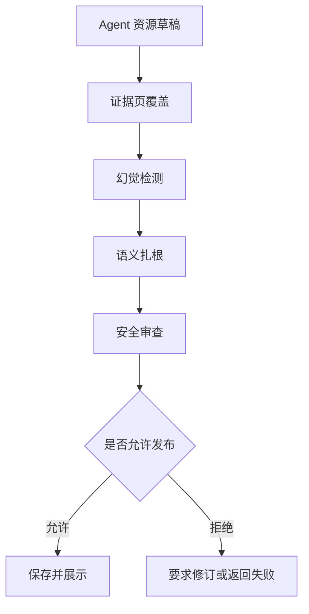

这套发布门保证系统不是简单调用大模型, 而是形成可控、可审计的 AI 工程。

<div style="page-break-after: always;"></div>

## 21. 前沿 AI 融合说明

### 21.1 使用的 AI 技术

| AI 技术 | 项目体现 | 创新点 |
|---|---|---|
| 大语言模型 | ProfileAgent、资源 Agent、PathPlannerAgent、DebugAgent | 学习上下文结构化输入, 结果可审查 |
| 多智能体协同 | ResourceGraph 中多个 Agent 按资源类型和审查节点协作 | 生成与审核解耦 |
| GraphRAG | 课程页、KC 图谱、向量检索、BM25 融合 | 证据扎根和前置知识扩展 |
| 学习分析 | LearningEvent 和 MasteryEvaluator | 用真实行为更新掌握度 |
| 教育数字孪生 | 8 维画像 + 掌握度 + 错误记忆 | 驱动路径和资源推送 |
| 多模态生成 | STORYBOARD、文生图、TTS、视频合成 | 把抽象知识转成可视化素材 |
| 流式智能体观测 | SSE 和工具时间线 | 让 AI 工作过程可见 |
| 安全对齐 | SafetyCritic 和反幻觉审查 | 教育场景下的可信 AI |

### 21.2 不依赖微调的原因

项目默认不使用微调大模型。原因是高校课程内容经常更新, 微调成本高且难以追溯。系统采用 RAG、结构化 Prompt、Schema 约束、多智能体审查和真实判题数据, 在不微调的情况下达到更强的可控性和可维护性。

### 21.3 可替换模型设计

Graph 服务支持 OpenAI-compatible 接口和国产兼容模型。模型相关信息通过环境变量配置, 包括 base url、api key、model、fast model。这样比赛演示、校内部署和未来商用部署可以使用不同模型, 不影响业务代码。

<div style="page-break-after: always;"></div>

## 22. 开发实现说明

### 22.1 开发分层

| 层级 | 目录 | 职责 |
|---|---|---|
| Web 前端 | `frontend/` | 用户交互、可视化、Phaser 小镇 |
| 后端服务 | `backend/` | API、业务一致性、数据库事务 |
| 多智能体 | `services/pythontopia-graph/` | Agent 编排、资源生成、路径规划 |
| RAG 服务 | `services/pythontopia-rag/` | 课程检索、证据引用 |
| 数据 | `data/course-pack-43/` | Python 课程包 |
| 部署 | `deploy/` | Docker Compose、Nginx、发布脚本 |

### 22.2 开发流程


### 22.3 代码质量约束

前端使用 TypeScript strict, 后端使用 Java 21 和 Spring Boot, Python 服务使用 FastAPI 和结构化 schema。业务层避免散装动态字段。新增 API 需要 DTO、校验、统一错误返回和测试。

<div style="page-break-after: always;"></div>

## 23. 测试说明书

### 23.1 测试目标

测试目标是证明系统不是静态展示, 而是可以完成真实学习闭环:

1. 学生能生成画像。
2. 学生能生成个性化资源。
3. 资源生成能记录证据和安全结果。
4. 学生能提交练习并得到正式判题。
5. 失败提交能进入 Bug 矿洞。
6. 掌握度和画像能被事件更新。
7. 路径和推荐能根据状态变化。
8. 教师端能查看班级弱点并生成补救资源。

### 23.2 测试资产概况

当前仓库测试文件规模:

| 测试范围 | 测试文件数量 |
|---|---:|
| 后端测试 | 181 |
| 前端测试和 e2e | 253 |
| graph + rag 测试 | 115 |

### 23.3 后端测试重点

| 测试对象 | 验证内容 |
|---|---|
| ResourceWorkshopControllerTest | 工坊接口、鉴权、资源创建 |
| ResourceWorkshopServiceTest | 证据保存、消费检查、补救决策 |
| WorkshopGraphClientTest | 后端调用 AI 图服务 |
| ProfileServiceTest | 画像对话、草稿应用、安全结果 |
| PassiveProfileServiceTest | 学习事件到画像维度更新 |
| LearningPathServiceTest | 路径生成、节点写入、任务生成 |
| LearnerRecommendationServiceTest | 今日推荐逻辑 |
| SubmissionServiceTest | 正式提交、事件发布 |
| JudgeServiceTest | 判题 verdict 和沙箱执行 |
| BugMineServiceTest | 失败提交进入调试 |
| TeacherDashboardControllerTest | 班级统计接口 |
| RemediationServiceTest | 一键补救包生成 |

### 23.4 前端测试重点

| 页面 | 验证内容 |
|---|---|
| ProfilePage | 画像展示、自评维度、雷达图 |
| WorkshopPage | 资源类型选择、资源展示、检查反馈 |
| StageLearnPage | 看、学、练任务链路 |
| ChapterTestPage | 章测流程、提交、路由守卫 |
| Teacher ClassroomDetail | 热力图、补救包按钮、任务信息 |
| ToolCallTimeline | Agent 工具调用过程展示 |

### 23.5 AI 服务测试重点

| 服务 | 验证内容 |
|---|---|
| resource_graph | 六类资源 Agent、发布门、证据链 |
| path_planner_agent | 7 天路径、前置关系、弱点优先 |
| pythontopia_rag | GraphRAG 查询、citation、no evidence |
| safety_critic | PII、答案泄露、危险代码、安全输出 |

<div style="page-break-after: always;"></div>

## 24. 核心测试用例

### 24.1 工坊资源生成

| 用例 | 步骤 | 预期结果 |
|---|---|---|
| 生成讲义 | 选择薄弱 KC, 选择讲义 | 返回 HANDOUT artifact, 保存 evidence page ids |
| 生成思维导图 | 选择 for 循环, 选择导图 | 返回节点边结构或 Mermaid |
| 生成练习 | 选择学生失败过的 KC | 题目难度匹配, 不泄露答案 |
| 生成代码实验 | 选择列表或循环 | 返回代码骨架和测试点 |
| 生成动画分镜 | 选择抽象概念 | 返回场景、画面、旁白 |
| 资源检查失败 | 微测答错 | 进入补救或换资源决策 |

### 24.2 画像更新

| 用例 | 步骤 | 预期结果 |
|---|---|---|
| 对话画像 | 学生回答学习背景 | 画像草稿更新并有审查结果 |
| 练习通过 | 学生正式提交 AC | 知识基础和实践能力上升 |
| 多次失败 | 同一 KC 多次 WA | 易错模式更新 |
| 重试成功 | Bug 矿洞后提交通过 | 情绪与坚持度上升 |

### 24.3 反幻觉

| 用例 | 步骤 | 预期结果 |
|---|---|---|
| 请求课件外内容 | 问与课程无关的知识 | 标注通识或提示无证据 |
| 编造页码 | Agent 草稿含不存在引用 | 发布门拒绝 |
| 泄露答案 | 练习生成包含完整可提交答案 | SafetyCritic 拒绝 |

<div style="page-break-after: always;"></div>

## 25. 部署说明

### 25.1 部署拓扑

```mermaid
flowchart TB
  User[浏览器] --> Nginx[主机 Nginx :80]
  Nginx --> Frontend[frontend 容器 127.0.0.1:8080]
  Nginx --> Backend[backend 容器 127.0.0.1:18080]
  Backend --> PG[(Postgres + pgvector)]
  Backend --> Redis[(Redis)]
  Backend --> Graph[pythontopia-graph]
  Backend --> RAG[pythontopia-rag]
  Graph --> RAG
  Backend --> Media[/shared/generated-media]
  RAG --> Course[/shared/course-pack-43]
```

### 25.2 发布包流程

`deploy/scripts/build_release_archive.sh` 负责构建四个应用镜像:

1. `pythontopia/frontend:release`
2. `pythontopia/backend:release`
3. `pythontopia/graph:release`
4. `pythontopia/rag:release`

脚本会导出镜像 tar, 暂存源码树, 按 allowlist 清理本地专用文件, 生成 sha256sums, 并调用校验脚本复验。

### 25.3 生产安装流程

`deploy/scripts/install_release.sh` 在 ECS root 环境执行, 流程包括:

1. 参数和运行环境检查。
2. 准备 `/opt/pythontopia` 目录结构。
3. 备份数据库、`.env`、Nginx 和 Compose 配置。
4. 解包发布包并校验 sha256。
5. `docker load` 导入四个镜像。
6. `docker compose config` 校验。
7. 启动依赖和应用服务。
8. 安装或 reload Nginx。
9. 终验 `/healthz`。

### 25.4 公网验收

`deploy/scripts/public_acceptance.sh` 验收以下项目:

| 项目 | 预期 |
|---|---|
| 首页 | HTTP 200 |
| `/healthz` | HTTP 200 |
| 静态资源 | Content-Type 和缓存头正确 |
| 内部端口 | 8080、18080、18091、18092、15432、16379 不公网暴露 |
| 重定向 | 不指回 8080 |
| SSE | 可使用演示账号检查真实流式链路 |

当前文档阶段只说明部署流程。正式最终提交前需要在阿里云 ECS 上实际执行发布包构建、上传、安装和公网验收。

<div style="page-break-after: always;"></div>

## 26. 开源与许可证说明

### 26.1 代码与素材边界

系统不复制任何商业像素游戏官方素材。像素素材必须来自 CC0、CC-BY 3.0/4.0、CC-BY-SA 3.0 或 OFL-1.1 等已审计来源。资产许可证在 `LICENSE-ART.md` 和 `frontend/public/assets/pixel/LICENSE.md` 中维护。

### 26.2 第三方框架

| 框架 | 用途 | 许可证需在最终材料中标注 |
|---|---|---|
| Vue 3 | 前端 UI | 是 |
| Phaser 3 | 游戏画布 | 是 |
| Spring Boot | 后端服务 | 是 |
| FastAPI | Python 微服务 | 是 |
| PostgreSQL / pgvector | 数据与向量索引 | 是 |
| Redis | 缓存和状态辅助 | 是 |
| Mermaid | 文档图表 | 是 |
| ffmpeg | 媒体合成 | 是 |

### 26.3 AI Coding 工具使用说明

开发过程中允许使用 AI Coding 工具辅助完成需求梳理、局部代码建议、测试样例补充、文档初稿生成和演示脚本编写。但项目关键功能均以仓库代码、测试和本地运行结果为最终依据。AI 生成内容必须经过人工审查、测试验证和安全检查, 不得把 AI 文案直接当作实现证据。

<div style="page-break-after: always;"></div>

## 27. 性能与用户体验策略

### 27.1 响应策略

| 场景 | 策略 |
|---|---|
| 普通列表和详情 | REST 立即返回 |
| AI 问答和工具调用 | SSE 流式输出 |
| 多模态合成 | 异步 job + 进度流 |
| 工坊资源生成 | 先显示生成中状态, 完成后展示资源卡 |
| 判题 | 正式提交后返回 verdict 和测试反馈 |

### 27.2 2C4G ECS 优化

生产 Compose 对容器设置内存上限, 日志轮转, 并把对外入口收敛为主机 Nginx 80 端口。graph 和 rag 不暴露宿主端口, 后端和前端只绑定 127.0.0.1。

### 27.3 用户体验策略

1. 页面先给出下一步行动, 再展示解释信息。
2. AI 输出过程可见, 降低等待焦虑。
3. 资源卡片支持阅读、检查、反馈和跳转练习。
4. 错误不是终点, 会自然导入 Bug 矿洞。
5. 教师端面向扫描, 用热力图和摘要减少阅读压力。

<div style="page-break-after: always;"></div>

## 28. 创新性与实用性总结

### 28.1 创新点

| 创新点 | 说明 |
|---|---|
| 画像不是问卷, 而是事件驱动的教育数字孪生 | 学生每次学习行为都会反馈到画像 |
| 资源不是静态资料, 而是多智能体按证据生成 | 六类资源均保留 Agent 和证据 |
| 个性化不是推荐列表, 而是路径、资源、判题、补救闭环 | 看、学、练、测、补救、重规划 |
| 反幻觉不是口头承诺, 而是发布门和数据库字段 | grounding result 和 safety result 可审计 |
| 游戏化不是装饰, 而是学习入口和任务组织方式 | 中央小镇聚合学习流程 |
| 教师端不是管理后台, 而是课堂补救生产力工具 | 热力图到一键补救包 |

### 28.2 实用价值

Pythontopia 能用于高校 Python 基础课的课前预习、课中练习、课后补救和班级诊断。系统既能帮助学生获得个性化资源, 也能帮助教师把大模型能力转化为真实教学干预。

### 28.3 与普通 AI 聊天机器人的差异

| 普通聊天机器人 | Pythontopia |
|---|---|
| 一问一答, 缺少长期状态 | 8 维画像和掌握度持续更新 |
| 回答难以验证 | GraphRAG 证据页和反幻觉审查 |
| 不知道学生是否学会 | 正式判题和资源检查 |
| 不知道下一步学什么 | PathPlannerAgent 生成路径 |
| 教师难以使用结果 | 班级热力图和补救包 |

<div style="page-break-after: always;"></div>

## 29. 演示材料建议

### 29.1 PPT 结构建议

| 页 | 标题 | 内容 |
|---:|---|---|
| 1 | Pythontopia: Python 学习小镇 | 项目定位 |
| 2 | 痛点: 同课不同人 | 学生差异和教师负担 |
| 3 | 核心闭环 | 画像、资源、练习、路径 |
| 4 | 多智能体资源工坊 | 六类资源和证据链 |
| 5 | GraphRAG 与反幻觉 | 引用页、审查门 |
| 6 | 真实判题与 Bug 矿洞 | 从失败到补救 |
| 7 | 教师端 | 班级热力图和补救包 |
| 8 | 技术架构 | 前端、后端、AI、数据 |
| 9 | 创新与实用价值 | 评分项映射 |
| 10 | 演示二维码或访问地址 | 结束页 |

### 29.2 视频演示重点

6 分钟演示建议覆盖:

1. 主线地图和学生当前状态。
2. 画像雷达和画像来源。
3. 工坊生成个性化资源。
4. 展示证据页、Agent 时间线、安全结果。
5. 提交一题, 失败后进入 Bug 矿洞。
6. 修复或展示通过后掌握度变化。
7. 教师端查看班级弱点并生成补救包。

完整逐字脚本见 `docs/presentations/2026-07-04-cnsoftbei-a3-demo-script.md`。

<div style="page-break-after: always;"></div>

## 30. 风险与改进计划

| 风险 | 当前控制 | 后续改进 |
|---|---|---|
| LLM 供应商不稳定 | 支持 OpenAI-compatible 环境变量切换 | 增加多模型 fallback 和缓存 |
| 多模态合成耗时 | 异步 job 和进度流 | 增加队列和产物复用 |
| RAG 证据不足 | no evidence 机制和拒绝发布 | 增加课程页 OCR 质量检查 |
| 判题沙箱性能 | worker pool 和正式提交限制 | 增加资源隔离和更多语言限制 |
| 教师端数据噪声 | 聚合统计和热力图 | 增加异常检测和人工标注 |
| 比赛演示网络波动 | 本地脚本和公网验收脚本 | 准备离线演示数据和备用录屏 |

## 31. 结论

Pythontopia 对赛题 A3 的回答是: 用大模型多智能体生成资源, 但不止于生成。系统把画像、课程证据、知识图谱、正式判题、学习事件、路径规划、班级统计和多模态合成连接起来, 形成一个可解释、可追踪、可部署的 Python 个性化学习系统。

从比赛评分角度看, 项目在功能与技术实现上覆盖了赛题所有基础要求和多数提高方向; 在创新性上提出教育数字孪生、证据驱动多智能体资源工坊、Bug 矿洞调试闭环和教师补救包; 在实用性上面向高校 Python 基础课真实场景; 在文档和演示上提供了可导出、可讲解、可验证的材料。

最终交付建议包括:

1. 本 Markdown 提交文档。
2. 6 分钟以内演示视频。
3. PPT。
4. 可运行源码、数据集和模型配置说明。
5. ECS 公网部署地址和公网验收日志。
6. 开源许可证与 AI Coding 工具说明。
