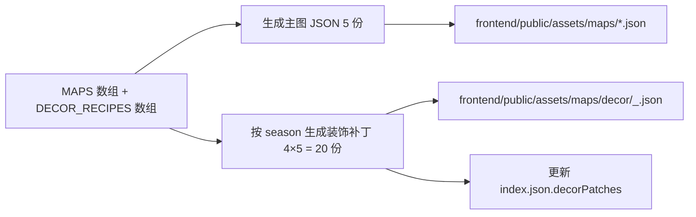
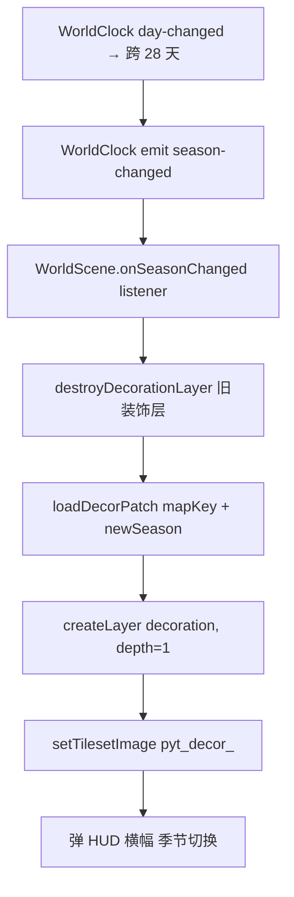

# 0. 文档定位

Pythontopia 的星露谷化大世界由 5 张 tilemap 组成（`town_hub` / `farm_north` / `mine_south` / `campus_east` / `port_west`），每张地图按 `docs/game-tilemap-conventions.md` 第 2 章固定四层结构（`ground` / `decoration` / `collision` / `overlay`）。本文专门规定 **`decoration` 层在 4 季节（SPRING / SUMMER / AUTUMN / WINTER）下的程序化装饰内容**——也就是玩家不会被挡住、但能直接感知到"季节变了 / 节日到了"的那一层。

四条硬性原则（任何后续装饰提案违反一条即拒绝）：

1. **装饰层不影响碰撞**。所有装饰 tile / sprite `collides=false`，玩家可穿过。`docs/00-visual-system-overview.md` §8 已规定 4 季节 LUT 调色，本文负责"季节装饰内容"这一面，不负责调色。
2. **装饰只增强季节感和教育沉浸**，不放任何"挡路 / 引诱玩家撞墙"的强游戏元素；游戏 boss、矿洞、NPC 出生点等强玩法点归 `collision` / `objectgroup` 管。
3. **装饰按季节 + 节日双轴切换**：季节由 `WorldClock` 推 `season-changed` 事件触发；节日按 `world-clock-calendar.md` + `r12-deepen/05-festival-events.md` 的 11 节日额外**叠加临时装饰**，节日结束自动卸载。
4. **装饰允许教育耦合，但耦合点必须是"软触发"**——点击 / 走近触发对话或副任务，不允许装饰直接强行打断玩家走路或弹出全屏窗口。

视觉风格遵循 `00-visual-system-overview.md`（米黄羊皮纸基底 `#FBE8C5`、深棕硬边 `#5C3A24`、Ark Pixel 12 中文像素字、PNG nearest-neighbor），**严禁复制商业像素游戏官方素材**。

---

# 1. 5 地图 × 4 季节 = 20 套装饰总表

每张地图 × 每个季节 = 1 个"装饰套"，每套包含 3–4 个 sprite item（少于 3 个无法形成视觉密度，多于 4 个会冲到性能上限）。20 套合计约 64 个 sprite 资产。

| 地图 | SPRING | SUMMER | AUTUMN | WINTER |
| --- | --- | --- | --- | --- |
| **town_hub** | 樱花树 / 春联 / 风车 / 灯笼 | 阳伞 / 喷泉 / 葵花 / 西瓜摊 | 枫叶堆 / 灯笼 / 南瓜灯 | 雪人 / 圣诞树 / 灯串 |
| **farm_north** | 嫩苗田垄 / 桃花树 / 蜜蜂 | 稻穗 / 稻草人 / 萤火虫 | 黄叶 / 玉米堆 / 大南瓜 | 雪覆田 / 干草堆 / 冬眠帐 |
| **mine_south** | 苔藓岩 / 春洞滴水 / 矿洞嫩花 | 萤光矿石 / 散热扇 / 矿工灯 | 蘑菇丛 / 枯枝木箱 / 红铜矿 | 冰柱柱 / 冰面 / 矿洞炉火 |
| **campus_east** | 樱花步道 / 风信子 / 春假彩旗 | 白桦树荫 / 长椅 / 喷水池 | 银杏长廊 / 落叶堆 / 红枫 | 雪覆操场 / 圣诞灯 / 雪松 |
| **port_west** | 春帆船 / 樱木栈道 / 飞鸟 | 沙滩伞 / 贝壳 / 萤火虫 | 货箱堆 / 渔火 / 红叶帆 | 浮冰群 / 海港灯 / 雪堆船 |

> 设计依据：5 张地图各承载教育语义（hub = 仪式 / farm = KC 知识种子 / mine = Bug 训练 / campus = 教学 / port = 综合应用），季节装饰必须强化各自语义。例如 farm 春装饰强调"嫩苗 = KC 种下"，mine 冬装饰强调"冰封 = 错题冻结待化解"。

---

# 2. 装饰 tile 规范

## 2.1 像素与渲染尺寸

| 项 | 值 | 备注 |
| --- | --- | --- |
| **源 tile 边长** | 16 px | 与 `scripts/generate-maps.mjs` TILE 常量、其他 4 层一致 |
| **Phaser 渲染缩放** | 2× | 玩家可见装饰展示为 32×32 px / tile（与 `00-visual-system-overview` 像素质感一致） |
| **单个装饰占位** | 1×1 / 1×2 / 2×2 tile（≈ 16×16 / 16×32 / 32×32 源 px） | 个别"大型景观"（圣诞树）允许 2×3 tile，禁止超出 3×3 |
| **导出格式** | PNG（透明背景 / nearest-neighbor） | 不允许 WebP / SVG |
| **调色板** | 仅使用 `00-visual-system-overview` §1 的 12 色基本盘 + 4 季节边框 4 色 | 不允许自创色 |

> 之所以保留 16 px 源、2× 渲染：与 `scripts/generate-maps.mjs` 现有 Kenney tilemap_packed.png / tiny_dungeon 132 帧抽帧逻辑完全对齐，新装饰可直接以"扩展 tileset 帧号"方式接入，零成本与现有地图生成流程兼容。

## 2.2 层级与 depth

引用 `docs/game-tilemap-conventions.md` §3 Z 轴排序规则：

| 层 / 元素 | depth | 与装饰关系 |
| --- | --- | --- |
| `ground` | 0 | 装饰画在它上面 |
| **`decoration`（本文范围）** | **1**（固定） | 装饰层主体 |
| 角色 / NPC sprite | 动态 `= y` | 比装饰更高（玩家从装饰前走过会盖住装饰）|
| `collision` | 不渲染（`setVisible(false)`） | 装饰**不写入** `collision` 层，所以不会挡路 |
| `overlay` | 9999 | 树冠 / 屋顶；装饰**只在不需要遮玩家头顶时**留在 `decoration`，需要遮挡的（高大圣诞树顶部 / 灯笼穗子下垂部分）拆 2 份分别放 `decoration` 与 `overlay` |

> 装饰层与渲染顺序的关键约束：`decoration` 层 sprite 永远在玩家下方（因为玩家 depth ≈ y 远大于 1），这意味着樱花树主体放 `decoration` 没问题，但"树冠"部分必须放到 `overlay`，否则会被玩家从树前走过遮挡，星露谷感破功。

## 2.3 碰撞与触发

- **装饰 tile 全部 `collides=false`**（不在 tileset properties 写 `collides=true`）。
- **可交互装饰** 走 `objectgroup` 路线：在 `triggers` object layer 中加 `trigger_decor_<itemKey>` 对象（位置对齐装饰中心，`width/height` ≈ 32×32），通过 `dialogId` 或 `questId` 属性挂接对话 / 副任务。详见 §9 教育耦合。
- **节日临时装饰** 也走 `decoration` 层（非 overlay），由 `WorldFestivalService` 触发临时 `setTile` 注入，节日结束自动恢复。

---

# 3. 20 套装饰主项要素表

每套装饰的"主项"（最具代表性的 1 个 sprite）汇总如下；同套内的次要 sprite（如 town_hub × SPRING 的"春联 / 风车 / 灯笼"）规范一致，文件名换 itemKey 即可。所有"数量上限"为单张地图单次加载内该装饰类的 sprite 上限（与 §11 性能预算 60 个 / 地图配额配套）。

| # | 装饰名 | spawnMap | season | 像素尺寸（源） | itemKey / 资产路径 | license 来源 | 上限 | spawn 规则 |
| --: | --- | --- | --- | --- | --- | --- | --: | --- |
| 01 | 樱花树 | town_hub | SPRING | 32×32 (2×2) | `decor/spring/cherry_blossom_tree.png` | Kenney Foliage CC0 | 6 | 固定坐标：广场四角 + 主路两侧 |
| 02 | 葵花 | town_hub | SUMMER | 16×32 (1×2) | `decor/summer/sunflower_tall.png` | Kenney Plant Pack CC0 | 8 | 固定：花坛内 4 株 + 随机草地 4 株 |
| 03 | 南瓜灯 | town_hub | AUTUMN | 16×16 (1×1) | `decor/autumn/jack_o_lantern.png` | OpenGameArt Halloween CC0（去 IP 后） | 10 | 节日 Day 60 注入 + 长驻 4 个 |
| 04 | 雪人 | town_hub | WINTER | 16×32 (1×2) | `decor/winter/snowman.png` | LPC Winter CC-BY-SA 3.0 | 4 | 玩家可"build"：点击雪地空格生成（详 §9.4） |
| 05 | 嫩苗田垄 | farm_north | SPRING | 16×16 (1×1) | `decor/spring/sprout_row.png` | LPC Crops CC-BY-SA 3.0 | 12 | 程序化沿田垄 2 行 × 6 列 |
| 06 | 稻草人 | farm_north | SUMMER | 16×32 (1×2) | `decor/summer/scarecrow.png` | Kenney Farming Pack CC0 | 2 | 固定：田中央 + 田南角 |
| 07 | 大南瓜 | farm_north | AUTUMN | 32×32 (2×2) | `decor/autumn/giant_pumpkin.png` | OpenGameArt Pumpkin CC0 | 3 | 固定：收获季田头 |
| 08 | 雪覆田 | farm_north | WINTER | 16×16 (1×1，平铺) | `decor/winter/snow_field_tile.png` | LPC Winter CC-BY-SA 3.0 | 24 | 程序化覆盖全部空田垄（顶部 2px 白边） |
| 09 | 苔藓岩 | mine_south | SPRING | 16×16 (1×1) | `decor/spring/moss_rock.png` | Kenney Dungeon Pack CC0 | 8 | 沿矿洞墙根随机 |
| 10 | 萤光矿石 | mine_south | SUMMER | 16×16 (1×1，发光） | `decor/summer/glow_ore.png` | OpenGameArt Mining CC0 | 10 | 程序化散布 + 夜间自发光（+ 萤光粒子） |
| 11 | 蘑菇丛 | mine_south | AUTUMN | 16×16 (1×1) | `decor/autumn/mushroom_cluster.png` | LPC Mushroom CC-BY-SA 3.0 | 6 | 随机角落 |
| 12 | 冰柱 | mine_south | WINTER | 16×32 (1×2) | `decor/winter/icicle.png` | OpenGameArt Ice Pack CC0 | 8 | 程序化沿矿洞顶部下垂 |
| 13 | 樱花步道 | campus_east | SPRING | 32×32 (2×2) | `decor/spring/cherry_path_tree.png` | Kenney Foliage CC0 | 6 | 固定：主步道两侧每 4 tile 一棵 |
| 14 | 树荫长椅 | campus_east | SUMMER | 32×16 (2×1) | `decor/summer/shaded_bench.png` | LPC Furniture CC-BY-SA 3.0 | 4 | 固定：操场周边 4 张 |
| 15 | 银杏长廊 | campus_east | AUTUMN | 16×32 (1×2) | `decor/autumn/ginkgo_tree.png` | OpenGameArt Autumn Tree CC-BY 3.0 | 8 | 固定：长廊两侧 |
| 16 | 雪松 | campus_east | WINTER | 32×48 (2×3) | `decor/winter/snow_pine.png` | LPC Tree CC-BY-SA 3.0 | 4 | 固定：礼堂前 4 棵；顶部 1×2 拆到 overlay |
| 17 | 春帆船 | port_west | SPRING | 48×32 (3×2) | `decor/spring/spring_sailboat.png` | OpenGameArt Pixel Ships CC0 | 2 | 固定：港口码头停泊 2 艘 |
| 18 | 沙滩伞 | port_west | SUMMER | 16×32 (1×2) | `decor/summer/beach_umbrella.png` | Kenney Beach Pack CC0 | 6 | 固定：沙滩 6 把 |
| 19 | 货箱堆 | port_west | AUTUMN | 32×32 (2×2) | `decor/autumn/cargo_crate_stack.png` | Kenney Pixel Boxes CC0 | 6 | 固定：港口堆栈区 |
| 20 | 浮冰群 | port_west | WINTER | 16×16 (1×1) | `decor/winter/ice_floe.png` | OpenGameArt Ice Pack CC0 | 12 | 程序化沿水域漂浮（缓慢横向位移） |

> 每套的其余 1–2 个 sprite（如 town_hub × SPRING 的"春联 / 风车 / 灯笼"）共享同一 `<season>` 目录，命名 `decor/<season>/<itemKey>.png`，license 与上限按主项的同一档归纳。

---

# 4. 生成器扩展（`scripts/generate-maps.mjs`）

## 4.1 设计目标

- **不改变现有 5 张主地图 JSON**（`town_hub.json` / `farm_north.json` 等），它们继续维持"基底装饰"（春装版本作为默认底）。
- **新增 4 季节装饰 JSON 补丁**：每张地图额外生成 4 份 `decor/<map>_<season>.json`，仅含 `decoration` 一层（与主图同 width/height、同 firstgid），运行时按需叠加到主地图的 `decoration` 层。
- **新增 CLI 参数 `--season=spring|summer|autumn|winter|all`**：默认 `all` 一次性生成全部 20 份补丁；指定单季节只重生该季节 5 份（节省 CI 时间）。

## 4.2 CLI 用法

```bash
node scripts/generate-maps.mjs                       # 等价 --season=all
node scripts/generate-maps.mjs --season=spring       # 仅生成 5 张地图 × spring
node scripts/generate-maps.mjs --season=winter --dry-run
```

## 4.3 数据流



## 4.4 装饰配方（DECOR_RECIPES）

在 `scripts/generate-maps.mjs` 顶部追加（仅追加，不动现有 MAPS 数组）：

```js
const DECOR_RECIPES = [
  {
    mapKey: 'town_hub',
    season: 'spring',
    items: [
      { itemKey: 'cherry_blossom_tree', gid: 200, w: 2, h: 2, fixed: [[8, 6], [42, 6], [8, 34], [42, 34], [22, 18], [28, 18]] },
      { itemKey: 'spring_couplet',      gid: 204, w: 1, h: 2, fixed: [[24, 12], [26, 12]] },
      { itemKey: 'windmill',            gid: 206, w: 1, h: 2, fixed: [[6, 20], [44, 20]] },
      { itemKey: 'paper_lantern',       gid: 208, w: 1, h: 1, fixed: [[20, 8], [30, 8]] },
    ],
  },
  /* ... 19 套依此类推 ... */
];
```

> `fixed` 数组写死坐标的好处：跨地图主题对齐（樱花树永远落在小镇广场固定角），单测可硬断言；`random` 配方仅在 §3 上限内做局部洒落，每次生成 seed 固定（`Math.seedrandom('pyt-decor-' + mapKey + season)`）保证可复现。

## 4.5 补丁 JSON 结构

```json
{
  "mapKey": "town_hub",
  "season": "spring",
  "width": 50,
  "height": 40,
  "tilewidth": 16,
  "tileheight": 16,
  "layer": {
    "name": "decoration",
    "type": "tilelayer",
    "width": 50,
    "height": 40,
    "data": [/* 2000 个 gid，多数为 0 */]
  },
  "tilesetExt": {
    "name": "pyt_decor_spring",
    "firstgid": 200,
    "image": "/assets/pixel/decor/spring/_atlas.png"
  }
}
```

> 复用现有 tilemap loader 而不改主 JSON：是为了让 `WorldScene` 运行时切季节时**只重载 200 个 tile 的小补丁**，而不是 2000 tile 的整张 ground/overlay。

---

# 5. 运行时切换（WorldClock → WorldScene）

## 5.1 事件流



> 切换装饰 **不重载整张地图**（不重建碰撞网格、不重置玩家坐标、不重启 BGM），玩家无感切换。

## 5.2 关键代码示意（仅声明，本文不实现）

```ts
this.clock.subscribe((event) => {
  if (event.type !== 'season-changed') return;
  this.swapDecorationLayer(event.to);
});

private async swapDecorationLayer(season: Season): Promise<void> {
  this.layers.decoration?.destroy();
  const patch = await loadDecorPatch(this.mapKey, season);
  const tileset = this.map.addTilesetImage(patch.tilesetExt.name, patch.tilesetExt.image);
  const layer = this.map.createBlankLayer('decoration', tileset, 0, 0, patch.width, patch.height);
  patch.layer.data.forEach((gid, i) => {
    if (gid === 0) return;
    layer.putTileAt(gid, i % patch.width, Math.floor(i / patch.width));
  });
  layer.setScale(RENDER_SCALE).setDepth(1);
  this.layers.decoration = layer;
}
```

## 5.3 跨地图切换

玩家从 `town_hub` 走 fade 到 `farm_north` 时，`WorldScene.create()` 在加载新地图后**立刻**调 `swapDecorationLayer(this.clock.snapshot().season)`，保证场景一进就是当前季节。无需等下一次 `season-changed` 事件。

## 5.4 节日叠加

`WorldFestivalService` 触发 `FESTIVAL_START` 时（详见 `r12-deepen/05-festival-events.md` §3.1），前端 `useFestivalStore.begin(payload)` 调 `WorldScene.applyFestivalDecor(festivalKey)`，**额外**注入节日 sprite 到 `decoration` 层（与季节装饰共存）。节日结束 (`FESTIVAL_END`) 调 `WorldScene.removeFestivalDecor(festivalKey)`，仅卸载节日 sprite，保留季节底装饰。

---

# 6. 资产命名 & 路径

## 6.1 目录树

```
frontend/public/assets/pixel/decor/
├── spring/
│   ├── _atlas.png                     # 4×N 拼图 (firstgid=200..)
│   ├── cherry_blossom_tree.png
│   ├── spring_couplet.png
│   ├── windmill.png
│   ├── paper_lantern.png
│   ├── sprout_row.png
│   ├── peach_tree.png
│   ├── bee.png
│   ├── moss_rock.png
│   ├── spring_cave_drip.png
│   ├── cave_sprout.png
│   ├── cherry_path_tree.png
│   ├── hyacinth.png
│   ├── spring_banner.png
│   ├── spring_sailboat.png
│   ├── cherry_pier.png
│   └── seagull.png
├── summer/
├── autumn/
└── winter/
```

## 6.2 命名约定

| 类型 | 模式 | 例子 |
| --- | --- | --- |
| 单装饰 | `decor/<season>/<item_key>.png` | `decor/spring/cherry_blossom_tree.png` |
| 季节图集 | `decor/<season>/_atlas.png` | `decor/winter/_atlas.png` |
| 节日叠加装饰 | `decor/festivals/<festival_key>/<item_key>.png` | `decor/festivals/bug_carnival/bug_lantern.png` |
| 玩家可建造 | `decor/<season>/buildable/<item_key>.png` | `decor/winter/buildable/snowman.png` |

**强制**：snake_case、英文、PNG 透明、源 16 px / tile（多倍 tile 拼成大装饰）。**禁止**中文文件名、空格、其他扩展名。

---

# 7. License

每个新增装饰必须在 `LICENSE-ART.md` + `frontend/public/assets/pixel/LICENSE.md` 双文件同步登记。20 个主装饰的 license 来源已在 §3 表格列出，下表汇总按 license 类型归类（便于审计脚本扫描）：

| license 类型 | 装饰套数 | 典型来源 | 传染性 |
| --- | ---: | --- | --- |
| **CC0 1.0** | 11 | Kenney Foliage / Plant / Farming / Beach / Boxes / Dungeon / Mining Pack | 无 |
| **CC-BY 3.0** | 1 | OpenGameArt Autumn Tree（必须在 about 页面署名作者） | 无 |
| **CC-BY 4.0** | 1 | OpenGameArt Pixel Ships 部分变体 | 无 |
| **CC-BY-SA 3.0+** | 7 | LPC Crops / Winter / Furniture / Mushroom / Tree | **传染** |

> CC-BY-SA 3.0 传染规则按 `AGENTS.md` 已接受：包装作品同时以 CC-BY-SA 3.0+ 公开，代码层保持 MIT。新增任何装饰前必须先跑 `scripts/check-asset-license.mjs` 扫描其来源，若引入非 CC 兼容协议（如星露谷物语 / 牧场物语等专有像素），CI 失败拒绝合并。

每个装饰条目登记字段：`{itemKey, license, sourceUrl, author, attributionRequired, sha256}`。

---

# 8. 教育耦合（装饰 → 对话 / 任务）

装饰耦合教育是 Pythontopia 区分于纯娱乐像素小镇的核心，4 季节代表性耦合点如下：

| 季节 | 装饰 | 触发条件 | 耦合教育内容 |
| --- | --- | --- | --- |
| **SPRING** | 樱花树（town_hub） | 玩家走近 ≤ 1.5 tile 距离 + 当前时间 EVENING | 偶遇 `student_hobby` NPC → 触发 `quest_side_painting_cherry`：用 turtle 库画 5 朵樱花 → 通过给 50 Pythoco + `student_hobby` friendship +2 |
| **SUMMER** | 葵花（town_hub）/ 萤光矿石（mine_south） | 玩家点击装饰（鼠标 / 触屏） | 葵花：弹 KC-040 列表入门题"统计葵花田中花瓣总数"；萤光矿石：触发 mine 副任务"用 while 循环模拟萤光闪烁周期" |
| **AUTUMN** | 南瓜灯（town_hub） | Day 60 `bug_carnival` 节日期间装饰自动注入 | 点击南瓜灯 → 弹"今日错题之灯墙"，列出当日 `practice_submission.status != ACCEPTED` 的题目 + 错题热度（高频误区高亮） |
| **WINTER** | 雪人（town_hub）+ 浮冰群（port_west） | 玩家点击空雪地空格 → 弹"build 雪人"按钮 | 完成 `build` 动画（4 帧合成）→ `inventory_item.snowman_token +1` + 5 Pythoco；浮冰群点击 → 触发"列表元素移动"练习（KC-040 应用） |

## 8.1 触发实现位置

- 走近触发：`WorldScene.update()` 内对每个挂 `trigger_decor_*` 对象做距离检测，进入半径 `radiusPx=24` 触发 `dialogId` 或 `questId`。
- 点击触发：装饰挂 `Phaser.Input` 事件 `pointerdown`，调用 `useDialogStore.open(dialogId)` 或 `useQuestStore.start(questId)`。
- 节日触发：`WorldFestivalService` 在 `FESTIVAL_START` payload 中带 `decorOverrides[]`，由前端 `applyFestivalDecor` 注入。

## 8.2 教育耦合不允许做的事

1. **不允许把装饰当 boss**（强制阻挡玩家走路）——这违反 §0 原则 1。
2. **不允许在装饰触发里弹全屏窗口**——只允许下方 toast / 角色头顶气泡，玩家可继续走路。
3. **不允许装饰触发后扣 Pythoco**——装饰是"福利"，违反 `economy-system.md` §1.3 的"无 evidence 不扣分"原则。
4. **不允许装饰触发抢走 NPC 主线任务窗口**——若玩家正在 NPC 对话中，装饰触发延后到对话结束。

---

# 9. 节日装饰叠加

复用 `docs/gameplay/r12-deepen/05-festival-events.md` §7 的 11 节日 sprite 清单，每节日额外加 1 套临时装饰（与季节装饰共存，节日结束自动卸载）。

| 节日 | day | 临时装饰 | 加载位置 |
| --- | ---: | --- | --- |
| `spring_opening` | 1 | 彩旗串 / 鲜花拱门 / 讲话台 | town_hub 广场 |
| `spring_quiz` | 14 | 考场木桌 / 黑板 | campus_east 教室 |
| `spring_finale_race` | 28 | 赛道彩旗 / 起跑线 / 终点拱门 | farm_north 赛道 |
| `midterm_festival` | 35 | boss 房间黑色横幅 / 火盆 | mine_south boss 房间 |
| `port_fair` | 56 | 摊位帐篷 / 灯笼串 / 商品木箱 | port_west 集市 |
| `bug_carnival` | 60 | 错题灯墙 / Bug 摊位 / 黑色横幅 | mine_south 入口（叠加南瓜灯） |
| `final_warmup` | 70 | 通宵图书馆灯 / 模考桌 | campus_east 图书馆 |
| `finals_festival` | 84 | 礼堂红地毯 / 毕业旗帜 / 烟花架 | campus_east 礼堂 |
| `winter_showcase` | 90 | 展位木板 / 投票箱 | town_hub 广场（叠加圣诞树） |
| `silent_night` | 100 | 壁炉 / 雪夜窗户 / 围炉椅 | town_hub 限定壁炉 |
| `new_year_eve` | 112 | 倒计时台 / 跨年灯笼串 / 大屏 | town_hub 广场（叠加雪人） |

> 节日装饰路径：`frontend/public/assets/pixel/decor/festivals/<festival_key>/<item_key>.png`。节日 sprite 永远独立于季节套，可在春节叠加任何冬季套（如教师 override `silent_night` 提前到春末）。

---

# 10. 性能预算

像素装饰不是免费午餐，sprite 数 + 帧动画 + 透明 PNG 叠加都吃 GPU。Pythontopia 走"少而准"原则。

| 项 | 桌面 ≥ 1280px | 平板 768–1279px | 手机 ≤ 767px |
| --- | --- | --- | --- |
| **单地图装饰 sprite 上限** | 60 | 45 | 36（×0.6） |
| **季节切换最大重载耗时** | < 200 ms | < 250 ms | < 400 ms |
| **装饰图集 _atlas.png 上限** | 256×256 px / 季节 | 同左 | 同左（不切割） |
| **帧动画装饰**（如萤光矿石呼吸） | ≤ 6 个并发 | ≤ 4 个 | ≤ 2 个（其余降级静态） |
| **粒子叠加**（樱花瓣 / 落叶） | 200 粒子 | 120 粒子 | 80 粒子 |

> 60 / 地图 上限不是硬规则，是预算线：超过需在 PR 描述里报"装饰超预算原因 + 替代方案"。预算来自 `00-visual-system-overview` §9 响应式断点的 ×0.6 移动端缩放原则，与 BGM / 粒子总预算合并控制。

帧动画装饰的实现：使用 Phaser SpriteAnimation（不是 tilelayer），由 `swapDecorationLayer` 单独管理 lifecycle；季节切换时一并 destroy。

---

# 11. 验收

## 11.1 自动化测试

| 测试 | 目标 | 工具 |
| --- | --- | --- |
| `seasonalDecor.spec.ts` | 20 套装饰 JSON 全部存在、`layer.name === 'decoration'`、`gid > 0` 总数 ≤ §11 上限 | vitest + node:fs |
| `seasonalDecor.spec.ts.loadAll` | 在 jsdom 中模拟 4 × 5 = 20 套装饰加载，全部 < 200 ms | vitest + perf hook |
| `seasonalDecor.spec.ts.licenseRegistered` | 所有 `decor/<season>/*.png` 在 `LICENSE-ART.md` 有对应条目 | vitest + 正则扫 |
| `WorldScene.spec.ts.seasonSwap` | mock WorldClock emit `season-changed` → 验证 `decoration` 层 sprite 数变化 | vitest + Phaser headless |
| `WorldScene.spec.ts.festivalOverlay` | mock `FESTIVAL_START` → 验证节日 sprite 注入；`FESTIVAL_END` → 验证卸载 | vitest |
| `generate-maps.test.mjs.seasonFlag` | `node scripts/generate-maps.mjs --season=spring --dry-run` 仅输出 5 份补丁日志，其他季节不触发 | vitest |

## 11.2 Playwright 视觉回归

| 用例 | 操作 | 断言 |
| --- | --- | --- |
| `season-snapshot-spring.spec.ts` | 强制 `clock.fixSeason('SPRING')` → 截图 5 地图 | 与 baseline `__screenshots__/spring_<map>.png` 像素 diff < 1% |
| `season-snapshot-summer.spec.ts` | 同上 SUMMER | 同上 |
| `season-snapshot-autumn.spec.ts` | 同上 AUTUMN | 同上 |
| `season-snapshot-winter.spec.ts` | 同上 WINTER | 同上 |
| `season-swap.spec.ts` | 在 town_hub 推时间至 Day 28 → Day 29 → 截图前后 | 装饰 sprite 数变化、ground 层 hash 不变 |
| `festival-decor-bugcarnival.spec.ts` | 推到 Day 60 + 触发 `FESTIVAL_START` → 截图 mine_south 入口 | 出现"错题灯墙"sprite，`FESTIVAL_END` 后消失 |

## 11.3 人工验收

1. 玩家从 Day 1 一直推到 Day 112，途中跨季 4 次，每次切换 HUD 横幅 + 装饰瞬间换装；玩家坐标 / BGM 不重置。
2. 11 节日触发时装饰正确叠加，节日结束自动卸载，与季节装饰共存无冲突。
3. 移动端横屏（≤ 767 px）实测装饰数 ≤ 36，帧率 ≥ 30 FPS。
4. 装饰耦合教育触发（如 §9 樱花树偶遇 `student_hobby`）能正确触发副任务并写 `quest_evidence`。

完成上述 3 大项后，本文档由 Draft 升级为 Active（v1.0 → v1.0-released）。

---

# 12. 风险与开放问题

| 风险 | 描述 | 缓解 |
| --- | --- | --- |
| 装饰超预算 | 教师 / 节日运营在 `festivalCalendar.json` 误调高 sprite 数 | 在 `applyFestivalDecor` 内强校验 `total ≤ 60 / 45 / 36`，超出截断 + warn 上报 |
| 季节切换瞬间黑屏 | `swapDecorationLayer` 异步加载 `_atlas.png` 时玩家看到空白 | 预加载策略：BootScene 启动时把当前季节 + 下一季节图集都预热到 Phaser cache |
| 移动端浮冰群帧动画掉帧 | port_west 冬季 12 个浮冰横向位移导致重绘 | 移动端降级为静态 PNG（不位移），桌面端保留缓动 |
| LPC CC-BY-SA 传染未署名 | 美术外包遗漏在 about 页面署名作者 | `LICENSE-ART.md` 已强制 + CI `check-asset-license.mjs` 扫描 + about 页面 e2e 断言 |
| 节日装饰与季节装饰冲突 | `silent_night`（冬）叠加雪人，但雪人本身是冬季装饰 → 重叠 | 节日 sprite 注入前去重：若同 itemKey 已在 `decoration` 层，节日只加非重复项 |
| 自创色违规 | 美术外包用了不在 12 色基本盘的色 | PR review 阶段过色彩扫描脚本 `scripts/check-decor-palette.mjs`（待 R-13 实现） |

---

-- 本文档由"视觉设计师 + tilemap 程序员"子代理生成于 2026-05-24（UTC+8），属 R-12 W7 星露谷化改造阶段产出，与 `00-visual-system-overview.md` 视觉宪法、`game-tilemap-conventions.md` 四层结构规范、`r12-deepen/05-festival-events.md` 节日玩法共同构成 Pythontopia 大世界视觉与玩法的"装饰子规范"。
