# Pythontopia 需求分析说明书

> Requirements Specification — 面向高校 Python 初学者的多端像素学习小镇「第二课堂」
> 课程底座：Alethicode `packId=43`《Python 语言基础》

---

## 文档控制（Document Control）

| 项目 | 内容 |
| --- | --- |
| 文档标题 | Pythontopia 需求分析说明书 |
| 文档编号 | PYT-SRS-002 |
| 版本 | v2.0（结构重构基线版） |
| 状态 | 已发布 · 随后端契约演进同步 |
| 文档结构 | 对齐《参考文档/1.需求规格说明书.docx》目录骨架（引言 → 系统概述 → 功能需求 → 非功能需求 → 部署环境） |
| 内容来源 | 一律基于仓库真实代码（`backend/`、`services/`、`frontend/`）与权威契约 `docs/clients/api-contract.md`、硬约束 `AGENTS.md` |
| 适用范围 | Pythontopia 全产品（Web / Android / Windows / 微信小程序 / 微信小游戏 + 共享后端 + 多智能体 + RAG） |
| 创建 / 更新 | 2026-06-11 |
| 密级 | 内部（Internal）· 比赛评审可见 |

### 修订历史（Revision History）

| 版本 | 日期 | 修订人 | 摘要 |
| --- | --- | --- | --- |
| v1.x | 2026-06-11 | 项目组 | 旧版 IEEE-830/ISO-29148 重型结构 |
| v2.0 | 2026-06-11 | 项目组 | **完全重写**：按参考文档目录骨架重构为「引言/系统概述/功能需求(按模块+用例动作)/非功能需求/部署环境」五章；立项动因改为普世化「第二课堂」叙事；功能需求逐模块锚定真实端点、DTO 与数据表；不再使用附录 |

### 审批（Approval）

| 角色 | 姓名 | 签署 | 日期 |
| --- | --- | --- | --- |
| 产品负责人 | _占位_ | _占位_ | _占位_ |
| 技术负责人 | _占位_ | _占位_ | _占位_ |
| 教研顾问 | _占位_ | _占位_ | _占位_ |
| 评审专家 | _占位_ | _占位_ | _占位_ |

---

## 序言（Preface）

这份文档要回答的，不是「我们又做了一个什么系统」，而是「我们到底想接住谁」。

Pythontopia 源于一次很朴素的一线观察：在高校 Python 公共课的课堂上，**逃课的学生不少；坐在教室里的，也有相当一部分「人到了、心没到」**——点名一过便低头刷手机、赶别科作业，一整节课没有亲手运行过一行代码。大班统一进度、单向灌输、缺乏即时反馈与个性化关照，让一部分学生（尤其非计算机专业、零基础者）很快跟不上节奏，并滑入一条清晰可见的恶性循环：**某节课没跟上 → 下一节听不懂 → 畏难与挫败累积 → 干脆翘课放弃**。等到期末上机或考试，他们才发现自己已严重落后，而那时既没有可回放的课堂，也没有适合自己起点的补课路径，想补也无从下手。

我们判断：录播课与 MOOC 早已存在，却治不了「不想看、看不懂、坚持不下去」这三个核心痛点。**市场缺的不是又一门网课，而是一个能补位第一课堂的「第二课堂」**。因此 Pythontopia 的立项目标，是为这些翘课或在课堂掉队的学生，开辟一个课外随时可达的学习场——它不取代教师线下授课，而是**补位**：让学生在像素学习小镇里，按自己的节奏把同一门课程重新、完整地走一遍（看 → 学 → 练 → 测），并辅以遗忘回声复盘、学习路径重排与教师学情看板。诉求只有一个，朴素而具体：**帮掉队的学生把缺失的课堂一点点补回来、不再落后**。

针对课堂教学的核心断层，我们从三处发力：用**游戏化动机**（像素小镇 / 关卡星级 / 任务体系）把不愿投入课堂的注意力拉回学习本身；用**个性化**（8 维学习画像 / 动态路径重排 / 画像驱动出题）让零基础学生也能从合适难度起步；用**即时反馈 + 科学防遗忘**（真实判题、Bug 矿洞分层调试、FSRS 间隔复习），把「听过但没掌握」真正转化为「练会且记住」。

> 一句话：Pythontopia 要解决的从来不是「再做一个网课」，而是为那些在传统课堂里**留不住、跟不上**的学生，打造一个有持续学习动机、能精准因材施教、内容可信不误导、真正能帮他们补回进度的**第二课堂**。

---

## 目录（Table of Contents）

**1 引言**
- 1.1 编写目的
- 1.2 适用范围
- 1.3 背景与立项动因
- 1.4 术语、定义与缩写
- 1.5 文档概述（文档约定 · 预期读者及阅读建议）
- 1.6 参考资料

**2 系统概述**
- 2.1 建设目标
- 2.2 用户特点
- 2.3 假定与约束（时间 / 人员 / 技术 / 业务）
- 2.4 产品定位与系统上下文

**3 功能需求**
- 3.1 系统总体业务概述
- 3.2 总体功能模块框架
- 3.3 认证与账号模块
- 3.4 学习画像模块
- 3.5 中央小镇与世界状态模块
- 3.6 主线冒险模块（看 / 学 / 练 / 测）
- 3.7 课程包与课件资产模块
- 3.8 导师答疑与课件问答模块
- 3.9 资源工坊模块（六类个性化资源）
- 3.10 训练场与判题模块（双轨执行）
- 3.11 Bug 矿洞与遗忘回声模块
- 3.12 无尽模式模块
- 3.13 复盘大厅、费曼自测与学习评估模块
- 3.14 学习路径规划模块
- 3.15 任务与公告板模块
- 3.16 轻量班级与教师看板模块
- 3.17 NPC 记忆个性化模块
- 3.18 多智能体编排与防幻觉模块
- 3.19 多端接入模块

**4 非功能需求**
- 4.1 性能需求（时间特性 / 适应性）
- 4.2 安全需求
- 4.3 可信 AI 与防幻觉
- 4.4 可使用性与可访问性
- 4.5 可维护性
- 4.6 可移植性与多端一致性
- 4.7 可靠性与可用性
- 4.8 可观测性
- 4.9 合规与隐私
- 4.10 教育有效性

**5 部署环境**
- 5.1 部署拓扑与容器编排
- 5.2 运行环境
- 5.3 配置与密钥
- 5.4 启动与验证

---

## 1 引言

### 1.1 编写目的

本文是 Pythontopia 的需求分析说明书，目的在于：

- 完整、无歧义、可验证地刻画 Pythontopia「做什么（What）」，而非「怎么做（How）」，作为设计、开发、测试与验收的共同基线；
- 固化 R-14「世界收缩」与 R-15「主线完全重构」之后的**当前权威范围**，澄清「明确不做」的能力边界，避免范围蔓延；
- 让产品、教研、研发、测试、比赛评审与新成员，对「第二课堂」要接住谁、靠什么接住，达成一致理解。

本文所有功能、数据、接口与约束描述均**以仓库真实代码为准**：后端源在 `backend/`，AI 微服务在 `services/`，客户端契约以 `docs/clients/api-contract.md` 为唯一权威，业务硬约束以 `AGENTS.md` 为最高优先级。

### 1.2 适用范围

**产品名**：Pythontopia（独立仓库 `/home/cypress/Pythontopia`）。

**一句话定义**：Pythontopia 是一款面向高校 Python 初学者的**多端像素学习小镇**，定位为补位第一课堂的「**第二课堂**」——以《Python 语言基础》（packId=43）为唯一知识底座，用「多智能体 + 学生画像 + 课件 RAG + 游戏化任务 + 真实练习评估」，为每位（尤其翘课或课堂掉队的）学生生成个性化学习资源并规划学习路径，把一门完整课程在课外重新走完一遍、不落后。**教育优先，游戏承载**。

**范围内（In-Scope）**：

| 能力域 | 说明 | 承载模块 |
| --- | --- | --- |
| 账号与鉴权 | 注册 / 登录 / 续签 / 角色（学生 / 教师 / 管理员） | §3.3 |
| 8 维学习画像 | 访谈被动更新 + 4 主观维度自评 + 雷达快照 + 修订历史 | §3.4 |
| 中央小镇与世界状态 | 聚合启动、像素小镇渲染、存档 / 技能 / 日历 / NPC 对话 | §3.5 |
| 主线冒险（R-15） | 关卡地图 + Stage 三件套（看 / 学 / 练）+ 章末大测试 + 0–3★ 星级 + 补星 | §3.6 |
| 课程包与课件资产 | 章节 / KC / 课件页 / 证据页图 / 题目 / 视频（Range 流） | §3.7 |
| 导师答疑（课件问答） | RAG 检索 + 证据引用 + 防幻觉 / 安全审查（SSE 流式） | §3.8 |
| 资源工坊 | 六类个性化资源生成 + 意图路由 | §3.9 |
| 训练场与判题 | Pyodide 预览 + 服务端 subprocess 判题（隐藏用例、verdict） | §3.10 |
| Bug 矿洞与遗忘回声 | 失败提交 / FSRS 到期 → 分层卡片（L1–L5）→ 重试 / 变式 | §3.11 |
| 无尽模式 | 预生成题池循环练习 + 章节范围补星 | §3.12 |
| 复盘 / 费曼 / 评估 | 周期评估聚合 + 评估叙事 + 费曼自测 + 路径重排 | §3.13 |
| 学习路径规划 | 画像 / 掌握度驱动的 KC 学习顺序（DRAFT / ACTIVE） | §3.14 |
| 任务与公告板 | 每日 / 系统 / 班级任务，强 evidence 校验 | §3.15 |
| 轻量班级与教师看板 | 加入班级、发布班级任务、星级分布、章测通过率、KC 热力图、主线进度 | §3.16 |
| NPC 记忆个性化 | memory-aware 个性化寒暄（agent 失败降级，不伪造） | §3.17 |
| 多智能体编排与防幻觉 | 学习总管 + 11 默认 Agent + 章测出题流 + 三审拦截 | §3.18 |
| 多端接入 | Web / Android / Windows / 微信小程序 / 微信小游戏，共享后端 | §3.19 |

**范围外 / 明确不做（Out-of-Scope，R-14 收敛后）**：❌ 背包 / 物品、❌ 货币 / 经济、❌ 商店 / 购买、❌ 农场 / 作物（播种 / 浇水 / KC 作物隐喻）、❌ 体力系统、❌ NPC 好感 / 送礼、❌ ReAct 循环、❌ 纯前端假数据冒充真实业务、❌ 复制任何商业像素游戏官方素材、❌ 隐藏测试用例下发前端、❌ 重型可观测栈（Prometheus / Grafana / Jaeger / APM）。详见 §2.3.4 与 §4。

### 1.3 背景与立项动因

**一线观察（直接动因）**：本项目源于在高校《Python》公共课 / 通识基础课上的真实随堂观察——逃课的学生不少，坐在教室里的也有相当一部分「人到了、心没到」：点名一过便低头刷手机、赶别科作业，一整节课没有亲手运行过一行代码。大班统一进度、单向灌输、缺乏即时反馈与个性化关照，使一部分学生很快跟不上节奏，并滑入一条清晰可见的恶性循环。

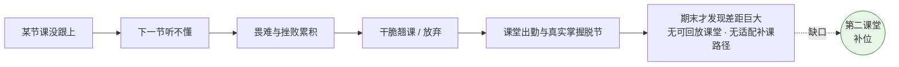

**立项判断——缺的不是又一门网课，而是「第二课堂」**：录播与 MOOC 早已存在，却治不了「不想看、看不懂、坚持不下去」。Pythontopia 的立项目标，是为翘课或在课堂掉队的学生开辟一个课外随时可达的「第二课堂」。它不取代第一课堂，而是补位：让学生按自己的节奏把同一门课程重新、完整地走一遍（看 → 学 → 练 → 测），并辅以遗忘回声复盘、学习路径重排与教师学情看板。

**对症的设计取向**：针对上述断层，第二课堂在三处发力——

| 断层 | 设计取向 | 系统对策（落点） |
| --- | --- | --- |
| 不想投入课堂的注意力 | **游戏化动机** | 像素小镇 / 关卡星级 / 任务体系（§3.5、§3.6、§3.15） |
| 零基础者起点参差、被一刀切 | **个性化教学** | 8 维画像 / 动态路径重排 / 画像驱动出题（§3.4、§3.6、§3.14） |
| 缺即时反馈、学了就忘 | **即时反馈 + 防遗忘** | 真实判题 / Bug 矿洞分层调试 / FSRS 间隔复习（§3.10、§3.11） |

**技术来源**：Pythontopia 基于 Alethicode 技术资产抽取重构而成的独立新项目，复用其课程包 / RAG / 防幻觉 / 画像 / 判题 / 班级等成熟能力，但不携带其老前端技术债。

### 1.4 术语、定义与缩写

| 术语 / 缩写 | 全称 / 英文 | 定义 |
| --- | --- | --- |
| 第二课堂 | Second Classroom | 本项目核心定位：补位（而非取代）第一课堂的课外学习场，面向翘课 / 课堂掉队的学生，提供可回放、个性化、能补课的完整学习闭环。 |
| KC | Knowledge Component | 知识点 / 知识成分，课程最小学习目标单元；packId=43 含 65 个 KC，编码 `PY43-KC-001`。 |
| 看 / 学 / 练 / 测 | Watch / Study / Practice / Test | 核心教学闭环四动作（R-14 起替代旧农场 / 作物隐喻）。 |
| town_hub | 中央小镇 | R-14 世界收缩方案 A 确定的唯一主玩地图（≤50×40）。 |
| Stage（小节） | Mainline Stage | 章内 KC 分组学习单元，每章 3–5 个，共约 24 个；含「看 + 学 + 练」三件套。 |
| 三件套 | Three-piece set | Stage 完成判据：视频时长达标 + 课件读完 + 例题完成。 |
| 章末大测试 | Chapter Test | 画像驱动 AI 预生成、考试期零 AI 调用的章节综合测验（选 / 判 / 填 / 编程）。 |
| 星级 | Chapter Star | 每章 0–3★ 掌握度量化（`chapter_star` 后端权威）。 |
| Bug 矿洞 | Bug Mine | 错题 / 失败提交的分层调试复习支线（L1–L5 卡片）。 |
| 遗忘回声 | Forgetting Echo | 由 FSRS-lite 复习引擎召回的「曾会、现该复盘」到期 KC。 |
| FSRS-lite | Free Spaced Repetition Scheduler (lite) | 自研纯函数确定性间隔复习引擎，输出难度 D / 稳定度 S / 可提取性 R。 |
| 掌握度 | Mastery | KC 掌握程度 `kc_mastery.mastery_score ∈ [0,1]`，由唯一公式驱动。 |
| 工坊 / 百晓工坊 | Workshop | 多智能体生成 6 类个性化学习资源的场景。 |
| 双轨执行 | Dual-track Execution | Pyodide 前端即时预览 + 服务端正式判题。 |
| Pyodide | — | 浏览器内 WebAssembly Python 运行时，仅用于预览，非正式判题。 |
| 防幻觉三审 | Grounding / Safety Review | 资源生成末端的 `GroundingCriticAgent` + `SafetyAgent` 拦截。 |
| evidence_page_ids | 证据页 ID | AI 生成内容必须锚定的课件页编号，用于防伪造引用。 |
| RAG | Retrieval-Augmented Generation | 检索增强生成；用于课件证据检索 + 防幻觉。 |
| Agent | 智能体 | LangGraph 编排下具有单一职责、结构化输出的 AI 节点。 |
| LLM | Large Language Model | 大语言模型；演示主链路用讯飞 Spark，开发期可 fallback OpenAI 兼容。 |
| DTO | Data Transfer Object | 后端数据传输对象，与领域实体严格分离。 |
| SSE | Server-Sent Events | 服务端推送流（`text/event-stream`），用于多智能体流式输出。 |
| JWT | JSON Web Token | 无状态鉴权令牌，Bearer 头携带，TTL 12 小时。 |
| MoSCoW | Must / Should / Could / Won't | 需求优先级分级法。 |

### 1.5 文档概述（文档约定 · 预期读者及阅读建议）

**文档约定（Conventions）**

- **需求标识**：功能需求 `FR-<模块>-<序号>`，非功能需求 `NFR-<质量属性>-<序号>`，业务目标 `BR-<序号>`，约束 `CON-<序号>`。编号全局唯一稳定，删除后不复用。
- **优先级（MoSCoW）**：`M` 必须 / `S` 应当 / `C` 可以 / `W` 本期不做（登记备查）。
- **关键字（RFC 2119 风格）**：「必须 / 禁止 / 应当 / 可以」对应 MUST / MUST NOT / SHOULD / MAY，含规范约束力。
- **验证方法**：`T` 测试 / `D` 演示 / `I` 检视 / `A` 分析。
- **状态**：`已实现`（仓库现状已落地并有测试）/ `部分实现` / `建设中` / `约束`（政策约束）。
- 端点路径默认含 `/api` 前缀；时间字段为 ISO-8601；KC 编码形如 `PY43-KC-001`。
- **图示约定**：流程图 / 时序图 / 状态机 / ER 图 / 用例近似 / 甘特 / 思维导图等用 **Mermaid**（Word 版中已渲染为图片）。**截图类占位**统一写明【网址】+【操作步骤】+【截取对象】；前端 Base：开发 `npm run dev` 为 `http://localhost:5173`、Docker 部署为 `http://localhost:8080`（除 `/login` 外均需登录）。**生成图 / 示意图**（65 节点 KC 依赖网、完整 ER、判题沙箱架构）非截图，用 Graphviz / draw.io 生成；均注明数据来源与工具。

**预期读者及阅读建议（Intended Audience & Reading Suggestions）**

| 读者 | 关注重点 | 建议阅读路径 |
| --- | --- | --- |
| 比赛评审 / 教研顾问 | 立项价值、教学闭环、可信 AI | 序言 → §1.3 → §3.1 → §3.6 → §4.3 / §4.10 |
| 产品 / 项目负责人 | 范围、目标、角色、边界 | §1.2 → §2.1 → §2.3.4 |
| 后端 / AI 研发 | 端点契约、数据表、Agent 职责、防幻觉 | §3.3–§3.19（各模块「数据与接口要点」）→ §3.18 |
| 客户端研发（多端） | 共享契约、Base URL、SSE、能力收敛 | §3.19 → §3.1 → 各模块端点 |
| 测试 / QA | 验收要点、状态机、错误码 | 各模块「验收要点」→ §4 |
| 运维 | 部署拓扑、运行环境、启动验证 | §5 |

### 1.6 参考资料

1. `AGENTS.md` — 项目硬约束、目录约定、防幻觉与禁止事项（**最高优先级业务约束源**）。
2. `docs/clients/api-contract.md` — 四 / 五端客户端集成契约（**唯一权威 API 契约**）。
3. `docs/clients/README.md` — 多端客户端总览矩阵。
4. `README.md` — 项目定位、技术栈、快速开始、测试基线。
5. `docs/system_design.md` — 系统设计（架构 + Agent + 关键时序 + 数据模型）。
6. `docs/profile_schema.md` — 8 维学习画像数据结构。
7. `docs/mastery_formula.md` — 掌握度公式 + FSRS-lite 复习引擎 + Bug 矿洞优先级。
8. `docs/plans/r15-mainline-rebuild-plan.md` — R-15 主线完全重构实施计划。
9. `android/docs/ADR-001-tech-selection.md` — Android 端技术选型决策记录。
10. `deploy/docker-compose.yml` 与各服务 `main.py` — 部署拓扑、端口、健康检查权威来源。
11. 《参考文档/1.需求规格说明书.docx》— 本文目录骨架参考（仅结构）。
12. ISO/IEC 25010:2011 — 软件质量模型（非功能需求组织参照）；WCAG 2.1 AA — 无障碍目标参照。

---

## 2 系统概述

### 2.1 建设目标

**产品愿景**

> 让每一位 Python 初学者，在一座会「记住他、懂他、陪他成长」的像素小镇里，把一门完整课程从看懂到练会、从遗忘到巩固，走成一条属于自己的路径。

价值主张三角（个性化 / 可信赖 / 有动机，共同指向「完成一门完整课程」）：

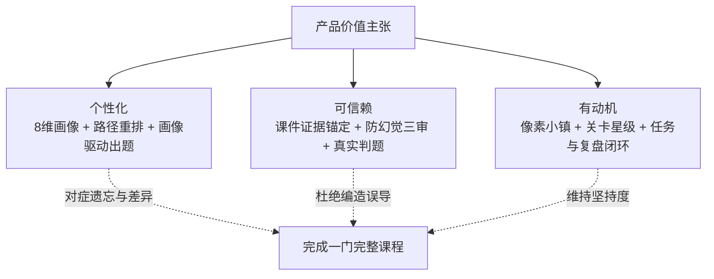

**产品级业务目标与成功度量（BR）**

| 编号 | 业务目标 | 关键结果 / 成功度量（KPI） | 优先级 |
| --- | --- | --- | --- |
| BR-00 | 开辟「第二课堂」，接住翘课 / 课堂掉队的学生 | 学生可课外按自己节奏完整重走课程闭环；掉队学生有可量化的「补回」路径（掌握度回升 / 章节补星 / 遗忘回声清零） | M |
| BR-01 | 让学生完成一门完整 Python 课程闭环 | 演示账号端到端走完「注册 → 画像 → Stage 三件套 → 章测 → 星级 → 复盘」 | M |
| BR-02 | 个性化教学，不做静态一刀切 | 画像至少 8 维且由 ≥6 类来源持续更新；章测题面随画像变化 | M |
| BR-03 | AI 内容可信、不误导初学者 | 100% AI 学习资源经防幻觉三审；客观题带 `evidence_page_ids` | M |
| BR-04 | 真实练习与反馈 | 正式提交入库、verdict 真实；前端 Pyodide 仅预览 | M |
| BR-05 | 对遗忘对症下药 | FSRS-lite 到期 KC 召回遗忘回声并引导复盘 | S |
| BR-06 | 赋能教师掌握学情 | 教师看板呈现星级分布 / 章测通过率 / KC 热力图 / 主线进度 | S |
| BR-07 | 多端可达 | 同一后端支撑 Web / Android / Windows / 微信 5 端 | S |
| BR-08 | 合规可公开发布 | 仅用 CC0 / CC-BY / CC-BY-SA / OFL 已审计资产，license 完备 | M |
| BR-09 | 比赛演示稳定 | 7 分钟演示脚本可复现；关键链路有兜底 | M |

**分角色目标**（按学生 / 教师 / 管理员拆解，映射来源 BR 与承载模块）

学生目标（SG，主用户）：

| 编号 | 目标 | 来源 | 承载模块 |
| --- | --- | --- | --- |
| SG-1 | 课外完整重走一门 Python 课程闭环：注册 → 画像 → Stage 看 / 学 / 练 → 章末大测试 → 0–3★ → 复盘 | BR-00, BR-01 | §3.3, §3.5, §3.6, §3.13 |
| SG-2 | 获得随 8 维画像持续变化的个性化（章测题面、资源选型、路径重排） | BR-02 | §3.4, §3.6, §3.14 |
| SG-3 | 在训练场提交真题并获**真实判题**反馈（Pyodide 仅预览 + 服务端正式判题双轨） | BR-04 | §3.10 |
| SG-4 | 用课件问答（带页码证据）、工坊（6 类资源）、费曼自测获取**不泄答**的学习支持 | BR-03 | §3.8, §3.9, §3.13 |
| SG-5 | 把失败提交沉淀为 Bug 矿洞调试支线，并被遗忘回声（FSRS-lite）按到期 KC 召回复盘 | BR-05 | §3.11, §3.13 |
| SG-6 | 被 NPC 记住、在公告板领 / 完成任务、加入班级参与教学 | BR-00 | §3.15, §3.16, §3.17 |
| SG-7 | 以同一后端契约从任一端接入，能力一致 | BR-07 | §3.19 |

教师目标（TG）：

| 编号 | 目标 | 来源 | 承载模块 |
| --- | --- | --- | --- |
| TG-1 | 创建班级、生成邀请码、管理成员并绑定《Python 语言基础》 | BR-06 | §3.16 |
| TG-2 | 发布班级任务，在教师看板查看星级分布 / 章测通过率 / KC 热力图 / 主线进度 | BR-06 | §3.16 |
| TG-3 | 抽查 AI 出题与生成资源质量（防幻觉三审、`evidence_page_ids` 可核） | BR-03, BR-06 | §3.9, §3.18 |
| TG-4 | 识别掉队 / 高风险学生，依 KC 热力安排补救 | BR-00, BR-06 | §3.16, §3.14 |

管理员目标（AG，保持轻量）：

| 编号 | 目标 | 来源 | 承载模块 |
| --- | --- | --- | --- |
| AG-1 | 账号与角色治理（STUDENT / TEACHER / ADMIN + 班级 owner / member），越权 403 | — | §3.3, §4.2 |
| AG-2 | AI 可信治理与追溯：所有 AI 生成留 `resource_run` 审计，决策可回溯「为什么 + agent + 证据链」 | BR-03 | §3.18, §4.8 |
| AG-3 | 运行治理：Docker Compose 一键部署 + 健康检查 + seed 幂等可重入 | BR-09 | §5 |
| AG-4 | 合规治理：CC / OFL 资产 license 登记、PII 脱敏、演示账号无真实凭据 | BR-08 | §4.9 |

### 2.2 用户特点

| 用户类 | 占比 / 重要性 | 技术水平 | 核心诉求 | 访问端 |
| --- | --- | --- | --- | --- |
| 学生（Student） | 高（主用户） | Python 初学者，差异大（CS / 非 CS / 文科） | 看懂、练会、被记住、有动机、查漏补缺 | 全部 5 端 |
| 教师（Teacher） | 中 | 熟悉教学，未必懂编程平台 | 掌握班级学情、发布任务、抽查 AI 出题 | Web |
| 管理员（Admin） | 低 | 运维 | 账号 / 角色 / 数据治理 | Web |
| 评审 / 访客 | 临时 | 不定 | 快速理解作品与教学闭环 | Web（匿名可读课件） |

**典型人物画像（Persona）**——用于校准个性化设计是否真的「接住了人」：

| 维度 | 小薇（非计算机专业 · 文科） | 阿杰（理工科 · 有一点基础） | 王老师（课程教师） |
| --- | --- | --- | --- |
| 背景 | 新闻学大二，零编程基础，必修 Python | 自动化大一，学过一点 C，自评 3/5 | 教《Python 语言基础》，带 50 人班 |
| 目标 | 通过考试（`learning_goal=EXAM`），不挂科 | 做项目（PROJECT），快点过基础学进阶 | 掌握全班学情、定位高频误区、布置针对性任务 |
| 痛点 | 看到代码就紧张，语法 / 缩进 / 类型反复出错，遗忘快 | 基础觉得简单想跳过，偶有盲区，动机依赖挑战 | 难量化每人掌握度；不放心 AI 出题质量 |
| 媒体偏好 | 视频 > 思维导图 > 文本 > 代码 | 代码 > 文本 > 视频 | — |
| 对系统期望 | 多图示、低难度循序、被记住错误并提醒复盘 | 路径可跳级、有进阶难题 / 无尽挑战、代码案例 | 星级分布 / 章测通过率 / KC 热力图 + 出题抽审 |
| 关键场景 | 看视频 → 思维导图资源 → 低难度练习 → 矿洞分层提示 | 画像快速定级 → 章测直接验证 → 无尽 + 拓展阅读 | 建班 → 发任务 → 看板诊断 → 抽查 AI 题 |

> 截图占位（八维画像雷达图）：
> - **网址**：`http://localhost:5173/profile`（Docker 部署 `http://localhost:8080/profile`）
> - **操作**：用演示学生账号登录（seed 见 `deploy/scripts/seed_demo_classroom.sh`，如 `demo-stu-01`）→ 已建画像后打开「我的画像」页 → 截取「八维画像雷达图」卡片。
> - **数据来源**：`GET /api/learner/profile/dimensions`；亦可用 ECharts radar 按该接口数据重绘。

### 2.3 假定与约束

#### 2.3.1 时间假定

- 项目处于比赛迭代节奏：R-14「世界收缩」与 R-15「主线完全重构」并行推进；Beta 以 7 分钟演示脚本为验收锚点。
- 学生单次学习时长假定 5–240 分钟 / 天（`learning_preference.session_minutes_per_day`），系统不假设长时间在线。
- LLM Provider 配额充足且可用；重 LLM 路径（章测出题）通过**预生成解耦**，保证考试期零等待（见 §3.6、§4.1）。

#### 2.3.2 人员假定

- 项目由小团队（3 人 + AI 协作）维护，最终质量由人工负责；因此刻意收敛范围、保持轻量（见 §2.3.4）。
- 学生为 Python 初学者，差异大；教师熟悉教学但未必懂编程平台；管理员承担运维。
- 演示与评审场景使用统一 `demo-` 前缀的虚构账号，不含真实学生 PII。

#### 2.3.3 技术约束

技术栈与编码规范按层固定（源：`AGENTS.md`，违背即视为不合规）：

| 层 | 约束（CON） |
| --- | --- |
| 前端 | CON-FE-01 Vue 3 + Vite + TypeScript strict + Pinia + Vitest；CON-FE-02 游戏渲染 Phaser 3；CON-FE-03 业务层禁 `any`，Phaser / 第三方动态对象隔离 adapter 层；CON-FE-04 组件 `PascalCase.vue`、工具模块 `camelCase.ts`；CON-FE-05 **单 `Phaser.Game` 实例**；CON-FE-06 地图 Tiled JSON 程序化生成、主玩图 `town_hub`；CON-FE-07 8 向输入写后端降 4 向 |
| 后端 | CON-BE-01 Java 21 + Spring Boot + Maven；CON-BE-02 类 PascalCase / 方法变量 camelCase / 常量 UPPER_SNAKE_CASE；CON-BE-03 REST 用资源名、非动作路径；CON-BE-04 新增 API 必有 DTO + 校验 + 统一错误 + 测试；CON-BE-05 表名 / 字段 snake_case；CON-BE-06 迁移须说明目的 / 影响 / 不可逆风险；CON-BE-07 RPG 存档表无前缀（V100–V110） |
| Python 微服务 | CON-PY-01 FastAPI + LangGraph；CON-PY-02 文件 / 函数 / 变量 snake_case、类 PascalCase；CON-PY-03 Agent 输出**结构化**（非大段自然语言）；CON-PY-04 Agent 故障 **fail-fast** 不静默降级；CON-PY-05 生产 / 演示**单 worker** |
| Android | CON-AND-01 Kotlin 2.2 + Compose（Material3）+ LibGDX 1.13.1 + Hilt / KSP；CON-AND-02 Retrofit / OkHttp / kotlinx-serialization + 协程；CON-AND-03 业务层禁 `Any`；CON-AND-04 不复用 Web 端 Phaser / `tilemap.ts` / `frontend/src/api/*.ts`；CON-AND-05 不运行 Python（仅服务端判题）；CON-AND-06 minSdk 26 / targetSdk 35 |
| 数据库 | PostgreSQL 16 + pgvector；Flyway 迁移（现状 V001–V160）；表 / 字段 snake_case |

#### 2.3.4 业务约束

**政策硬约束（CON-POL，源：`AGENTS.md`，最高优先级）**

| 编号 | 约束 |
| --- | --- |
| CON-POL-01 | 项目名 `Pythontopia`；默认独立仓库 `/home/cypress/Pythontopia`。 |
| CON-POL-02 | 唯一课程知识底座 Alethicode `packId=43`《Python 语言基础》。 |
| CON-POL-03 | 课程种子内置 `data/course-pack-43/`；初始化后验证 **7 文档 / 561 页 / 7 章 / 65 KC / 46 示例 / 39 题**。 |
| CON-POL-04 | 抽取 Alethicode 能力时保留来源说明，不带入老前端技术债。 |
| CON-POL-05 | **不启用 ReAct 循环**（除非用户明确要求）。 |
| CON-POL-06 | 不做纯前端假数据冒充真实业务数据。 |
| CON-POL-07 | 不用 Vuex、宽松 TypeScript 或散装 API 字段。 |
| CON-POL-08 | 不把班级架构删成单机游戏；不为展示效果牺牲教育目标。 |
| CON-POL-09 | R-14 世界收缩方案 A：单一中央 `town_hub`，废弃 5 图分块 / 农场作物 / 货币商店；R-15 进一步重构为后端权威 mainline 域。 |

**明确不做（Won't-have，能力边界）**

| 编号 | 不做项 | 说明 |
| --- | --- | --- |
| CON-OUT-01 | ❌ 背包 / 物品（inventory） | R-14 产品层弃用，端点退役，无客户端能力 |
| CON-OUT-02 | ❌ 货币 / 经济（currency） | 同上 |
| CON-OUT-03 | ❌ 商店 / 购买（shop） | 同上 |
| CON-OUT-04 | ❌ 农场 / 作物（播种 / 浇水 / KC 作物隐喻） | R-14 推翻 |
| CON-OUT-05 | ❌ 体力系统 / NPC 好感 / 送礼 | 已移除 |
| CON-OUT-06 | ❌ 完整课堂协作编码 / 复杂评分 / 多课程后台 / 实时监控大屏 | 班级保持轻量 |
| CON-OUT-07 | ❌ 多 pack 支持（解耦 packId=43） | 未来工作 |
| CON-OUT-08 | ❌ 真实长视频生成 | Storyboard 当前仅脚本 |
| CON-OUT-09 | ❌ 移动端复杂离线 | 本期在线为主 |
| CON-OUT-10 | ❌ 重型可观测栈（Prometheus / Grafana / Jaeger / Langfuse / APM / 集中式日志） | 收敛为审计表 + 决策玻璃盒 + healthcheck（见 §4.8） |

> 客户端**不得**为以上不存在的能力建 UI 或调用端点。说明：`inventory_item` / `currency` / `shop_listing` 等表仍残留在 schema 中（R-14 仅产品层弃用、未做 DROP 迁移），但对应客户端能力不存在。

### 2.4 产品定位与系统上下文

Pythontopia 是一个**多端 + 共享后端 + AI 微服务**的分布式系统。系统边界与外部实体（C4 System Context 近似）：

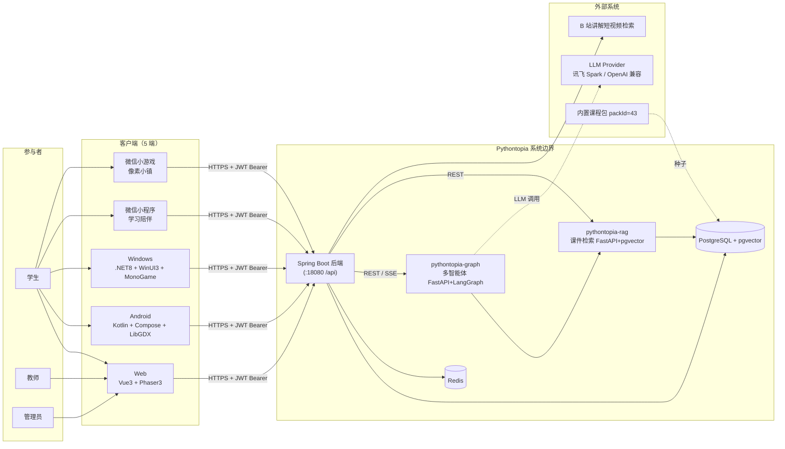

容器 / 组件视图（Web 端示例）：

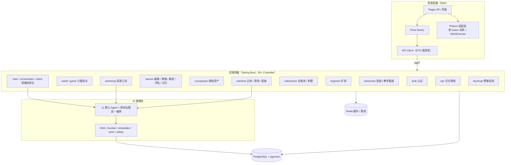

产品功能全景（思维导图）：

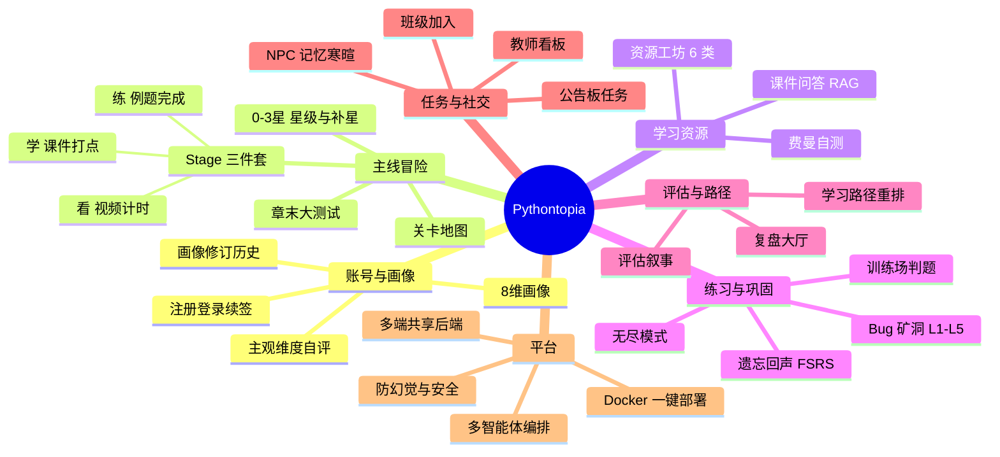

---

## 3 功能需求

> 编号规则 `FR-<模块>-<序号>`。每个功能模块（§3.3–§3.19）统一采用同一内部模板：**① 模块概述与用例动作清单 → ② 功能需求条目（含优先级 / 验证 / 状态）→ ③ 主流程 / 时序 / 状态图 → ④ 关键数据与接口要点（锚定真实端点 / DTO / 数据表）→ ⑤ 验收要点**。所有端点路径、字段、枚举与错误码均与后端源码及 `api-contract.md` 核对。

### 3.1 系统总体业务概述

Pythontopia 的全部玩法都服务于一个朴素目标：把第一课堂缺失的「看 → 学 → 练 → 测」闭环，在像素小镇里**为掉队学生重走一遍**。游戏元素与教学语义严格一一映射，杜绝无教育目的的装饰系统。

**游戏 → 教学语义映射（R-14 起）**

| 游戏元素 | 教育语义 | 系统落点（真实表 / 端点） |
| --- | --- | --- |
| KC 任务 | 知识点学习目标 | `course_kc` + `kc_mastery` |
| 看（Watch） | 课程视频 / 课件 / 课件问答（RAG） | Stage 视频计时 + 课件页 + `/api/tutor/ask` |
| 学（Study） | 资源工坊生成并消费学习资源 | 6 类 `learning_resource` |
| 练（Practice） | 训练场提交真实题判题 | `practice_submission` + `judge_result` |
| 测（Test） | 掌握度达阈值 / 章末大测试 | `kc_mastery` 阈值 + `chapter_test` + `chapter_star` |
| Bug 矿洞事件 | 提交失败 → 进 Bug 矿洞（支线） | `bug_mine_session` + `bug_mine_card` |
| 复盘大厅 | 周期评估 → 路径重排 | `learner_evaluation` + `learning_path` |

**核心教学闭环（看 → 学 → 练 → 测）**

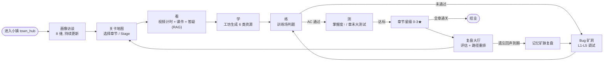

**端到端最小业务链路（参考实现，已落地）**

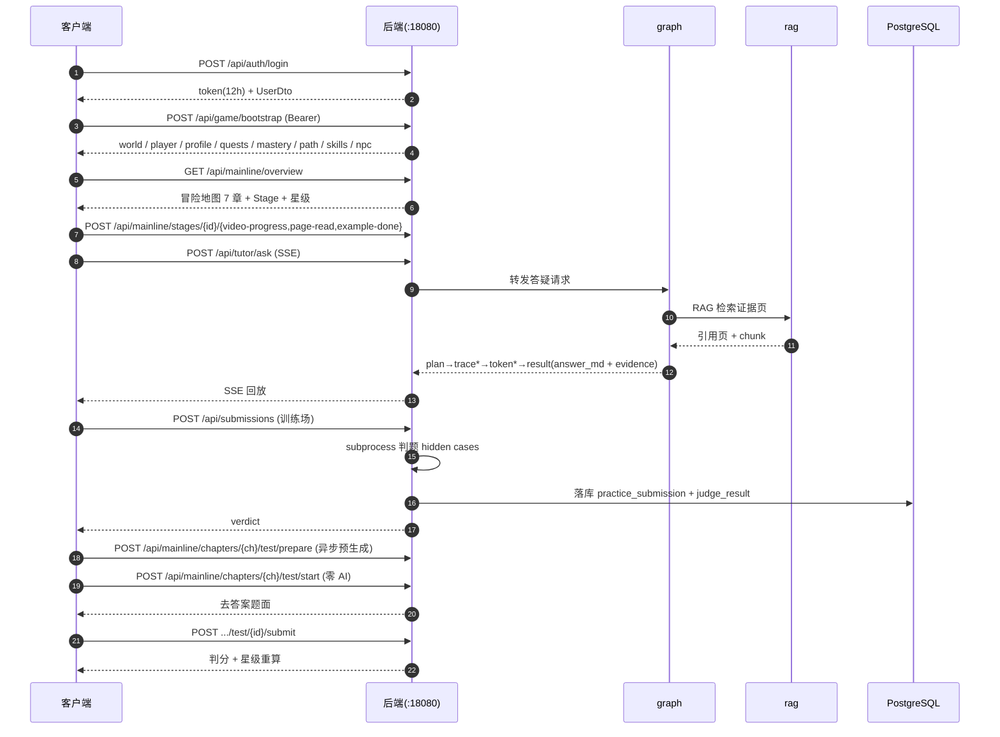

**学生用户旅程（情绪曲线）**

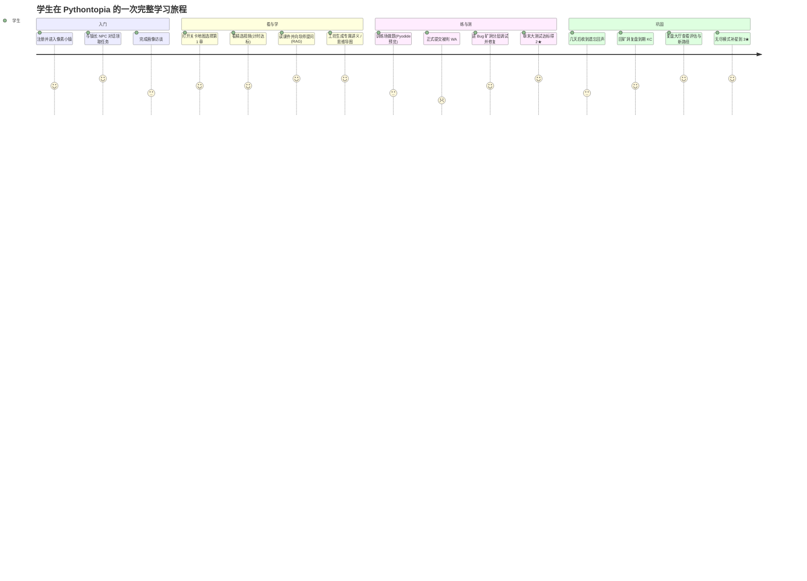

**关键业务状态机**

提交（Submission）生命周期：

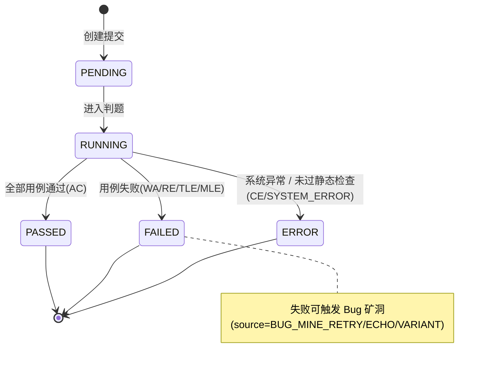

章末大测试（Chapter Test）生命周期：

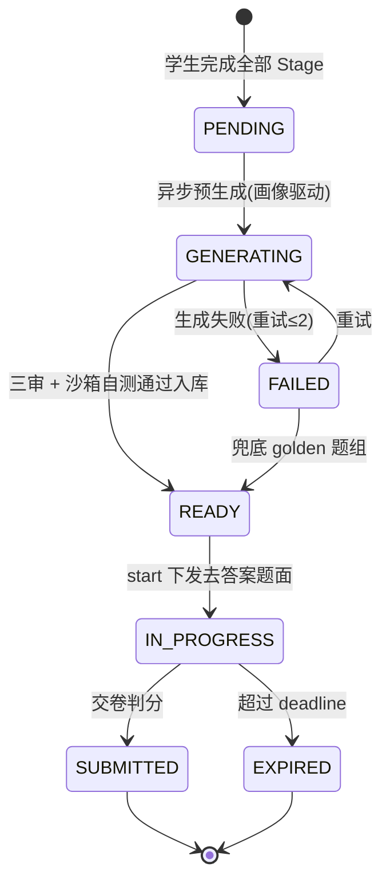

章节星级（Chapter Star）演化（只升不降、幂等）：

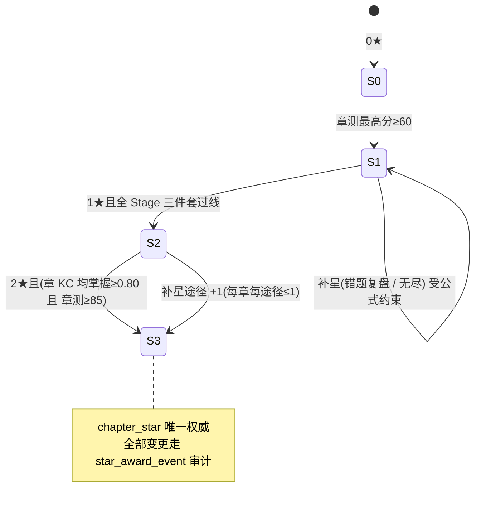

### 3.2 总体功能模块框架

**功能框架图**——模块间的数据 / 触发依赖（顶层）：

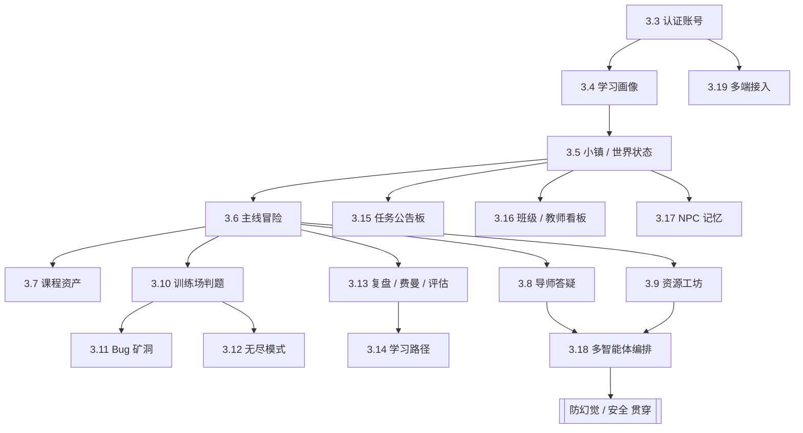

**用例总览**（参与者—用例关系，Mermaid 近似 UML 用例图）：

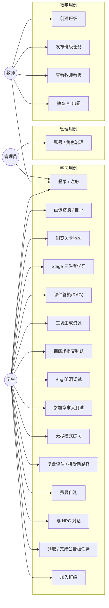

**功能模块清单**（17 个功能模块，逐一展开于 §3.3–§3.19）：

| 模块 | 章节 | 主参与者 | 核心端点前缀 | 优先级 |
| --- | --- | --- | --- | --- |
| 认证与账号 | §3.3 | 全部 | `/api/auth/*` | M |
| 学习画像 | §3.4 | 学生 | `/api/learner/profile*` | M |
| 中央小镇与世界状态 | §3.5 | 学生 | `/api/game/bootstrap`、`/api/world/*`、`/api/npc/*` | M |
| 主线冒险（看 / 学 / 练 / 测） | §3.6 | 学生 | `/api/mainline/*` | M |
| 课程包与课件资产 | §3.7 | 全部（匿名） | `/api/course/**` | M |
| 导师答疑与课件问答 | §3.8 | 学生 | `/api/tutor/ask`（SSE） | M |
| 资源工坊（6 类资源） | §3.9 | 学生 | `/api/workshop/*`、`/api/intent/route` | M |
| 训练场与判题（双轨） | §3.10 | 学生 | `/api/problems/{id}/public`、`/api/submissions*` | M |
| Bug 矿洞与遗忘回声 | §3.11 | 学生 | `/api/bug-mine/*` | S |
| 无尽模式 | §3.12 | 学生 | `/api/mainline/endless/summary` | S |
| 复盘 / 费曼 / 评估 | §3.13 | 学生 | `/api/learner/evaluations*`、`/api/feynman/*` | S |
| 学习路径规划 | §3.14 | 学生 | `/api/learner/path*`（bootstrap 内聚合） | S |
| 任务与公告板 | §3.15 | 学生 | `/api/quests*` | S |
| 轻量班级与教师看板 | §3.16 | 学生 + 教师 | `/api/classrooms/*`、`/api/teacher/.../dashboard/*` | S |
| NPC 记忆个性化 | §3.17 | 学生 | `/api/npc/{key}/greeting` | C |
| 多智能体编排与防幻觉 | §3.18 | 学生 + 系统 | `/api/orchestrator/turn/stream`（SSE） | S |
| 多端接入 | §3.19 | 全部 | 全契约（`api-contract.md`） | S |

### 3.3 认证与账号模块

**模块概述**：提供注册 / 登录 / 续签与基于角色的访问控制，是所有学习端点的入口。无状态 JWT、Bearer 头携带、TTL 12 小时，不使用 Cookie / Session。主参与者：全部角色。

**用例动作清单**：① 注册账号；② 登录获取令牌；③ 续签令牌；④ 角色与越权控制。

**功能需求**

| 需求 ID | 描述与业务规则 | 优先级 | 验证 | 状态 |
| --- | --- | --- | --- | --- |
| FR-AUTH-001 | 支持用户名 + 密码**注册**，成功返回 `201` + `UserDto`，用户名唯一。 | M | T/D | 已实现 |
| FR-AUTH-002 | 支持**登录**，返回 `LoginResponse{token, expiresAt, user}`；凭据错误返回 `BAD_CREDENTIALS(401)`。 | M | T/D | 已实现 |
| FR-AUTH-003 | JWT 无状态、Bearer 头携带、**TTL 12 小时**（`ttlMinutes:720`），不使用 Cookie / Session。 | M | T/I | 已实现 |
| FR-AUTH-004 | `/api/auth/refresh`：用**仍有效**的 token 换发新 token；token 过期后 refresh 亦返回 `401`（无独立 refresh token）。 | M | T | 已实现 |
| FR-AUTH-005 | 角色 `STUDENT / TEACHER / ADMIN`；面向学生的学习端点绝大多数仅 `STUDENT` 可访问，越权 `403`。 | M | T | 已实现 |
| FR-AUTH-006 | 教师注册 / 晋升须校验教师邀请码（`PYT_TEACHER_INVITE_CODE`）。 | S | T | 已实现 |
| FR-AUTH-007 | 客户端收到 `401` 应统一跳登录重登，不得静默刷新过期 token。 | M | I | 契约约定 |
| FR-AUTH-008 | 所有错误返回统一信封 `{code,message,details,traceId,timestamp}`，HTTP 状态码与 `code` 对应。 | M | T/I | 已实现 |

**关键数据与接口要点**

```jsonc
// POST /api/auth/register（匿名）→ 201 UserDto
{ "username": "demo-stu-01",   // 3–64, 仅 [A-Za-z0-9_.-], 全局唯一
  "password": "P@ssw0rd123",   // 8–72
  "displayName": "演示学生",    // ≤128, 禁含 < > & " ' `（防 XSS）
  "role": "STUDENT",           // STUDENT|TEACHER|ADMIN
  "teacherInviteCode": null }  // role=TEACHER 时必填
// POST /api/auth/login（匿名）→ LoginResponse
{ "token": "<jwt>", "expiresAt": "2026-06-06T09:39:00Z",
  "user": { "id": 1, "username": "demo-stu-01", "displayName": "演示学生", "role": "STUDENT" } }
```

- 登录主流程：校验凭据 → 签发 JWT（claims 含 userId / role，TTL 720 分钟）→ 返回 token + expiresAt + user → 客户端后续请求带 `Authorization: Bearer`。
- 边界与安全：密码加盐哈希存储（不可逆）；JWT 无状态不可撤销（靠短 TTL）；并发重复注册同名由唯一约束拦截。
- 错误码（✅ 真实）：`BAD_CREDENTIALS(401)`、`REFRESH_TOKEN_INVALID(401)`、`UNAUTHORIZED(401)`、`FORBIDDEN(403)`、`BAD_REQUEST(400)`。

**验收要点**

- AC-AUTH-1：demo 学生登录返回有效 token，12h 内访问 `/api/game/bootstrap` 成功。
- AC-AUTH-2：教师 token 访问 `/api/quests/today` 返回 `403`。
- 可追踪锚点：`AuthController` · `users` 表（role 列）· backend 鉴权测试。

### 3.4 学习画像模块

**模块概述**：画像固定绑定 packId=43，含 **8 维**统一聚合（`learner_profile.dimensions` JSONB）。画像由对话访谈主动产出 + 学习行为被动持续更新，并驱动路径排序、章测出题、工坊选型与 NPC 寒暄。**禁止只凭一次问卷做静态推荐**。主参与者：学生。

**用例动作清单**：① 发起画像访谈；② 逐轮对话并结束落库；③ 查看 8 维雷达快照；④ 自评 4 个主观维度；⑤ 行为驱动被动更新；⑥ 查看画像修订历史。

**8 维结构化定义**（与 `LearnerProfileDto` 一致，取值域为硬约束）

| 维度 | key | 子字段与取值域 |
| --- | --- | --- |
| 专业背景 | `major` | `CS` / `NON_CS_STEM` / `NON_CS_HUMANITIES` / `OTHER` |
| 知识基础 | `base_level` | `programming_years` 0–20；`python_self_rated_level` 1–5 |
| 学习目标 | `learning_goal` | `kind` EXAM/PROJECT/INTEREST/JOB；`target_kc_codes` 仅 pack43 |
| 认知风格 | `cognitive_style` | `field_dependent` 0–1；`sequential_vs_holistic` −1..1 |
| 学习偏好 | `learning_preference` | `media_priority` 有序集 video/text/mindmap/code；`session_minutes_per_day` 5–240 |
| 易错模式 | `error_patterns` | `frequent_kc_codes` 仅 pack43；`common_categories`（syntax/loop/type/debugging…） |
| 实践能力 | `practice_capability` | `avg_attempts_per_problem` 0–20；`success_rate` 0–1 |
| 情绪与坚持度 | `emotion_persistence` | `resilience` 0–1；`recent_mood` positive/neutral/negative |

**功能需求**

| 需求 ID | 描述与业务规则 | 优先级 | 验证 | 状态 |
| --- | --- | --- | --- | --- |
| FR-PROF-001 | 提供对话式画像访谈，由 `ProfileAgent` 结构化产出 / 更新画像。 | M | T/D | 已实现 |
| FR-PROF-002 | `GET /api/learner/profile` 返回当前画像；无画像时 `204 No Content`。 | M | T | 已实现 |
| FR-PROF-003 | `GET /api/learner/profile/dimensions` 返回 8 维快照（供雷达图 + 自评 UI）。 | M | T | 已实现 |
| FR-PROF-004 | `PUT /api/learner/profile/dimensions/{key}` 学生仅可**自评** 4 个主观维度；改客观维度 `403`。 | M | T | 已实现 |
| FR-PROF-005 | 画像必须由 ≥6 类来源**持续被动更新**（访谈、练习、判题、Bug 调试、资源反馈、任务、班级表现）。 | M | A/I | 已实现（`PassiveProfileService` 监听 `LearningEvent`） |
| FR-PROF-006 | `target_kc_codes` / `frequent_kc_codes` 必须存在于 pack43；学生陈述值须保留访谈轮次证据锚；接地失败则追问且**不写库**。 | M | A/I | 已实现 |
| FR-PROF-007 | `GET /api/learner/profile/revisions?limit=` 返回画像修订历史（可追溯）。 | S | T | 已实现 |
| FR-PROF-008 | 画像用于驱动：路径排序、章测出题个性化、工坊资源选型、NPC 个性化寒暄。 | M | A | 已实现 |

**画像更新数据流**

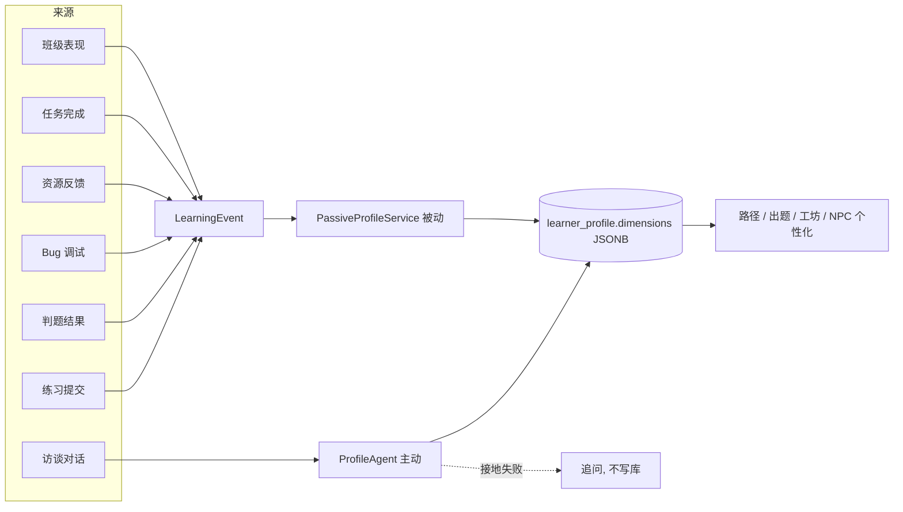

**关键数据与接口要点**

- 访谈端点：`POST /api/learner/profile/interview`（开会话）→ `.../{sessionId}/turn`（逐轮）→ `.../{sessionId}/finish`（结束并落库 + curriculum bootstrap 初始化 65 KC 掌握度）。
- 维度快照 `ProfileDimensionDto`：`{ key, label, score(0..1), confidence(=min(1,evidenceCount/8), <0.3 信号不足), evidenceCount, selfEditable, tags[] }`。
- 接地规则（防幻觉）：推断值在 `narrativeSummary` 用低置信表述；接地失败 agent 追问且不得写 `learner_profile`。
- 错误码：`UNAUTHORIZED(401)`、`FORBIDDEN(403)`（越权改客观维度）、`PROFILE_DIMENSION_NOT_FOUND(404)`、`BAD_REQUEST(400)`。

**验收要点**

- AC-PROF-1：访谈后 `dimensions` 8 个 key 齐全；客观维度自评返回 403。
- AC-PROF-2：一次判题失败后，相关维度的被动更新事件可见于修订历史。
- 可追踪锚点：`ProfileController` / `ProfileInterviewController` · `learner_profile` / `profile_revision` 表 · `docs/profile_schema.md`。

### 3.5 中央小镇与世界状态模块

**模块概述**：登录后通过**单次聚合启动**进入像素小镇 `town_hub`（≤50×40），一次性拉齐世界 / 玩家 / 画像 / 任务 / 掌握度 / 路径 / 技能 / NPC / 存档 / 日历事件，避免多次往返。世界含轻量日历 / 天气用于氛围与节律，但**不引入无教育目的的装饰系统**。主参与者：学生。

**用例动作清单**：① 聚合启动进入小镇；② 角色移动（8 向输入降 4 向写库）；③ 存档 / 读档；④ 世界时钟与日历事件；⑤ 技能树；⑥ NPC 脚本对话（个性化寒暄见 §3.17）。

**功能需求**

| 需求 ID | 描述与业务规则 | 优先级 | 验证 | 状态 |
| --- | --- | --- | --- | --- |
| FR-WORLD-001 | `POST /api/game/bootstrap` 登录后 / 章节重置后调用一次，**聚合返回** world、player、profile、quests、mastery、path、skills、NPC、存档槽、待处理日历事件。 | M | T/D | 已实现 |
| FR-WORLD-002 | 主玩地图为**单一中央小镇 `town_hub`**（≤50×40）；`mine_south` 仅作 Bug 矿洞支线场景。 | M | I | 已实现（R-14） |
| FR-WORLD-003 | Phaser 必须为**单 Game 实例**（`phaserGame.ts` 单例 + `WorldCanvas.vue`），禁止多组件多实例。 | M | I | 已实现 |
| FR-WORLD-004 | 输入支持 8 方向（`ExtendedDirection`），写后端时降为 4 向（`toServerDirection`）。 | S | T | 已实现 |
| FR-WORLD-005 | 世界含日历 / 日期 / 天气等轻状态，用于氛围与节律。 | C | I | 已实现 |
| FR-WORLD-006 | 玩家存档保留技能 / 对话 / 日历 / 存档槽（背包 / 经济已废弃）。 | S | I | 部分（R-14 收敛） |
| FR-WORLD-007 | **不得**提供背包 / 物品、货币 / 经济、商店 / 购买、农场 / 作物、体力、NPC 好感 / 送礼等能力或 UI。 | M | I | 已实现（移除） |

**聚合启动契约**

```jsonc
// POST /api/game/bootstrap（Bearer）→ GameBootstrapResponse（一次性聚合 10 个字段）
{
  "world":   { "worldSessionId": 9, "dayIndex": 1, "season": "SPRING", "timeOfDay": "MORNING",
               "weather": "SUNNY", "inGameMinutes": 480 },
  "player":  { /* PlayerStateDto: 位置 / 朝向 / 外观 */ },
  "profile": { /* LearnerProfileDto, 见 §3.4；可能为 null */ },
  "quests":  [ /* QuestDto[]，见 §3.15 */ ],
  "mastery": [ /* MasterySnapshotDto[]: kcCode, masteryScore(0..1), confidence, latestSource */ ],
  "path":    [ /* LearningPathNodeDto[]: 当前 ACTIVE 路径节点 */ ],
  "skills":  [ /* LearnerSkillDto[] */ ],
  "npcStates": [ /* NpcDialogStateDto[] */ ],
  "activeSlot": { /* SaveSlotDto */ },
  "pendingEvents": [ /* WorldEventDto[] */ ]
}
```

- 渲染约束：地图 Tiled JSON 由 `scripts/generate-maps.mjs` 程序化生成；前端叠加 HUD（任务 / 学习目标 / 星条），再拉 `/api/mainline/overview` 渲染冒险地图入口。
- 能力边界：响应**不含** `currency` / `inventory`（R-14 移除）。
- 错误码：`UNAUTHORIZED(401)`。

**验收要点**

- AC-WORLD-1：bootstrap 单次返回上述聚合字段，响应中**不含** currency / inventory。
- AC-WORLD-2：全局仅一个 `Phaser.Game` 实例（代码检视 + 运行时断言）。
- 可追踪锚点：`GameBootstrapController` / `WorldController` / `SaveSlotController` / `CalendarController` / `SkillController`。

### 3.6 主线冒险模块（看 / 学 / 练 / 测）

**模块概述**：R-15「主线完全重构」的核心。主线进度为**后端权威**（`mainline_stage_progress` / `chapter_star` / `chapter_test`，迁移 V156/V157），旧前端权威 `mainQuest` 存档整体废弃。客户端只读 `overview` 渲染冒险地图，并通过写接口打点；**星级公式、解锁、补星判定全在后端**。主参与者：学生。

**用例动作清单**：① 浏览冒险地图（7 章 + Stage + 星级）；② 进入 Stage 学习页；③「看」视频打点；④「学」课件页打点；⑤「练」例题打点；⑥ 触发章末大测试预生成；⑦ 开考（零 AI）；⑧ 交卷判分；⑨ 查看章节星级与补星。

#### 3.6.1 关卡地图与导航

| 需求 ID | 描述与业务规则 | 优先级 | 验证 | 状态 |
| --- | --- | --- | --- | --- |
| FR-MAIN-001 | `GET /api/mainline/overview` 一次拉齐 `MainlineOverviewDto`：`totalStars` + 7 章（chapter, title, unlocked, stars, bestTestScore, stages[], testStatus, starBreakdown, recovery）。 | M | T/D | 已实现 |
| FR-MAIN-002 | 关卡地图为独立 Phaser 场景 `ChapterMapScene`（星露谷风羊皮卷），复用单 Game 实例；节点三态：锁定 / 进行中 / 已通关（0–3★）。 | M | D | 已实现 |
| FR-MAIN-003 | 章节按顺序解锁（第 1 章默认解锁）；锁定章节不可进入学习 / 测试。 | M | T | 已实现 |
| FR-MAIN-004 | 地图入口：town_hub 告示牌 + HUD 按钮；`overview` 大 payload 渲染应 < 200ms。 | S | T | 已实现 |

#### 3.6.2 Stage 三件套（看 / 学 / 练）

章内 KC 分组为 **Stage（小节）**，每章 3–5 个，共约 24 个，覆盖全部 65 KC。每 Stage「三件套」过线判据如下。

| 需求 ID | 描述与业务规则 | 优先级 | 验证 | 状态 |
| --- | --- | --- | --- | --- |
| FR-MAIN-010 | `GET /api/mainline/stages/{stageId}` 返回小节学习页详情（静态定义 + 当前用户已完成 id 集合）。 | M | T | 已实现 |
| FR-MAIN-011 | **看**：`POST .../video-progress {deltaSec}` 累计观看达 `requiredVideoSec`（运行时按本章视频总时长×80% 计）过线；服务端硬限频（单次 ≤120s、每分钟 ≤2 次）防挂机刷。 | M | T | 已实现 |
| FR-MAIN-012 | 视频源 = stage `video_keyword` 实时检索的 B 站精选短视频（≤10min），站内 iframe 按可见性计时（失焦不计）。 | S | D | 已实现 |
| FR-MAIN-013 | **学**：`POST .../page-read {pageId}` 读完课件页（幂等，重复同页只记一次）。 | M | T | 已实现 |
| FR-MAIN-014 | **练**：`POST .../example-done {problemId, submissionId?}` 完成例题；带 `submissionId` 须本人且 `PASSED`。允许 AI 导学陪练。 | M | T | 已实现 |
| FR-MAIN-015 | 全部写接口**幂等**；三件套全部过线则 `completed_at` 置位。 | M | T | 已实现 |
| FR-MAIN-016 | 前端「看」打点应 10s 批量上报一次，降低高频写压力。 | C | I | 已实现 |

Stage 学习态 ER（节选）：

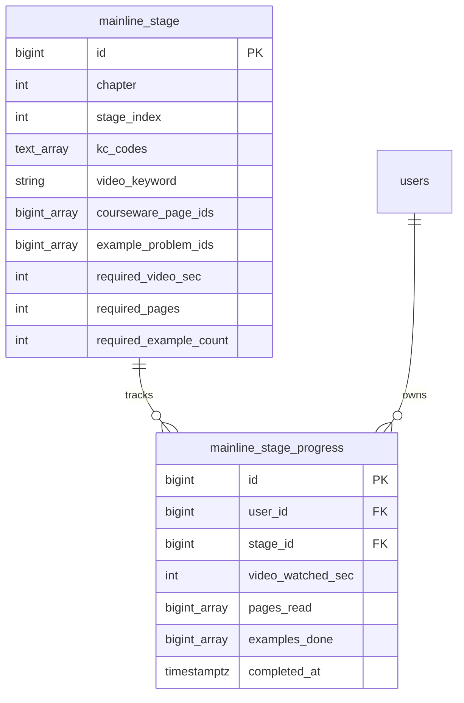

#### 3.6.3 章末大测试（无 AI 考试）

> 核心创新：**画像驱动 AI 预生成入库、考试期间零 AI 调用** + 防作弊锁。题型 = 选择×5×8 + 判断×3×5 + 填空×3×5 + 编程×1×30 = **100 分**，默认限时 30 分钟。

| 需求 ID | 描述与业务规则 | 优先级 | 验证 | 状态 |
| --- | --- | --- | --- | --- |
| FR-MAIN-020 | `POST .../test/prepare` 触发**异步预生成**（`chapter_test` 置 GENERATING，`@Async` + 信号量节流）。 | M | T | 已实现 |
| FR-MAIN-021 | 预生成由 graph `POST /agents/chapter-test/generate` 完成：输入 = 章 KC + 8 维画像摘要 + errorbook 高频错因 + 证据页；输出题面 JSON（含答案 / 解析 / 证据页，**绝不下发答案**）。 | M | T | 已实现 |
| FR-MAIN-022 | 个性化：易错模式 → 针对性出题；知识基础弱 → 降低编程题复杂度但覆盖相同 KC。 | S | A | 已实现 |
| FR-MAIN-023 | 防幻觉：客观题必须带 `evidence_page_ids`（RAG 校验）；编程题须沙箱跑参考解通过全部用例才入库；失败重试 ≤2，再失败用每章人工 **golden 兜底题组**。 | M | T | 已实现 |
| FR-MAIN-024 | `POST .../test/start` 开考：下发**去答案**题面 + `deadlineAt`；同章未提交只允许一份 IN_PROGRESS；**考试过程零 LLM 调用**。 | M | T/D | 已实现 |
| FR-MAIN-025 | `POST .../{testId}/submit` 交卷判分：CHOICE/JUDGE 精确比对；FILL 归一化比对；CODING 走判题沙箱跑隐藏用例按通过比例给分。超时按 `deadlineAt` 拒收记 `integrity.overtime`。 | M | T | 已实现 |
| FR-MAIN-026 | 重考：不限次数、冷却 10 分钟、`attempt_no` 递增、重新预生成（防背答案）、取**最高分**计星；`GET .../test/latest` 解析仅提交后返回。 | S | T | 已实现 |
| FR-MAIN-027 | 防作弊（尽力而为）：考试页隐藏 AI 工坊 / 导学 / 矿洞入口 + 路由守卫；禁粘贴计数 `integrity.paste_blocked`；`visibilitychange` 失焦计数（仅记录供教师参考）；服务端时限硬校验。 | S | T/I | 已实现 |

章末大测试预生成 + 考试时序（高并发关键路径）：

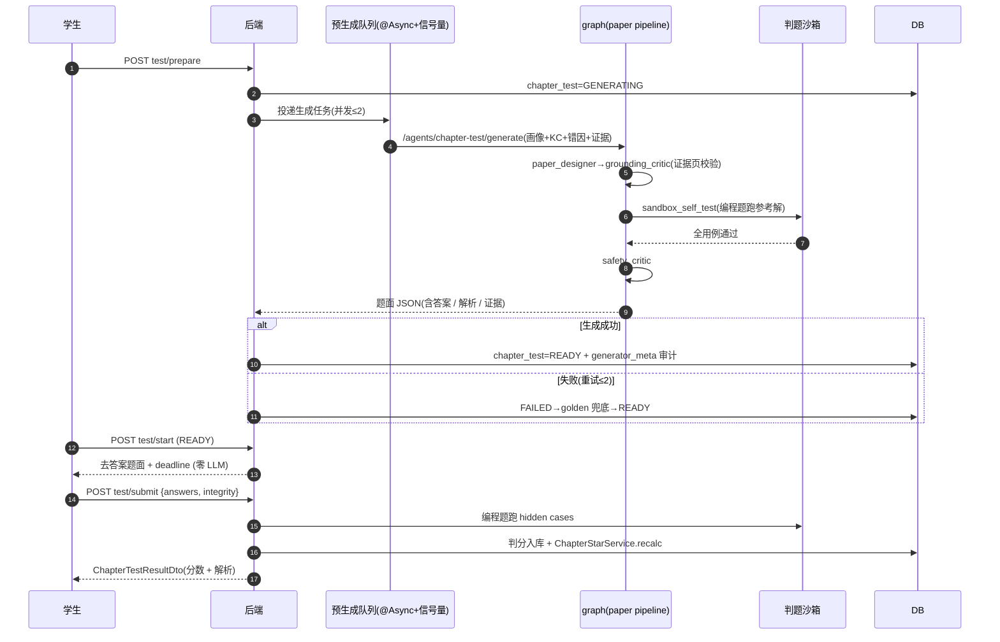

#### 3.6.4 章节星级与补星

| 需求 ID | 描述与业务规则 | 优先级 | 验证 | 状态 |
| --- | --- | --- | --- | --- |
| FR-MAIN-030 | 每章 0–3★，`chapter_star` 唯一权威，变更走 `star_award_event` 审计；`ChapterStarService.recalc(userId, chapter)` 统一收口，**幂等、只升不降**。 | M | T | 已实现 |
| FR-MAIN-031 | **1★** = 章测最高分 ≥ 60；**2★** = 1★ 且本章全部 Stage 三件套过线；**3★** = 2★ 且（本章 KC 平均掌握度 ≥ 0.80 且测试最高分 ≥ 85）。 | M | T | 已实现 |
| FR-MAIN-032 | **错题复盘补星**：本章 KC 的 bug-mine session `RESOLVED` ≥ 3 → +1（`ERRORBOOK_RECOVERY`）；`POST .../recovery/errorbook` 校验后发放（幂等）。 | S | T | 已实现 |
| FR-MAIN-033 | **无尽挑战补星**：无尽「本章范围」单轮答对 ≥ 8 且正确率 ≥ 80% → +1（`ENDLESS_RECOVERY`），防刷每日每章至多记 1 次。补星每章每途径至多 +1、封顶 3★。 | S | T | 已实现 |

**关键数据与接口要点**

- 关卡地图 `GET /api/mainline/overview` → `MainlineOverviewDto`（含 `starBreakdown:{test,stage,mastery,recovered[]}`、`recovery:{errorbookDone,endlessDone}`）。
- 开考 `POST .../test/start` → `ChapterTestPaperDto`（**去答案**：`{ testId, attemptNo, timeLimitSec, deadlineAt, items:[{ qid,type,score,stem,options[],samples[] }] }`，不含 answer / explain / hidden_test_cases / reference_solution / evidence_page_ids）。
- 交卷 `POST .../{testId}/submit` → `ChapterTestResultDto`（`score/maxScore/passed/stars/overtime` + 逐题 `awardedScore/correctAnswer/explain` + `integrity`）。
- 补星 `POST .../endless/summary {chapter,correct,total,streak}` 与 `POST .../recovery/errorbook` → `{ starAwarded }`。
- 错误码（✅ 真实）：`CHAPTER_TEST_OVERTIME(409)`、`UNAUTHORIZED(401)`；代表性：章节锁定 / 未就绪 / 已有进行中。

**验收要点**

- AC-MAIN-1：完成第 1 章全部 Stage 后可触发预生成；start 时若未就绪则同步生成或发 golden，考试期零 LLM。
- AC-MAIN-2：章测 70 分 → 1★；补齐三件套 → 2★；KC 均掌握 0.82 且重考 88 分 → 3★。
- AC-MAIN-3：星级只升不降，重复 recalc 幂等；超时提交被拒收并记 `overtime`。
- 可追踪锚点：`MainlineController` / `ChapterTestController` / `MainlinePracticeController` · `mainline_*` / `chapter_star` / `chapter_test` / `star_award_event` 表。

### 3.7 课程包与课件资产模块

**模块概述**：课程底座唯一为 packId=43《Python 语言基础》，`/api/course/**` 全部**匿名可读**（课件浏览、证据页图、视频标签不带 `Authorization`）。验收计数为硬约束：**7 文档 / 561 页 / 7 章 / 65 KC / 46 示例 / 39 题**。主参与者：全部（匿名）。

**用例动作清单**：① 查看课程包元信息；② 浏览章节 / KC；③ 阅读课件页（含证据图）；④ 浏览题目（不含隐藏用例）；⑤ 课件页渲染为 PNG 证据图；⑥ 视频 Range 流式播放。

**章节与 KC 结构（packId=43，`course_chapter` 真实值）**

| 章（id） | 章节标题 |
| --- | --- |
| ch1（179） | 第一章：计算工具与计算思维（KC001–007） |
| ch2（180） | 第二章：Python 语言基础(2) |
| ch3（181） | 第三章：计算机信息表示及计算 |
| ch4（182） | 第四章：流程自动化 |
| ch5（183） | 第五章：数据结构 |
| ch6（184） | 第六章：数据存取与分析 |
| ch7（185） | 第七章：归纳与抽象（KC054–065） |

> 大章节 = `course_chapter` 7 章；小章节 Stage = 章内 KC 分组（每章 3–5 个，共约 24 个），覆盖全部 65 KC。
>
> 生成图占位（65 节点 KC 依赖网，**非截图**）：由 `course_kc.prerequisite_codes`（65 节点）用 Graphviz / Cytoscape 出有向图；取数 `GET /api/course/kcs`。Mermaid 在该规模可读性差。

**功能需求**

| 需求 ID | 描述与业务规则 | 优先级 | 验证 | 状态 |
| --- | --- | --- | --- | --- |
| FR-CRS-001 | `GET /api/course/pack` 返回课程包元信息（文档 / 页 / 章 / KC / 示例 / 题计数）。 | M | T | 已实现 |
| FR-CRS-002 | `GET /api/course/chapters`、`GET /api/course/kcs?chapterId=` 返回章节 / KC 列表。 | M | T | 已实现 |
| FR-CRS-003 | `GET /api/course/pages?kcCode=PY43-KC-001` 返回某 KC 课件页（含 markdown 正文 / 摘要）。 | M | T | 已实现 |
| FR-CRS-004 | `GET /api/course/pages/{pageId}/image` 将课件页渲染为 PNG 证据图（`image/png`，缓存 24h）。 | M | T | 已实现 |
| FR-CRS-005 | `GET /api/course/problems?kcCode=`、`/{id}` 返回题目（题面，**不含隐藏用例**）。 | M | T | 已实现 |
| FR-CRS-006 | `GET /api/course/videos` / `/{id}` 返回视频清单与**支持 HTTP Range** 的流式分发（206/200/416）。 | S | T | 已实现 |
| FR-CRS-007 | 课程种子数据必须内置 `data/course-pack-43/`；空库初始化后须通过计数验收。 | M | T | 已实现 |
| FR-CRS-008 | **禁止伪造**课件页码、章节、题目、作者或教材内容。 | M | I | 约束 |

**关键数据与接口要点**

- `GET /api/course/pack` → `{ id:43, name:"Python语言基础", document_count:7, page_count:561, chapter_count:7, kc_count:65, example_count:46, problem_count:39 }`。
- 训练场公开题 `/api/problems/{id}/public` → `PublicProblemDto{ id, kcCode, title, statementMarkdown, inputDescription, outputDescription, difficulty, samples }`（**隐藏用例不下发**）。
- 视频 Range 行为：带 `Range` → `206 Partial Content` + `Content-Range` + `Accept-Ranges: bytes`；无 Range → `200`；越界 → `416`。
- 错误码：页 / 题 / 视频不存在 → `404`；视频 Range 越界 → `416`；公开题视图 → `PROBLEM_NOT_FOUND(404)`。

**验收要点**

- AC-CRS-1：空库 docker 初始化后 `/api/course/pack` 计数 = 7 / 561 / 7 / 65 / 46 / 39。
- AC-CRS-2：`/api/course/problems/{id}` 与 `/public` 响应不含隐藏用例字段。
- 可追踪锚点：`CoursePackController` / `CoursePageImageController` / `CourseVideoController` · `course_pack` / `course_chapter` / `course_kc` / `course_page` / `course_problem` 表。

### 3.8 导师答疑与课件问答模块

**模块概述**：基于 RAG 的课件问答（导师答疑），SSE 流式输出，含课件证据引用与防幻觉 / 安全审查。命中不足或触发敏感词时**绝不编造引用**；训练场 / 考试语境下有**防泄答护栏**。主参与者：学生（仅 STUDENT）。

**用例动作清单**：① 向导师提问（流式）；② 查看回答与证据引用回链；③ 上报采纳讲法；④ 查看答疑会话历史；⑤ 无证据时诚实告知 / 标注通识知识。

**功能需求**

| 需求 ID | 描述与业务规则 | 优先级 | 验证 | 状态 |
| --- | --- | --- | --- | --- |
| FR-RAG-001 | `POST /api/tutor/ask`（SSE）提供导师答疑流，事件序列 `plan → trace* → token* → result → (error)`。 | M | T/D | 已实现 |
| FR-RAG-002 | RAG 按 `kc_codes` / `chapter_id` 检索课件页；命中低于阈值或触发敏感词统一返回 `no_evidence_found=true, hits=[]`，**绝不编造引用**。 | M | T | 已实现 |
| FR-RAG-003 | 答疑结果须给出 `evidence_page_ids`，前端可点击回链到课件页（`page_id → (docId, pageNo)`）。 | M | T | 已实现 |
| FR-RAG-004 | **防泄答护栏**：训练场 / 考试语境不得给可复制提交的完整答案（`SAFETY_KEYWORDS` + prompt 规则），只给思路 / 定位 / 反问。 | M | A/I | 已实现 |
| FR-RAG-005 | 内容若来自通识知识而非课件，必须显式标注「基于通识知识」。 | M | I | 已实现 |
| FR-RAG-006 | RAG 索引由 `init_rag_index.sh` 构建；重建端点受 `X-Internal-Token` 保护。 | S | T | 已实现 |
| FR-RAG-007 | SSE 为 `POST` + 自定义 `Authorization`，浏览器原生 `EventSource` 不适用；各端按契约用 fetch / OkHttp / wx.request 分块解析。 | M | I | 契约约定 |

RAG 答疑防幻觉流：

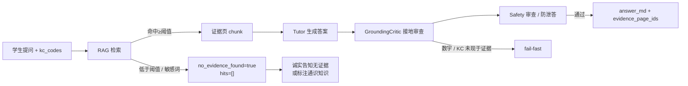

**关键数据与接口要点**

```jsonc
// POST /api/tutor/ask（SSE, STUDENT）请求
{ "question": "for 循环和 while 循环有什么区别?", "kcCodes": ["PY43-KC-016"],
  "context": "训练场 / 课件 / 题目语境（防泄答与锚定）", "profileBrief": "媒介偏好 video; 易错 loop" }
// result 帧 data
{ "answer_md": "...", "evidence_page_ids": [123,456], "grounding": "PASS", "safety": "PASS" }
```

- 配套非流式端点：`POST /api/tutor/style-engaged`（上报采纳讲法，`204`）、`GET /api/tutor/sessions?limit=20`。
- 证据回链：`evidence_page_ids` 经 `resolvePageById` 解析后跳转课件页 / 证据图。
- 错误码：`TUTOR_FAILED`（error 帧）、`UNAUTHORIZED(401)`、`FORBIDDEN(403)`。

**验收要点**

- AC-RAG-1：查询「input函数 / for循环 / 列表」返回非空证据页并可回链。
- AC-RAG-2：训练场题目语境下索取完整答案被护栏拒绝。
- 可追踪锚点：`TutorController` / `RagController` · graph `tutor_agent.py` · rag 服务。

### 3.9 资源工坊模块（六类个性化资源）

**模块概述**：多智能体按 KC + 画像生成 **6 类个性化学习资源**：讲义（Handout）/ 思维导图（MindMap）/ 练习题（Practice）/ 代码案例（CodeLab）/ 拓展阅读（Reading）/ 动画脚本（Storyboard）。对话框先经意图路由分类再分派。每次生成必写审计并经防幻觉三审。主参与者：学生（教师禁止生成）。

**用例动作清单**：① 输入一句话经意图路由分类；② 流式生成 6 类资源；③ 浏览历史资源；④ 提交资源反馈（反哺画像）；⑤ `VIDEO` 意图取 B 站精选视频卡片；⑥ `REVIEW` 意图引导矿脉回声复习。

**功能需求**

| 需求 ID | 描述与业务规则 | 优先级 | 验证 | 状态 |
| --- | --- | --- | --- | --- |
| FR-WS-001 | `POST /api/workshop/resources/stream`（SSE，`plan → trace* → result`）按 KC + 画像生成资源；亦提供非流式 `POST /api/workshop/resources`。 | M | T/D | 已实现 |
| FR-WS-002 | 6 类资源各由对应 Agent 产出结构化 artifact；MindMap / Storyboard 支持 ASCII / SVG / Mermaid 图。 | M | T | 已实现 |
| FR-WS-003 | 每次生成必写审计 `resource_run`{agent_name, scenario, input_summary, output_artifact, evidence_page_ids, safety_result, grounding_result, status, correlation_id, graph_trace, created_at}。 | M | I/A | 已实现 |
| FR-WS-004 | 生成末端必须经 `GroundingCriticAgent` + `SafetyAgent`；命中即写明证据或显式标注通识知识。 | M | A | 已实现 |
| FR-WS-005 | `GET /api/workshop/resources?type=&kcCode=&limit=&offset=`、`/{id}` 浏览资源；`POST /{id}/feedback` 提交反馈。 | S | T | 已实现 |
| FR-WS-006 | 工坊对话先经 `POST /api/intent/route` 意图路由分类（`intent ∈ {ASK,VIDEO,REVIEW,HANDOUT,MINDMAP,PRACTICE,CODE_LAB,READING,STORYBOARD}`）。 | S | T | 已实现 |
| FR-WS-007 | `REVIEW` 引导去 Bug 矿洞按 FSRS 到期 KC 复盘（不调生成管线）；`VIDEO` 走 B 站精选视频卡片（检索非生成）。 | S | T | 已实现 |
| FR-WS-008 | 教师角色禁止生成资源（仅 STUDENT 可 `POST /api/workshop/resources`）。 | M | T | 已实现 |
| FR-WS-009 | Agent 故障必须 fail-fast，不允许静默降级成普通聊天；不启用 ReAct 循环。 | M | A/I | 约束 |

意图路由分派：

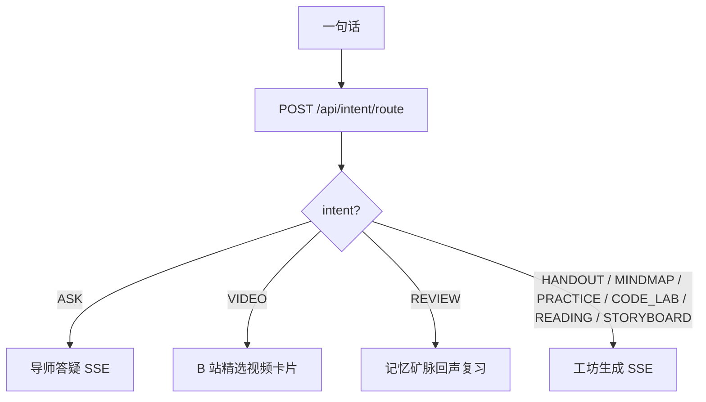

**关键数据与接口要点**

```jsonc
// POST /api/workshop/resources(/stream) → LearningResourceDto
{ "id": 88, "packId": 43, "kcCodes": ["PY43-KC-016"], "chapterId": 181,
  "type": "MINDMAP",            // HANDOUT|MINDMAP|PRACTICE|CODE_LAB|READING|STORYBOARD
  "title": "for 循环知识脑图",
  "contentFormat": "MERMAID",   // MARKDOWN|MERMAID|STRUCT_JSON
  "content": { /* 结构化 artifact */ },
  "evidencePageIds": [123, 456], "summary": "...",
  "safetyStatus": "PASS", "groundingStatus": "PASS", "createdAt": "..." }
```

- 主流程：意图路由 → 选 Agent → RAG 取证据页 → Designer 生成 → GroundingCritic 接地 → Safety 审查 → 入库 `learning_resource` + `resource_run` 审计 → SSE result。
- 错误码（✅ 真实）：`FORBIDDEN(403)`（教师生成）、`RESOURCE_KC_EMPTY(400)`、`RESOURCE_KC_UNKNOWN(400)`、`RESOURCE_THROTTLED`、`RESOURCE_GRAPH_EMPTY(502)`、`RESOURCE_GRAPH_NO_ARTIFACT(502)`、`RESOURCE_GENERATION_FAILED`、`RESOURCE_NOT_FOUND(404)`。

**验收要点**

- AC-WS-1：生成一份「for 循环」思维导图，`resource_run` 审计含证据页与 safety / grounding 结果、`graph_trace` 非空。
- AC-WS-2：教师 token 生成资源返回 403。
- 可追踪锚点：`ResourceWorkshopController` / `IntentController` · graph 资源管线 · `learning_resource` / `resource_run` 表。

### 3.10 训练场与判题模块（双轨执行）

**模块概述**：双轨执行——Pyodide 前端即时预览（非正式）+ 服务端 subprocess Python 沙箱正式判题（隐藏用例 + 静态检查 + 限频 + 资源限制）。正式提交必真实入库，**Pyodide 结果绝不当作正式判题**。判题联动掌握度并可触发 Bug 矿洞。主参与者：学生。

**用例动作清单**：① 浏览公开题目（隐藏用例不下发）；② Pyodide 即时预览；③ 提交代码判题；④ 轮询判题结果至终态；⑤ 查看提交历史。

**功能需求**

| 需求 ID | 描述与业务规则 | 优先级 | 验证 | 状态 |
| --- | --- | --- | --- | --- |
| FR-ARENA-001 | `GET /api/problems/{id}/public` 返回公开题视图，**隐藏测试用例不下发**；非学生 → 403。 | M | T | 已实现 |
| FR-ARENA-002 | `POST /api/submissions {problemId, code, questId?, source?}` 提交判题；`code` ≤ 8192 字符；`source ∈ {TRAINING, PATH_QUEST, BUG_MINE_RETRY, BUG_MINE_ECHO, BUG_MINE_VARIANT, CLASSROOM}`。 | M | T | 已实现 |
| FR-ARENA-003 | 判题在服务端 **subprocess Python 沙箱**执行隐藏用例 + 静态检查 + 限频；状态机 `PENDING→RUNNING→{PASSED,FAILED,ERROR}`。 | M | T | 已实现 |
| FR-ARENA-004 | `GET /api/submissions/{id}` 返回 `judgeResult{verdict,passedCases,totalCases,failureReason,trace}`；客户端**轮询直到终态**（建议 1s + 退避）。 | M | T | 已实现 |
| FR-ARENA-005 | `verdict ∈ {AC,WA,RE,TLE,CE,MLE,SYSTEM_ERROR}`；判题失败统一脱敏宿主路径。 | M | T/I | 已实现 |
| FR-ARENA-006 | 正式提交结果必须真实入库（`practice_submission`+`judge_result`）；前端 **Pyodide 仅即时预览**，不得当作正式判题结果。 | M | I/A | 已实现 |
| FR-ARENA-007 | 判题通过 / 失败联动掌握度（`PRACTICE_PASS +0.20` / `PRACTICE_FAIL −0.05`）并写 `kc_mastery_event`。 | M | T | 已实现 |
| FR-ARENA-008 | `GET /api/submissions?problemId=&status=&limit=&offset=` 返回提交历史。 | S | T | 已实现 |

> 示意图占位（判题沙箱隔离架构，**非截图**）：绘制 subprocess 进程隔离 + 资源限制（CPU / 内存 / 时限 / 系统调用）+ `JudgeWorkerPool` 并发上限与限频，用 draw.io / Mermaid flowchart 绘制。

**关键数据与接口要点**

```jsonc
// POST /api/submissions（STUDENT）→ SubmissionDto(status=PENDING)
{ "problemId": 101, "code": "print(1)", "questId": 55, "source": "TRAINING" }
// GET /api/submissions/{id} → SubmissionDetailDto
{ "submission": { "id": 9, "status": "FAILED", "runtimeMs": 12, "memoryKb": 5120 },
  "judgeResult": { "verdict": "WA", "passedCases": 2, "totalCases": 5, "failureReason": "输出与期望不一致" } }
```

- 轮询模型：`PENDING → RUNNING → {PASSED, FAILED, ERROR}`，固定 1s 间隔 + 上限退避，命中终态即停。
- 边界与安全：code > 8192 或为空 → `CE` / `BAD_REQUEST`；判题失败脱敏宿主路径；Pyodide 结果**绝不**写正式判题表；`JudgeWorkerPool` 有并发上限。
- 错误码：`BAD_REQUEST(400)`、`PROBLEM_NOT_FOUND(404)`、`FORBIDDEN(403)`（非学生）、`SYSTEM_ERROR`（verdict）。

**验收要点**

- AC-ARENA-1：三类提交（通过 / 失败 / 运行错误）verdict 正确且入库。
- AC-ARENA-2：公开题视图不含隐藏用例；Pyodide 结果不写正式判题表。
- 可追踪锚点：`SubmissionController` / `PublicProblemController` · `practice_submission` / `judge_result` 表 · 判题沙箱。

### 3.11 Bug 矿洞与遗忘回声模块

**模块概述**：错题 / 失败提交的分层调试复习支线。失败提交可入矿生成 L1–L5 分层卡片，**逐层揭示不一次性给答案**；遗忘回声则由 **FSRS-lite 复习引擎**召回当下到期（`now > due_at`）的 KC 并生成同套卡片。入矿优先级与回声优先级全由后端计算，前端只展示。主参与者：学生。

**用例动作清单**：① 查看错题本（未关闭矿洞）；② 查看遗忘回声候选；③ 由失败提交 / 回声打开矿洞；④ 逐层解锁卡片；⑤ 原题重试 / L5 变式提交；⑥ 关闭矿洞（RESOLVED / ABANDONED）。

**功能需求**

| 需求 ID | 描述与业务规则 | 优先级 | 验证 | 状态 |
| --- | --- | --- | --- | --- |
| FR-BUG-001 | 失败提交可 `POST /api/bug-mine/sessions {submissionId}` 打开矿洞，生成分层卡片（L1–L5，L1 默认 revealed）。 | S | T | 已实现 |
| FR-BUG-002 | `POST .../cards/{cardId}/reveal` 解锁当前深度允许的卡片；逐层揭示，不一次性给答案。 | S | T | 已实现 |
| FR-BUG-003 | `POST .../retry-submit {code}` 原题重试；`POST .../variant-submit {code}` L5 同 KC 变式提交。 | S | T | 已实现 |
| FR-BUG-004 | `GET /api/bug-mine/errorbook` 返回未关闭矿洞列表，含 `minePriority`、`decayRisk`、`recommendationReason`（后端算，前端只展示）。 | S | T | 已实现 |
| FR-BUG-005 | `GET /api/bug-mine/echoes` 返回**遗忘回声**候选（仅 FSRS 到期，按入矿优先级降序）；`POST /api/bug-mine/echoes {kcCode}` 写真实 `practice_submission(source=BUG_MINE_ECHO)` 并生成卡片。 | S | T | 已实现 |
| FR-BUG-006 | 矿洞排序 `mine_priority = 0.35(1−mastery) + 0.20·decay_risk + 0.20·recent_fail + 0.15·profile_hit + 0.10(1−confidence)`；`decay_risk = 1 − R`（FSRS 可提取性）。 | S | A/T | 已实现 |
| FR-BUG-007 | `POST .../close?status=RESOLVED\|ABANDONED` 关闭 session；`RESOLVED` 计入错题复盘补星。 | S | T | 已实现 |
| FR-BUG-008 | 修复成功联动掌握度 `DEBUG_FIX +0.15`。 | S | T | 已实现 |

Bug 矿洞分层揭示状态：

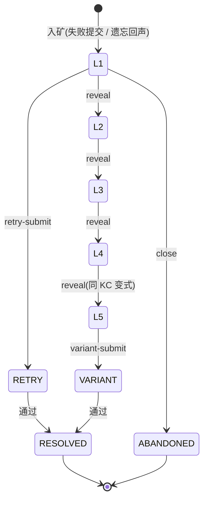

**关键数据与接口要点**

```jsonc
// GET /api/bug-mine/echoes → BugMineEchoCandidateDto[]
{ "kcCode": "PY43-KC-016", "problemId": 476, "problemTitle": "圆面积调试",
  "masteryScore": 0.72, "confidence": 0.25, "decayRisk": 0.86,
  "minePriority": 0.71, "recommendationReason": "遗忘回声 · 置信度低 · 建议入矿" }
```

- 回声门槛：FSRS 到期（`now > due_at`）、`mastery_score ≥ 0.45`（区分「曾会现忘」与「掌握薄弱」）、同 KC 无未关闭 session。
- 分层流程：入矿生成 L1–L5（L1 默认 revealed）→ 逐层 reveal → retry / variant 提交 → 通过则 RESOLVED 且 `DEBUG_FIX +0.15`；本章 RESOLVED ≥ 3 触发错题复盘补星。
- 错误码（✅ 真实）：`BUG_MINE_NOT_FOUND(404)`、`SUBMISSION_ALREADY_PASSED(409)`、`BUG_MINE_DEPTH_LOCKED(409)`、`BUG_MINE_SESSION_CLOSED(409)`、`BUG_MINE_RETRY_EXCEEDED(409)`、`BUG_MINE_VARIANT_LOCKED(409)`、`BUG_MINE_ECHO_NOT_FOUND(404)`。

**验收要点**

- AC-BUG-1：失败提交可入矿并逐层揭示；RESOLVED ≥ 3 触发本章错题复盘补星。
- 可追踪锚点：`BugMineController` · `bug_mine_session` / `bug_mine_card` / `kc_review_state` 表 · `docs/mastery_formula.md`。

### 3.12 无尽模式模块

**模块概述**：循环练习巩固模式，题面取自 `pregenerated_problem` 预生成池（运行时**只取不生成**），Pyodide 预检 + graph 评估，累计正确率。单轮小结可触发章节范围的 `ENDLESS_RECOVERY` 补星（防刷）。主参与者：学生。

**用例动作清单**：① 进入无尽循环练习；② 单轮小结上报；③ 触发本章补星判定。

**功能需求**

| 需求 ID | 描述与业务规则 | 优先级 | 验证 | 状态 |
| --- | --- | --- | --- | --- |
| FR-END-001 | 无尽模式提供循环练习（AI 预生成卡片 + Pyodide 预检 + graph 评估），题面来自 `pregenerated_problem` 池，运行时只取不生成。 | S | T/D | 已实现 |
| FR-END-002 | 主题为白色 / 羊皮纸亮色（对齐练习场 token），代码 / 终端块保留深色例外。 | C | I | 已实现 |
| FR-END-003 | `POST /api/mainline/endless/summary {chapter,correct,total,streak}` 上报一轮小结，触发 `ENDLESS_RECOVERY` 补星判定（每日每章至多记 1 次）。 | S | T | 已实现 |

**关键数据与接口要点**

- 补星上报 `POST /api/mainline/endless/summary` → `{ starAwarded }`；判定：本章范围单轮答对 ≥ 8 且正确率 ≥ 80% → +1 星。
- 防刷：每日每章至多记 1 次有效补星；补星每章每途径至多 +1、封顶 3★、幂等。
- 边界：预生成池不足时降级提示、不阻塞；无尽不计入正式 KC 掌握主链路（巩固为主）。

**验收要点**

- AC-END-1：无尽单轮答对 ≥ 8 且正确率 ≥ 80% 触发补星，重复刷被防刷限制。
- 可追踪锚点：`MainlineController`（endless/summary）· `useEndlessRun` · `pregenerated_problem` 表。

### 3.13 复盘大厅、费曼自测与学习评估模块

**模块概述**：周期性学习评估聚合 6 类客观指标，由 `EvaluationNarrativeAgent` 生成接地审查后的评估叙事，并产出 DRAFT 学习路径供学生接受重排；费曼自测让学生「讲给 AI 学弟听」，AI 基于课件证据提问以暴露理解漏洞。主参与者：学生。

**用例动作清单**：① 发起周期评估；② 查看评估叙事与 6 指标；③ 接受新路径（归档旧 ACTIVE + 重排 quest）；④ 开启费曼会话；⑤ 向 AI 学弟讲解并被追问；⑥ 费曼讲解质量判定。

**功能需求**

| 需求 ID | 描述与业务规则 | 优先级 | 验证 | 状态 |
| --- | --- | --- | --- | --- |
| FR-REV-001 | `POST /api/learner/evaluations` 聚合 6 类指标产出周期评估；由 `EvaluationNarrativeAgent` 生成 `narrative_md`（经接地审查）。 | S | T | 已实现 |
| FR-REV-002 | 评估同时生成 `draftPath`（PathPlanner → DRAFT 路径），写 `learner_evaluation` + 6 指标 + `EVALUATION` 修订。 | S | T | 已实现 |
| FR-REV-003 | `POST /api/learner/evaluations/{id}/accept-new-path` 接受新路径：归档旧 ACTIVE 路径并重排 quest。 | S | T | 已实现 |
| FR-REV-004 | 评估叙事中的数字与 KC 必须出现在输入 metrics / 课件引用，否则节点 fail-fast。 | M | A | 已实现 |
| FR-FEY-001 | 提供费曼会话：学生把知识点讲给「AI 学弟（tutee）」听，AI 提问以暴露理解漏洞。 | C | T/D | 已实现 |
| FR-FEY-002 | 费曼会话可与题目关联（`feynman_session`，V153），形成讲解 → 练习闭环。 | C | T | 已实现 |
| FR-FEY-003 | 费曼 tutee 须基于课件证据提问，不编造知识点。 | M | A | 已实现 |

复盘评估 → 路径重排时序：

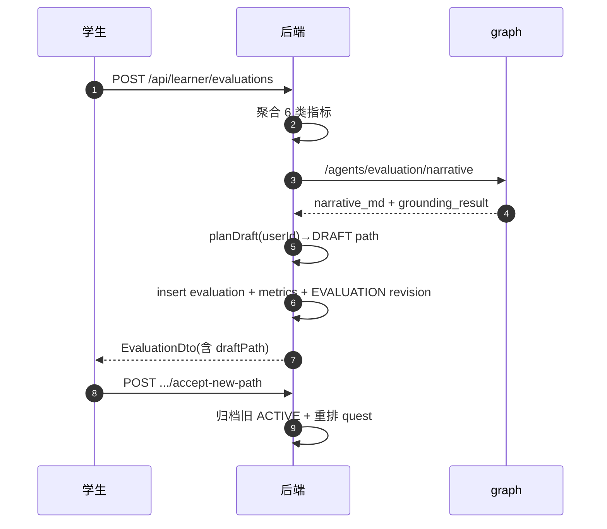

**关键数据与接口要点**

- 6 类评估指标（✅ 真实 metricKey）：`bug_mine_resolve_rate`、`kc_mastery_delta_total`、`kc_mastery_total`、`practice_pass_rate`、`profile_confidence_delta`、`resource_consumption_count`。
- 费曼端点（`/api/feynman`，仅 STUDENT）：`POST /sessions {kcCode}` → `POST /sessions/{id}/teach {explanation}` → `POST /sessions/{id}/judge`；逐轮落 `feynman_turn`。
- 边界：未接受前 DRAFT 不影响当前学习；同一学生同时仅一条 ACTIVE 路径。
- 错误码（✅ 真实）：`EVALUATION_NARRATIVE_SAFETY_FAILED`、`EVALUATION_NARRATIVE_GROUNDING_FAILED`、`FEYNMAN_PROBLEM_NOT_FOUND(404)`、`FORBIDDEN(403)`。

**验收要点**

- AC-REV-1：评估叙事中的数字与 KC 均可在输入 metrics / 课件引用中找到，否则 fail-fast。
- AC-FEY-1：费曼会话中 AI 学弟提问接地课件、不伪造；可与题目关联形成讲 → 练闭环。
- 可追踪锚点：`LearnerEvaluationController` / `FeynmanController` · `learner_evaluation` / `learner_evaluation_metric` / `feynman_session` / `feynman_turn` 表。

### 3.14 学习路径规划模块

**模块概述**：`PathPlannerAgent` 依据 8 维画像 + 当前掌握度 + KC 前置依赖，规划有序 KC 学习路径（`learning_path` + `learning_path_node`），状态 `DRAFT / ACTIVE`，同一学生仅一条 ACTIVE。学习总管可将看 / 学 / 练 / 测计划优先锚定到 FSRS 到期待复习 KC。主参与者：学生。

**用例动作清单**：① 画像完成后 curriculum bootstrap 初始化 65 KC；② 生成 ACTIVE 路径；③ 复盘生成 DRAFT；④ 接受后 promote（归档旧 ACTIVE）；⑤ 遗忘锚定（注入 `decaying_kcs`）。

**功能需求**

| 需求 ID | 描述与业务规则 | 优先级 | 验证 | 状态 |
| --- | --- | --- | --- | --- |
| FR-PATH-001 | `PathPlannerAgent` 依据画像 + 掌握度 + KC 前置依赖规划学习顺序（`learning_path` + `learning_path_node`）。 | S | T | 已实现 |
| FR-PATH-002 | 路径状态 `DRAFT / ACTIVE`；同一学生同时仅一条 ACTIVE。 | S | T | 已实现 |
| FR-PATH-003 | 路径变更须经接地审查（PathPlanner → Critic）。 | M | A | 已实现 |
| FR-PATH-004 | curriculum bootstrap：画像完成后初始化 65 KC 掌握度（`BOOTSTRAP delta=0`）。 | M | T | 已实现 |
| FR-PATH-005 | 学习总管可将看 / 学 / 练 / 测计划优先锚定到 FSRS 到期待复习 KC（见 §3.18）。 | S | A | 已实现 |

**关键数据与接口要点**

- 规划输入：8 维画像 + `kc_mastery` + `course_kc.prerequisite_codes`（V125 按教学顺序 seed）→ 有序 KC 路径（经 GroundingCritic 接地）。
- 当前 ACTIVE 路径节点随 `game/bootstrap` 的 `path` 字段返回（见 §3.5）。
- 遗忘锚定（Phase 2）：后端注入 `decaying_kcs`（前 5，优先级「到期 > 最近失败 > 最近接触」）。
- 错误码（✅ 真实）：`PATH_PLANNING_FAILED`、`PATH_PERSIST_FAILED`、`PATH_ACTIVATE_FAILED`、`PATH_DRAFT_ARCHIVE_FAILED`。

**验收要点**

- AC-PATH-1：画像完成 → bootstrap 65 KC → 生成唯一 ACTIVE 路径；复盘 DRAFT 接受后旧 ACTIVE 归档。
- 可追踪锚点：`LearningPathController` · `learning_path` / `learning_path_node` 表 · graph `PathPlannerAgent`。

### 3.15 任务与公告板模块

**模块概述**：每日 / 系统 / 班级任务在公告板领取，任务完成**必须提供 evidence**（提交 / 资源 / 读页 / 掌握度增量），`QuestService` 强校验，无证据不可完成。任务带深链供一键跳转去做题 / 看资源 / 读课件。主参与者：学生（仅 STUDENT）。

**用例动作清单**：① 查看今日 / 全部任务；② 领取 / 开始任务；③ 带 evidence 完成任务；④ 跳过任务；⑤ 通过深链跳转执行。

**功能需求**

| 需求 ID | 描述与业务规则 | 优先级 | 验证 | 状态 |
| --- | --- | --- | --- | --- |
| FR-QST-001 | `GET /api/quests/today`、`GET /api/quests?status=&source=&limit=&offset=` 返回今日 / 全部任务。 | S | T | 已实现 |
| FR-QST-002 | `POST /api/quests/{id}/start\|complete\|skip` 领取 / 完成 / 跳过任务。 | S | T | 已实现 |
| FR-QST-003 | 任务完成必须提供 **evidence**（`submission_id` / `resource_id` / `page_read_id` / `kc_mastery_delta`），`QuestService` 强校验。 | M | T | 已实现 |
| FR-QST-004 | 任务来源 `source ∈ {PATH_PLANNER, CLASSROOM, SYSTEM_DEFAULT}`；班级任务由教师发布、学生公告板领取。 | S | T | 已实现 |

**关键数据与接口要点**

```jsonc
// QuestDto（富字段）
{ "id": 55, "source": "SYSTEM_DEFAULT", "title": "完成 for 循环 3 道练习", "kcCode": "PY43-KC-016",
  "nodeType": "PRACTICE", "dueDate": "2026-06-12", "priority": 3, "status": "OPEN",
  "requiredEvidenceType": "SUBMISSION", "requiredMasteryDelta": 0.10,
  "targetProblemIds": [101,102,103], "deepLinkRoute": "/training", "deepLinkParams": { "kcCode": "PY43-KC-016" } }
```

- 状态机（✅ 真实 `QuestStatus`）：`OPEN → IN_PROGRESS → COMPLETED`（或 `SKIPPED` / `EXPIRED`）。
- evidence 强校验：`complete` 须提供与 `requiredEvidenceType` 匹配的证据之一（`submission_id` 须本人 PASSED）。
- 错误码（✅ 真实）：`QUEST_NOT_FOUND(404)`、`EVIDENCE_REQUIRED(400)`、`FORBIDDEN(403)`。

**验收要点**

- AC-QST-1：无 evidence 调 complete 被拒；带合法 submission_id 完成成功。
- 可追踪锚点：`QuestController` / `ClassroomQuestController` · `quest` / `quest_progress` 表。

### 3.16 轻量班级与教师看板模块

**模块概述**：保留轻量班级能力——教师建班、学生加入、教师发布班级任务、学生公告板领取；教师看板呈现星级分布 / 章测通过率 / 无尽活跃 / 主线进度 / KC 热力图。**刻意保持轻量**：不做协作编码、复杂评分、多课程后台、实时监控大屏。主参与者：学生 + 教师。

**用例动作清单**：① 学生用 joinCode 加入班级；② 查看我的班级 / 班级任务；③ 教师创建班级、发布班级任务；④ 教师查看四类看板；⑤ 教师抽查 AI 章测题。

**功能需求**

| 需求 ID | 描述与业务规则 | 优先级 | 验证 | 状态 |
| --- | --- | --- | --- | --- |
| FR-CLS-001 | 学生：`GET /api/classrooms/mine`、`POST /api/classrooms/join {joinCode}`、`GET /api/classroom/quests/mine`。 | S | T | 已实现 |
| FR-CLS-002 | 教师：创建班级、发布班级任务（资源名式 REST，非动作路径）。 | S | T | 已实现 |
| FR-CLS-003 | 教师看板（TEACHER/ADMIN + 班级归属校验）：KC 热力图、任务完成率、高频误区、资源使用。 | S | T | 已实现 |
| FR-CLS-004 | 教师看板（R-15 新增）：`mainline-stars`、`chapter-tests`、`endless-activity`、`mainline-progress`。 | S | T | 已实现 |
| FR-CLS-005 | 教师可对 AI 生成的章测题进入 `TeacherReviewPage` 抽样审查。 | S | D | 已实现 |
| FR-CLS-006 | 50 人班看板聚合查询应 < 500ms（索引 / 快照表 + 5 分钟 TTL 缓存）。 | S | A/T | 已实现 |
| FR-CLS-007 | **不做**完整课堂协作编码、复杂评分系统、多课程后台、实时监控大屏。 | W | I | 约束 |

**关键数据与接口要点**

| 看板端点（`/api/teacher/classrooms/{id}/dashboard/*`） | 响应要点 |
| --- | --- |
| `mainline-stars` | 每章 0/1/2/3★ 人数矩阵 + 总星 TopN |
| `chapter-tests` | 每章参试数 / 通过率 / 分数分布 |
| `endless-activity` | 近 7 日无尽轮次 / 正确率 / 补星数 |
| `mainline-progress` | 成员 × 章节 Stage 完成度矩阵 |

- 学生侧：`GET /api/classrooms/mine`、`POST /api/classrooms/join {joinCode}`、`GET /api/classroom/quests/mine`。
- 性能：50 人班聚合 < 500ms（索引 + 快照表 `classroom_kc_snapshot` + 5 分钟 TTL 缓存，EXPLAIN 验证）。
- 错误码（✅ 真实）：`JOIN_CODE_CONFLICT(409)`、`CLASSROOM_ALREADY_JOINED(409)`、`CLASSROOM_QUEST_NOT_FOUND(404)`、`FORBIDDEN(403)`（班级归属 / 非教师）。

> 截图占位（KC 掌握度热力图 / 章测分数箱线图）：
> - **网址**：`http://localhost:5173/teacher` →（进入某班级）`/teacher/classroom/{id}` 的「学情看板」
> - **操作**：用演示教师账号登录 → `/teacher` 选演示班级（seed 见 `deploy/scripts/seed_demo_classroom.sh`）→ 打开「KC 掌握度热力图」与「章测分数分布」面板 → 分别截取。
> - **数据来源**：`classroom_kc_snapshot`、`GET /api/teacher/classrooms/{id}/dashboard/chapter-tests`。

**验收要点**

- AC-CLS-1：学生用 joinCode 加入班级后可见班级任务。
- AC-CLS-2：教师看板四类端点返回结构正确且非学生越权被拒。
- 可追踪锚点：`TeacherClassroomController` / `TeacherDashboardController` / `MainlineDashboardController` · `classrooms` / `classroom_members` / `classroom_quest` / `classroom_kc_snapshot` 表。

### 3.17 NPC 记忆个性化模块

**模块概述**：打开 NPC 对话时返回「记忆感知 + 画像」个性化寒暄（1–2 句），插入脚本对话首节点之前；由后端组装记忆摘要 + 画像 brief 经 `NpcDialogAgent` 生成。agent 失败时返回降级语义并走脚本对话，**绝不伪造个性化内容**（fail-fast）。主参与者：学生。

**用例动作清单**：① 打开 NPC 对话拉取个性化寒暄；② agent 失败降级走脚本；③ 30 分钟缓存复用；④ quest marker 响应式重绘。

**功能需求**

| 需求 ID | 描述与业务规则 | 优先级 | 验证 | 状态 |
| --- | --- | --- | --- | --- |
| FR-NPC-001 | `GET /api/npc/{npcKey}/greeting` 返回「记忆感知 + 画像」个性化寒暄（1–2 句），插入脚本对话首节点之前。 | C | T/D | 已实现 |
| FR-NPC-002 | 寒暄由后端组装 `MemoryRetrievalService` 摘要 + 画像 brief → graph `NpcDialogAgent` 生成。 | C | A | 已实现 |
| FR-NPC-003 | agent 失败时返回降级语义（「记忆服务暂不可用」+ 走脚本对话），**不伪造个性化内容**。 | M | A | 已实现 |
| FR-NPC-004 | 每 NPC × 学生 30 分钟内复用上次 greeting（缓存）。 | C | T | 已实现 |
| FR-NPC-005 | quest marker（感叹号）须响应式重绘，完成即清除。 | S | T | 已实现 |

**关键数据与接口要点**

```jsonc
// GET /api/npc/{npcKey}/greeting（STUDENT）→ NpcGreetingResponse
{ "npcKey": "mayor_py", "greeting": "上次 for 循环错了 3 次，今天要不要去矿洞复盘？",
  "personalized": true, "source": "memory_aware" }
// agent 失败时降级（不伪造）
{ "npcKey": "mayor_py", "greeting": "（记忆服务暂不可用）", "personalized": false, "source": "fallback" }
```

- NPC 静态数据 `data/npcs/<key>/{meta,dialog}.json` 同步到前端 public（npm predev/prebuild 钩子）。
- 错误码（✅ 真实）：`FORBIDDEN(403)`（仅学生）；agent 失败**不抛业务错误码**，返回降级寒暄、不阻断对话。

**验收要点**

- AC-NPC-1：记忆服务可用时返回个性化寒暄；不可用时降级且不伪造内容。
- 可追踪锚点：`NpcGreetingController` · `npc_memory` / `npc_persona` 表 · graph `NpcDialogAgent`。

### 3.18 多智能体编排与防幻觉模块

**模块概述**：贯穿全系统的 AI 能力底座。学习总管（Orchestrator）SSE 编排看 / 学 / 练 / 测计划，后端服务端注入 FSRS 到期 `decaying_kcs` 优先锚定复盘。**11 个默认 Agent** + 扩展 Agent，全部输出结构化（Pydantic），故障 fail-fast，**不启用 ReAct**；资源 / 画像 / 路径 / debug / 评估 / 章测生成均经 `GroundingCritic` + `Safety` 末端拦截。主参与者：学生（学习总管）+ 系统（贯穿）。

**用例动作清单**：① 学习总管多智能体编排（流式）；② 记忆矿脉增强（注入 `decaying_kcs`）；③ Agent 结构化输出；④ 防幻觉三审拦截；⑤ 生成全链路审计。

**11 个默认 Agent**：`ProfileAgent`、`CurriculumMapperAgent`、`ResourceDesignerAgent`、`MindMapAgent`、`PracticeAgent`、`CodeLabAgent`、`StoryboardAgent`、`PathPlannerAgent`、`DebugAgent`、`GroundingCriticAgent`、`SafetyAgent`；扩展：`EvaluationNarrativeAgent`、`OrchestratorAgent`、`IntentRouterAgent`、`NpcDialogAgent`、`paper_designer` 流水线等。

**功能需求**

| 需求 ID | 描述与业务规则 | 优先级 | 验证 | 状态 |
| --- | --- | --- | --- | --- |
| FR-ORC-001 | `POST /api/orchestrator/turn/stream`（SSE）提供学习总管多智能体编排流。 | S | T/D | 已实现 |
| FR-ORC-002 | 后端**服务端注入** `decaying_kcs`（FSRS 到期最该复盘 KC，取前 5），客户端无需也不应上送；取数失败降级为空、不阻断。 | S | A | 已实现 |
| FR-ORC-003 | 所有 Agent 输出必须**结构化**（Pydantic schema），不能只返回自然语言大段文本。 | M | I | 已实现 |
| FR-ORC-004 | Agent 故障必须 **fail-fast**，不允许静默降级成普通聊天；**不启用 ReAct 循环**。 | M | I/A | 约束 |
| FR-ORC-005 | 资源 / 画像 / 路径 / debug / 评估 / 章测生成均必须经 `GroundingCritic` + `Safety` 末端拦截。 | M | A | 已实现 |
| FR-ORC-006 | 数字与 KC 必须出现在输入 metrics / 课件引用中，否则节点 fail-fast；不得输出隐藏测试；不得直接给可复制提交的完整答案。 | M | A/I | 约束 |
| FR-ORC-007 | 生产与演示默认 graph **单 worker**；重 LLM 路径（章测）走异步预生成队列削峰。 | M | I | 约束 |

Agent 协作拓扑：

```mermaid
flowchart TD
  Profile[ProfileAgent] --> Curr[CurriculumMapperAgent] --> Resource[ResourceDesignerAgent]
  Resource --> Mind[MindMapAgent]
  Resource --> Practice[PracticeAgent]
  Resource --> CodeLab[CodeLabAgent]
  Resource --> Story[StoryboardAgent]
  Curr --> Path[PathPlannerAgent]
  Path --> Debug[DebugAgent]
  Debug --> Eval[EvaluationNarrativeAgent]
  Resource --> Critic[GroundingCriticAgent] --> Safety[SafetyAgent]
  Path --> Critic
  Eval --> Critic
  Orchestrator[OrchestratorAgent] --> Curr
  Intent[IntentRouterAgent] --> Orchestrator
```

**关键数据与接口要点**

- 三个 SSE 流端点（均 `POST` + `text/event-stream`，仅 STUDENT）：`/api/tutor/ask`、`/api/orchestrator/turn/stream`、`/api/workshop/resources/stream`。事件并集 = `plan / trace / token / result / error`。
- 记忆矿脉注入（Phase 2）：后端注入 `decaying_kcs`（来自 `BugMineService.decayingKcCodes`），总管 `_select_kcs` 优先级「到期 > 最近失败 > 最近接触」。
- 审计：每次生成写 `resource_run`（含 `graph_trace` / `correlation_id`，见 §4.8）。
- 错误码：`ORCHESTRATOR_FAILED` / `TUTOR_FAILED`（error 帧）、`UNAUTHORIZED(401)`、`FORBIDDEN(403)`。

**验收要点**

- AC-ORC-1：编排流逐帧推送 trace / token / result；取数失败降级为空、对话不阻断。
- AC-ORC-2：任一生成路径末端经 Grounding + Safety；数字 / KC 未现于证据则 fail-fast。
- 可追踪锚点：`OrchestratorController` / `IntentController` · graph `services/pythontopia-graph` · `resource_run.graph_trace`。

### 3.19 多端接入模块

**模块概述**：5 端（Web / Android / Windows / 微信小程序 / 微信小游戏）共用**同一套** Spring Boot 后端（`:18080` `/api`，JWT Bearer）。客户端接入以 `docs/clients/api-contract.md` 为**唯一权威契约**，各原生 / 微信端不复用 Web 端 Phaser / `tilemap.ts` / `frontend/src/api/*.ts`。能力收敛后无背包 / 货币 / 商店端点。主参与者：全部。

**用例动作清单**：① 按环境选 Base URL 接入；② Bearer 鉴权；③ SSE 分块解析；④ 遵守能力收敛边界。

**功能需求**

| 需求 ID | 描述与业务规则 | 优先级 | 验证 | 状态 |
| --- | --- | --- | --- | --- |
| FR-MC-001 | 5 端共用**同一套** Spring Boot 后端（`:18080` `/api` JWT Bearer）。 | S | I | 已实现 / 建设中 |
| FR-MC-002 | 客户端接入以 `docs/clients/api-contract.md` 为**唯一权威契约**，不得凭空发明端点或字段。 | M | I | 约束 |
| FR-MC-003 | 各原生 / 微信端**不复用** Web 端 Phaser / `tilemap.ts` / `frontend/src/api/*.ts`。 | M | I | 约束 |
| FR-MC-004 | Base URL 按环境区分（Web / Win 本机 `localhost:18080`；Android 模拟器 `10.0.2.2:18080`；微信线上须备案 HTTPS 白名单）。 | M | I | 契约 |
| FR-MC-005 | 微信小程序范围为「学习陪伴」（画像 / 课程 / 答疑 / 任务，**无像素小镇**）；微信小游戏含像素小镇。 | S | I | 建设中 |
| FR-MC-006 | Android 端不运行 Python（Beta 首发仅服务端判题）。 | M | I | 约束 |
| FR-MC-007 | 收敛后无背包 / 货币 / 商店端点，各端不得为其建 UI。 | M | I | 约束 |
| FR-MC-008 | CORS 仅对本机 Web 源放行；原生端不受 CORS；微信端走域名白名单。 | M | I | 已实现 |

多端共享后端：

```mermaid
flowchart TB
  Web["Web (Phaser)"] --> BE
  And["Android (LibGDX)"] --> BE
  Win["Windows (MonoGame)"] --> BE
  WxA["微信小程序(陪伴)"] --> BE
  WxG["微信小游戏(小镇)"] --> BE
  BE["共享后端 :18080 /api"] --> GP[graph]
  BE --> RG[rag]
  BE --> DB[(PostgreSQL)]
```

**关键数据与接口要点**

| 运行环境 | Base URL |
| --- | --- |
| Web / Windows（本机） | `http://localhost:18080` |
| Android 模拟器（AVD） | `http://10.0.2.2:18080` |
| Android 真机 / 局域网 | `http://<后端局域网 IP>:18080` |
| 微信开发者工具 | `http://localhost:18080`（勾选「不校验合法域名」） |
| 微信线上 | `https://<已备案 HTTPS 域名>`（加入服务器域名白名单） |

- SSE 跨端：Web 用 `fetch` + `ReadableStream`；原生用 OkHttp / HttpClient 流式按行；微信用 `wx.request({enableChunked:true})`（浏览器原生 `EventSource` 不适用，因须 `POST` + 自定义头）。
- CORS：仅对本机 Web 源放行（`localhost:8080/5173/5174` 及 `127.0.0.1`，allowCredentials）；原生端不受 CORS；微信走域名白名单。

**验收要点**

- AC-MC-1：任一端按对应 Base URL + Bearer 可走通最小链路（登录 → bootstrap → 课程 → 答疑 → 判题）。
- AC-MC-2：各端无背包 / 货币 / 商店 UI 与调用。
- 可追踪锚点：`docs/clients/api-contract.md` · `docs/clients/README.md` · 各端目录 README。

---

## 4 非功能需求

> 按 ISO/IEC 25010 质量模型组织，每条含**可度量目标**与验证方法（T/D/I/A）。除参考文档涵盖的性能 / 安全 / 可使用性 / 可维护性 / 可移植性 / 可靠性 / 可观测性 / 合规与隐私外，Pythontopia 另设两条与教育产品强相关的**特设质量属性**：可信 AI / 防幻觉（§4.3）与教育有效性（§4.10）。

质量属性全景（ISO 25010 映射）：

```mermaid
mindmap
  root((质量属性 ISO 25010))
    性能效率
      响应时间
      吞吐与并发
    安全性
      鉴权授权
      防泄答沙箱
      数据脱敏
    可信AI特设
      防幻觉三审
      证据锚定
      fail_fast
    可靠性
      容错兜底
      可恢复
    易用性
      像素一致风格
      可访问性a11y
    可维护性
      DTO分层
      测试基线
      契约单一权威
    可移植性
      多端共享后端
      容器化部署
    合规与隐私特设
      CC_OFL授权
      PII脱敏
    教育有效性特设
      KC覆盖
      个性化命中
      闭环完成
    可观测性特设
      审计即可观测
      决策玻璃盒
      健康检查
```

### 4.1 性能需求

#### 4.1.1 时间特性

| 编号 | 需求（可度量） | 验证 | 优先级 |
| --- | --- | --- | --- |
| NFR-PERF-001 | `GET /api/mainline/overview` 大 payload 渲染 < 200ms（单查询 CTE 聚合，避免 N+1）。 | T/A | M |
| NFR-PERF-002 | 50 人班教师看板聚合查询 < 500ms（索引 / 快照表 + 5 分钟 TTL 缓存，EXPLAIN 验证）。 | T/A | S |
| NFR-PERF-003 | **考试期间零 LLM 调用**；章测 start 永不等待 LLM（预生成解耦）。 | D/A | M |
| NFR-PERF-004 | 判题轮询建议 1s 固定间隔 + 上限退避；判题沙箱有并发上限（`JudgeWorkerPool`）。 | I | S |
| NFR-PERF-005 | 「看」打点前端 10s 批量上报；服务端单行 UPSERT + 限频（单次 ≤120s、每分钟 ≤2 次）。 | T | S |

#### 4.1.2 适应性（容量与并发）

| 编号 | 需求 | 验证 | 优先级 |
| --- | --- | --- | --- |
| NFR-SCAL-001 | 章测预生成走异步队列（DB 状态机 + `@Scheduled` 补偿），backend→graph 信号量并发默认 2（`pythontopia.mainline.pregen-concurrency`）。 | T/A | M |
| NFR-SCAL-002 | 10 名学生同时 prepare 章测不超信号量、不丢任务。 | T | S |
| NFR-SCAL-003 | graph / rag 单 worker，靠队列削峰；无尽题面用预生成池只取不生成。 | I | M |
| NFR-SCAL-004 | 客观题判分纯内存；编程题判分走并发受限的判题池。 | I | S |

### 4.2 安全需求

| 编号 | 需求 | 验证 | 优先级 |
| --- | --- | --- | --- |
| NFR-SEC-001 | 无状态 JWT，TTL 12h，Bearer 头；学习端点按角色授权（多数仅 STUDENT），越权 403。 | T | M |
| NFR-SEC-002 | 判题在 subprocess 沙箱内执行，静态检查 + 限频 + 资源限制；失败脱敏宿主路径。 | T/A | M |
| NFR-SEC-003 | **隐藏测试用例不下发**到前端 DTO；章测答案 / 解析不下发。 | T/I | M |
| NFR-SEC-004 | 防泄答护栏：答疑 / 导学在练习 / 考试语境不给可复制完整答案。 | A | M |
| NFR-SEC-005 | RAG 重建端点受 `X-Internal-Token` 保护；内部服务间调用不暴露。 | I | S |
| NFR-SEC-006 | 考试防作弊（尽力而为）：禁粘贴计数、失焦记录、路由守卫、时限硬校验；明示无法阻止二设备求助。 | T/I | S |
| NFR-SEC-007 | Android JWT 存储用 EncryptedSharedPreferences + Keystore + BiometricPrompt（OWASP MASVS-L1）。 | I | S |
| NFR-SEC-008 | 业务层禁扩散 `any` / `Any`（前端 / Android）；第三方动态对象隔离在 adapter 层。 | I | M |

### 4.3 可信 AI 与防幻觉（特设质量属性，最高红线）

| 编号 | 需求 | 验证 | 优先级 |
| --- | --- | --- | --- |
| NFR-AIH-001 | 所有生成资源必须经证据审查（GroundingCritic + Safety）。 | A | M |
| NFR-AIH-002 | 不得伪造课件页码、章节、题目、作者或教材内容。 | I/A | M |
| NFR-AIH-003 | 内容若来自通识而非课件，必须显式标注。 | I | M |
| NFR-AIH-004 | RAG 命中低于阈值或敏感词触发时返回 `no_evidence_found=true, hits=[]`，绝不编造引用。 | T | M |
| NFR-AIH-005 | 数字 / KC 必须出现在输入 metrics / 课件引用中，否则节点 fail-fast。 | A | M |
| NFR-AIH-006 | Agent 故障 fail-fast，不静默降级成普通聊天；不启用 ReAct。 | I | M |
| NFR-AIH-007 | 章测客观题必须带 `evidence_page_ids`（RAG 校验）；编程题须沙箱自测通过参考解才入库。 | T | M |

### 4.4 可使用性与可访问性

| 编号 | 需求 | 验证 | 优先级 |
| --- | --- | --- | --- |
| NFR-USE-001 | 30 分钟新手引导（onboarding）可让首次用户完成首个学习闭环。 | D | S |
| NFR-USE-002 | 像素风统一、HUD 清晰、关卡地图三态直观（锁定 / 进行 / 通关）。 | I | S |
| NFR-USE-003 | 满足 WCAG 2.1 AA 关键项（对比、键盘、焦点、替代文本），见 `docs/a11y-checklist.md`。 | I/T | S |
| NFR-USE-004 | 游戏画布之外的学习内容必须**可读、可复制、可引用**（课件 / 答疑 / 资源非画布渲染）。 | I | M |
| NFR-USE-005 | 文案以简体中文为主，集中管理便于扩展（见 `docs/i18n-translation-guide.md`）。 | I | C |

> 截图占位（关键界面 UI 流序列）：登录后依次访问，每页各截一图（前端 Base：开发 `http://localhost:5173`、Docker `http://localhost:8080`）：
> 1. 登录页 `/login`
> 2. 像素小镇 `/world`（等地图与 HUD 加载完成后截）
> 3. 关卡地图 `/mainline-map`（展示 7 章三态与 0–3★）
> 4. Stage 学习页 `/mainline/stage/{stageId}`（由关卡地图点任一已解锁小节进入，展示看 / 学 / 练三件套）
> 5. 章末大测试 `/chapter-test/{chapter}`（先在关卡地图点「参加大测试」开考后截）
> 6. 复盘大厅 `/review-hall`
> 历史截图见 `qa-screens/`。

### 4.5 可维护性

| 编号 | 需求 | 验证 | 优先级 |
| --- | --- | --- | --- |
| NFR-MNT-001 | 后端 DTO 与领域实体严格分离，统一 `ApiError`；新增 API 必有 DTO + 校验 + 错误返回 + 测试。 | I | M |
| NFR-MNT-002 | 前端 TypeScript strict，业务层禁 `any`，API client 明确 DTO 类型。 | I | M |
| NFR-MNT-003 | 测试基线绿（编写本文时合计约 2379+ 通过：backend / graph / rag / frontend），改动按影响范围验证。 | T | M |
| NFR-MNT-004 | 客户端契约以 `api-contract.md` 为唯一权威，跨端不漂移。 | I | M |
| NFR-MNT-005 | 迁移文件须说明目的、影响表与不可逆风险。 | I | M |

### 4.6 可移植性与多端一致性

| 编号 | 需求 | 验证 | 优先级 |
| --- | --- | --- | --- |
| NFR-PORT-001 | 5 端共用同一后端契约，能力收敛一致（无背包 / 货币 / 商店）。 | I | M |
| NFR-PORT-002 | 各端不复用 Web Phaser / tilemap / api 源，但语义一致。 | I | S |
| NFR-PORT-003 | 容器化部署可在标准 Docker 环境一键启动，不绑定特定云厂商。 | T | S |

### 4.7 可靠性与可用性

| 编号 | 需求 | 验证 | 优先级 |
| --- | --- | --- | --- |
| NFR-REL-001 | 章测生成失败重试 ≤2，再失败用 golden 兜底，保证可考试。 | T | M |
| NFR-REL-002 | NPC / 记忆 / 编排取数失败时降级（空 / 脚本对话），不阻断主流程。 | T | S |
| NFR-REL-003 | 演示主链路有兜底（LLM dryrun / golden / 缓存），7 分钟脚本可复现。 | D | M |
| NFR-REL-004 | Docker Compose 6 服务健康检查；幂等可重入 seed。 | T | S |

### 4.8 可观测性（特设运维质量属性）

> 比赛规模下走**「审计即可观测 + 面向用户的可解释性」**轻量路线：**不引入**重型 APM / 监控栈（无 Prometheus / Grafana / Jaeger / Langfuse / Actuator），而以**数据库审计表、决策玻璃盒、健康检查、结构化应用日志、SSE 阶段事件**构成可观测面。

| 编号 | 需求（可度量） | 验证 | 优先级 |
| --- | --- | --- | --- |
| NFR-OBS-001 | AI 生成全链路审计：资源 / 章测 / 评估 / 画像每次生成写 `resource_run`{agent_name, scenario, input_summary, output_artifact, evidence_page_ids, safety_result, grounding_result, status, correlation_id, graph_trace, created_at}；章测另写 `chapter_test.generator_meta`。 | I/A | M |
| NFR-OBS-002 | 跨服务关联：backend→graph 以 `correlation_id` 贯穿，graph 节点轨迹落 `resource_run.graph_trace`（JSON）。 | I/T | S |
| NFR-OBS-003 | 决策可解释（决策玻璃盒）：`DecisionTraceService` 取学生最近 ≤50 条 `resource_run`，归一为 push/problem/path/remediation/resource/profile，附「agent + 证据页链 + 人话结论」。 | D/T | S |
| NFR-OBS-004 | 关键事件审计追加：星级变更全部经 `star_award_event`（source / reason，幂等只升不降）。 | I | M |
| NFR-OBS-005 | 健康检查：postgres（`pg_isready`）/ redis（`redis-cli ping`）compose healthcheck；graph、rag 暴露 `GET /healthz`；backend `:18080/api` 可探活。 | T | S |
| NFR-OBS-006 | 结构化应用日志携带关键标识（correlation_id / userId / scenario）；当前为应用层日志，不接入集中式日志平台（边界明示）。 | I | S |
| NFR-OBS-007 | 生成过程可观测（SSE）：编排 / 工坊 / 答疑 / 章测出题经 SSE 推送阶段事件（含 error 帧如 `TUTOR_FAILED` / `ORCHESTRATOR_FAILED`）。 | I | S |

### 4.9 合规与隐私（特设红线）

| 编号 | 需求 | 验证 | 优先级 |
| --- | --- | --- | --- |
| NFR-CMP-001 | 仅使用 CC0 / CC-BY 3.0/4.0 / CC-BY-SA 3.0 / OFL-1.1 已审计资产；`LICENSE-ART.md` 与 `frontend/public/assets/pixel/LICENSE.md` 同步登记。 | I | M |
| NFR-CMP-002 | 接受 LPC CC-BY-SA 3.0 传染：包装作品以 CC-BY-SA 3.0+ 发布，代码层 MIT 分层授权。 | I | M |
| NFR-CMP-003 | 不复制任何商业像素游戏官方素材（含星露谷）。 | I | M |
| NFR-PRV-001 | 演示账号 `demo-` 前缀虚构身份；不含真实 PII 与真实 LLM 密钥（`.env` 已 gitignore）；视频 cookie 不入库。 | I | M |

### 4.10 教育有效性（特设质量属性）

| 编号 | 需求 | 验证 | 优先级 |
| --- | --- | --- | --- |
| NFR-EDU-001 | 课程闭环必须覆盖全部 65 KC（Stage 分组覆盖、路径可达）。 | A/I | M |
| NFR-EDU-002 | 个性化命中：章测题面与资源选型随 8 维画像变化（易错优先、难度自适应）。 | A/D | M |
| NFR-EDU-003 | 所有玩法必须服务画像 / 路径 / 资源生成 / 练习评估 / 班级教学，无纯装饰系统。 | I | M |
| NFR-EDU-004 | 对遗忘对症：FSRS 到期 KC 被召回并引导复盘，而非全局一刀切。 | A/T | S |

---

## 5 部署环境

> 本章给出部署形态：单宿主 Docker Compose 六服务的拓扑、端口、通信链路、运行环境、配置与启动验证。所有端口 / 镜像 / 链路均以 `deploy/docker-compose.yml` 与各服务 `main.py` 为准。系统**不**绑定特定云厂商，标准 Docker 环境即可一键启动。

### 5.1 部署拓扑与容器编排

```mermaid
flowchart TB
  subgraph Clients["客户端（5 端）"]
    C1["Web / Android / Windows / 微信"]
  end
  subgraph Host["单宿主（WSL2 开发 / 单机演示）· Docker Compose"]
    FE["frontend<br/>Nginx 静态(Vue3 build)<br/>8080→80"]
    BE["backend<br/>Spring Boot · Java21<br/>127.0.0.1:18080 /api"]
    GP["pythontopia-graph<br/>FastAPI+LangGraph<br/>host 网络 127.0.0.1:18091<br/>/healthz"]
    RG["pythontopia-rag<br/>FastAPI+pgvector<br/>127.0.0.1:18092<br/>/healthz"]
    PG[("postgres<br/>pgvector/pgvector:pg16<br/>15432→5432")]
    RD[("redis:7-alpine<br/>16379→6379")]
  end
  subgraph Ext["外部 / 宿主代理"]
    PX["宿主代理 :7892<br/>(host.docker.internal)"]
    LLM["LLM：讯飞 Spark / OpenAI 兼容"]
    BILI["B 站讲解短视频"]
  end
  C1 -->|HTTPS + JWT Bearer| BE
  C1 -->|静态资源| FE
  BE -->|REST + SSE| GP
  BE -->|REST + RAG admin token| RG
  GP -->|REST| RG
  BE --> PG
  BE --> RD
  RG --> PG
  GP -.经代理.-> PX --> LLM
  GP -.经代理.-> PX --> BILI
```

**服务与端口（真实映射，源 `deploy/docker-compose.yml`）**

| 服务 | 镜像 / 运行时 | 容器端口 | 宿主映射 | 健康检查 |
| --- | --- | --- | --- | --- |
| postgres | `pgvector/pgvector:pg16` | 5432 | `15432:5432` | `pg_isready`（10s/5s/×10） |
| redis | `redis:7-alpine` | 6379 | `16379:6379` | `redis-cli ping`（10s/5s/×5） |
| backend | `pythontopia-backend:dev`（Java 21） | 18080 | `127.0.0.1:18080:18080` | `:18080/api` 探活 |
| pythontopia-graph | `pythontopia-graph:dev`（FastAPI，Py 3.11） | 18091 | `network_mode: host`（`127.0.0.1:18091`） | `GET /healthz` |
| pythontopia-rag | `pythontopia-rag:dev`（FastAPI，Py 3.11） | 18092 | `127.0.0.1:18092:18092` | `GET /healthz` |
| frontend | `pythontopia-frontend:dev`（Nginx 静态） | 80 | `8080:80` | 依赖 backend 启动 |

> graph 使用 `network_mode: host` 以便容器经宿主代理（`host.docker.internal:7892`）访问外网（B 站检索 / LLM）；graph、rag 源码 `:ro` 挂载支持开发态热更。

**通信链路与鉴权**

| 源 → 目标 | 协议 / 端口 | 鉴权 | 用途 |
| --- | --- | --- | --- |
| 5 端客户端 → backend | HTTP(S) `:18080` `/api` | JWT Bearer（TTL 12h） | 全部业务请求 |
| backend → graph | REST + SSE `:18091`（`PYTHONTOPIA_SERVICES_GRAPHURL`） | 内部网络 | 工坊 / 编排 / 章测出题 / 答疑流 |
| backend → rag | REST `:18092`（`PYTHONTOPIA_SERVICES_RAGURL`） | `RAGADMINTOKEN`（`PYT_RAG_ADMIN_TOKEN`） | 课件检索 / 重建索引 |
| graph → rag | REST `:18092`（`PYT_RAG_URL`） | 内部 | 取证据页（evidence_fetcher） |
| graph → LLM / B 站 | HTTPS，经宿主代理 `:7892` | provider 凭据 / — | 资源 / 章测 / 答疑生成（默认 `dryrun`）；讲解短视频检索 |
| backend / rag → PostgreSQL | TCP `:5432` | DB 凭据 | 持久化 + pgvector 检索 |
| backend → Redis | TCP `:6379` | — | 缓存 / 限流 / 状态 |

### 5.2 运行环境

| 维度 | 描述 |
| --- | --- |
| 后端运行时 | Java 21 + Spring Boot；端口 `:18080`，前缀 `/api` |
| AI 微服务 | Python 3.11；graph `:18091`、rag `:18092`（生产 / 演示默认单 worker） |
| 数据库 | PostgreSQL 16 + pgvector（`pgvector/pgvector:pg16`）；Redis 7（缓存 / 限流 / 状态） |
| Web 客户端 | 现代浏览器（Chromium / Firefox / Safari 近两年版本）；WebAssembly（Pyodide 预览） |
| Android | minSdk 26 / targetSdk 35 / compileSdk 35；JVM Toolchain 17 |
| Windows | .NET 8 + WinUI 3 + MonoGame（建设中） |
| 微信 | 微信开发者工具；线上须已备案 HTTPS 域名加入白名单 |
| LLM | 讯飞 Spark（演示主链路）/ OpenAI 兼容（开发 fallback）/ `dryrun`（CI 默认），由 `PYT_LLM_PROVIDER` 切换 |

**环境形态**

| 形态 | 描述 |
| --- | --- |
| 开发（WSL2） | Windows 11 + WSL2 Ubuntu；`./dev.sh` 起全栈（含 graph / rag）；graph 用 host 网络经宿主代理访问外网；graph / rag 源码 `:ro` 挂载支持热更 |
| 演示 / 单机 | 单宿主 Docker Compose 六服务；backend / rag 仅监听 `127.0.0.1`（无公网入口），frontend `:8080` 对外；LLM 经宿主代理；graph / rag 默认**单 worker**（靠队列削峰，见 NFR-SCAL-003） |
| 数据卷 | `pytopia_pg`（Postgres 数据）；启动踩坑见 `docs/dev-startup.md`（数据卷历史密码与 `deploy/.env` 不一致会致 Flyway 失败） |

### 5.3 配置与密钥

关键环境变量（默认值见 `deploy/docker-compose.yml`，真实值置于 `deploy/.env`，**已 gitignore、不入提交包**）：

| 变量 | 用途 | 默认 / 说明 |
| --- | --- | --- |
| `PYT_DB_USERNAME` / `PYT_DB_PASSWORD` | 数据库凭据 | `pytopia` / `pytopia_dev_password`（演示） |
| `PYT_JWT_SECRET` | JWT 签名密钥 | ≥32 字符，演示用占位需替换 |
| `PYT_TEACHER_INVITE_CODE` | 教师注册 / 晋升邀请码 | `pytopia-teacher` |
| `PYT_RAG_ADMIN_TOKEN` | RAG 重建端点保护 token | `pytopia-rag-admin` |
| `PYT_LLM_PROVIDER` | LLM 提供方切换 | `dryrun`（CI 默认）/ `openai-compat` / `spark` |
| `PYT_OPENAI_BASE_URL` / `PYT_OPENAI_API_KEY` / `PYT_OPENAI_MODEL` | OpenAI 兼容 provider | 开发 fallback（映射为无前缀 `OPENAI_*` / `LLM_*`） |
| `PYT_SPARK_APP_ID` / `PYT_SPARK_API_KEY` / `PYT_SPARK_API_SECRET` | 讯飞 Spark 凭据（含多模态 TTI / TTS / 看图答疑） | 缺失则自动降级占位、不阻塞链路 |
| `PYT_XFYUN_PROXY_HOST` / `PYT_XFYUN_PROXY_PORT` | 讯飞 / 外网代理 | `host.docker.internal` / `7892`（留空则直连） |
| `PYT_BILI_PROXY` | B 站检索代理 | `http://127.0.0.1:7892` |

> 缺失 Spark / OpenAI 凭据时，多模态与 LLM 自动降级（占位 / dryrun / golden），不阻塞主链路（见 NFR-REL-003）。

### 5.4 启动与验证

**一键启动**

```bash
# 本地全栈开发（含 graph / rag 微服务），优先用根目录脚本
./dev.sh

# 或部署目录直接编排六服务
cd deploy && docker compose up -d
docker compose ps          # 六服务健康
```

辅助脚本（`deploy/scripts/`）：`init_db.sh`（建库 / 迁移）、`init_rag_index.sh`（构建 RAG 索引）、`seed_demo_classroom.sh`（演示班级种子）、`demo_smoke.sh`（冒烟）、`teardown_demo.sh`（拆解）。

**启动后验证（按影响范围）**

| 改动范围 | 验证命令 / 方法 |
| --- | --- |
| 课程数据初始化 | 空库初始化后 `GET /api/course/pack` 计数断言 **7 / 561 / 7 / 65 / 46 / 39** |
| 健康检查 | `docker compose ps` 六服务健康；`curl :18091/healthz`、`curl :18092/healthz` 返回 200 |
| 后端 API 改动 | `cd backend && mvn test`（含 Testcontainers 端到端） |
| 前端类型 / 组件 | `cd frontend && npm run typecheck` / `npm run test`（Vitest） |
| Python Agent 改动 | `cd services/pythontopia-graph && python -m pytest -q`（rag 同理） |
| RAG 改动 | 查询「input函数 / for循环 / 列表」并检查引用页 |
| 判题改动 | 验证通过 / 失败 / 运行错误三类提交入库 |

**Beta 主链路验收清单（演示稳健性锚点）**

```mermaid
flowchart LR
  A1["空库初始化<br/>seed 计数 7/561/7/65/46/39"] --> A2["注册 → 画像 → bootstrap"]
  A2 --> A3["Stage 三件套打点"]
  A3 --> A4["章测预生成 → start(零AI) → submit"]
  A4 --> A5["星级 0-3★ 计算 / 补星"]
  A5 --> A6["关卡地图三态渲染"]
  A6 --> A7["训练场三类判题入库"]
  A7 --> A8["Bug 矿洞分层 + 遗忘回声"]
  A8 --> A9["工坊 6 类 + 防幻觉审计"]
  A9 --> A10["教师看板四类聚合"]
  A10 --> A11["演示 7 分钟脚本可复现"]
```

---

> **文档维护说明**：本文为需求基线，随后端契约（`api-contract.md`）与硬约束（`AGENTS.md`）演进同步更新；如三者冲突，以 `AGENTS.md` > `api-contract.md` > 本文为准并尽快回填。图示用 Mermaid，雷达图 / 65 节点 KC 依赖网 / 热力图 / 像素 UI 线框等以 `图示占位` 标注，可用 SVG / ECharts / 真机截图替换。本 `.md` 可直接经 Pandoc / 支持 Mermaid 的工具转 Word。
